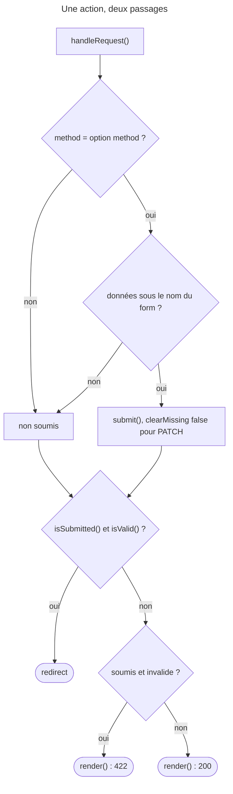

## Objectif

Traiter une submission dans le bon ordre, savoir ce que `handleRequest()`
décide à ta place, et ce que `submit($data, false)` valide vraiment.

## L'essentiel

Une seule action affiche et traite le form : `handleRequest()` soumet le form
**seulement** si la Request lui est destinée, puis le garde
`isSubmitted() && isValid()` décide entre le redirect et le rendu. Après une
submission, l'object est **déjà à jour**. `submit($data, false)` garde les
fields absents, sans les dispenser des constraints de la class.

## Le schéma



## L'exemple : une `Task`

```php
#[Route('/task/new', name: 'task_new')]
public function new(Request $request): Response
{
    $task = new Task();                          // #[Assert\NotBlank] sur $title
    $form = $this->createForm(TaskType::class, $task);
    $form->handleRequest($request);

    if ($form->isSubmitted() && $form->isValid()) {
        // $task contient déjà les valeurs saisies
        return $this->redirectToRoute('task_success');
    }

    return $this->render('task/new.html.twig', ['form' => $form]);
}
```

## Le pattern recommandé

`handleRequest()` est ce qui permet à une seule action de servir l'affichage et
le traitement : sans submission pour ce form, il ne fait **rien**, et le code
tombe sur le `render()`. Le redirect après succès évite qu'un rafraîchissement
renvoie le `POST`.

## Quand `handleRequest()` soumet-il ?

`HttpFoundationRequestHandler` (8.0) teste, dans l'ordre :

1. **La method** de la Request = l'option `method` du form (`POST` par défaut).
2. **Le nom du form** : lu dans la query string pour `GET`, `HEAD` et `TRACE`,
   dans le body et les files sinon.
3. Puis `submit($data, 'PATCH' !== $method)`.

| Situation | `isSubmitted()` |
|---|---|
| form `POST`, Request `GET` portant ses fields | `false` |
| form `'method' => 'GET'`, `?task_form[title]=x` | `true` |
| form `POST`, Request `POST` sans key `task_form` | `false` |
| form `'method' => 'PATCH'`, Request `PATCH` partielle | `true`, absents conservés |

## L'ordre des deux tests

`isValid()` sur un form non soumis lève une `LogicException` : « Cannot check
if an unsubmitted form is valid… ». `isSubmitted()` vaut `true` même si les
données sont invalides ; `isValid()` compte aussi les erreurs des fields
enfants.

## L'object est déjà à jour

- L'object passé à `createForm()` est modifié **en place** :
  `$form->getData() === $task`.
- Un form ne se soumet qu'**une fois** : un second `submit()` lève une
  `AlreadySubmittedException`, « A form can only be submitted once. ».
- `AbstractController::render()` passe la Response en **422** pour un form
  soumis et invalide, et convertit le form en vue sans `createView()`.
  `renderView()` rend une string : pas de 422.

## `submit()`, pour le contrôle fin

```php
if ($request->isMethod('POST')) {
    $form->submit($request->getPayload()->all($form->getName()));
}
```

- L'exemple de `forms.rst` écrit `getPayload()->get(…)` : pour un form
  composé, la valeur est un array, et `InputBag::get()` lève une
  `BadRequestException`. Il faut `all()`.
- `$clearMissing` vaut `true` par défaut : un field absent devient `null` ;
  `false` le garde — le choix de `handleRequest()` pour un form `PATCH`.

## `clearMissing` et la validation

La documentation (« Constraints At Field Level ») dit qu'avec `false`, seules
les constraints des fields soumis sont évaluées. Le code 8.0 nuance :

| Constraint de `email`, absent de `submit(['nick' => 'z'], false)` | Résultat |
|---|---|
| option `constraints` du field | **sautée** |
| attribute sur `User::$email`, valeur stockée invalide | **invalide** : l'object entier est validé |

Pour forcer la validation d'un field absent : ajouter sa key à `null` avant de
soumettre — `null` remplace alors la valeur stockée.

## Pièges d'examen

**`isValid()` sur un form non soumis lève une exception.** Le garde
`isSubmitted() && isValid()` n'est pas facultatif.

**Une Request d'une autre method que celle du form est ignorée.**

**Après une submission valide, l'object est déjà à jour.**

**La submission manuelle vide les fields absents par défaut** ; `false` les
préserve.

**`false` ne dispense pas un field absent des constraints de la class** : il
est validé avec sa valeur stockée ; seule l'option `constraints` du field est
sautée.

**`getPayload()->get()` refuse un form composé** : la valeur est un array, il
faut `all()`.

## Application

- Un form de recherche en `<form method="get">` jamais soumis →
  `'method' => 'GET'`.
- Un `PATCH` refusé sur `email`, non envoyé → la valeur stockée viole une
  constraint de la class : corriger la donnée.

## QCM d'entraînement

**Question 1.** Un form de recherche est créé avec `'method' => 'GET'`, sous
le nom `search`. Une Request `GET` arrive avec `?search[q]=php`. Que donne
`handleRequest()` ?

- **A.** Rien : un form ne se soumet qu'en `POST`
- **B.** Le form est soumis
- **C.** Une exception : `GET` ne porte pas de body
- **D.** Le form est soumis, mais toujours invalide

<details>
<summary>Correction</summary>

**Bonne réponse : B.** La method correspond à l'option du form, et la query
string porte des données sous son nom : `submit()` est appelé.

</details>

**Question 2.** Après `handleRequest()`, le controller rappelle
`$form->submit($data)` pour corriger une valeur. Que se passe-t-il ?

- **A.** Les nouvelles valeurs remplacent les précédentes
- **B.** Le second appel est ignoré sans erreur
- **C.** Le form est revalidé avec les deux jeux de données
- **D.** Une `AlreadySubmittedException`

<details>
<summary>Correction</summary>

**Bonne réponse : D.** Un form ne se soumet qu'une fois : « A form can only be
submitted once. ». `setData()` après submission lève aussi.

</details>

**Question 3.** Pour soumettre à la main le `TaskType` nommé `task_form`, le
code écrit `$form->submit($request->getPayload()->get('task_form'))`. Que se
passe-t-il ?

- **A.** Une `BadRequestException`
- **B.** Le form est soumis normalement
- **C.** Le form reçoit `null` et vide ses fields
- **D.** Une `TypeError` dans `submit()`

<details>
<summary>Correction</summary>

**Bonne réponse : A.** La valeur d'un form composé est un array, que
`InputBag::get()` refuse ; `all('task_form')` la rend telle quelle.

</details>

**Question 4.** Un form soumis et invalide est passé à `$this->render()` dans
un `AbstractController`. Quel statut porte la Response ?

- **A.** 200, comme tout rendu
- **B.** 400, la Request étant invalide
- **C.** 422
- **D.** 302, vers la même page

<details>
<summary>Correction</summary>

**Bonne réponse : C.** `render()` repère le form soumis et invalide parmi ses
parameters et passe en 422 un statut encore à 200.

</details>

## Fiche express

**Si tu dois retenir seulement 7 choses :**

- **Une action** : `handleRequest()`, garde, redirect, `render()`.
- Soumis seulement si **method = option `method`** et **nom du form présent**.
- **`isSubmitted()` avant `isValid()`**, sinon `LogicException`.
- L'object est **modifié en place** ; un form ne se soumet **qu'une fois**.
- `render()` : **422** pour un form soumis et invalide.
- `submit($data, false)` garde les absents ; `PATCH` le fait seul.
- `false` saute l'option `constraints`, **pas** les constraints de la class.

Moyen mnémotechnique : **« Method, nom, submission ; soumis, puis valide »**.

## Sources officielles

- [Forms, « Processing Forms », « Using the submit() Method », « Constraints At Field Level »](https://github.com/symfony/symfony-docs/blob/8.0/forms.rst)
- [Form 8.0, `Form`](https://github.com/symfony/symfony/blob/8.0/src/Symfony/Component/Form/Form.php), [`HttpFoundationRequestHandler`](https://github.com/symfony/symfony/blob/8.0/src/Symfony/Component/Form/Extension/HttpFoundation/HttpFoundationRequestHandler.php) et [`FormValidator`](https://github.com/symfony/symfony/blob/8.0/src/Symfony/Component/Form/Extension/Validator/Constraints/FormValidator.php)
- [FrameworkBundle 8.0, `AbstractController`](https://github.com/symfony/symfony/blob/8.0/src/Symfony/Bundle/FrameworkBundle/Controller/AbstractController.php)

