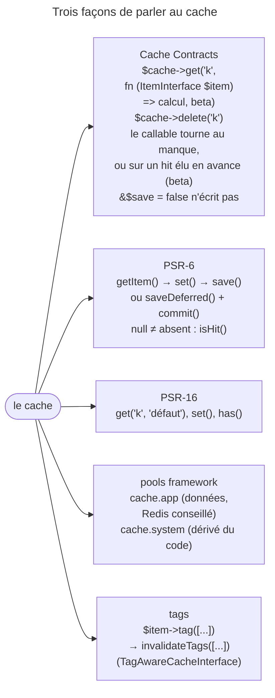

## Objectif

Mettre en cache une valeur coûteuse à calculer, et savoir pourquoi l'API de
Symfony n'a pas de method pour écrire.

## L'essentiel

Le component Cache met des valeurs en cache dans le code. L'API recommandée,
les **Cache Contracts**, n'a que `get()` et `delete()` : pas de `set()`, car
`get()` reçoit un callable qui produit la valeur au manque. Le reste de la page
répond à trois questions : quelle API, que fait `get()` au juste, et quel pool.

## Le schéma



## L'exemple : un calcul coûteux

```php
use Symfony\Contracts\Cache\ItemInterface;

$value = $cache->get('my_cache_key', function (ItemInterface $item, bool &$save): string {
    $item->expiresAfter(3600);
    $item->tag(['reports']);
    $result = $this->computeSomethingExpensive();
    $save = '' !== $result;          // un résultat douteux n'est pas mis en cache

    return $result;
});
```

Typer un argument `CacheInterface` injecte le pool `cache.app`.

## Trois API, une recommandée

- les **Cache Contracts** — recommandés : moins de code, et **protection
  contre la ruée par défaut** ;
- **PSR-6** — pools et items, quand une bibliothèque tierce l'exige ;
- **PSR-16** — un cache « simple », sans object item.

Les adapters parlent à la fois les Cache Contracts et PSR-6 : on choisit l'API
selon le **contrat qu'attend le code consommateur**.

## Quatre mots

| Terme | Definition |
|---|---|
| **Item** | une unité stockée : une key, une valeur |
| **Pool** | un repository logique d'items ; toutes les opérations passent par lui |
| **Adapter** | la class qui implémente le stockage réel — files, Redis… |
| **Provider** | le service de connexion au stockage, notion propre au framework |

Chaque pool du framework reçoit un **namespace** dérivé de son nom : deux pools
ne se heurtent pas sur un stockage partagé.

## L'API qui surprend

- `get()` lit **et** écrit : la valeur et la façon de la produire sont
  déclarées au même endroit.
- Le callable tourne au manque, et sur une key présente quand le recalcul
  anticipé l'élit ou que `beta` vaut `INF` ; `$item->isHit()` y rend alors
  `true`.
- `bool &$save`, passé **par référence** : `false` empêche l'enregistrement.

## La ruée sur le cache

Quand une key coûteuse expire, les Requests simultanées la recalculeraient
toutes. Les Cache Contracts l'évitent **sans configuration** : un **lock** — un
seul process par key et par machine — et une **expiration anticipée
probabiliste**, où un user au hasard recalcule avant l'échéance pendant que
les autres sont servis. Le `beta`, troisième parameter de `get()`, la règle :
`1.0` par défaut, plus haut = plus tôt, **`0` la désactive** sans désactiver
le cache, **`INF` force le recalcul**. Seul un item doté d'une échéance peut
être élu en avance.

## PSR-6 : écrire soi-même

| Opération | Effet |
|---|---|
| `set('x')` sans `save()` | rien n'est stocké |
| `set(null)` puis `save()` | `isHit()` **vrai**, `get()` rend `null` |
| `saveDeferred()` | invisible d'un **autre** pool jusqu'au `commit()` ; le même pool le voit aussitôt |
| `deleteItem('k')` | l'item disparaît |

`ArrayAdapter` enregistre tout de suite : son `saveDeferred()` appelle `save()`.
`expiresAfter()` et `expiresAt()` fixent l'échéance.

## PSR-16 et les bridges

`get('k', 'défaut')` rend le défaut au manque ; `has()` distingue un `null`
stocké d'une absence. `Psr16Cache` fait d'un pool PSR-6 un cache PSR-16 ;
`Psr16Adapter` fait l'inverse, et parle aussi les Cache Contracts.

## Les pools du framework

| Pool | Usage | Adapter par défaut |
|---|---|---|
| `cache.app` | données applicatives | `cache.adapter.filesystem` |
| `cache.system` | ce qui **dérive du code source** | `cache.adapter.system` |

`cache.system` se régénère au préchauffage et ne change qu'au deployment ;
`cache.adapter.system` **choisit** le stockage : files PHP, chaînés derrière
APCu quand il est là. Pour `cache.app`, Redis permet de survivre au deployment et
de partager entre serveurs. Adapters : `apcu`, `array`, `filesystem`,
`memcached`, `pdo`, `psr6`, `redis`, `valkey`.

## Pièges d'examen

**Il n'existe pas de `set()`** dans les Cache Contracts ; en PSR-6, `set()` sans
`save()` n'écrit rien.

**`null` n'est pas une absence** : `isHit()` en PSR-6, `has()` en PSR-16.

**`$save` est passé par référence** ; le mettre à `false` empêche
l'enregistrement.

**Le rappel ne tourne pas qu'au manque.** Exécuté : avec `beta` à `INF`, il
tourne sur une key présente, et `isHit()` y rend `true`.

**`cache.system` n'est pas un `cache.app` plus rapide** : il suppose des données
dérivables du code source.

## Application

- Effacer tous les rapports d'un client sans connaître leurs keys →
  `tag()`, puis `invalidateTags()`.
- Une bibliothèque fournit un cache PSR-16, le code attend les Cache
  Contracts → `Psr16Adapter`.

## QCM d'entraînement

**Question 1.** Deux `FilesystemAdapter`, même namespace et même dossier. Le
premier fait `saveDeferred()` d'un item, sans `commit()`. Le second lit la
key : `isHit()` ?

- **A.** `true` : le file est écrit aussitôt
- **B.** `false`, jusqu'au `commit()` du premier
- **C.** `true`, mais `get()` rend `null`
- **D.** Une exception : un item différé est verrouillé

<details>
<summary>Correction</summary>

**Bonne réponse : B.** Un item différé reste en mémoire dans son pool ; un
autre pool ne le voit qu'une fois `commit()` appelé.

</details>

**Question 2.** Le **même** pool fait `saveDeferred()` d'un item, puis
`getItem()` sur cette key, sans `commit()`. `isHit()` ?

- **A.** `false` : rien n'est écrit avant `commit()`
- **B.** Une exception : `commit()` est requis
- **C.** `true`
- **D.** `null`, faute de valeur

<details>
<summary>Correction</summary>

**Bonne réponse : C.** Le pool qui détient l'item différé le valide aussitôt
qu'on le lit ; seul un autre pool doit attendre le `commit()`.

</details>

**Question 3.** Une bibliothèque fournit un cache PSR-16, et le code de
l'application attend `CacheInterface` des Cache Contracts. Quel bridge ?

- **A.** `Psr16Cache`
- **B.** `ChainAdapter`
- **C.** `Psr16Adapter`
- **D.** Aucun : PSR-16 ne s'adapte pas

<details>
<summary>Correction</summary>

**Bonne réponse : C.** `Psr16Adapter` fait d'un cache PSR-16 un pool PSR-6 qui
parle aussi les Cache Contracts ; `Psr16Cache` fait l'inverse.

</details>

**Question 4.** Un service reçoit un `FilesystemAdapter` et veut appeler
`invalidateTags()`. Que manque-t-il ?

- **A.** Un pool `TagAwareCacheInterface`, comme `TagAwareAdapter`
- **B.** Rien : tout adapter invalide par tag
- **C.** Un `commit()` avant l'invalidation
- **D.** L'option `tags: true` dans `config/packages/cache.yaml`, toujours

<details>
<summary>Correction</summary>

**Bonne réponse : A.** `invalidateTags()` appartient à `TagAwareCacheInterface` ;
un `FilesystemAdapter` seul ne l'a pas, `TagAwareAdapter` le lui ajoute.

</details>

## Fiche express

**Si tu dois retenir seulement 7 choses :**

- Item, **pool**, **adapter**, provider ; un namespace par pool.
- Cache Contracts : **`get()` et `delete()`**, pas de `set()`.
- Callable : au manque ou en avance ; **`&$save`** ; `beta` 0 = jamais en
  avance, `INF` = tout de suite.
- PSR-6 : **`save()`** ; `saveDeferred()` + `commit()` pour les autres pools.
- `null` n'est pas une absence : **`isHit()`**, **`has()`**.
- **`cache.app`** pour les données, **`cache.system`** pour le dérivé du code.
- `tag()` + **`invalidateTags()`** (`TagAwareCacheInterface`).

Moyen mnémotechnique : **« Demander, pas écrire »**.

## Sources officielles

- [Cache](https://github.com/symfony/symfony-docs/blob/8.0/cache.rst)

