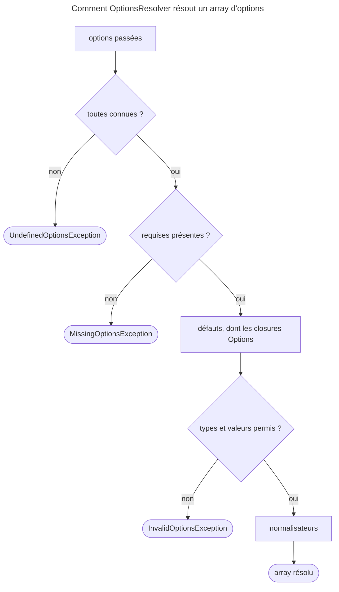

## Objectif

Déclarer et contraindre les options d'un form type. Le component sert
partout où une class accepte un array d'options, pas seulement dans les
forms.

## Avant la règle : le problème à résoudre

Un `PriceType` accepte des options : une devise, un nombre de décimales, un
libellé. Si elles arrivent dans un array brut :

- une faute de frappe (`'curency'`) passe inaperçue et la devise par défaut
  s'applique en silence ;
- `'decimals' => 'deux'` casse bien plus loin, dans le calcul ;
- rien ne dit quelles options existent, ni lesquelles sont obligatoires.

Il faut une **déclaration** : quelles options, quelles default values,
quels types, quelles valeurs permises — vérifiée à chaque usage.

## Le fil rouge : `PriceType`

```php
public function configureOptions(OptionsResolver $resolver): void
{
    $resolver->setDefaults(['decimals' => 2, 'currency' => 'EUR']);
    $resolver->setRequired('vat_rate');
    $resolver->setAllowedTypes('decimals', 'int');
    $resolver->setAllowedValues('currency', ['EUR', 'USD']);
    $resolver->setDefault('label', function (Options $options) {
        return 'Prix (' . $options['currency'] . ')';
    });
}
```

## Le cycle complet en un schéma



## Le problème résolu

Un array d'options est ingérable : une key mal orthographiée passe inaperçue,
un type inattendu casse plus loin, et rien ne dit ce qui est accepté.
`OptionsResolver` remplace l'array par une **déclaration** contrôlée.

Exécuté avec `symfony/options-resolver` 8.0.8 : une option inconnue lève
`UndefinedOptionsException`, dont le message liste les options définies —
« The option "b" does not exist. Defined options are: "a", "c". ».

## Les methods

| Method | Effet |
|---|---|
| `setDefaults()` | déclare des options avec une default value |
| `setRequired()` | l'option doit être fournie, sauf si elle a un défaut |
| `setDefined()` | l'option est **acceptée** mais sans défaut et non obligatoire |
| `setAllowedTypes()` | contraint le type : `'string'`, `'int\|null'`, `'DateTime[]'` |
| `setAllowedValues()` | contraint la valeur à une liste, ou à un test |
| `setNormalizer()` | transforme la valeur après validation |
| `setDeprecated()` | signale une option obsolète sans la retirer |
| `setOptions()` | déclare des options **imbriquées** |

La distinction qui se rate est `setDefined()` contre `setDefaults()` : la
première déclare qu'une option **existe** sans lui donner de valeur ; la seconde
lui en donne une. Exécuté : une option seulement définie et non fournie est
**absente** de l'array résolu.

Exécuté aussi : `setAllowedValues('p', fn ($v) => $v > 0)` refuse `-1` ;
`setDeprecated('old', 'acme/pkg', '1.2', 'Use "new".')` émet « Since acme/pkg
1.2: Use "new". » quand l'option est passée.

## Requise et défaut se combinent

Une option peut être requise **et** avoir un défaut. Exécuté : `setRequired('a')`
puis `setDefault('a', 1)` résout `['a' => 1]` ; `isRequired('a')` reste vrai,
`isMissing('a')` devient faux. C'est le cas documenté d'une sous-classe qui
fournit la valeur d'une option que son parent exige. Sans défaut ni valeur :
`MissingOptionsException`, « The required option "a" is missing. ».

## Options lazy

Une default value peut être une closure recevant les options déjà
résolues, ce qui permet à une option de dépendre d'une autre :

```php
$resolver->setDefault('label', function (Options $options) {
    return $options['required'] ? 'Obligatoire' : 'Facultatif';
});
```

Le parameter doit être typé **`Options`**. La documentation le signale, et
l'exécution le confirme : une closure non typée devient **elle-même** la
default value — l'option résolue est un object `Closure`.

L'ordre de déclaration n'a pas d'importance : exécuté, une option lazy
déclarée avant celle dont elle dépend se résout correctement. Un second
parameter reçoit la default value précédente : exécuté, un défaut `'base'`
redéfini par `fn (Options $o, $prev) => $prev . '+child'` donne
`'base+child'`.

## Validation, puis normalization

La validation passe **avant** le normalisateur, qui ne peut donc pas réparer une
valeur refusée. Exécuté : avec `setAllowedTypes('n', 'int')` et un normalisateur
qui convertit en entier, `'5'` est refusée par `InvalidOptionsException` ; avec
`setAllowedValues('m', ['GET', 'POST'])` et un normalisateur `strtoupper()`,
`'post'` est refusée aussi.

Pour `'DateTime[]'`, chaque élément est contrôlé : un array contenant une
string est refusé, « one of the elements is of type "string" ».

## Options imbriquées

En 8.0, elles se déclarent par `setOptions()` :

```php
$resolver->setOptions('db', function (OptionsResolver $db): void {
    $db->setDefaults(['host' => 'localhost', 'port' => 3306]);
});
```

Exécuté : `['db' => ['port' => 5432]]` donne `host` et `port` complétés, et une
key inconnue lève « The option "db[nope]" does not exist. ». La même closure
passée à `setDefault()` n'est **pas** interprétée : l'option vaut l'object
`Closure`.

## Dans un form type

```php
public function configureOptions(OptionsResolver $resolver): void
{
    $resolver->setDefaults(['data_class' => Task::class]);
    $resolver->setRequired('category');
    $resolver->setAllowedTypes('category', 'string');
}
```

Les options ainsi déclarées deviennent celles que `->add()` accepte pour ce type,
et arrivent dans `$options` de `buildForm()`.

## Concrètement dans ton application

- Une option avec une valeur raisonnable : `setDefaults()`.
- Une option sans default value que le code teste par `isset()` :
  `setDefined()`.
- Une option sans laquelle le type n'a pas de sens : `setRequired()`.
- Une option qui dépend d'une autre : une closure typée `Options`.
- Une conversion de format (une URL, une casse) : `setNormalizer()`, en
  autorisant **le format d'entrée** dans `setAllowedTypes()` ou
  `setAllowedValues()`.

## À comprendre

- **Pourquoi lister les options définies dans l'exception ?** Pour qu'une faute
  de frappe se corrige en lisant le message.
- **Pourquoi la validation avant la normalization ?** Parce que le
  normalisateur doit pouvoir compter sur une valeur du bon type.
- **Pourquoi typer `Options` ?** Parce que c'est le seul signe qui distingue une
  default value calculée d'une closure qu'on voudrait stocker telle quelle.

## À mémoriser

- `setDefaults` donne une valeur, `setDefined` autorise sans en donner,
  `setRequired` exige sauf défaut.
- Requise + défaut : requise, mais jamais manquante.
- `setAllowedTypes` et `setAllowedValues` contrôlent, **puis** `setNormalizer`
  transforme.
- Option inconnue : exception qui liste les options définies.
- Défaut lazy : closure typée `Options` ; second parameter = défaut précédent.
- Imbrication : `setOptions()`, pas `setDefault()`.
- Moyen mnémotechnique : **« Connaître, exiger, compléter, vérifier,
  normaliser »**.

## Pièges d'examen

**Déclarer qu'une option existe n'est pas lui donner une default value** :
une option seulement définie est absente du résultat.

**Une option requise peut avoir un défaut** : elle reste requise, mais n'est plus
manquante.

**Une option lazy exige le type `Options`** ; sans lui, la closure est la
valeur.

**Le normalisateur s'exécute après la validation** : il ne rattrape pas une
valeur refusée.

**Les options imbriquées passent par `setOptions()`**, pas par `setDefault()`.

## Application : trois scénarios

**Scénario 1 — La devise en minuscules refusée.** `setAllowedValues('currency',
['EUR', 'USD'])` et un normalisateur `strtoupper()` : `'eur'` est refusé.
*Solution.* La validation passe d'abord : autoriser aussi les minuscules, ou
valider par une function qui ignore la casse.

**Scénario 2 — Le libellé qui affiche « Closure ».** Un défaut écrit
`fn ($o) => 'Prix (' . $o['currency'] . ')'` produit un object `Closure`.
*Solution.* Typer le parameter : `fn (Options $o) => …`.

**Scénario 3 — L'option fantôme.** Le code lit `$options['tooltip']` et lève
une « Undefined array key ». L'option avait été déclarée par `setDefined()`.
*Solution.* Une option seulement définie est absente quand elle n'est pas
passée : `setDefault('tooltip', null)`, ou un test `isset()`.

## QCM d'entraînement

Six questions sur OptionsResolver. Choisis avant d'ouvrir la correction.

**Question 1.** `setDefined('tooltip')` est appelé, puis `resolve([])`. Que contient l'array résolu pour `tooltip` ?

- **A.** `null`
- **B.** Une exception : l'option n'a pas de valeur
- **C.** Une string vide
- **D.** Rien : la key est absente

<details>
<summary>Correction</summary>

**Bonne réponse : D.** Exécuté : une option seulement définie et non fournie
n'apparaît pas.

A est le piège : c'est le résultat d'un `setDefault('tooltip', null)`. B et C
inventent des comportements.

</details>

**Question 2.** `setRequired('vat_rate')` puis `setDefault('vat_rate', 20)`. On appelle `resolve([])`. Résultat ?

- **A.** `['vat_rate' => 20]`, et l'option reste requise
- **B.** `MissingOptionsException` : une option requise doit être passée
- **C.** `['vat_rate' => 20]`, et l'option n'est plus requise
- **D.** Une exception : requise et défaut s'excluent

<details>
<summary>Correction</summary>

**Bonne réponse : A.** Exécuté : `isRequired()` reste vrai, `isMissing()`
devient faux.

B est le piège. C confond requise et manquante. D invente une incompatibilité.

</details>

**Question 3.** `setAllowedTypes('decimals', 'int')` et un normalisateur `fn (Options $o, $v) => (int) $v`. On passe `'2'`. Résultat ?

- **A.** `2` : le normalisateur convertit avant la vérification
- **B.** `InvalidOptionsException`
- **C.** `'2'`, la string étant tolérée pour un int
- **D.** Un avertissement de deprecation, puis `2`

<details>
<summary>Correction</summary>

**Bonne réponse : B.** La vérification passe d'abord ; exécuté : « expected to
be of type "int", but is of type "string" ».

A est le piège : l'ordre est inverse. C et D inventent une tolérance.

</details>

**Question 4.** Un défaut est écrit `setDefault('label', fn ($o) => 'Prix')`, sans type sur le parameter. Que vaut l'option résolue ?

- **A.** `'Prix'`
- **B.** `null`
- **C.** Un object `Closure`
- **D.** Une exception : une closure doit être typée

<details>
<summary>Correction</summary>

**Bonne réponse : C.** Sans le type `Options`, la closure est la valeur
(exécuté).

A est le piège : c'est le résultat avec `fn (Options $o)`. B et D sont faux.

</details>

**Question 5.** Une option `db` est déclarée par `setOptions()` avec les défauts `host` et `port`. On passe `['db' => ['nope' => 1]]`. Résultat ?

- **A.** `nope` est ignoré
- **B.** `nope` est ajouté aux défauts
- **C.** `UndefinedOptionsException`
- **D.** `db` est remplacé par `['nope' => 1]`

<details>
<summary>Correction</summary>

**Bonne réponse : C.** Exécuté : « The option "db[nope]" does not exist. ».
Les options imbriquées sont résolues comme les autres, path compris dans le
message.

A, B et D supposent un array libre.

</details>

**Question 6.** Une option garde une default value `'base'` déclarée par un type parent. Le type enfant écrit `setDefault('a', fn (Options $o, $prev) => $prev . '+child')`. Que vaut `a` ?

- **A.** `'+child'` : le défaut précédent est perdu
- **B.** `'base'` : le parent l'emporte
- **C.** Une exception : un défaut ne se redéfinit pas
- **D.** `'base+child'`

<details>
<summary>Correction</summary>

**Bonne réponse : D.** Le second parameter reçoit le défaut précédent
(exécuté).

A oublie ce parameter. B et C sont faux : l'enfant redéfinit le défaut.

</details>

## Fiche express

**Si tu dois retenir seulement 6 choses :**

- **`setDefaults`** donne une valeur ; **`setDefined`** autorise sans valeur
  (absente si non passée) ; **`setRequired`** exige, sauf défaut.
- Option **inconnue** : `UndefinedOptionsException`, avec la liste des options.
- **Vérifier puis normaliser** : le normalisateur ne rattrape rien.
- Défaut lazy : closure **typée `Options`** ; sinon la closure est la valeur.
- Second parameter d'un défaut lazy : **le défaut précédent**.
- Imbrication : **`setOptions()`**.

**En une phrase, pour tout reconstruire :**

```text
inconnue ? Undefined → requise absente ? Missing → défauts (closures Options)
  → types/valeurs ? Invalid → normalisateurs → array résolu
```

## Sources officielles

- [The OptionsResolver Component](https://github.com/symfony/symfony-docs/blob/8.0/components/options_resolver.rst)
- [OptionsResolver 8.0, `OptionsResolver`](https://github.com/symfony/symfony/blob/8.0/src/Symfony/Component/OptionsResolver/OptionsResolver.php)
