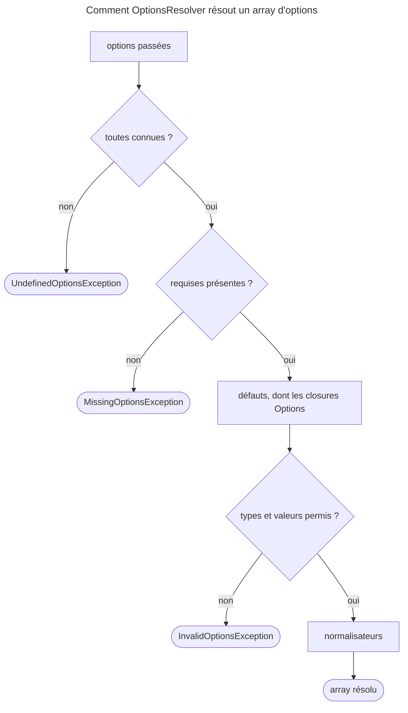

## Objectif

Déclarer et contraindre les options d'un form type. Le component sert
partout où une class accepte un array d'options, pas seulement dans les
forms.

## L'essentiel

`OptionsResolver` remplace un array d'options brut par une **déclaration** :
quelles options existent, lesquelles sont requises, leurs défauts, leurs types
et valeurs permis. Une faute de frappe lève une exception au lieu de passer en
silence. C'est le mécanisme de `configureOptions()` dans un form type.

## Le schéma



## L'exemple : `PriceType`

```php
public function configureOptions(OptionsResolver $resolver): void
{
    $resolver->setDefaults(['decimals' => 2, 'currency' => 'EUR']);
    $resolver->setRequired('vat_rate');
    $resolver->setAllowedTypes('decimals', 'int');
    $resolver->setAllowedValues('currency', ['EUR', 'USD']);
    $resolver->setDefault('label', function (Options $options) {
        return 'Prix (' . $options['currency'] . ')';
    });
}
```

Les options déclarées sont celles que `->add()` accepte pour ce type ; elles
arrivent dans `$options` de `buildForm()`.

## Le problème résolu

Une option inconnue lève `UndefinedOptionsException`, qui liste les options
définies : « The option "b" does not exist. Defined options are: "a", "c". ».

## Les methods

| Method | Effet |
|---|---|
| `setDefaults()` | déclare des options **avec** une default value |
| `setDefined()` | l'option est acceptée, **sans** défaut : absente du résultat si non passée |
| `setRequired()` | l'option doit être fournie, sauf si elle a un défaut |
| `setAllowedTypes()` | `'string'`, `'int\|null'`, `'DateTime[]'` (chaque élément contrôlé) |
| `setAllowedValues()` | une liste, ou une function de test |
| `setNormalizer()` | transforme la valeur **après** validation |
| `setDeprecated()` | signale une option obsolète quand elle est passée |
| `setOptions()` | déclare des options **imbriquées** |

Requise et défaut se combinent : `isRequired('a')` reste vrai,
`isMissing('a')` devient faux. Sans défaut ni valeur :
`MissingOptionsException`, « The required option "a" is missing. ».

## Options lazy

Une default value peut être une closure qui reçoit les options résolues, ce
qui permet à une option de dépendre d'une autre.

- Le parameter doit être typé **`Options`** ; sinon, la closure est elle-même
  la valeur.
- L'ordre de déclaration n'a pas d'importance.
- Un second parameter reçoit le défaut précédent, celui d'un type parent :
  `fn (Options $o, $prev) => $prev . '+child'`.

## Validation, puis normalization

La validation passe **avant** le normalisateur, qui ne répare donc pas une
valeur refusée : avec `setAllowedValues('m', ['GET', 'POST'])` et un
normalisateur `strtoupper()`, `'post'` est refusée par
`InvalidOptionsException`.

## Options imbriquées

```php
$resolver->setOptions('db', function (OptionsResolver $db): void {
    $db->setDefaults(['host' => 'localhost', 'port' => 3306]);
});
```

`['db' => ['port' => 5432]]` donne `host` et `port` complétés. La même closure
passée à `setDefault()` n'est pas interprétée : l'option vaut l'object
`Closure`.

## Pièges d'examen

**Déclarer qu'une option existe n'est pas lui donner une default value** :
une option seulement définie est absente du résultat.

**Une option requise peut avoir un défaut** : elle reste requise, mais n'est plus
manquante.

**Une option lazy exige le type `Options`** ; sans lui, la closure est la
valeur.

**Le normalisateur s'exécute après la validation** : il ne rattrape pas une
valeur refusée.

**Les options imbriquées passent par `setOptions()`**, pas par `setDefault()`.

## Application

- Un libellé qui dépend de la devise → un défaut lazy,
  `fn (Options $o) => 'Prix (' . $o['currency'] . ')'`.
- Une sous-classe qui fournit l'option que son parent exige →
  `setDefault()` sur l'option requise.

## QCM d'entraînement

**Question 1.** Une option `db` est déclarée par `setOptions()` avec les
défauts `host` et `port`. On passe `['db' => ['nope' => 1]]`. Résultat ?

- **A.** `nope` est ignorée, `host` et `port` complétés
- **B.** `db` vaut `['nope' => 1]` tel quel
- **C.** « The option "db[nope]" does not exist. »
- **D.** Une `MissingOptionsException` sur `host`

<details>
<summary>Correction</summary>

**Bonne réponse : C.** Le sous-resolver contrôle ses keys comme le resolver
principal : une option inconnue y est refusée, avec son path.

</details>

**Question 2.** Le type parent donne à `a` le défaut `'base'`. Le type enfant
écrit `setDefault('a', fn (Options $o, $prev) => $prev . '+child')`. Que vaut
`a` sans option passée ?

- **A.** `'base+child'`
- **B.** `'+child'` : `$prev` vaut `null`
- **C.** `'base'` : le défaut du parent l'emporte
- **D.** Un object `Closure`

<details>
<summary>Correction</summary>

**Bonne réponse : A.** Le second parameter d'une closure lazy reçoit la
default value précédente, ici celle du type parent.

</details>

**Question 3.** `setDefault('db', function (OptionsResolver $db) { … })` est
écrit à la place de `setOptions()`. Que vaut l'option `db` résolue ?

- **A.** Les défauts déclarés dans la closure
- **B.** Un object `Closure`
- **C.** `null` : la closure ne retourne rien
- **D.** Une exception : le type du parameter est refusé

<details>
<summary>Correction</summary>

**Bonne réponse : B.** Seul `setOptions()` interprète cette closure comme un
sous-resolver ; `setDefault()` n'appelle que les closures typées `Options`.

</details>

**Question 4.** Le défaut lazy de `label` lit `$o['currency']`, mais il est
déclaré **avant** `setDefault('currency', 'EUR')`. Que vaut `label` ?

- **A.** Une exception : `currency` n'existe pas encore
- **B.** `'Prix ()'`, `currency` valant `null`
- **C.** Un object `Closure`, non résolu
- **D.** `'Prix (EUR)'`

<details>
<summary>Correction</summary>

**Bonne réponse : D.** Les closures lazy s'exécutent à la résolution, une fois
toutes les options déclarées : l'ordre de déclaration ne compte pas.

</details>

## Fiche express

**Si tu dois retenir seulement 7 choses :**

- Option inconnue : **`UndefinedOptionsException`**, avec la liste.
- **`setDefined()`** : acceptée, absente si non passée ; **`setDefaults()`** :
  une valeur.
- Requise **et** défaut : requise, mais pas manquante.
- Lazy : closure typée **`Options`** ; `$prev` reçoit l'ancien défaut.
- Types et valeurs **avant** le normalisateur.
- Imbriquées : **`setOptions()`**, pas `setDefault()`.
- `setDeprecated()` avertit quand l'option est passée.

Moyen mnémotechnique : **« Connaître, exiger, compléter, vérifier,
normaliser »**.

## Sources officielles

- [The OptionsResolver Component](https://github.com/symfony/symfony-docs/blob/8.0/components/options_resolver.rst)
- [OptionsResolver 8.0, `OptionsResolver`](https://github.com/symfony/symfony/blob/8.0/src/Symfony/Component/OptionsResolver/OptionsResolver.php)

