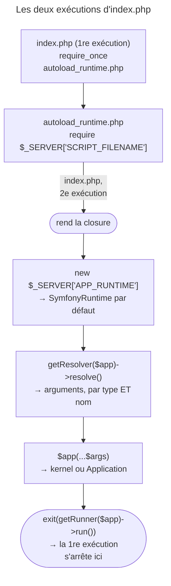

## Objectif

Comprendre ce qui s'exécute entre le chargement de l'autoload et la remise
d'une Request au kernel, et pourquoi le file d'entrée **retourne** au lieu
d'exécuter.

## L'essentiel

Le component Runtime sort l'amorçage du file d'entrée : `public/index.php`
**retourne une function**, et c'est le runtime qui l'appelle, résout ses
arguments et exécute ce qu'elle rend — un kernel HTTP ou une application de
console. Deux conséquences à l'examen : le script d'entrée **s'exécute deux
fois**, et les arguments de la function sont reconnus par leur **type et leur
nom**.

## Le schéma



## L'exemple : le front controller

```php
// public/index.php
require_once dirname(__DIR__).'/vendor/autoload_runtime.php';

return function (array $context): Kernel {
    return new Kernel($context['APP_ENV'], (bool) $context['APP_DEBUG']);
};
```

## Le file d'entrée ne lance rien

Le script ne construit ni n'envoie la Response : il rend une function.
`vendor/autoload_runtime.php` est écrit par le **plugin Composer** du
component ; avec `--no-plugins`, il n'existe pas.

| Le script rend | Résultat |
|---|---|
| `42` au lieu d'une function | `TypeError` : *callable object expected* |
| une function qui rend une string | `TypeError` : *object expected* |
| une function qui rend une `Response` | la Response est envoyée |

C'est **la nature de l'object rendu** qui choisit HTTP ou console : un même
mécanisme sert `public/index.php` et `bin/console`.

## Les cinq étapes

La documentation 8.0 les énumère : runtime instancié, script d'entrée
**inclus à nouveau**, arguments de la function résolus, function appelée,
application exécutée. Le code 8.0 inverse les deux premières ; un runtime qui
journalise son constructor donne *script returns closure*, puis
*runtime constructed*. Le code l'emporte.

| Ligne du script | Exécutions |
|---|---|
| **au-dessus** du `require_once` | **deux** |
| au-dessous | une seule |

La première exécution s'achève par l'`exit` d'`autoload_runtime.php` ; la
seconde trouve le file déjà chargé et continue. D'où la règle : **aucun effet
de bord** dans ce script. Charger `vendor/autoload.php` **avant** désactive
tout : le script va au bout, l'application ne tourne pas, exit code `0`,
aucun message.

## Les arguments sont résolus par type *et* par nom

| Argument | Reçoit |
|---|---|
| `array $context` | `$_SERVER` + `$_ENV` selon la documentation ; le code n'ajoute `$_ENV` que sans `PATH` dans `$_SERVER` |
| `array $argv` | les arguments de la ligne de command |
| `array $request` | `query`, `body`, `files`, `session` |

`array $ctx` lève une `InvalidArgumentException` qui énumère ces trois noms.
`SymfonyRuntime` accepte en plus une `Request` créée depuis les superglobales
et les objects d'entrée et de sortie de console.

## Choisir le runtime

`SymfonyRuntime` est le défaut ; `GenericRuntime` s'appuie sur les
superglobales. `SymfonyRuntime` charge les files `.env` : sans `.env`, il lève
une `PathException` ; avec `disable_dotenv`, il démarre en `dev`, debug à `1`.

| Pour choisir | Pour les options |
|---|---|
| `APP_RUNTIME` | `APP_RUNTIME_OPTIONS`, en JSON |
| `extra.runtime.class` dans `composer.json` | `extra.runtime` |

## Pièges d'examen

**Le file d'entrée retourne une function ; il n'exécute pas
l'application.**

**Le script d'entrée est réexécuté** par le runtime : ce qui précède le
`require_once` tourne deux fois.

**`autoload.php` chargé avant `autoload_runtime.php`** : rien ne s'exécute, sans
erreur.

**Le type *et* le nom de l'argument sont significatifs.**

**`--no-plugins` empêche la création de `autoload_runtime.php`.**

## Application

- Un compteur de visites à incrémenter → dans le kernel ou un listener,
  jamais au-dessus du `require_once` du front controller.
- Une image Docker sans file `.env` → `APP_RUNTIME_OPTIONS='{"disable_dotenv":true}'`.

## QCM d'entraînement

**Question 1.** La closure de `public/index.php` rend `'ok'`, une string.
Que se passe-t-il ?

- **A.** `ok` est envoyé comme corps de Response
- **B.** Une `TypeError` : un object est attendu
- **C.** La string sert d'exit code
- **D.** Le kernel par défaut est construit à la place

<details>
<summary>Correction</summary>

**Bonne réponse : B.** Debug actif ou non, la valeur rendue doit être un
object, kernel ou application ; une string lève une `TypeError` avant tout envoi.

</details>

**Question 2.** Une closure déclare `array $request`. Que reçoit-elle ?

- **A.** L'object `Request` courant
- **B.** Les headers HTTP, indexés par nom
- **C.** Un array `query`, `body`, `files`, `session`
- **D.** Une `InvalidArgumentException` : seul `$context` est permis

<details>
<summary>Correction</summary>

**Bonne réponse : C.** Ce nom réservé regroupe les superglobales `$_GET`,
`$_POST`, `$_FILES` et `$_SESSION` ; l'object `Request` exige le type `Request`.

</details>

**Question 3.** `SymfonyRuntime` démarre avec `disable_dotenv`, et aucune
variable `APP_ENV` n'est définie. Quel environment obtient-on ?

- **A.** `prod`, le plus sûr
- **B.** Aucun : une `PathException`
- **C.** `test`
- **D.** `dev`, debug à `1`

<details>
<summary>Correction</summary>

**Bonne réponse : D.** L'option évite seulement la lecture des files `.env` ;
les default values du runtime prennent alors la place des variables
absentes.

</details>

**Question 4.** Pourquoi une ligne placée **sous** le `require_once` du
runtime ne s'exécute-t-elle qu'une fois ?

- **A.** La 1re exécution se termine par un `exit`
- **B.** OPcache met en cache la seconde exécution du script
- **C.** Le runtime retire du script les lignes qui suivent
- **D.** `require_once` bloque toute autre exécution du script

<details>
<summary>Correction</summary>

**Bonne réponse : A.** La première exécution s'arrête dans le file requis,
avant la suite ; seule la seconde, où le file est déjà chargé, l'atteint.

</details>

## Fiche express

**Si tu dois retenir seulement 6 choses :**

- `index.php` **rend une closure** ; le runtime l'appelle et exécute le
  résultat.
- Le script tourne **deux fois** au-dessus du `require_once` : aucun effet de
  bord.
- `autoload.php` chargé avant : **rien ne tourne**, sans erreur.
- `$context`, `$argv`, `$request` : **type et nom**.
- `--no-plugins` : pas d'`autoload_runtime.php`.
- `APP_RUNTIME` ou `extra.runtime.class` ; options en `APP_RUNTIME_OPTIONS`.

Moyen mnémotechnique : **« Rendre, pas lancer »**.

## Sources officielles

- [`components/runtime.rst`, branche 8.0](https://github.com/symfony/symfony-docs/blob/8.0/components/runtime.rst)
- [`autoload_runtime.template`, branche 8.0](https://github.com/symfony/symfony/blob/8.0/src/Symfony/Component/Runtime/Internal/autoload_runtime.template)

