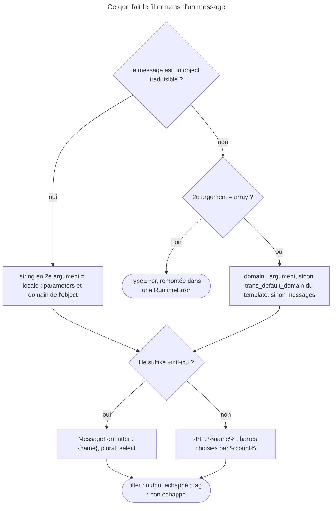

## Objectif

Traduire depuis un template, gérer le plural et savoir ce que le filter et le
tag font différemment. L'organisation des catalogues et la détection de la
locale appartiennent aux lots Internationalisation et Routing.

## Avant la règle : le problème à résoudre

Une boutique s'affiche en français et en allemand. Le titre est une key,
`cart.title` ; le message d'accueil insère le prénom ; le panier dit « Aucun
article », « 1 article » ou « 3 articles » ; le bas de page vient d'un domain
`store`. Et le label d'un statut, calculé par une enum, doit se traduire plus
tard, dans la locale de la page.

Twig offre pour cela **un filter**, `|trans`, **un tag**, ``, et **une
function**, `t()`. Ils ne se comportent pas pareil : ordre des arguments,
escaping, emplacements, domain par défaut. Tous les faits de cette page ont été
exécutés avec Twig 3.22.2, Translation 8.0.14 et l'extension intl.

## Le fil rouge : la page panier

```twig
{# templates/cart/show.html.twig #}

<h1>{{ 'cart.title'|trans }}</h1>
<p>{{ 'cart.greeting'|trans({'%name%': app.user.firstName}) }}</p>
<p>{{ 'cart.items'|trans({count: cart.count}) }}</p>
<p>{{ order.status.label|trans }}</p>
```

```yaml
# translations/store+intl-icu.fr.yaml
cart.items: '{count, plural, =0 {Aucun article} one {# article} other {# articles}}'
```

Le domain `store` vaut pour ce template seulement ; le compte passe par ICU,
grâce au suffixe `+intl-icu` du file ; le statut est un object traduisible
que `|trans` traduit dans la locale courante.

## Le cycle complet en un schéma

Ce que fait le filter d'un message, lu dans `TranslationExtension` et rejoué :



## Le filter

```html
<h1>{{ 'page.title'|trans }}</h1>
<p>{{ 'user.greeting'|trans({'%name%': user.name}) }}</p>
<p>{{ 'checkout.total'|trans({}, 'store') }}</p>
<p>{{ 'legal.notice'|trans({}, 'messages', 'de') }}</p>
```

Dans le code de `TranslationExtension` (Twig Bridge 8.0), la signature est
`trans(arguments = [], domain = null, locale = null, count = null)` : **parameters,
domain, locale**, puis un compte qui renseigne `%count%`. Un domain omis vaut
`messages`, une locale omise vaut la locale courante.

Twig accepte les **named arguments** : `|trans(domain: 'store')` — ou
`domain = 'store'`, l'autre séparateur admis par Twig 3.22 — évite l'array
vide.

Le deuxième argument doit être un array. Une string n'y est admise que si le
message est un object traduisible : elle désigne alors la **locale**. Sur une
string ordinaire, `|trans('store')` fait lever une `TypeError` au filter.

**Rejoué :** les quatre appels ci-dessus, `trans(domain: 'store')` et
`trans(domain = 'store')` rendent la traduction attendue ; `|trans(count: 3)`
remplit `%count%`. Et `'checkout.total'|trans('store')` arrive dans le template
sous la forme d'une `Twig\Error\RuntimeError` dont `getPrevious()` est la
`TypeError` : « Unless the message is a "…TranslatableInterface", argument 2
passed to "…TranslationExtension::trans()" must be an array of parameters,
"string" given. »

## Les emplacements

Symfony remplace les emplacements par `strtr()`. Les pourcents de `%name%` sont
une **convention** : la documentation précise que `#name#` ou `{name}`
fonctionnent aussi, pourvu que la key de l'array corresponde exactement.

**Rejoué :** `#name#` et `{name}` sont remplacés comme `%name%`. Mais avec le
message `Bonjour %name%` et l'array `{'name': 'Ada'}`, le résultat est
`Bonjour %Ada%` : `strtr()` remplace la string `name` là où il la trouve, et
laisse les pourcents autour.

## Le tag

```html
{% trans with {'%name%': 'Fabien'} from 'app' into 'fr' %}Hello %name%
```

- `count`, `with`, `from`, `into`, **dans cet ordre** : `TransTokenParser` les
  lit ainsi, et un mot hors de place est une erreur de syntaxe.
- Dans le tag, la notation `%var%` est **obligatoire**. Un emplacement absent
  de `with` est lu dans le **contexte** : `%name%` vaut la variable `name`
  (`TransNode`).
- Le body doit être du texte simple.
- Un pourcent littéral se double : `%percent%%%`.

`` fixe le domain du template courant — et de
lui seul : un template inclus garde `messages`, pour éviter les effets de bord.

**Rejoué :**

| Écriture | Résultat |
|---|---|
| `` | `SyntaxError` : « Twig was looking for the "with", "from", or "into" keyword » |
| `Hello {{ name }}` | `SyntaxError` : « A message inside a trans tag must be a simple text » |
| `Hello %name%`, sans `name`, `strict_variables` actif | `RuntimeError` : « Variable "name" does not exist » |
| le même, `strict_variables` inactif | `Bonjour ` — l'emplacement est vide |
| `with {'%name%': 'With'}` et une variable `name` | `with` l'emporte : `Bonjour With` |
| `{% trans with {'%percent%': 20} %}%percent%%% de remise` | `20% de remise` |
| `apples` | `5 pommes`, la syntaxe à barres du catalogue |

## Échappé ou non

La documentation le souligne : l'output du **filter** est échappé, celui du
**tag** ne l'est **pas**. Pour afficher du HTML traduit par le filter, on
ajoute `|raw` après `|trans`.

**Rejoué** avec le message `Bonjour <b>%name%</b>` : le filter écrit
`Bonjour &lt;b&gt;Ada&lt;/b&gt;`, le filter suivi de `|raw` et le tag écrivent
`Bonjour <b>Ada</b>`.

## Le plural

La documentation 8.0 traite le plural — et le genre, et les formats propres à
une locale — par **ICU MessageFormat** :

- le file de catalogue porte le suffixe `+intl-icu` —
  `messages+intl-icu.en.yaml` ;
- les emplacements s'écrivent `{name}`, et `MessageFormatter` traite tous les
  messages du file.

La syntaxe à barres verticales — `'{0} Aucun résultat|one result|%count%
results'` — sélectionne d'après `%count%`. La documentation la qualifie de
syntaxe *legacy* ; elle fonctionne toujours et garde une chose qu'ICU n'a pas :
les intervalles personnalisés, `]0,1000]`.

**Rejoué** avec `{0} Aucune pomme|{1} Une pomme|]1,Inf[ %count% pommes`, en
français : `count: 0` donne `Aucune pomme`, `count: 1` `Une pomme`, `count: 5`
`5 pommes`.

## Plural et select, exécutés

Exécuté avec Translation 8.0.14 — la dernière version 8.0 du component — et
l'extension intl, ICU 74.2 :

| Message ICU | Résultat |
|---|---|
| `{n, plural, one {# fichier} other {# fichiers}}`, locale `fr` | `0 fichier`, `1,5 fichier`, `2 fichiers` |
| le même message en anglais | `0 files` |
| `=0 {aucun fichier}` placé avant `one` | `=0` l'emporte pour 0 |
| `select` ou `plural` sans `other` | `InvalidArgumentException` à chaque `trans()`, même pour une valeur prévue |
| `{gender, select, female {{n, plural, …}} other {…}}` | les deux s'imbriquent |
| `#` dans un `plural` imbriqué | le nombre du `plural` le plus intérieur |

Les catégories `one`, `few`… suivent les règles de la **locale** : en
français, 0 et 1,5 sont `one`. Une key de parameter `%name%` remplit `{name}` —
Symfony retire les pourcents —, mais `%name%` écrit dans un message ICU reste
du texte.

## L'object traduisible

`t('notification.welcome', {…}, 'domaine')` construit un `TranslatableMessage`,
qui transporte ses parameters et son domain et se traduit à l'affichage par
`|trans`, dans la locale courante — ou celle passée en deuxième argument.
Retourner une key brute, depuis une enum par exemple, perd parameters et
domain, et `translation:extract` ne la voit pas.

Il ne s'affiche **que** traduit : en 8.0, `TranslatableMessage` n'a plus de
`__toString()`. Exécuté contre 7.4.21 : `{{ message }}` y affichait la key
brute ; avec Symfony 8.0.15 et Twig 3.22.2, le rendu échoue sur une `Error` PHP non
emballée — « could not be converted to string » —, et seul
`{{ message|trans }}` produit le texte.

Lu dans `Template::display()` (Twig 3.22) : la conversion en string se fait
**hors** du `try/catch` qui emballe les exceptions en `RuntimeError`, d'où
cette `Error` brute. **Rejoué** aussi : `t('hi', {}, 'store')|trans` lit le
domain `store` porté par l'object.

## Concrètement dans ton application

- Un texte fixe : `{{ 'key'|trans }}`, le domain par `trans_default_domain`
  en tête du template.
- Un texte avec variables : `|trans({'%name%': …})`, la key **avec** ses
  pourcents.
- Un pluriel, un genre : un file `+intl-icu` et des `{name}` ; la syntaxe à
  barres seulement pour des intervalles.
- Du HTML dans une traduction : le tag, ou `|trans|raw` — en sachant que rien
  n'est alors échappé.
- Un label calculé ailleurs — enum, service, Form — : renvoyer `t(…)`, et
  l'afficher avec `|trans`, jamais seul.

## À comprendre

- **Pourquoi une string en deuxième argument est-elle une erreur ?** Pour une
  string, ce slot est celui des parameters ; un object traduisible a déjà les
  siens, le slot devient la locale.
- **Pourquoi le tag n'échappe-t-il pas ?** Son body est écrit dans le template
  lui-même : c'est du texte de confiance, comme le reste du template.
- **Pourquoi `trans_default_domain` ne traverse-t-il pas un `include` ?** Un
  fragment inclus doit traduire pareil partout, quel que soit le template qui
  l'inclut.
- **Pourquoi `t()` plutôt qu'une key ?** La traduction a lieu au rendu, dans la
  locale du rendu, avec les parameters et le domain voulus par celui qui a créé
  le message.

## À mémoriser

- **`|trans(paramètres, domaine, locale, count)`** ; named arguments admis.
- String en deuxième argument : **locale** pour un object, **erreur** pour une
  string — une `RuntimeError` autour de la `TypeError`.
- **`strtr()`** : la key doit correspondre exactement, pourcents compris.
- Tag : **`count`, `with`, `from`, `into`** ; texte simple ; `%var%` lu dans
  le contexte ; **non échappé**.
- **`trans_default_domain`** : ce template seulement.
- ICU : **`+intl-icu`**, **`{name}`**, `other` obligatoire ; barres =
  *legacy*, intervalles.
- **`t()`** : affiché seul, le rendu échoue.
- Moyen mnémotechnique : **« PDL : parameters, puis domain, puis locale — le
  filter échappe, le tag fait confiance »**.

## Pièges d'examen

**L'ordre des arguments du filter est parameters, puis domain, puis locale.** Les
named arguments évitent de le deviner.

**Une string en deuxième argument** n'est une locale que pour un object
traduisible ; ailleurs, c'est une erreur.

**Le filter échappe, le tag non.**

**`trans_default_domain` ne traverse pas un `include`.**

**Dans le tag, un emplacement non fourni vient du contexte.**

**Accolades et pluriel** : sans le suffixe `+intl-icu`, `{name}` n'est qu'un
emplacement ordinaire — rien n'est pluralisé.

## Application : trois scénarios

**Scénario 1 — Le prénom entre pourcents.** La page affiche `Bonjour %Ada%`.
*Solution.* L'array passe `{'name': …}` alors que le message contient
`%name%` : `strtr()` a remplacé `name` seul. Écrire la key avec ses pourcents,
`{'%name%': …}`.

**Scénario 2 — Le pluriel qui ne pluralise pas.** Le panier affiche
`{count, plural, one {# article} other {# articles}}` tel quel. *Solution.* Le
file s'appelle `store.fr.yaml` : sans `+intl-icu`, les accolades ne sont pas
interprétées. Le renommer `store+intl-icu.fr.yaml`.

**Scénario 3 — Le statut qui casse la page.** Une enum renvoie
`t('status.paid')`, et `{{ order.status.label }}` lève une erreur.
*Solution.* Un `TranslatableMessage` ne se convertit plus en string en 8.0 :
écrire `{{ order.status.label|trans }}`.

## QCM d'entraînement

Cinq questions sur la traduction dans Twig. Choisis avant d'ouvrir la
correction.

**Question 1.** Le catalogue traduit `user.greeting` par `Bonjour %name%`. Que
rend `{{ 'user.greeting'|trans({'name': 'Ada'}) }}` ?

- **A.** `Bonjour Ada`
- **B.** `Bonjour %name%`
- **C.** `Bonjour %Ada%`
- **D.** Une erreur : emplacement inconnu

<details>
<summary>Correction</summary>

**Bonne réponse : C.** Rejoué : `strtr()` remplace la string `name` là où il
la trouve, et laisse les pourcents.

A vaudrait pour un message ICU `Bonjour {name}`, où la key `name` remplit
`{name}` ; ici, `strtr()` cherche la string exacte. B et D sont faux.

</details>

**Question 2.** Que fait `Hello {{ name }}` ?

- **A.** Il traduit `Hello` et affiche `name` à la suite
- **B.** Il traduit le message après avoir inséré `name`
- **C.** Il ignore `{{ name }}`, qui n'est pas un emplacement du tag
- **D.** Il ne compile pas

<details>
<summary>Correction</summary>

**Bonne réponse : D.** Rejoué : « A message inside a trans tag must be a simple
text ». Une variable s'écrit `%name%` dans le tag.

A, B et C supposent que le tag accepte une expression dans son body.

</details>

**Question 3.** `strict_variables` est actif, aucune variable `name` n'existe.
Que fait `Hello %name%` ?

- **A.** Il lève une `RuntimeError`
- **B.** Il affiche `Hello %name%`, tel quel, sans traduire
- **C.** Il affiche `Hello `, l'emplacement vide
- **D.** Il ne compile pas

<details>
<summary>Correction</summary>

**Bonne réponse : A.** Rejoué : `TransNode` lit dans le contexte tout
emplacement absent de `with`, comme une variable ordinaire — d'où « Variable
"name" does not exist ». C est le résultat sans `strict_variables`.

B et D sont faux.

</details>

**Question 4.** Le catalogue `fr` contient
`apples: '{0} Aucune pomme|{1} Une pomme|]1,Inf[ %count% pommes'`. Que rend
`{{ 'apples'|trans(count: 0) }}` ?

- **A.** `0 pommes`
- **B.** `Aucune pomme`
- **C.** `Une pomme`, 0 étant `one` en français
- **D.** Le message brut, faute de suffixe `+intl-icu`

<details>
<summary>Correction</summary>

**Bonne réponse : B.** Rejoué : la syntaxe à barres choisit l'intervalle
`{0}` d'après `%count%`, que l'argument `count` renseigne.

C confond avec les catégories ICU. D confond avec un message ICU : la syntaxe à
barres n'a pas besoin du suffixe. A est faux.

</details>

**Question 5.** Que rend
`{% trans with {'%percent%': 20} %}%percent%%% de remise` ?

- **A.** `20%% de remise`
- **B.** `%percent%% de remise`
- **C.** `20% de remise`
- **D.** Une erreur de syntaxe

<details>
<summary>Correction</summary>

**Bonne réponse : C.** Rejoué : dans le tag, un pourcent littéral se double ;
`%%` devient `%`.

A oublie la règle. B et D sont faux.

</details>

## Fiche express

**Si tu dois retenir seulement 8 choses :**

- **`|trans(paramètres, domaine, locale, count)`**, named arguments admis.
- String en 2ᵉ argument : **locale** pour `t()`, **erreur** pour une string.
- **`strtr()`** : `{'%name%': …}`, pas `{'name': …}`.
- Tag : **`count` `with` `from` `into`**, texte simple, `%var%` du contexte.
- **Filter échappé, tag non** ; `|raw` pour le HTML du filter.
- **`trans_default_domain`** : le template courant, pas les inclus.
- ICU : **`+intl-icu`**, **`{name}`**, catégories de la locale, `other`
  obligatoire.
- **`t()`** se traduit par `|trans` ; seul, il fait échouer le rendu.

**En une phrase, pour tout reconstruire :**

```text
trans(params, domain, locale, count) ; string en 2e = locale pour t(), erreur sinon ; strtr exact ;
tag : count with from into, texte simple, non échappé ; default domain local ; ICU = +intl-icu + {name} ; t() via |trans
```

## Sources officielles

- [Symfony Translation, translations dans les templates](https://github.com/symfony/symfony-docs/blob/8.0/translation.rst) et [ICU MessageFormat](https://github.com/symfony/symfony-docs/blob/8.0/reference/formats/message_format.rst)
- [Symfony Twig Reference, filter `trans`](https://github.com/symfony/symfony-docs/blob/8.0/reference/twig_reference.rst)
- [Twig Bridge 8.0, `TranslationExtension`](https://github.com/symfony/symfony/blob/8.0/src/Symfony/Bridge/Twig/Extension/TranslationExtension.php), [`TransTokenParser`](https://github.com/symfony/symfony/blob/8.0/src/Symfony/Bridge/Twig/TokenParser/TransTokenParser.php) et [`TransNode`](https://github.com/symfony/symfony/blob/8.0/src/Symfony/Bridge/Twig/Node/TransNode.php)
- [Twig 3.22, `Template`](https://github.com/twigphp/Twig/blob/v3.22.0/src/Template.php)
