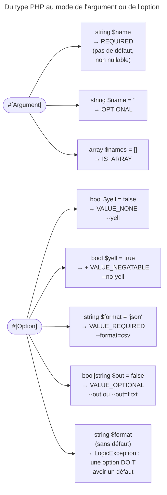

## Objectif

Déclarer l'entrée d'une command par attributes. Le mode — requis, optionnel,
array, drapeau — n'est plus écrit : il est **déduit de la signature**. Savoir
lire cette déduction est l'essentiel de l'item.

## L'essentiel

Un **argument** est positionnel (`app:greet Alice`), une **option** est
nommée (`--iterations=5`). En 8.0, `#[Argument]` et `#[Option]` se posent sur
les parameters de `__invoke()`, et le mode — requis, optionnel, array,
drapeau — se **déduit de la signature** : type et default value.

## Le schéma



## L'exemple : saluer

```php
#[AsCommand(name: 'app:greet')]
class GreetCommand
{
    public function __invoke(
        #[Argument] string $name,
        #[Argument] string $lastName = '',
        #[Option] int $iterations = 1,
        #[Option] bool $yell = false,
    ): int {
        // app:greet Alice Martin --iterations=3 --yell
        return Command::SUCCESS;
    }
}
```

## Déclarer

- Chaque attribute accepte `description`, `name` et `suggestedValues` ;
  `#[Option]` accepte en plus `shortcut`.
- Le `name` par défaut est le nom du parameter en **kebab-case** : `$lastName`
  devient `last-name`, la key de `$input->getArgument('last-name')`.
- Un argument sans default value et non nullable est **requis**.
- Types admis : `string`, `bool`, `int`, `float`, `array` et les enums typées
  (`BackedEnum`), dont les cas alimentent l'autocomplétion ; une valeur
  inconnue est refusée en listant les valeurs valides.

## Le mode d'une option

| Signature | Mode | Usage |
|---|---|---|
| `bool $yell = false` | `VALUE_NONE` | `--yell` |
| `bool $yell = true` ou `?bool $yell = null` | `VALUE_NONE` + `VALUE_NEGATABLE` | `--yell` ou `--no-yell` |
| `string $format = 'json'`, `int $limit = 10` | `VALUE_REQUIRED` | `--format=csv` |
| `array $roles = []` | `VALUE_REQUIRED` + `VALUE_IS_ARRAY` | `--roles=ADMIN --roles=USER` |
| `string\|bool $output = false` | `VALUE_OPTIONAL` | `--output` ou `--output=f.txt` |

- **Une option doit déclarer une default value** : sans elle, une
  `LogicException` dès l'ajout à l'application — « must declare a default
  value ». Une option n'est jamais requise.
- Types union : seuls `bool|string`, `bool|int` et `bool|float`, avec la default
  value `false` (sinon « must have a default value of false ») ; `--output` seul rend `true`, `--output=f.txt` la string.

## L'équivalent classique

```php
$this
    ->addArgument('name', InputArgument::REQUIRED, 'Who to greet')
    ->addOption('iterations', 'i', InputOption::VALUE_REQUIRED, 'How many times', 1)
;
```

`InputArgument` : `REQUIRED`, `OPTIONAL`, `IS_ARRAY`. `InputOption` :
`VALUE_NONE`, `VALUE_REQUIRED`, `VALUE_OPTIONAL`, `VALUE_IS_ARRAY`,
`VALUE_NEGATABLE`. Les attributes ne font que produire ces objects.

## Pièges d'examen

**Une option sans default value est une erreur**, pas une option requise.
Une option n'est jamais requise ; c'est un argument qui peut l'être.

**`bool $flag = true` n'est pas un drapeau simple** : il accepte une forme
négative, donc `--no-flag` existe.

**Le nom par défaut est kebab-case**, pas le nom du parameter tel quel.

**`shortcut` n'existe que pour les options** — un argument n'a pas de nom, donc
pas de raccourci.

**L'ordre des arguments est contraint.** `InputDefinition` lève une
`LogicException` pour un argument requis déclaré après un argument optionnel,
et pour **tout** argument déclaré après un argument array — celui-ci
absorbant toutes les valeurs positionnelles restantes. Exécuté :
`array $a = [], string $b = ''` est refusé, même `$b` optionnel, avec un
message trompeur : « Cannot add a required argument "b" after an array
argument "a". »

## Application

- Un drapeau actif par défaut, désactivable → `#[Option] bool $cache = true`,
  et `--no-cache`.
- Une option de format facultative → `#[Option] string $format = 'json'`.

## QCM d'entraînement

**Question 1.** Une command déclare `#[Option] string $format`, sans default
value. Que se passe-t-il ?

- **A.** Une option requise : `--format` devient obligatoire
- **B.** Une `LogicException` dès l'ajout de la command
- **C.** `$format` vaut une string vide quand l'option manque
- **D.** Une erreur seulement quand l'option n'est pas passée

<details>
<summary>Correction</summary>

**Bonne réponse : B.** Une option doit déclarer une default value ; l'erreur
est une erreur de definition, levée avant toute exécution.

</details>

**Question 2.** `#[Option] bool $loud = true`. La command est lancée avec
`--no-loud`. Que vaut `$loud` ?

- **A.** `false`
- **B.** `true` : `--no-loud` n'existe pas
- **C.** Une erreur : option inconnue
- **D.** `null`

<details>
<summary>Correction</summary>

**Bonne réponse : A.** Un bool de défaut `true` rend l'option négative
disponible : `VALUE_NONE` et `VALUE_NEGATABLE`, donc `--no-loud`.

</details>

**Question 3.** `#[Option] bool|string $output = false`. La command est lancée
avec `--output`, sans valeur. Que vaut `$output` ?

- **A.** `false`, la default value
- **B.** Une string vide
- **C.** `true`
- **D.** Une erreur : valeur manquante

<details>
<summary>Correction</summary>

**Bonne réponse : C.** Ce type union donne `VALUE_OPTIONAL` : l'option seule
vaut `true`, et `--output=f.txt` rend la string.

</details>

**Question 4.** Une command de copie veut des files, puis un dossier de
destination facultatif : `#[Argument] array $files = []`, suivi de
`#[Argument] string $dest = ''`. Que donne son ajout à l'application ?

- **A.** `$files` reçoit toutes les valeurs, `$dest` reste vide
- **B.** `$dest` reçoit la dernière valeur, `$files` les autres
- **C.** Les deux arguments sont acceptés, dans cet ordre
- **D.** Une `LogicException`

<details>
<summary>Correction</summary>

**Bonne réponse : D.** Rien ne peut suivre un argument array, qui absorbe
toutes les valeurs restantes : « Cannot add a required argument "dest" after
an array argument "files". », même pour `$dest` optionnel.

</details>

## Fiche express

**Si tu dois retenir seulement 6 choses :**

- Argument **positionnel**, option **nommée**.
- Mode **déduit** du type et de la default value.
- Argument sans défaut, non nullable : **requis**.
- Option : **default value obligatoire** ; jamais requise.
- `bool $x = true` → **`--no-x`** ; `bool|string $x = false` → valeur
  optionnelle.
- Nom par défaut en **kebab-case** ; `shortcut` pour les options seulement.

Moyen mnémotechnique : **« La signature décide »**.

## Sources officielles

- [Console Input](https://github.com/symfony/symfony-docs/blob/8.0/console/input.rst)
- [`Attribute\Option`, branche 8.0](https://github.com/symfony/symfony/blob/8.0/src/Symfony/Component/Console/Attribute/Option.php)
- [`Attribute\Argument`, branche 8.0](https://github.com/symfony/symfony/blob/8.0/src/Symfony/Component/Console/Attribute/Argument.php)

