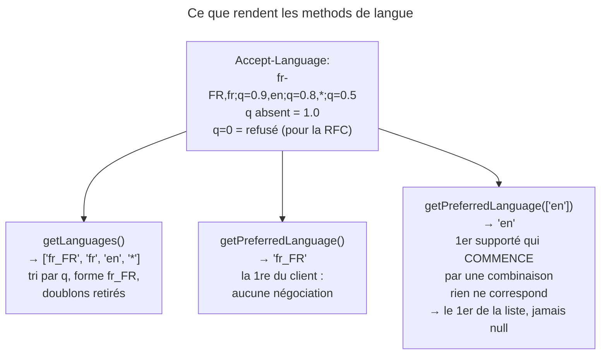
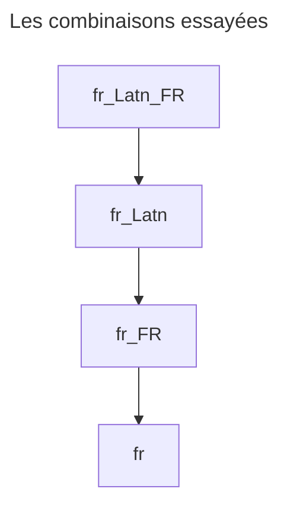

## Objectif

Lire la préférence linguistique du client depuis la Request HTTP.

> **Périmètre.** Cette page couvre le mécanisme HTTP. Le choix du locale par la
> route appartient à l'item *User's locale guessing* (Routing), et la translation
> à *Internationalization and localization*.

## L'essentiel

Le client annonce ses langues dans `Accept-Language`, pondérées par `q`.
Symfony en donne deux lectures : `getLanguages()`, la liste **normalisée** et
triée, et `getPreferredLanguage($supported)`, qui **négocie** contre les
locales de l'application. Le choix du locale par la route et la translation
sont traités ailleurs (*User's locale guessing*, *Internationalization*).

## Le schéma



## L'exemple : choisir parmi les locales supportés

```php
$request->getLanguages();
// ['fr_FR', 'fr', 'en', '*'] — triées par préférence décroissante

$request->getPreferredLanguage(['en', 'de']);
// 'en' — le meilleur choix PARMI ceux que l'application propose
```

## Le header

```http
Accept-Language: fr-FR,fr;q=0.9,en;q=0.8,*;q=0.5
```

Sans `q`, la default value est `1.0` ; les valeurs vont de `0` à `1`, et `q=0`
signifie **refusé**. C'est une préférence, pas une instruction : un serveur qui
fait varier sa Response selon ce header ajoute `Vary: Accept-Language`, sinon
le cache partagé sert à tous la langue du premier visiteur.

## Comment Symfony normalise un tag de langue

Chaque valeur est décomposée en **langue** (2 ou 3 lettres, ou `i-` suivi
d'au moins cinq lettres, préfixe retiré), **écriture** (4 lettres, capitale
initiale) et **région** (2 lettres, majuscules), puis recomposée avec `_` :
`fr-FR` → `fr_FR`, `zh-hans` → `zh_Hans`, `fr-latn-fr` → `fr_Latn_FR`.

Ce qui suit est supprimé : `de-DE-1996` donne `de_DE`, `es-419` donne `es`.
Une valeur hors de ce moule — `x-klingon`, `*` — ressort en minuscules,
inchangée. La liste est dédoublonnée, et mémorisée au premier appel.
Le séparateur trahit la source : `fr-FR` vient du réseau, `fr_FR` de Symfony.

## Comment `getPreferredLanguage()` choisit

Pour chaque langue demandée, la method construit **toutes ses combinaisons**,
de la plus précise à la plus générale, et retient le premier locale supporté
qui **commence par** l'une d'elles :



C'est un **préfixe**, pas une égalité, et **l'ordre de votre liste départage** :
un client qui demande `fr` obtient `fr_CA` avec `['fr_CA', 'fr_FR']`, `fr_FR`
avec l'ordre inverse.

## Pièges d'examen

**`getPreferredLanguage()` sans argument ne négocie rien.** Elle renvoie la
première langue demandée par le client, que l'application sache la servir ou
non. Passer la liste des locales supportées est ce qui rend l'appel utile.

**`q=0` n'est pas filtré par Symfony.** La RFC en fait un refus, mais
`getLanguages()` garde la langue refusée, en fin de liste, et
`getPreferredLanguage()` peut la choisir. Exécuté : avec
`Accept-Language: fr;q=0,en`, `getPreferredLanguage(['de', 'fr'])` rend
**`fr`**, la langue que le client refuse.

**`Accept-Language` est une préférence, pas une instruction.** Un serveur peut
légitimement répondre dans une autre langue ; il l'indique alors par
`Content-Language`, et doit ajouter `Vary: Accept-Language` s'il fait varier la
Response selon ce header.

## Application

- Une application en `en` et `fr` → `getPreferredLanguage(['en', 'fr'])`, avec
  `en` en premier comme langue par défaut.
- Une page dont la langue dépend du client → `Vary: Accept-Language`.

## QCM d'entraînement

**Question 1.** La Request porte `Accept-Language: es-419`. Que rend
`getLanguages()` ?

- **A.** `['es_419']`
- **B.** `['es']`
- **C.** `['es-419']`, inchangé
- **D.** `[]` : la région numérique est rejetée

<details>
<summary>Correction</summary>

**Bonne réponse : B.** La grammaire n'admet qu'une région de deux lettres ;
ce qui suit la langue sans y entrer est supprimé, et seule `es` reste.

</details>

**Question 2.** Le client demande `fr`. Que rend
`getPreferredLanguage(['fr_CA', 'fr_FR'])` ?

- **A.** `fr_CA`
- **B.** `fr_FR`, la région la plus proche
- **C.** `fr`, la valeur demandée
- **D.** `null` : aucune égalité exacte

<details>
<summary>Correction</summary>

**Bonne réponse : A.** La comparaison est un préfixe, et le premier locale de
la liste qui commence par `fr` l'emporte : l'ordre de la liste décide.

</details>

**Question 3.** `Accept-Language: ja, en;q=0.5`. L'application, qui ne parle
pas japonais, appelle `getPreferredLanguage()` sans argument. Résultat ?

- **A.** `en`, la seule langue servie
- **B.** `null`
- **C.** Une exception : la liste est requise
- **D.** `ja`

<details>
<summary>Correction</summary>

**Bonne réponse : D.** Sans liste, rien n'est négocié : la method rend la
première langue du client, que l'application sache la servir ou non.

</details>

**Question 4.** Le code appelle `getLanguages()`, modifie ensuite le header
`Accept-Language`, puis rappelle `getLanguages()`. Que rend le second appel ?

- **A.** La nouvelle liste, relue dans le header
- **B.** La liste du premier appel
- **C.** Une liste vide : le cache est invalidé
- **D.** Les deux listes, fusionnées et triées

<details>
<summary>Correction</summary>

**Bonne réponse : B.** La liste est calculée une fois puis mémorisée dans la
Request ; changer le header ensuite ne la recalcule pas.

</details>

## Fiche express

**Si tu dois retenir seulement 6 choses :**

- `q` absent = **1.0** ; `q=0` refuse — mais Symfony **ne l'écarte pas**.
- `getLanguages()` : triée, normalisée en **`fr_FR`**, dédoublonnée.
- Langue, écriture, région ; **le reste est supprimé** (`es-419` → `es`).
- `getPreferredLanguage()` **sans liste** ne négocie rien.
- Avec une liste : **préfixe** et **ordre de la liste** ; jamais `null`.
- Négocier la langue impose **`Vary: Accept-Language`**.

Moyen mnémotechnique : **« Tiret du réseau, souligné de Symfony »**.

## Sources officielles

- [`Request`](https://github.com/symfony/symfony/blob/8.0/src/Symfony/Component/HttpFoundation/Request.php) — `getLanguages()`, `getPreferredLanguage()`
  (branche 8.0, `6f841c0`)
