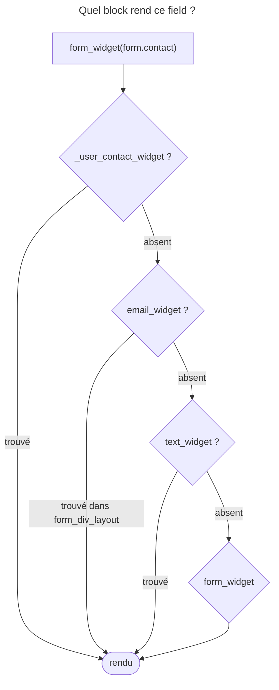

## Objectif

Changer le HTML produit par le rendu d'un form, au bon niveau de
spécificité, et au bon endroit : partout, pour un template, ou sur place.

## Avant la règle : le problème à résoudre

Le site veut trois changements dans ses forms :

- tous les fields texte dans un `<div class="input">` ;
- le seul field `contact` du form `user`, accompagné d'une phrase
  d'aide en dessous ;
- sur une seule page, un rendu à part, sans toucher au reste du site.

Réécrire chaque form à la main dans ses templates serait sans fin. Le
rendu des forms est fait de **blocks Twig** : il suffit de redéfinir le bon
block, au bon niveau. Encore faut-il savoir **lequel** est utilisé pour un
field donné, et **dans quel ordre** les templates de blocks sont consultés.

## Le fil rouge : le form `user`

Un form `user` avec trois fields : `name` (`TextType`), `contact` (`EmailType`)
et `vip` (`TextType` avec l'option `block_prefix: 'vip'`). Exécuté avec
`symfony/form` et `symfony/twig-bridge` 8.0.15, Twig 3.22 :

```text
name     ["form", "text", "_user_name"]
contact  ["form", "text", "email", "_user_contact"]
vip      ["form", "text", "vip", "_user_vip"]
```

## Le cycle complet en un schéma



## Ce qu'est un theme

Un theme est un template Twig qui définit les **blocks** utilisés pour rendre les
fields. Symfony en fournit plusieurs, dont `form_div_layout.html.twig`, le theme
par défaut ; Twig Bridge 8.0.15 en livre douze templates, Bootstrap, Foundation
et Tailwind compris.

## Les parties d'un field

| Suffixe | Partie |
|---|---|
| `_row` | le container complet |
| `_label` | le libellé |
| `_widget` | le field de saisie |
| `_help` | le texte d'aide |
| `_errors` | les erreurs |

Le nom d'un block est un préfixe suivi d'une partie : `email_widget`,
`text_row`, `_user_contact_label`.

## La chaîne de recherche

Chaque field porte la liste `block_prefixes` de sa lignée de types, plus un
préfixe unique. Pour un field `contact` de type `EmailType` dans un form
nommé `user`, exécuté avec `symfony/form` 8.0.15 :

```text
["form", "text", "email", "_user_contact"]
```

Le rendu cherche du **plus spécifique au plus général**, dans tous les themes
à chaque niveau avant de descendre :

```text
_user_contact_widget   →  absent ? on descend
email_widget           →  trouvé dans form_div_layout.html.twig
text_widget            →  (jamais atteint ici)
form_widget
```

Le theme par défaut **définit `email_widget`**, et **aucun** theme livré ne
définit `text_widget`. Conséquence vérifiée par rendu réel : un `text_widget`
personnalisé change les fields `TextType`, mais **pas** les fields `EmailType`,
dont le block plus spécifique est trouvé d'abord. Chaque field remonte ainsi sa
propre lignée jusqu'à `form_`.

## Cibler un field, ou plusieurs fields

Le block le plus spécifique commence par un **souligné** et porte le nom du
form puis celui du field : `_user_contact_widget` ne change que `contact` dans
`user` (exécuté).

Pour **plusieurs** fields choisis, sans créer de type, l'option `block_prefix` insère
un préfixe dans la lignée, juste avant le préfixe unique : exécuté, `vip`
reçoit `["form", "text", "vip", "_user_vip"]`, et un block `vip_widget` ne
s'applique qu'aux fields qui portent ce préfixe.

## Où appliquer un theme

**Globalement**, par `twig.form_themes`. La liste est parcourue **de la fin vers
le début** : le dernier theme listé est consulté en premier. Exécuté avec deux
themes définissant le même block : c'est toujours le dernier qui gagne.

**Pour un template**, par le tag ``
ou ``. Ces themes
s'**ajoutent** aux themes globaux. Avec le mot `only`, ils les **remplacent** —
theme par défaut compris. Exécuté : un theme qui ne définit que `text_widget`,
appliqué avec `only`, fait échouer `form_row()` — « Unable to render the form as
none of the following blocks exist: "_user_name_row", "text_row", "form_row" ».
La documentation le dit : avec `only`, le theme doit tout définir, par exemple
en commençant par `` (exécuté : le rendu
revient).

**Dans le template courant**, avec `_self` — à une condition que la documentation
signale : le template doit **étendre** un autre template. Sinon, « any theme
blocks you define in it will be rendered as regular output » : chaque block est
**aussi** affiché là où il est écrit, avec les variables de la page. Exécuté
sans `extends`, sur un template neuf à chaque fois :

| Template | Résultat |
|---|---|
| block simple, puis `form_widget(form.name)` | le block est affiché **et** le field l'utilise |
| l'exemple `_registration_email_row` de la documentation | le block, rendu sur place avec `form` = le form entier, rend `email` ; le `form_row(form.email)` qui suit lève « Field "email" has already been rendered » |
| un block qui appelle `block('form_widget_simple')` | `RuntimeError` : le block n'existe pas dans ce template |

Le même template **avec** `extends` rend le field personnalisé, une seule fois.

## Trois exemples documentés qui échouent

La page `form_themes.rst` (8.0) s'appuie sur un block `text_widget` que le code
ne fournit pas. Rendu réel avec twig-bridge 8.0.15 :

| Exemple documenté | Résultat |
|---|---|
| `email_widget` qui enveloppe `{{ form_widget(form) }}` | le field devient `<input type="text">` : le type `email` est perdu |
| `` puis `text_widget` avec `parent()` | `RuntimeError` : aucun trait ne définit `text_widget` |
| `use … with text_widget as base_text_widget` | `RuntimeError` : block non défini dans le trait |

Le premier s'explique par la chaîne de blocks : l'appel imbriqué descend à `text_widget`,
absent, puis à `form_widget`, dont `form_widget_simple` prend `text` par défaut.
Pour envelopper un field e-mail sans perdre son type, on importe le theme par
défaut avec `` et on appelle `parent()`
dans `email_widget`, qui, lui, existe : exécuté, l'output garde
`type="email"`.

## Concrètement dans ton application

- Le style de tout le site : un theme dans `twig.form_themes`, après le theme
  Bootstrap ou Tailwind s'il y en a un — le dernier gagne.
- Une page à part : `` dans son
  template.
- Un seul field : `_nomduform_nomduchamp_widget` (ou `_row`, `_label`…).
- Plusieurs fields choisis : l'option `block_prefix` et un block à ce nom.
- Un block sur place : `_self`, dans un template qui fait `extends`.

## À comprendre

- **Pourquoi chercher du plus spécifique au plus général ?** Pour qu'on puisse
  ne changer qu'un field sans toucher à son type, ou qu'un type sans toucher à
  `form`.
- **Pourquoi le dernier theme listé gagne-t-il ?** Parce que la liste se lit
  comme une pile de surcharges : on ajoute à la fin ce qui doit l'emporter.
- **Pourquoi `_self` exige-t-il `extends` ?** Parce qu'un template sans parent
  affiche ses blocks là où ils sont écrits ; avec un parent, ses blocks ne
  sortent que là où le parent les appelle.

## À mémoriser

- Theme = template de blocks ; défaut `form_div_layout.html.twig`.
- Recherche : préfixe unique, type, types parents, `form_` — dans tous les
  themes à chaque niveau.
- `text_widget` n'existe dans aucun theme livré ; `email_widget`, si.
- Cinq parties : `_row`, `_label`, `_widget`, `_help`, `_errors`.
- Un field : `_form_field_partie` ; un group : l'option `block_prefix`.
- `twig.form_themes` : le dernier gagne ; `form_theme … only` remplace tout,
  défaut compris ; `_self` avec `extends`.
- Moyen mnémotechnique : **« Du plus précis au plus vague, du dernier au
  premier »**.

## Pièges d'examen

**La liste des themes est parcourue de la fin vers le début.**

**`text_widget` n'existe dans aucun theme livré** ; `email_widget`, si.

**Un field remonte sa propre lignée** : un block de type parent ne s'applique
pas quand un block plus spécifique existe.

**`_self` exige un template qui en étend un autre.**

**Redéfinir `_row` quand on voulait `_widget` efface libellé, aide et erreurs.**

**`form_theme … only` écarte aussi le theme par défaut** : un theme incomplet
fait échouer le rendu.

## Application : trois scénarios

**Scénario 1 — Les e-mails oubliés.** Un `text_widget` personnalisé enveloppe les
fields texte, mais les fields e-mail restent nus. *Solution.* Le theme par
défaut définit `email_widget`, trouvé avant `text_widget` : redéfinir aussi
`email_widget`, avec `` et `parent()`.

**Scénario 2 — Le theme global sans effet.** `twig.form_themes` liste
`app.html.twig` puis `bootstrap_5_layout.html.twig`, et le `form_row`
personnalisé de `app.html.twig` ne s'applique pas : Bootstrap 5 définit aussi
`form_row`. *Solution.* Le dernier listé gagne : mettre `app.html.twig` en
dernier.

**Scénario 3 — Le partial qui casse.** Un template inclus par `include()`, sans
`extends`, fait `` et définit `_user_contact_row` ;
la page affiche le field en double ou lève une exception. *Solution.* Déplacer
les blocks dans un template de theme séparé, appliqué par
``.

## QCM d'entraînement

Six questions sur les themes. Choisis avant d'ouvrir la correction.

**Question 1.** Le field `vip` d'un form `user` est un `TextType` déclaré avec `'block_prefix' => 'vip'`. Quel block de theme le vise sans viser les autres fields texte ?

- **A.** `text_vip_widget`
- **B.** `vip_text_widget`
- **C.** `vip_widget`
- **D.** `widget_vip`

<details>
<summary>Correction</summary>

**Bonne réponse : C.** Exécuté : la lignée devient `["form", "text", "vip",
"_user_vip"]`, et un block `vip_widget` s'applique.

A, B et D inventent un ordre ou une combinaison : un nom de block est un préfixe
de la lignée suivi d'une partie.

</details>

**Question 2.** Un template applique ``, et `fields.html.twig` ne définit que `text_widget`. Que donne `form_row(form.name)` ?

- **A.** La ligne complète, avec le `text_widget` personnalisé
- **B.** Une erreur : aucun block `_row` n'est trouvé
- **C.** La ligne du theme par défaut, sans le `text_widget` personnalisé
- **D.** Le seul widget personnalisé, sans libellé

<details>
<summary>Correction</summary>

**Bonne réponse : B.** `only` écarte les themes globaux, défaut compris ; exécuté,
« Unable to render the form as none of the following blocks exist ».

A et C supposent que le theme par défaut reste disponible. D invente un rendu
partiel.

</details>

**Question 3.** `twig.form_themes` liste `app.html.twig` puis `admin.html.twig`, et les deux définissent `text_row`. Lequel rend les fields texte ?

- **A.** `app.html.twig` : le premier listé est prioritaire
- **B.** Celui qui définit aussi `text_widget`
- **C.** Une erreur : deux themes ne peuvent définir le même block
- **D.** `admin.html.twig` : le dernier listé gagne

<details>
<summary>Correction</summary>

**Bonne réponse : D.** La liste est consultée de la fin vers le début (exécuté
avec deux themes au même block).

A est le piège : l'ordre de lecture intuitif. B et C inventent des règles.

</details>

**Question 4.** Pour envelopper chaque saisie dans un `<div class="input">`, l'équipe redéfinit `text_widget`. Sur la page d'inscription, le field `email` reste nu. Pourquoi ?

- **A.** `EmailType` n'hérite pas de `TextType`
- **B.** Le block doit s'appeler `_text_widget`
- **C.** `text_widget` ne vise que les fields sans type
- **D.** `email_widget` existe et passe avant

<details>
<summary>Correction</summary>

**Bonne réponse : D.** Le theme par défaut définit `email_widget`, plus
spécifique, trouvé avant `text_widget` (exécuté).

A est le piège : `EmailType` hérite bien de `TextType`, mais la recherche
s'arrête au premier block trouvé. B et C inventent des règles.

</details>

**Question 5.** Un template **sans** `extends` fait ``, définit un block `text_widget` qui affiche `<CUSTOM>`, puis rend `form_widget(form.name)`. Que contient la page ?

- **A.** `<CUSTOM>` deux fois
- **B.** `<CUSTOM>` une fois, rendu par le field seulement
- **C.** Le block, puis le field au rendu par défaut
- **D.** Une exception : `_self` exige `extends`

<details>
<summary>Correction</summary>

**Bonne réponse : A.** Exécuté sur un template neuf : sans parent, le block est
affiché là où il est écrit, puis le field l'utilise aussi.

B est le résultat **avec** `extends`. C n'arrive que si le field est rendu
**avant** le tag `form_theme`. D : rien n'interdit l'écriture ; c'est le rendu
qui dérape.

</details>

**Question 6.** Un theme redéfinit `_user_contact_row` en n'y mettant que `{{ form_widget(form) }}`. Que perd le field `contact` ?

- **A.** Rien : `_row` ne concerne que le container
- **B.** Son libellé, son aide et ses erreurs
- **C.** Son type `email` : il devient `text`
- **D.** Sa valeur soumise

<details>
<summary>Correction</summary>

**Bonne réponse : B.** Le block `_row` assemble toutes les parties ; le redéfinir
remplace l'ensemble.

A est le piège. C confond avec un `email_widget` qui enveloppe
`form_widget(form)`. D : le rendu ne touche pas la donnée.

</details>

## Fiche express

**Si tu dois retenir seulement 7 choses :**

- Un theme = un template de **blocks** ; défaut `form_div_layout.html.twig`.
- Recherche : **préfixe unique → type → parents → `form_`**, tous les themes à
  chaque niveau.
- **`text_widget` n'existe pas** dans les themes livrés ; `email_widget`, si.
- Cinq parties : **`_row`, `_label`, `_widget`, `_help`, `_errors`**.
- Un field : **`_form_field_partie`** ; un group : **`block_prefix`**.
- `twig.form_themes` : **le dernier gagne** ; `form_theme … only` remplace
  tout.
- **`_self` + `extends`**, sinon les blocks s'affichent sur place.

**En une phrase, pour tout reconstruire :**

```text
block = PRÉFIXE + _PARTIE ; recherche : _form_field → type → parents → form
  ; themes : du dernier listé au premier ; only = sans le défaut ; _self = avec extends
```

## Sources officielles

- [How to Work with Form Themes](https://github.com/symfony/symfony-docs/blob/8.0/form/form_themes.rst)
- [Twig Bridge 8.0, `form_div_layout.html.twig`](https://github.com/symfony/symfony/blob/8.0/src/Symfony/Bridge/Twig/Resources/views/Form/form_div_layout.html.twig)
- [Form 8.0, `FormRenderer`](https://github.com/symfony/symfony/blob/8.0/src/Symfony/Component/Form/FormRenderer.php)
