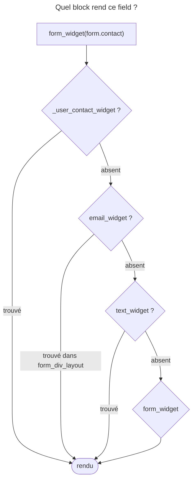

## Objectif

Changer le HTML produit par le rendu d'un form, au bon niveau de
spécificité, et au bon endroit : partout, pour un template, ou sur place.

## L'essentiel

Le rendu d'un form est fait de **blocks Twig** ; un theme en redéfinit
quelques-uns. Pour chaque field, le rendu cherche le block **du plus précis au
plus vague** le long de sa lignée de types, et parcourt les themes **du
dernier au premier**. Tout se joue sur le bon nom de block, au bon endroit.

## Le schéma



## L'exemple : le form `user`

`name` (`TextType`), `contact` (`EmailType`) et `vip` (`TextType` avec
`block_prefix: 'vip'`) :

```text
name     ["form", "text", "_user_name"]
contact  ["form", "text", "email", "_user_contact"]
vip      ["form", "text", "vip", "_user_vip"]
```

## Les parties d'un field

Un nom de block = un préfixe + une partie : `_row` (le container complet),
`_label`, `_widget`, `_help`, `_errors`. Exemples : `email_widget`,
`text_row`, `_user_contact_label`. Le theme par défaut est
`form_div_layout.html.twig` ; Bootstrap, Foundation et Tailwind sont livrés
aussi.

## La chaîne de recherche

```text
_user_contact_widget   →  absent ? on descend
email_widget           →  trouvé dans form_div_layout.html.twig
text_widget            →  jamais atteint ici
form_widget
```

À chaque niveau, tous les themes sont consultés avant de descendre. Le theme
par défaut **définit `email_widget`**, et **aucun** theme livré ne définit
`text_widget` : un `text_widget` personnalisé change les `TextType`, pas les
`EmailType`.

## Cibler un field, ou plusieurs fields

- Un seul field : `_` + nom du form + nom du field — `_user_contact_widget`.
- Plusieurs fields choisis, sans créer de type : l'option `block_prefix`
  insère un préfixe dans `block_prefixes`, et un block `vip_widget` ne vise que
  les fields qui le portent.

## Où appliquer un theme

| Portée | Écriture | À savoir |
|---|---|---|
| globale | `twig.form_themes` | le **dernier** listé gagne |
| un template | `` | s'ajoute aux themes globaux |
| un template, seul | `` | remplace tout, theme par défaut compris |
| sur place | `` | à une condition : le template étend un autre template |

- Avec `only`, un theme incomplet fait échouer le rendu : « Unable to render
  the form as none of the following blocks exist… ». Commencer par
  ``.
- `_self` sans `extends` : chaque block est **aussi** affiché là où il est
  écrit, et un appel à `block('form_widget_simple')` lève une `RuntimeError`.

## Trois exemples documentés qui échouent

`form_themes.rst` (8.0) s'appuie sur un `text_widget` que le code ne fournit
pas :

| Exemple documenté | Résultat |
|---|---|
| `email_widget` qui enveloppe `{{ form_widget(form) }}` | `<input type="text">` : le type `email` est perdu |
| `` puis `text_widget` avec `parent()` | `RuntimeError` |
| `use … with text_widget as base_text_widget` | `RuntimeError` |

Pour envelopper un e-mail sans perdre son type : `use` du theme par défaut, et
`parent()` dans `email_widget`, qui existe.

## Pièges d'examen

**La liste des themes est parcourue de la fin vers le début.**

**`text_widget` n'existe dans aucun theme livré** ; `email_widget`, si.

**Un field remonte sa propre lignée** : un block de type parent ne s'applique
pas quand un block plus spécifique existe.

**`_self` exige un template qui en étend un autre.**

**Redéfinir `_row` quand on voulait `_widget` efface libellé, aide et erreurs.**

**`form_theme … only` écarte aussi le theme par défaut** : un theme incomplet
fait échouer le rendu.

## Application

- Une `<div class="input">` autour de chaque saisie → redéfinir `text_widget`
  **et** `email_widget`, avec `parent()`.
- Un form d'une seule page avec son propre rendu → `` dans ce template.

## QCM d'entraînement

**Question 1.** Le field `vip` d'un form `user` est un `TextType` déclaré avec
`'block_prefix' => 'vip'`. Quel block le vise sans viser les autres fields
texte ?

- **A.** `text_widget`
- **B.** `vip_widget`
- **C.** `_vip_widget`
- **D.** `user_vip_widget`

<details>
<summary>Correction</summary>

**Bonne réponse : B.** L'option ajoute `vip` à `block_prefixes`, juste avant
le préfixe unique `_user_vip` ; `vip_widget` ne vise que ces fields.

</details>

**Question 2.** Un template applique
``, et `fields.html.twig`
ne définit que `text_widget`. Que donne `form_row(form.name)` ?

- **A.** La ligne, rendue par le theme par défaut
- **B.** Le widget seul, sans libellé
- **C.** Une erreur de rendu
- **D.** Une ligne vide, sans erreur

<details>
<summary>Correction</summary>

**Bonne réponse : C.** `only` écarte aussi le theme par défaut : ni
`text_row` ni `form_row` ne sont trouvés, et le rendu échoue.

</details>

**Question 3.** Un theme redéfinit `_user_contact_row` en n'y mettant que
`{{ form_widget(form) }}`. Que perd le field `contact` ?

- **A.** Rien : `_row` ne concerne que le container
- **B.** Son type `email` : il devient `text`
- **C.** Sa valeur soumise
- **D.** Son libellé, son aide et ses erreurs

<details>
<summary>Correction</summary>

**Bonne réponse : D.** Le block `_row` assemble toutes les parties du field ;
le redéfinir remplace l'ensemble, pas seulement le container.

</details>

**Question 4.** Suivant la documentation, un theme définit `email_widget` qui
enveloppe `{{ form_widget(form) }}` dans une `<div>`. Que devient le field
`contact` ?

- **A.** Un `<input type="text">`
- **B.** Un `<input type="email">` dans la `<div>`
- **C.** Une boucle infinie de rendu
- **D.** Une `RuntimeError` : block inconnu

<details>
<summary>Correction</summary>

**Bonne réponse : A.** L'appel imbriqué descend à `form_widget`, dont
`form_widget_simple` prend `text` par défaut ; `parent()` garde `email`.

</details>

## Fiche express

**Si tu dois retenir seulement 7 choses :**

- Block = **préfixe + partie** (`_row`, `_label`, `_widget`, `_help`,
  `_errors`).
- Recherche **du plus précis au plus vague** : `_form_field`, type, parent,
  `form`.
- **`email_widget`** existe ; **`text_widget`** n'existe dans aucun theme
  livré.
- Un field : `_user_contact_widget` ; plusieurs : option **`block_prefix`**.
- `twig.form_themes` : **le dernier gagne**.
- **`only`** écarte aussi le theme par défaut.
- **`_self`** exige un `extends`.

Moyen mnémotechnique : **« Du plus précis au plus vague, du dernier au
premier »**.

## Sources officielles

- [How to Work with Form Themes](https://github.com/symfony/symfony-docs/blob/8.0/form/form_themes.rst)
- [Twig Bridge 8.0, `form_div_layout.html.twig`](https://github.com/symfony/symfony/blob/8.0/src/Symfony/Bridge/Twig/Resources/views/Form/form_div_layout.html.twig)
- [Form 8.0, `FormRenderer`](https://github.com/symfony/symfony/blob/8.0/src/Symfony/Component/Form/FormRenderer.php)

