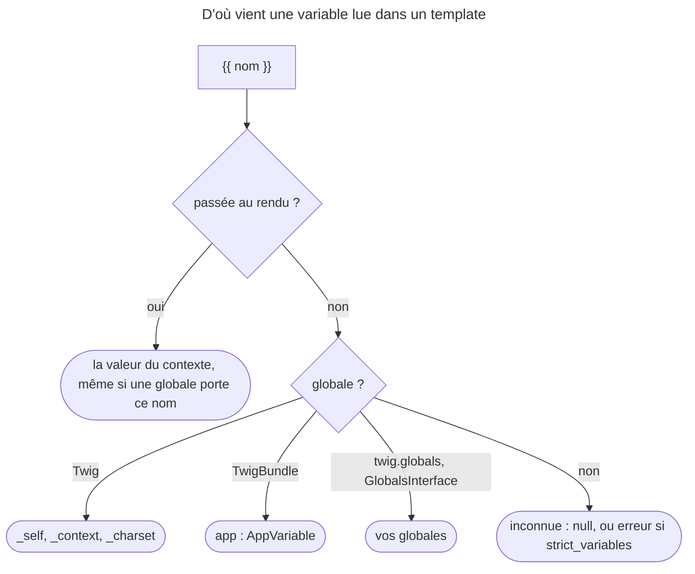

## Objectif

Connaître les variables disponibles dans **tous** les templates sans qu'un
controller les passe, et savoir en déclarer.

## L'essentiel

Un template lit des variables qui viennent de deux endroits : le **contexte**
passé au rendu par le controller, et les **globales**, disponibles partout.
Twig en fournit trois, Symfony en ajoute une — `app` — et l'application peut
déclarer les siennes. Le contexte gagne toujours.

## Le schéma



## L'exemple

```twig
<title>{{ site_name }} — {{ title }}</title>
Bonjour {{ app.user.userIdentifier }}

    <div class="flash">{{ message }}</div>

<nav class="{{ app.current_route == 'home' ? 'active' }}">…</nav>
```

`site_name` vient de `twig.globals`, `title` du controller, le reste de `app`.

## Les trois globales de Twig lui-même

| Variable | Contenu |
|---|---|
| `_self` | le nom du template courant |
| `_context` | toutes les variables visibles, passées **et** globales |
| `_charset` | le jeu de caractères courant |

## La variable `app`

TwigBundle expose `app`, un object `AppVariable`, dans chaque template :

| Property | Contenu |
|---|---|
| `app.user` | le user courant, ou `null` s'il n'est pas authentifié |
| `app.request` | la `Request` courante |
| `app.session` | la session, ou `null` |
| `app.flashes` | les flash messages ; `app.flashes('notice')` filtre par type |
| `app.environment`, `app.debug` | l'environment et le mode debug |
| `app.token` | le token de sécurité |
| `app.current_route`, `app.current_route_parameters` | la route courante et ses parameters |
| `app.locale`, `app.enabled_locales` | la locale courante et les locales activées |

- Sans Request — une command qui rend un email —, `app.request` et
  `app.session` valent `null`, et `app.flashes` rend `[]`.
- Une property dont le service manque **lève une exception** : `app.user` sans
  le component Security. Dans le template, elle arrive comme une
  `Twig\Error\RuntimeError` — qui n'est pas une `\RuntimeException`. Seul
  `app.flashes` retombe sur un array vide.
- Lire `app.flashes` démarre la session.

## Déclarer ses propres globales

```yaml
# config/packages/twig.yaml
twig:
    globals:
        ga_tracking: 'UA-xxxxx-x'
        mailer: '@app.mailer'
```

Une valeur qui commence par `@` désigne un service. Une extension Twig déclare
des globales par `GlobalsInterface::getGlobals()`.

- Une variable passée au rendu **masque** la globale du même nom.
- Les globales sont visibles **dans les macros**, qui ne voient pourtant pas les
  variables du template appelant.

## Le piège

`app.flashes` **consomme** les messages : les afficher deux fois dans une page
n'en montre qu'une. La lecture sans consommer est
`app.session.flashbag.peekAll()`.

## Pièges d'examen

**La session vue depuis un template peut être `null`** — et lire son contenu la
démarre, avec l'effet que cela a sur la cachabilité de la page.

**Le user courant vaut `null` quand personne n'est authentifié.** Lire
`app.user.email` lève alors une `RuntimeError` — « Impossible to access an
attribute ("email") on a null variable » — en mode strict, actif en `dev` par
défaut, et rend `null` sinon. Et `app.user` lève une exception si le component
Security n'est pas installé.

**`_self`, `_context`, `_charset` existent sans Symfony.** Ce sont les globales
de Twig ; `app` est celle de Symfony.

**La forme courte de la route courante existe.** Traverser les attributes de la
Request pour l'obtenir fonctionne, mais c'est le path long de la même chose.

## Application

- Le titre de la page affiche celui du controller, pas la globale `title` →
  c'est voulu : le contexte masque une globale du même nom.
- Les flash messages n'apparaissent pas dans le layout → un include plus haut
  dans la page les a déjà lus avec `app.flashes`.

## QCM d'entraînement

**Question 1.** `twig.globals` déclare `title: 'Site'`. Un controller rend un
template avec `['title' => 'Page']`. Que sort `{{ title }}` ?

- **A.** `Site` : la configuration prime
- **B.** `Page`
- **C.** Une erreur : nom en conflit
- **D.** `SitePage`

<details>
<summary>Correction</summary>

**Bonne réponse : B.** Une variable passée au rendu par le controller masque
la globale du même nom ; la configuration ne prime pas sur le contexte.

</details>

**Question 2.** Une command console rend un email Twig. Que vaut
`app.request` ?

- **A.** `null`
- **B.** Une Request vide créée pour l'occasion
- **C.** Une `RuntimeError` : pas de Request
- **D.** La dernière Request traitée par le serveur

<details>
<summary>Correction</summary>

**Bonne réponse : A.** Sans Request sur la pile, `app.request` et
`app.session` valent `null`, et `app.flashes` rend un array vide, sans erreur.

</details>

**Question 3.** Sans SecurityBundle, un controller entoure le rendu de
`{{ app.user }}` d'un `catch (\RuntimeException $e)`. Le catch s'exécute-t-il ?

- **A.** Oui : `AppVariable` lève une `RuntimeException`
- **B.** Oui, mais seulement en `prod`
- **C.** Non : `app.user` vaut `null`
- **D.** Non : Twig remonte une `RuntimeError`

<details>
<summary>Correction</summary>

**Bonne réponse : D.** Le template reçoit une `Twig\Error\RuntimeError`, qui
n'étend pas `\RuntimeException` ; l'exception levée par `AppVariable` est dans
`getPrevious()`.

</details>

**Question 4.** Une macro est appelée depuis un template qui a une variable
`local` ; une globale `site` existe. Que voit la macro ?

- **A.** `local` et `site`
- **B.** `site` seulement
- **C.** `local` seulement
- **D.** Ni l'un ni l'autre

<details>
<summary>Correction</summary>

**Bonne réponse : B.** Les globales sont visibles dans les macros, pas les
variables du template appelant.

</details>

## Fiche express

**Si tu dois retenir seulement 7 choses :**

- Twig fournit **`_self`**, **`_context`**, **`_charset`**.
- Symfony fournit **`app`**, dont **`user`**, **`request`**, **`session`**,
  **`flashes`**, **`current_route`**.
- **`app.flashes`** consomme les messages ; **`peekAll()`** non.
- Sans Request : **`app.request`** et **`app.session`** à `null`.
- Service absent : **exception**, en `RuntimeError` dans le template.
- **`twig.globals`** déclare ; **`@`** pour un service ; visibles dans les macros.
- Le **contexte** masque une **globale** : il masque la globale de même nom.

Moyen mnémotechnique : **« Twig en souligné, Symfony dans app, le reste en
globals »**.

```text
contexte > globales (Twig : _self _context _charset ; TwigBundle : app ; twig.globals / GlobalsInterface) ;
app : user request session flashes(consomme) environment debug token current_route locale
```

## Sources officielles

- [Symfony Templates, « The App Global Variable »](https://github.com/symfony/symfony-docs/blob/8.0/templates.rst)
- [Twig Bridge, `AppVariable`](https://github.com/symfony/symfony/blob/8.0/src/Symfony/Bridge/Twig/AppVariable.php)
- [Twig 3.22, *Global Variables*](https://github.com/twigphp/Twig/blob/v3.22.0/doc/templates.rst) et [*Globals*](https://github.com/twigphp/Twig/blob/v3.22.0/doc/advanced.rst)
