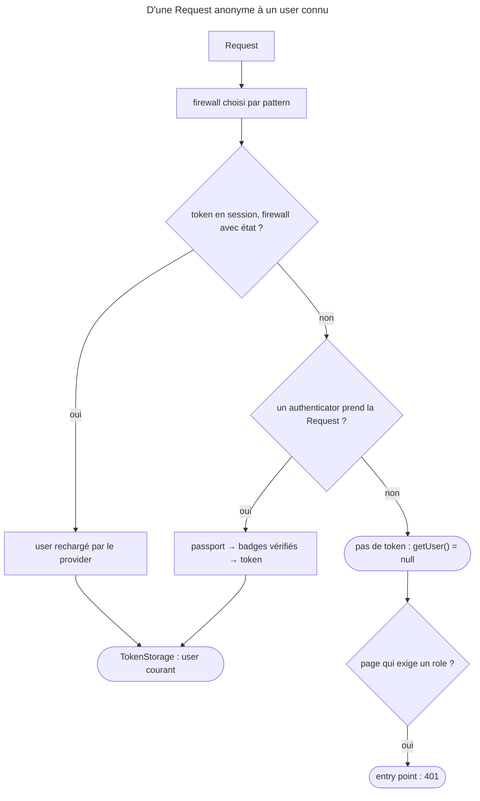

## Objectif

Suivre ce qui se passe entre une Request anonyme et un user connu, et ce qui
change selon qu'un firewall garde ou non le token d'une Request à l'autre. Le
détail des authenticators, passports et badges a son propre item.

## L'essentiel

L'authentication répond à « **qui** êtes-vous ? ». Un firewall transforme des
credentials en **token**, rangé dans le `TokenStorage` pour la Request
courante. Sans user, il n'y a **pas de token**. Avec état, le token survit en
session ; sans état, chaque Request se réauthentifie.

## Le schéma



## L'exemple

```yaml
security:
    providers:
        mem:
            memory:
                users:
                    alice: { password: 'x', roles: ['ROLE_USER'] }
    firewalls:
        main:
            provider: mem
            http_basic: ~
    access_control:
        - { path: ^/whoami, roles: ROLE_USER }
```

## La question posée

L'authentication répond à **« qui êtes-vous ? »**, l'authorization à « avez-vous
le droit ? ». Les deux sont indépendantes : un user authentifié peut n'avoir
aucun droit.

## Le trajet

1. La Request entre dans **un** firewall, choisi par son `pattern`.
2. Un **authenticator** de ce firewall la prend en charge.
3. Il construit un **passport**, dont les badges sont vérifiés.
4. Un **token** (`TokenInterface`) est produit, avec le user et ses roles.
5. Le token est déposé dans le **`TokenStorage`**.

`$this->getUser()` et `Security::getUser()` ne sont que des raccourcis vers le
`TokenStorage`.

## Pas de token sans user

Depuis la disparition du token anonyme, une Request non authentifiée n'a
**aucun token** :

| Request | `getToken()` | `getUser()` | Response |
|---|---|---|---|
| `/public`, sans credentials | `null` | `null` | 200 |
| `/whoami` (exige `ROLE_USER`), sans credentials | — | — | **401**, entry point |
| `/whoami`, credentials valides | `UsernamePasswordToken` | `alice` | 200 |

Le firewall l'explique : « the user is not fully authenticated; redirecting to
authentication entry point ».

## Avec ou sans état

- Par défaut, `stateless: false` : le token est **sérialisé en session**. À la
  Request suivante, le log dit « Read existing security token from the
  session », puis « User was reloaded from a user provider » : le user est
  **rechargé** par le provider, pas recopié tel quel.
- `stateless: true` (une API à tokens) : le token n'est jamais écrit en
  session ; une Request suivante sans credentials reçoit **401**.
- Après une connexion, l'ID de session est régénéré contre la fixation de
  session : `session_fixation_strategy` vaut `migrate` par défaut.

## Ce que le controller voit

```php
$this->getUser();                 // le user, ou null
$this->isGranted('ROLE_ADMIN');   // authorization, pas authentication
```

`getUser()` à `null` signifie « pas authentifié », pas « accès refusé ». Une
Request anonyme sur une page protégée reçoit **401** ; un user connu sans le
droit reçoit **403**.

## Pièges d'examen

**Authentication ≠ authorization.** `getUser()` répond à la première,
`isGranted()` à la seconde.

**Pas de user, pas de token** : `getToken()` rend `null` pour une Request
anonyme ; le token anonyme n'existe plus.

**`stateless: true` n'écrit pas le token en session** : le user n'est plus
mémorisé d'une Request à l'autre.

**Le token en session ne fige pas le user** : il est rechargé par le
provider à chaque Request.

## Application

- Un code teste `getToken() instanceof AnonymousToken` sur une page publique →
  en 8.0, il n'y a pas de token : tester `getUser() === null`.
- Une API perd l'authentication à chaque appel → c'est voulu avec
  `stateless: true` : le client renvoie ses credentials à chaque Request.

## QCM d'entraînement

**Question 1.** Sur une page publique, sans credentials, que rend
`$tokenStorage->getToken()` en Symfony 8.0 ?

- **A.** Un `AnonymousToken`
- **B.** Un `NullToken`
- **C.** Un `UsernamePasswordToken` sans user
- **D.** `null`

<details>
<summary>Correction</summary>

**Bonne réponse : D.** Le token anonyme a disparu : sans user authentifié, le
`TokenStorage` ne contient aucun token, et `getUser()` vaut aussi `null`.

</details>

**Question 2.** `alice`, authentifiée avec `ROLE_USER`, demande une page qui
exige `ROLE_ADMIN`. Quelle Response ?

- **A.** 401 : elle doit se réauthentifier
- **B.** 403
- **C.** 302 vers le form de connexion
- **D.** 200 : l'authentication suffit

<details>
<summary>Correction</summary>

**Bonne réponse : B.** Elle est connue, mais n'a pas le droit : l'accès refusé à
un user authentifié donne 403 ; un anonyme recevrait 401.

</details>

**Question 3.** Un firewall a `stateless: true`. Après un premier appel
authentifié, le client rappelle **sans** credentials. Que se passe-t-il ?

- **A.** Il est reconnu par le cookie de session
- **B.** Il est reconnu jusqu'à expiration du token
- **C.** 401 : aucun token n'a été gardé
- **D.** 200, avec un user anonyme

<details>
<summary>Correction</summary>

**Bonne réponse : C.** Un firewall sans état n'écrit pas le token en session et
ne pose pas de cookie : la Request suivante doit se réauthentifier.

</details>

**Question 4.** Sur un firewall avec état, un user connecté envoie une Request
avec son seul cookie de session. D'où vient le user de cette Request ?

- **A.** Une copie figée, désérialisée de la session
- **B.** Rechargé par le user provider
- **C.** D'une nouvelle authentication par l'authenticator
- **D.** Du cache HTTP

<details>
<summary>Correction</summary>

**Bonne réponse : B.** Le token est lu en session, puis son user est rechargé
par le provider à chaque Request : le log dit « User was reloaded from a user
provider ».

</details>

## Fiche express

**Si tu dois retenir seulement 7 choses :**

- **Authentication** = qui ; **authorization** = quel droit.
- Firewall → authenticator → passport → **token** → **`TokenStorage`**.
- Pas de user, **pas de token** : `getToken()` et `getUser()` à `null`.
- Anonyme refusé : **401** (entry point) ; connu refusé : **403**.
- Avec état : token **en session**, user **rechargé** à chaque Request.
- **`stateless: true`** : rien en session, credentials à chaque Request.
- **`session_fixation_strategy: migrate`** : nouvel ID après connexion.

Moyen mnémotechnique : **« Qui d'abord, droit ensuite »**.

```text
firewall → authenticator → passport → token → TokenStorage ; pas de token anonyme ;
401 anonyme, 403 connu ; session : token gardé, user rechargé ; stateless : rien gardé ; migrate
```

## Sources officielles

- [Security](https://github.com/symfony/symfony-docs/blob/8.0/security.rst)
- [SecurityBundle 8.0, `Security`](https://github.com/symfony/symfony/blob/8.0/src/Symfony/Bundle/SecurityBundle/Security.php)
- [SecurityBundle 8.0, `MainConfiguration`](https://github.com/symfony/symfony/blob/8.0/src/Symfony/Bundle/SecurityBundle/DependencyInjection/MainConfiguration.php)
- [Security HTTP 8.0, `ContextListener`](https://github.com/symfony/symfony/blob/8.0/src/Symfony/Component/Security/Http/Firewall/ContextListener.php)

