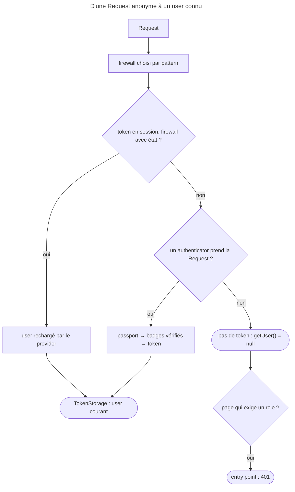

## Objectif

Suivre ce qui se passe entre une Request anonyme et un user connu, et ce qui
change selon qu'un firewall garde ou non le token d'une Request à l'autre. Le
détail des authenticators, passports et badges a son propre item.

## Avant la règle : le problème à résoudre

Une application a des pages publiques, une page « Mon compte » et une API.
À chaque Request, elle doit savoir **qui** est là :

- personne, sur une page publique — et ce n'est pas une erreur ;
- un user identifié par un form, qu'on ne veut pas réidentifier à chaque
  clic ;
- un client d'API qui envoie ses credentials à **chaque** Request.

Il faut donc un trajet qui transforme des credentials en un user, un endroit
où le garder pour la Request courante, et une règle qui dit s'il survit à la
Request suivante.

## Le fil rouge : un firewall `main`

```yaml
security:
    providers:
        mem:
            memory:
                users:
                    alice: { password: 'x', roles: ['ROLE_USER'] }
    firewalls:
        main:
            provider: mem
            http_basic: ~
    access_control:
        - { path: ^/whoami, roles: ROLE_USER }
```

## Le cycle complet en un schéma



## La question posée

L'authentication répond à **« qui êtes-vous ? »**. L'authorization, traitée
séparément, répond à « avez-vous le droit ? ». Les deux sont indépendantes : un
user parfaitement authentifié peut n'avoir aucun droit.

## Le trajet

1. La Request entre dans **un** firewall, choisi par son `pattern`.
2. Les **authenticators** de ce firewall sont interrogés : l'un déclare prendre
   la Request en charge.
3. Il construit un **passport**, dont les badges sont vérifiés.
4. Un **token** (`TokenInterface`) est produit : il porte le user et ses
   roles.
5. Le token est déposé dans le **`TokenStorage`**, où tout le reste de
   l'application le lira.

`TokenStorage` est la mémoire de la Request courante. `Security::getUser()` —
service `Symfony\Bundle\SecurityBundle\Security` — ou `$this->getUser()` dans un
controller n'est qu'un raccourci vers lui.

## Pas de token sans user

Depuis la disparition du token anonyme, une Request non authentifiée n'a **aucun
token**. Exécuté avec SecurityBundle 8.0.15, firewall `main` en `http_basic` :

| Request | `getToken()` | `getUser()` | Response |
|---|---|---|---|
| `/public`, sans credentials | `null` | `null` | 200 |
| `/whoami` (exige `ROLE_USER`), sans credentials | — | — | **401**, entry point |
| `/whoami`, credentials valides | `UsernamePasswordToken` | `alice` | 200 |

Le journal du firewall, pour la Request anonyme : « Access denied, the user is
not fully authenticated; redirecting to authentication entry point. »

## Avec ou sans état

Par défaut, le token est **sérialisé en session** entre deux Requests : c'est
`stateless: false`. Exécuté : après la connexion, « Stored the security token in
the session » ; à la Request suivante, avec le seul cookie, « Read existing
security token from the session » puis « User was reloaded from a user
provider » — le user est **rechargé** à chaque Request, pas recopié tel
quel.

Une API à tokens déclare `stateless: true` : le token n'est jamais écrit en
session. Exécuté sur un firewall sans état : aucun cookie posé après une
connexion réussie, et la Request suivante sans credentials reçoit **401**.

Après une connexion réussie, l'ID de session est régénéré contre la
fixation de session : `session_fixation_strategy` vaut `migrate` par défaut.
Exécuté : une connexion portant un cookie de session existant en reçoit un
nouveau, d'ID différent.

## Ce que le controller voit

```php
$this->getUser();                 // l'utilisateur, ou null
$this->isGranted('ROLE_ADMIN');   // autorisation, pas authentification
```

`getUser()` retournant `null` signifie « pas authentifié », **pas** « accès
refusé ». Exécuté : `alice`, authentifiée, obtient `isGranted('ROLE_ADMIN')`
faux, et une page qui exige `ROLE_ADMIN` lui répond **403** — alors qu'une
Request anonyme sur une page protégée reçoit **401**.

## Concrètement dans ton application

- Un site avec form de connexion : firewall avec état, le token voyage
  en session et le user est rechargé à chaque Request.
- Une API à token : `stateless: true`, les credentials accompagnent chaque
  Request.
- Une page publique : aucune règle d'accès, `getUser()` peut valoir `null`.
- Un « Mon compte » : `access_control` ou `isGranted()` ; sans user, l'entry
  point répond.

## À comprendre

- **Pourquoi plus de token anonyme ?** Parce que « pas de user » se dit mieux
  par `null` que par un faux token qu'il fallait tester partout.
- **Pourquoi recharger le user ?** Pour qu'un user désactivé ou dont les roles
  ont changé ne garde pas ses droits grâce à une session ancienne.
- **Pourquoi 401 et 403 ?** 401 dit « identifiez-vous » (l'entry point le
  demande) ; 403 dit « vous êtes identifié, mais c'est non ».

## À mémoriser

- Firewall → authenticator → passport → token → `TokenStorage`.
- Anonyme : **pas de token**, `getUser()` = `null`.
- Avec état : token en session, user **rechargé** ; `stateless: true` : rien
  en session.
- Session **migrée** à la connexion.
- Anonyme sur page protégée : **401** ; authentifié sans le role : **403**.
- Moyen mnémotechnique : **« Qui d'abord, droit ensuite »**.

## Pièges d'examen

**Authentication ≠ authorization.** `getUser()` répond à la première,
`isGranted()` à la seconde.

**Pas de user, pas de token** : `getToken()` rend `null` pour une Request
anonyme ; le token anonyme n'existe plus.

**`stateless: true` n'écrit pas le token en session** : le user n'est plus
mémorisé d'une Request à l'autre.

**Le token en session ne fige pas le user** : il est rechargé par le
provider à chaque Request.

## Application : trois scénarios

**Scénario 1 — Le test qui attend un token anonyme.** Un test vérifie
`$tokenStorage->getToken() instanceof AnonymousToken` sur une page publique, et
échoue. *Solution.* Une Request anonyme n'a pas de token : tester
`null === $tokenStorage->getToken()`, ou `null === $security->getUser()`.

**Scénario 2 — L'API qui oublie le client.** Après un premier appel réussi,
l'appel suivant sans credentials reçoit 401. *Solution.* C'est le
comportement voulu de `stateless: true` : le client envoie ses credentials à
chaque Request.

**Scénario 3 — Le role retiré qui reste actif.** Un admin retire `ROLE_ADMIN`
à un user connecté, qui le perd dès la Request suivante. *Solution.* Rien à
corriger : le user est rechargé par le provider à chaque Request, ses roles
avec lui.

## QCM d'entraînement

Six questions sur l'authentication. Choisis avant d'ouvrir la correction.

**Question 1.** Sur une page publique, sans credentials, que rend `$tokenStorage->getToken()` en Symfony 8.0 ?

- **A.** Un `AnonymousToken`
- **B.** Un `NullToken`
- **C.** Un `UsernamePasswordToken` sans user
- **D.** `null`

<details>
<summary>Correction</summary>

**Bonne réponse : D.** Exécuté avec SecurityBundle 8.0.15 : `getToken()` et
`getUser()` valent `null`.

A est le piège : le token anonyme n'existe plus. B et C n'existent pas pour ce
cas.

</details>

**Question 2.** Une Request **anonyme** demande une page qui exige `ROLE_USER`, sur un firewall `http_basic`. Quelle Response ?

- **A.** 401
- **B.** 403 : accès refusé
- **C.** 302 vers la page d'accueil
- **D.** 200, avec `getUser()` à `null`

<details>
<summary>Correction</summary>

**Bonne réponse : A.** C'est l'entry point du firewall qui répond. Exécuté :
« the user is not fully authenticated; redirecting to authentication entry
point », puis 401.

B est la Response d'un user **authentifié** sans le role. C et D sont faux.

</details>

**Question 3.** `alice`, authentifiée avec `ROLE_USER`, demande une page qui exige `ROLE_ADMIN`. Quelle Response ?

- **A.** 401 : elle doit se réauthentifier
- **B.** 403
- **C.** 302 vers le form de connexion
- **D.** 200 : l'authentication suffit

<details>
<summary>Correction</summary>

**Bonne réponse : B.** Elle est connue, mais n'a pas le droit. Exécuté :
« Access Denied. The user doesn't have ROLE_ADMIN. », 403.

A et C traitent le cas comme une absence d'authentication. D confond les deux
questions.

</details>

**Question 4.** Un firewall a `stateless: true`. Après un premier appel authentifié, le client rappelle **sans** credentials. Que se passe-t-il ?

- **A.** Il est reconnu par le cookie de session
- **B.** Il est reconnu jusqu'à expiration du token
- **C.** 401 : aucun token n'a été gardé
- **D.** 200, avec un user anonyme

<details>
<summary>Correction</summary>

**Bonne réponse : C.** Exécuté : aucun cookie posé après la connexion, et 401
à l'appel suivant.

A et B décrivent un firewall avec état. D : il n'y a plus de user anonyme.

</details>

**Question 5.** Sur un firewall avec état, un user connecté envoie une Request avec son seul cookie de session. D'où vient le user de cette Request ?

- **A.** Une copie figée, désérialisée de la session
- **B.** Rechargé par le user provider
- **C.** D'une nouvelle authentication par l'authenticator
- **D.** Du cache HTTP

<details>
<summary>Correction</summary>

**Bonne réponse : B.** Exécuté : « Read existing security token from the
session », puis « User was reloaded from a user provider ».

A est le piège : le user n'est pas figé. C et D sont faux.

</details>

**Question 6.** Un visiteur a déjà un cookie de session, puis se connecte. Que devient l'ID de session ?

- **A.** Il est conservé, pour garder le panier
- **B.** Il est supprimé : la session est vidée
- **C.** Il est conservé si la session est récente
- **D.** Il est remplacé par un nouveau

<details>
<summary>Correction</summary>

**Bonne réponse : D.** `session_fixation_strategy` vaut `migrate` : nouvel
ID, données conservées (exécuté : ID différent).

A est le piège de la fixation de session. B décrit `invalidate`. C invente une
condition.

</details>

## Fiche express

**Si tu dois retenir seulement 6 choses :**

- **Qui ?** (authentication) **≠ a-t-il le droit ?** (authorization).
- Firewall → authenticator → passport → **token** → **`TokenStorage`**.
- Anonyme : **aucun token**, `getUser()` = `null`.
- Avec état : token **en session**, user **rechargé** ; `stateless: true` :
  rien en session.
- Connexion : ID de session **migré**.
- Anonyme sur page protégée : **401** ; connu sans le role : **403**.

**En une phrase, pour tout reconstruire :**

```text
Request → firewall → (session ? recharger le user : authenticator → passport → token) → TokenStorage
  ; pas de token = anonyme → 401 si protégé ; token sans le rôle → 403
```

## Sources officielles

- [Security](https://github.com/symfony/symfony-docs/blob/8.0/security.rst)
- [SecurityBundle 8.0, `Security`](https://github.com/symfony/symfony/blob/8.0/src/Symfony/Bundle/SecurityBundle/Security.php)
- [SecurityBundle 8.0, `MainConfiguration`](https://github.com/symfony/symfony/blob/8.0/src/Symfony/Bundle/SecurityBundle/DependencyInjection/MainConfiguration.php)
- [Security HTTP 8.0, `ContextListener`](https://github.com/symfony/symfony/blob/8.0/src/Symfony/Component/Security/Http/Firewall/ContextListener.php)
