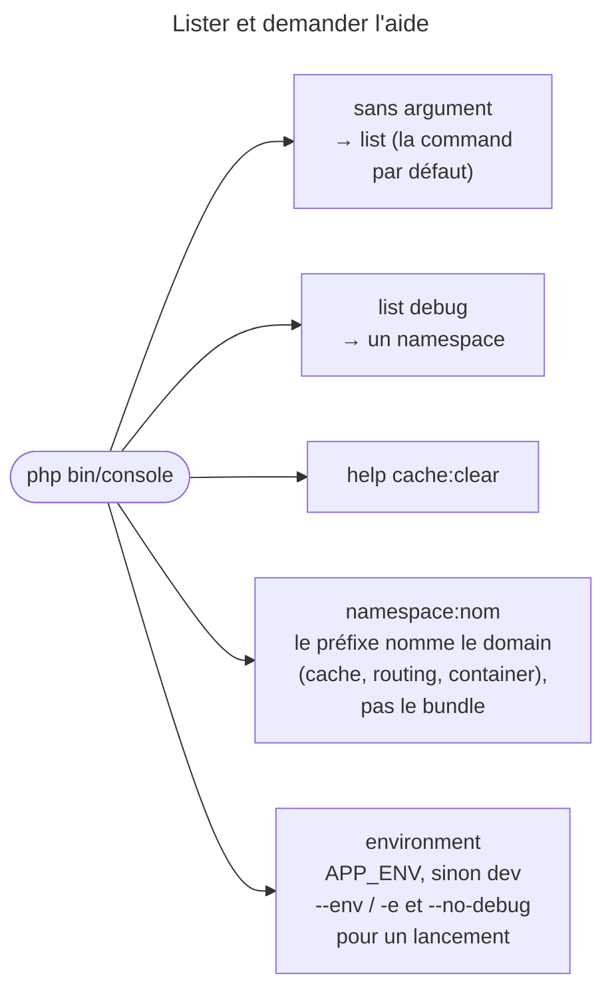
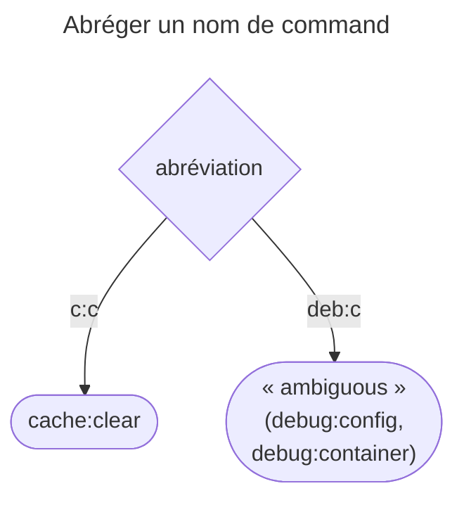

## Objectif

Savoir quelles commands sont déjà là, et laquelle sert à quoi. Aucune liste à
apprendre : `list` la donne.

## L'essentiel

Aucune liste à apprendre : `bin/console` sans argument exécute `list`, et
`help` détaille une command. À l'examen, il faut reconnaître les familles —
`debug:*` inspecte, `cache:*` vide, `lint:*` valide —, savoir abréger un nom,
et se rappeler qu'une command vise `dev` par défaut.

## Le schéma





## L'exemple : vider le cache de production

```bash
php bin/console cache:clear              # vide le cache de dev
php bin/console cache:clear --env=prod   # celui de prod
php bin/console d:r                      # debug:router, abrégé
```

## Les familles

| Famille | Ce qu'elle fait |
|---|---|
| `debug:*` | **inspecter** : container, routes, events, Twig, configuration |
| `cache:*` | vider, préchauffer, gérer les pools |
| `lint:*` | valider une syntaxe — YAML, Twig, XLIFF, container |
| `secrets:*` | gérer le coffre de secrets |
| `make:*` | générer du code, si MakerBundle est installé |

- La liste **dépend des components installés** : sans le component
  Translation, pas de `lint:xliff`.
- Commands sans namespace : `about`, `completion`, `help`, `list`,
  `_complete`.
- Les `debug:*` répondent à « qu'est-ce que Symfony a réellement compris de ma
  configuration ? » : elles lisent le container compilé.

## L'abréviation

Un nom s'abrège **segment par segment** tant qu'il reste **non ambigu** :

| Saisie | Résultat |
|---|---|
| `c:c` | `cache:clear` |
| `d:r` | `debug:router` |
| `l:y` | `lint:yaml` |
| `deb:c` | « Command "deb:c" is ambiguous. » — `debug:config`, `debug:container` |

## Pièges d'examen

**Une command vise `dev` sans `APP_ENV` ni `--env`.** Un `cache:clear` lancé
sans rien ne vide pas le cache de `prod`.

**`debug:*` lit le container compilé, pas les files de configuration.** C'est
précisément son intérêt : il montre ce que Symfony a retenu, pas ce qu'on croit
avoir écrit.

**`bin/console` sans argument exécute `list`.**

**Le préfixe n'indique pas le bundle d'origine** : il nomme le domain.

## Application

- Vérifier qu'une route est bien enregistrée → `debug:router`, plutôt que
  relire le file.
- Vider le cache du serveur de production → `cache:clear --env=prod`, ou
  `APP_ENV=prod`.

## QCM d'entraînement

**Question 1.** Que fait `php bin/console`, lancé sans aucun argument ?

- **A.** Il affiche l'aide de `help`
- **B.** Il exécute `list`
- **C.** Il échoue : une command est requise
- **D.** Il exécute `about`

<details>
<summary>Correction</summary>

**Bonne réponse : B.** `list` est la command par défaut de l'`Application` :
elle s'exécute quand aucun nom n'est donné, sans erreur.

</details>

**Question 2.** L'application a `debug:config` et `debug:container`. Que
donne `php bin/console deb:c` ?

- **A.** `debug:config`, la première dans l'ordre alphabétique
- **B.** `debug:container`, la plus utilisée
- **C.** « Command "deb:c" is ambiguous. »
- **D.** Les deux commands, l'une après l'autre

<details>
<summary>Correction</summary>

**Bonne réponse : C.** Une abréviation doit désigner une seule command ; sinon
l'erreur liste les candidates au lieu d'en choisir une.

</details>

**Question 3.** `APP_ENV` n'est pas défini. Quel cache vide
`php bin/console cache:clear`, lancé sans option ?

- **A.** Celui de `prod`
- **B.** Celui de tous les environments
- **C.** Celui de `test`
- **D.** Celui de `dev`

<details>
<summary>Correction</summary>

**Bonne réponse : D.** Sans `APP_ENV` ni `--env`, une command tourne en `dev` ;
le cache de production reste intact.

</details>

**Question 4.** Que signifie le préfixe `debug:` de `debug:router` ?

- **A.** Le bundle qui a enregistré la command, DebugBundle
- **B.** Le domain : inspecter l'application
- **C.** Que la command n'existe qu'avec `--debug`
- **D.** Que la command n'existe qu'en environment `dev`

<details>
<summary>Correction</summary>

**Bonne réponse : B.** Le namespace nomme ce sur quoi la command agit, pas le
bundle d'origine ; `debug:*` inspecte le container compilé.

</details>

## Fiche express

**Si tu dois retenir seulement 5 choses :**

- `bin/console` seul → **`list`** ; `help` détaille une command.
- **`debug:*`** inspecte, **`cache:*`** vide, **`lint:*`** valide.
- La liste **dépend des components installés**.
- Abréviation par segment, **si non ambiguë**.
- **`dev`** par défaut ; `--env` / `-e`, `--no-debug`.

Moyen mnémotechnique : **« Lister, inspecter, vider, valider »**.

## Sources officielles

- [Console Commands](https://github.com/symfony/symfony-docs/blob/8.0/console.rst)
- [`Application`, branche 8.0](https://github.com/symfony/symfony/blob/8.0/src/Symfony/Component/Console/Application.php)
- [`SymfonyRuntime`, branche 8.0](https://github.com/symfony/symfony/blob/8.0/src/Symfony/Component/Runtime/SymfonyRuntime.php)

