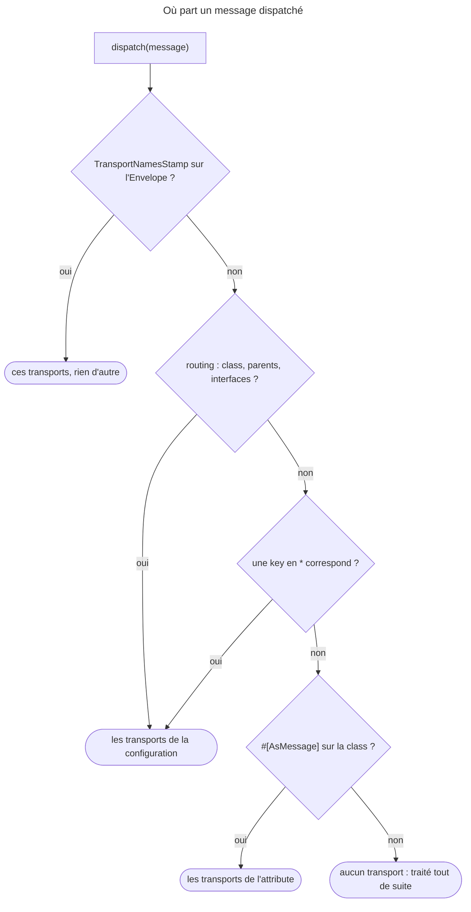

## Objectif

Router un message vers un transport, savoir ce que change l'absence de routage,
et ce qui est vérifié — ou non — au démarrage.

## L'essentiel

Un transport est un **DSN**. Le routage dit où part chaque message, par la
configuration ou par `#[AsMessage]` — la configuration gagne. Un message routé
**nulle part** n'est pas perdu : il est traité **tout de suite**. Une faute dans
`routing` casse le build ; la même dans l'attribute ne casse qu'au dispatch.

## Le schéma



Deux conséquences : **la configuration l'emporte** sur l'attribute, et **une
key en `*` n'est qu'un repli**.

## L'exemple

```yaml
framework:
    messenger:
        transports:
            async: '%env(MESSENGER_TRANSPORT_DSN)%'
            audit: '%env(AUDIT_TRANSPORT_DSN)%'
            sync:  'sync://'
        routing:
            'App\Message\SendWelcomeEmail': async
            'App\Message\ChargeCard': sync
```

```php
#[AsMessage(['async', 'audit'])]
final class SmsNotification {}
final class ResizeAvatar {}   // routé nulle part
```

`SendWelcomeEmail` part dans `async` ; `ChargeCard` est traité sur place par un
vrai transport ; `SmsNotification` part dans deux transports ; `ResizeAvatar`
est traité tout de suite, dans la Request.

## Déclarer

Messenger 8.0 fournit des bridges pour AMQP, Doctrine, Redis, Amazon SQS et
Beanstalkd, plus deux transports particuliers :

- **`sync://`** traite le message dans le même process, **et** pose un
  `SentStamp` : un vrai transport, pour rendre synchrone un type de message ;
- **`in-memory://`** ne traite rien et garde les messages, pour les tests. Il
  ne **sérialise** rien par défaut : un message qui porte une closure passe, et
  n'échoue qu'avec `in-memory://?serialize=true` — « Serialization of
  'Closure' is not allowed ».

Un transport asynchrone sérialise le message, par défaut avec `serialize()` et
`unserialize()` de PHP : on y met des identifiers, jamais d'entité. Séparer les
transports par latence est la recommandation, un worker par transport.

## Router

```yaml
routing:
    'App\Message\SmsNotification': [async, audit]
    'App\Message\AsyncMessageInterface': async
    'App\Message\*': async
```

- Une key peut être une class, une class parente, une **interface**, un
  **namespace** terminé par `*`, ou `*` seul ; un message peut viser
  **plusieurs** transports.
- Attribute **et** configuration sur le même message : la configuration gagne,
  c'est elle qui change le routage par environment.
- Parent et enfant **s'additionnent** ; un joker ne sert que si rien de plus
  précis n'a trouvé de transport — « the '*' acts as a fallback ».

| `routing` | Message | Transports |
|---|---|---|
| `SmsNotification: async`, `Notification: audit` (parente) | `SmsNotification` | `async` **et** `audit` |
| `Welcome: async`, `'*': audit` | `Welcome` | `async` seulement |
| `'*': audit` | `SmsNotification`, avec `#[AsMessage(['async', 'audit'])]` | `audit` seulement |

Au dispatch, `TransportNamesStamp` remplace **tout** :
`dispatch(new Welcome(), [new TransportNamesStamp(['sync'])])` ignore la key
`async`.

## Non routé : traité tout de suite

**Un message qui n'est routé nulle part est traité immédiatement**, de façon
synchrone. Ce n'est pas une erreur : une application sans `routing` fonctionne,
entièrement synchrone.

## Ce qui est vérifié au démarrage

FrameworkBundle contrôle chaque key de `routing` en construisant le container :

| Key de `routing` | Résultat |
|---|---|
| class mal orthographiée | **`LogicException`** au build : « class or interface … not found » |
| transport inexistant (`asyncc`) | **`LogicException`** : « This is not a valid transport or service id » |
| `App\Other\*` (namespace sans message) | **aucune erreur** : traité en synchrone |

L'attribute, lui, n'est vérifié qu'**au dispatch** : sans transport `async`
déclaré, le container se construit, puis `dispatch()` lève une
`RuntimeException`.

## Pièges d'examen

**Sans routage, le message est traité tout de suite** — pas mis en attente, pas
perdu.

**Une class mal orthographiée dans `routing` fait échouer le build** ; seul un
namespace sans correspondance est silencieux.

**La configuration l'emporte sur `#[AsMessage]`.**

**`sync://` n'est pas « pas de transport »** : il traite sur place, et pose un
`SentStamp`.

**`in-memory://` est réservé aux tests** ; il ne traite jamais rien.

## Application

- Les tests passent avec `in-memory://`, le worker de production échoue à
  désérialiser → `in-memory://?serialize=true` en test.
- `'App\Message\*': audit` devait copier chaque message, mais `Welcome`, routé
  vers `async`, n'y arrive jamais → un joker est un repli : `[async, audit]`.

## QCM d'entraînement

**Question 1.** Une class porte `#[AsMessage('async')]`, mais aucun transport
`async` n'est déclaré. Quand l'erreur apparaît-elle ?

- **A.** Au build du container, comme pour `routing`
- **B.** Jamais : le message est traité en synchrone
- **C.** Au premier `dispatch()` de ce message
- **D.** Au démarrage du worker, en lisant la file

<details>
<summary>Correction</summary>

**Bonne réponse : C.** Le container se construit, puis `dispatch()` lève :
« Invalid senders configuration: sender "async" is not in the senders locator. »

</details>

**Question 2.** `routing` contient `Welcome: async` et `'*': audit`. Où part
`Welcome` ?

- **A.** Dans `async` seulement
- **B.** Dans `async` et dans `audit`
- **C.** Dans `audit` seulement, la dernière règle gagne
- **D.** Nulle part : deux règles se contredisent

<details>
<summary>Correction</summary>

**Bonne réponse : A.** Le joker est ignoré dès qu'une règle plus précise a
trouvé un transport ; B serait vrai pour une règle sur la class parente.

</details>

**Question 3.** Un test dispatche vers `in-memory://` un message qui porte une
closure. Qu'arrive-t-il ?

- **A.** `Exception` : une closure ne se sérialise pas
- **B.** Le message est stocké, le test passe
- **C.** Le message est ignoré en silence
- **D.** Une `LogicException` au build du container

<details>
<summary>Correction</summary>

**Bonne réponse : B.** Sans `?serialize=true`, `in-memory://` garde l'object
tel quel ; A décrit cette option ou un vrai transport asynchrone.

</details>

**Question 4.** `Welcome` est routé vers `async`. Le code appelle
`dispatch(new Welcome(), [new TransportNamesStamp(['sync'])])`, et `sync`
vaut `sync://`. Que se passe-t-il ?

- **A.** Envoyé à `async` et à `sync`
- **B.** Envoyé à `async` : la configuration gagne
- **C.** Une exception : deux routages concurrents
- **D.** Traité sur place, via `sync` seulement

<details>
<summary>Correction</summary>

**Bonne réponse : D.** Le stamp est lu en premier et rien d'autre ensuite : un
seul `SentStamp`, celui de `sync`, et les handlers ont tourné.

</details>

## Fiche express

**Si tu dois retenir seulement 7 choses :**

- Un transport est un **DSN** ; `sync://` traite, `in-memory://` garde.
- **`routing`** ou **`#[AsMessage]`** ; la **configuration** gagne.
- Parent et enfant **s'additionnent** ; un **joker** n'est qu'un repli.
- **Non routé** : traité tout de suite, sans erreur.
- `routing` faux → **build** ; `#[AsMessage]` faux → **dispatch**.
- **`TransportNamesStamp`** passe avant tout.
- `in-memory://` ne **sérialise** qu'avec `?serialize=true`.

Moyen mnémotechnique :
**« le stamp, puis la configuration, puis l'attribute, sinon tout de suite »**.

```text
TransportNamesStamp > routing (class + parents + interfaces ; * en repli) > #[AsMessage] > rien = synchrone ;
routing vérifié au build, attribute au dispatch ; sync:// traite avec SentStamp ; in-memory:// sans serialize par défaut
```

## Sources officielles

- [Messenger, « Transports » et « Routing Messages to a Transport »](https://github.com/symfony/symfony-docs/blob/8.0/messenger.rst)
- [FrameworkBundle 8.0, `FrameworkExtension`](https://github.com/symfony/symfony/blob/8.0/src/Symfony/Bundle/FrameworkBundle/DependencyInjection/FrameworkExtension.php)
- [Messenger 8.0, `SendersLocator`](https://github.com/symfony/symfony/blob/8.0/src/Symfony/Component/Messenger/Transport/Sender/SendersLocator.php)
- [Messenger 8.0, `InMemoryTransportFactory`](https://github.com/symfony/symfony/blob/8.0/src/Symfony/Component/Messenger/Transport/InMemory/InMemoryTransportFactory.php)

