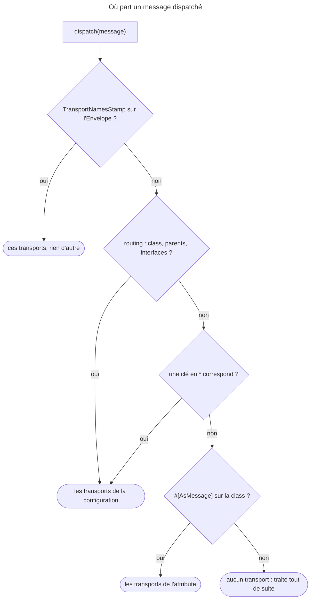

## Objectif

Router un message vers un transport, savoir ce que change l'absence de routage,
et ce qui est vérifié — ou non — au démarrage.

## Avant la règle : le problème à résoudre

Un même message peut devoir partir en file, partir vers deux files, ou rester
synchrone selon l'environment. Le controller qui le dispatche ne doit rien en
savoir. Il faut donc un endroit qui dise **où va chaque message**, et une règle
claire pour les cas où rien n'est dit.

Trois questions : **comment déclarer** un transport, **comment router** un
message, et **ce qui arrive** quand le routage est absent ou faux.

## Le fil rouge : trois messages, trois destins

```yaml
framework:
    messenger:
        transports:
            async: '%env(MESSENGER_TRANSPORT_DSN)%'
            audit: '%env(AUDIT_TRANSPORT_DSN)%'
            sync:  'sync://'
        routing:
            'App\Message\SendWelcomeEmail': async
            'App\Message\ChargeCard': sync
```

```php
#[AsMessage(['async', 'audit'])]
final class SmsNotification {}

final class ResizeAvatar {}   // routé nulle part
```

`SendWelcomeEmail` part dans `async`. `ChargeCard` est traité sur place, par un
vrai transport. `SmsNotification` part dans deux transports, par son
attribute. `ResizeAvatar` est traité tout de suite, dans la Request.

## Le cycle complet en un schéma

Lu dans `SendersLocator::getSenders()` et rejoué avec Messenger 8.0 :



Deux conséquences : **la configuration l'emporte** sur l'attribute, et **une
clé en `*` n'est qu'un repli**.

## Déclarer

Un transport est un **DSN** :

```yaml
framework:
    messenger:
        transports:
            async: '%env(MESSENGER_TRANSPORT_DSN)%'
            sync:  'sync://'
        routing:
            'App\Message\SendWelcomeEmail': async
```

Messenger 8.0 fournit des bridges pour AMQP, Doctrine, Redis, Amazon SQS et
Beanstalkd, plus deux transports particuliers :

- **`sync://`** — traite le message immédiatement, dans le même process ;
- **`in-memory://`** — ne traite rien et garde les messages en mémoire, pour
  qu'un test puisse vérifier ce qui a été envoyé sans démarrer de worker.

**Rejoué : `in-memory://` ne sérialise rien par défaut.** L'object stocké est
celui qu'on a dispatché. Un message qui porte une closure passe donc le test,
et n'échoue qu'avec `in-memory://?serialize=true` : « Serialization of
'Closure' is not allowed ». C'est l'option `serialize` de la documentation,
« useful to test an additional layer ».

## Router

Deux façons, qui disent la même chose à deux endroits :

```php
#[AsMessage(['async', 'audit'])]
final class SmsNotification {}
```

```yaml
routing:
    'App\Message\SmsNotification': [async, audit]
    'App\Message\AsyncMessageInterface': async
    'App\Message\*': async
```

Une key de routage peut être une class, une class parente, une **interface**,
un **namespace** terminé par `*`, ou `*` seul. Un message peut viser
**plusieurs** transports.

Quand le même message est routé par l'attribute **et** par la configuration, la
configuration gagne — la documentation le présente comme le moyen de changer le
routage par environment. Exécuté avec Messenger 8.0.15 :
`#[AsMessage(['async', 'audit'])]` seul envoie le message aux deux transports
(deux `SentStamp`) ; avec en plus une key `routing` vers un transport `sync://`,
seul ce dernier le reçoit.

**Rejoué, les règles qui se cumulent et celles qui se remplacent :**

| `routing` | Message | Transports |
|---|---|---|
| `SmsNotification: async`, `Notification: audit` (la class parente) | `SmsNotification` | `async` **et** `audit` |
| `Welcome: async`, `'App\Message\*': audit` | `Welcome` | `async` seulement |
| `Welcome: async`, `'*': audit` | `Welcome` | `async` seulement |
| `'*': audit` | `SmsNotification`, avec `#[AsMessage(['async', 'audit'])]` | `audit` seulement |

Parent et enfant **s'additionnent**, comme le dit la documentation ; un joker
ne sert que si rien de plus précis n'a trouvé de transport — lu dans
`SendersLocator` : « the '*' acts as a fallback ».

**Au dispatch, un stamp peut tout remplacer.** La documentation : on peut
« define and override the transport that a message is using at runtime » avec
`TransportNamesStamp`. Rejoué : `dispatch(new Welcome(), [new
TransportNamesStamp(['sync'])])` ignore la key `async` et traite le message sur
place.

## Non routé : traité tout de suite

C'est le point central : **un message qui n'est routé nulle part est traité
immédiatement**, de façon synchrone. Ce n'est pas une erreur.

Une application sans `routing` fonctionne donc parfaitement — elle est
simplement entièrement synchrone.

## Ce qui est vérifié au démarrage

Une faute de frappe dans le routage n'est **pas** toujours silencieuse.
FrameworkBundle contrôle chaque key en construisant le container. Exécuté :

| Key de `routing` | Résultat |
|---|---|
| `App\…\Welcom` (class mal orthographiée) | **`LogicException`** au build : « class or interface … not found » |
| la bonne class vers `asyncc` (transport inexistant) | **`LogicException`** : « This is not a valid transport or service id » |
| `App\…\Welcome`, `App\…\*`, `*` | message envoyé au transport |
| `App\Other\*` (namespace sans message) | **aucune erreur** : traité en synchrone |

Seul le joker de namespace qui ne correspond à rien reste silencieux — le
message continue d'être traité, mais dans la Request.

**L'attribute, lui, n'est vérifié qu'au dispatch.** Rejoué :
`#[AsMessage(['async', 'audit'])]` sans transport `async` déclaré — le
container se construit, et `dispatch()` lève `RuntimeException` : « Invalid
senders configuration: sender "async" is not in the senders locator. » La même
faute dans `routing` aurait cassé le build.

## `sync://` n'est pas « pas de routage »

Exécuté : un message routé vers un transport `sync://` est traité pendant
`dispatch()`, comme un message non routé — mais son Envelope porte un
`SentStamp`. C'est un vrai transport, utile pour rendre un type de message
synchrone quand le reste part en file.

## Serialization

Un transport asynchrone sérialise le message. Le serializer par défaut de
Messenger suffit dans la plupart des cas ; le component Serializer peut le
remplacer quand un autre système doit lire la file. C'est cette étape qui impose
qu'un message soit sérialisable, et qui explique qu'on n'y mette pas d'entité.

Par défaut, lu dans `Configuration` de FrameworkBundle :
`messenger.transport.native_php_serializer`, soit les fonctions natives
`serialize()` et `unserialize()` de PHP, que la documentation nomme.

## Choisir plusieurs transports

Séparer les transports par latence est la recommandation : un flux lent ne doit
pas retarder une confirmation de paiement. Chaque transport reçoit alors son
propre worker.

## Concrètement dans ton application

- Routage dans `messenger.yaml`, pas dans les classes, si l'environment doit
  pouvoir le changer.
- Un transport `sync://` pour rendre synchrone un type de message précis.
- `in-memory://?serialize=true` en test, pour attraper un message non
  sérialisable.
- Un joker `App\Message\*` en filet ; les règles précises restent prioritaires.
- Un `TransportNamesStamp` pour un envoi exceptionnel, sans toucher à la
  configuration.
- Des identifiers dans les messages, jamais d'entité.

## À comprendre

- **Pourquoi la configuration gagne-t-elle ?** L'attribute est écrit dans le
  code, la configuration dépend de l'environment : c'est elle qui doit pouvoir
  dire « en test, tout est synchrone ».
- **Pourquoi le build échoue-t-il sur une class inconnue mais pas sur un
  joker ?** Une class se vérifie ; un namespace en `*` est une promesse sur des
  classes futures, rien à vérifier.
- **Pourquoi l'attribute n'est-il vérifié qu'au dispatch ?** Il est lu sur
  l'Envelope au moment de l'envoi, par `SendersLocator`, pas en construisant le
  container.

## À mémoriser

- Transport = **DSN** ; `sync://` traite, `in-memory://` garde.
- Routage : **`routing`** ou **`#[AsMessage]`** ; la **configuration** gagne.
- Keys : class, parent, interface, `Namespace\*`, `*` ; un **joker** n'est
  qu'un repli.
- **Non routé** = traité tout de suite.
- Faute dans `routing` → **build** cassé ; faute dans `#[AsMessage]` →
  **dispatch** cassé.
- **`TransportNamesStamp`** remplace tout le routage.
- Moyen mnémotechnique : **« le stamp, puis la configuration, puis
  l'attribute, sinon tout de suite »**.

## Pièges d'examen

**Sans routage, le message est traité tout de suite** — pas mis en attente, pas
perdu.

**Une class mal orthographiée dans `routing` fait échouer le build** ; seul un
namespace sans correspondance est silencieux.

**La configuration l'emporte sur `#[AsMessage]`.**

**`sync://` n'est pas « pas de transport »** : il traite sur place, et pose un
`SentStamp`.

**`in-memory://` est réservé aux tests** ; il ne traite jamais rien.

## Application : trois scénarios

**Scénario 1 — Le test vert, la production rouge.** Les tests vérifient qu'un
message part dans `in-memory://` ; en production, le worker échoue à le
désérialiser. *Solution.* `in-memory://?serialize=true` en test : le message
passe par le serializer, comme sur un vrai transport.

**Scénario 2 — Le filet qui n'attrape rien.** `'App\Message\*': audit`
devait copier chaque message dans `audit`, mais `Welcome`, routé vers `async`,
n'y arrive jamais. *Solution.* Un joker est un repli : nommer `audit` dans la
règle de `Welcome`, `[async, audit]`.

**Scénario 3 — L'attribute qui casse au premier envoi.** Le déploiement passe,
puis la première inscription lève « sender "async" is not in the senders
locator ». *Solution.* Le transport n'existe pas dans cet environment ;
l'attribute n'est vérifié qu'au dispatch. Le déclarer, ou router par la
configuration, vérifiée au build.

## QCM d'entraînement

Cinq questions sur les transports. Choisis avant d'ouvrir la correction.

**Question 1.** Une class porte `#[AsMessage('async')]`, mais aucun transport
`async` n'est déclaré. Quand l'erreur apparaît-elle ?

- **A.** Au build du container, comme pour `routing`
- **B.** Jamais : le message est traité en synchrone
- **C.** Au premier `dispatch()` de ce message
- **D.** Au démarrage du worker, en lisant la file

<details>
<summary>Correction</summary>

**Bonne réponse : C.** Rejoué : le container se construit, `dispatch()` lève
« Invalid senders configuration: sender "async" is not in the senders
locator. »

A est vrai pour une key de `routing`, pas pour l'attribute. B et D sont faux.

</details>

**Question 2.** `routing` contient `Welcome: async` et `'*': audit`. Où part
`Welcome` ?

- **A.** Dans `async` seulement
- **B.** Dans `async` et dans `audit`
- **C.** Dans `audit` seulement, la dernière règle gagne
- **D.** Nulle part : deux règles se contredisent

<details>
<summary>Correction</summary>

**Bonne réponse : A.** Rejoué. Lu dans `SendersLocator::getSenders()` : « the
'*' acts as a fallback », ignoré dès qu'une règle plus précise a trouvé un
transport.

B serait vrai pour une règle sur la class parente. C et D sont faux.

</details>

**Question 3.** Un test dispatche vers `in-memory://` un message qui porte une
closure. Qu'arrive-t-il ?

- **A.** `Exception` : une closure ne se sérialise pas
- **B.** Le message est stocké, le test passe
- **C.** Le message est ignoré en silence
- **D.** Une `LogicException` au build du container

<details>
<summary>Correction</summary>

**Bonne réponse : B.** Rejoué : sans `?serialize=true`, `in-memory://` garde
l'object tel quel. Avec l'option, « Serialization of 'Closure' is not
allowed ».

A décrit `?serialize=true` ou un vrai transport. C et D sont faux.

</details>

**Question 4.** `Welcome` est routé vers `async`. Le code appelle
`dispatch(new Welcome(), [new TransportNamesStamp(['sync'])])`, et `sync`
vaut `sync://`. Que se passe-t-il ?

- **A.** Envoyé à `async` et à `sync`
- **B.** Envoyé à `async` : la configuration gagne
- **C.** Une exception : deux routages concurrents
- **D.** Traité sur place, via `sync` seulement

<details>
<summary>Correction</summary>

**Bonne réponse : D.** Rejoué : un seul `SentStamp`, celui de `sync`, et les
handlers ont tourné. Lu dans `SendersLocator` : le stamp est lu en premier, et
rien d'autre ensuite.

B confond avec le duel configuration contre attribute. A et C sont faux.

</details>

**Question 5.** `SmsNotification` étend `Notification`. `routing` contient
`SmsNotification: async` et `Notification: audit`. Où part un
`SmsNotification` ?

- **A.** Dans `async` seulement, la règle la plus précise
- **B.** Dans `audit` seulement, la règle du parent
- **C.** Dans `async` et dans `audit`
- **D.** Une `LogicException` : règles en conflit

<details>
<summary>Correction</summary>

**Bonne réponse : C.** La documentation : « If you configure routing for both a
child and parent class, both rules are used. » Rejoué : deux `SentStamp`.

A applique à tort la logique du joker. B et D sont faux.

</details>

## Fiche express

**Si tu dois retenir seulement 7 choses :**

- Un transport est un **DSN** ; `sync://` traite, `in-memory://` garde.
- **`routing`** ou **`#[AsMessage]`** ; la **configuration** gagne.
- Parent et enfant **s'additionnent** ; un **joker** n'est qu'un repli.
- **Non routé** : traité tout de suite, sans erreur.
- `routing` faux → **build** ; `#[AsMessage]` faux → **dispatch**.
- **`TransportNamesStamp`** passe avant tout.
- `in-memory://` ne **sérialise** qu'avec `?serialize=true`.

**En une phrase, pour tout reconstruire :**

```text
TransportNamesStamp > routing (class + parents + interfaces ; * en repli) > #[AsMessage] > rien = synchrone ;
routing vérifié au build, attribute au dispatch ; sync:// traite avec SentStamp ; in-memory:// sans serialize par défaut
```

## Sources officielles

- [Messenger, « Transports » et « Routing Messages to a Transport »](https://github.com/symfony/symfony-docs/blob/8.0/messenger.rst)
- [FrameworkBundle 8.0, `FrameworkExtension`](https://github.com/symfony/symfony/blob/8.0/src/Symfony/Bundle/FrameworkBundle/DependencyInjection/FrameworkExtension.php)
- [Messenger 8.0, `SendersLocator`](https://github.com/symfony/symfony/blob/8.0/src/Symfony/Component/Messenger/Transport/Sender/SendersLocator.php)
- [Messenger 8.0, `InMemoryTransportFactory`](https://github.com/symfony/symfony/blob/8.0/src/Symfony/Component/Messenger/Transport/InMemory/InMemoryTransportFactory.php)
