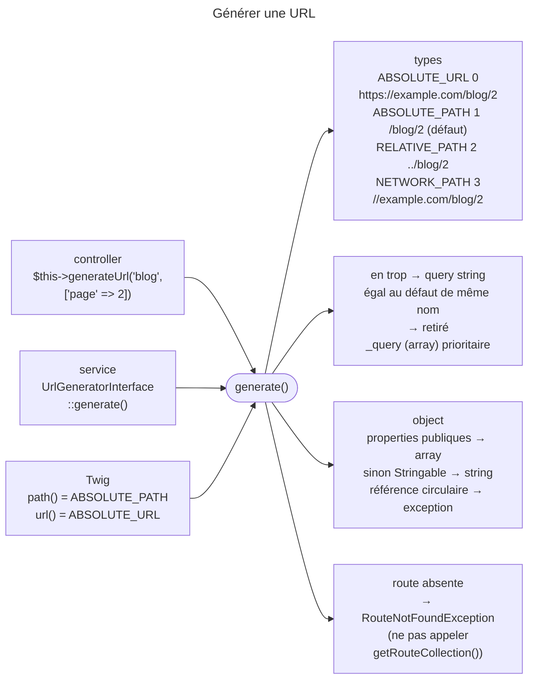

## Objectif

Générer une URL depuis une route, et maîtriser ce qui arrive aux parameters qui
ne font pas partie de la route.

## L'essentiel

Une URL se génère toujours depuis une route : `generateUrl()` dans un
controller, `generate()` d'`UrlGeneratorInterface` dans un service, `path()` et
`url()` en Twig. Le troisième argument choisit la forme — **path absolu par
défaut**. Un parameter absent de la route part en **query string**, sans
erreur ; un object y est converti, contrairement à ce que dit la documentation.

## Le schéma



## L'exemple

```php
$this->generateUrl('blog', ['page' => 2, 'category' => 'Symfony']);
// la route blog ne définit que page → /blog/2?category=Symfony

$this->generateUrl('blog', ['page' => 2], UrlGeneratorInterface::ABSOLUTE_URL);
// lien pour un email → https://example.com/blog/2
```

## Où et comment

| Contexte | Appel |
|---|---|
| controller (`AbstractController`) | `$this->generateUrl('nom', [...])` |
| service | injecter `UrlGeneratorInterface`, appeler `generate()` |
| template Twig | `path('nom', {...})` et `url('nom', {...})` |

On ne construit **jamais** une URL à la main : changer le path d'une route met
alors à jour tous les liens.

## Les quatre types de référence

Les constants sont sur `UrlGeneratorInterface` : `ABSOLUTE_URL` vaut `0`,
`ABSOLUTE_PATH` vaut `1` et c'est **le défaut**, `RELATIVE_PATH` vaut `2`,
`NETWORK_PATH` vaut `3`. La constant qui vaut `0` n'est donc pas le défaut.
`NETWORK_PATH` reprend le schéma courant ; `RELATIVE_PATH` est relatif au path
courant.

## Les parameters en trop

Un parameter absent de la definition de la route part en **query string**.
Deux nuances : un parameter en trop **égal à la default value** de même nom
est retiré ; la key réservée `_query` fournit un array de parameters qui
**l'emportent** sur les parameters en trop de même nom — une valeur qui n'est
pas un array lève une `InvalidParameterException`.

### Les objects en parameter supplémentaire

La documentation dit qu'un object — un Uuid — n'est pas converti, et conseille
`(string) $entity->getUuid()`. Le code 8.0 le convertit : `doGenerate()` prend
ses **properties publiques** en array s'il en a, sinon le convertit en chaîne
s'il est `Stringable`, et lève sur une référence circulaire. `AbstractUid` n'a
qu'une property `protected` et implémente `Stringable` : un Uuid est converti.

## Route absente

Ne pas appeler `getRouteCollection()` pour tester l'existence d'une route : cela
régénère le cache de routage. Tenter la génération et rattraper
`RouteNotFoundException`.

## Pièges d'examen

**Un parameter absent de la route n'est pas ignoré : il part en query
string.** Une faute de frappe dans un nom de parameter ne produit donc aucune
erreur — juste une URL avec un parameter en trop.

**Un object en parameter supplémentaire est converti, selon le code 8.0.** Les
properties publiques d'abord, en array ; `__toString()` seulement s'il n'en a
pas. La documentation dit encore le contraire.

**Un parameter en trop égal au défaut disparaît de la query string.**

**Le type de référence par défaut est le path absolu, pas l'URL absolue.**
Générer un lien pour un email demande de le dire explicitement.

## Application

- Un lien dans un email → `ABSOLUTE_URL`, ou `url()` en Twig.
- Un lien affiché seulement si la route existe → `try` sur `generate()`.

## QCM d'entraînement

**Question 1.** Quelle valeur entière porte `UrlGeneratorInterface::ABSOLUTE_URL` ?

- **A.** `0`
- **B.** `1`, la default value
- **C.** `2`
- **D.** `3`

<details>
<summary>Correction</summary>

**Bonne réponse : A.** L'URL absolue vaut `0` ; le défaut des methods de
génération est le path absolu, qui vaut `1`.

</details>

**Question 2.** Le code appelle `generate('blog', ['_query' => 'page=2'])`. Que
se passe-t-il ?

- **A.** `/blog?page=2`
- **B.** Une `InvalidParameterException`
- **C.** `/blog?_query=page%3D2`
- **D.** `/blog`, la key réservée étant simplement ignorée

<details>
<summary>Correction</summary>

**Bonne réponse : B.** La key réservée attend un array de parameters ; une
string n'est pas acceptée, et le generator le signale par une exception.

</details>

**Question 3.** Un object sans property publique, dont `__toString()` rend
`abc`, est passé en parameter supplémentaire `ref`. Que produit la génération
de `/blog` ?

- **A.** `/blog?ref=abc`
- **B.** Une `InvalidParameterException`
- **C.** `/blog?ref=`, sans valeur
- **D.** `/blog` : l'object est ignoré

<details>
<summary>Correction</summary>

**Bonne réponse : A.** Sans property publique à reprendre en array, le
generator convertit en chaîne un object `Stringable`, selon le code 8.0.

</details>

**Question 4.** La Request courante est `/en/blog/1`. Que produit la génération
de la route `/en/about` en `RELATIVE_PATH` ?

- **A.** `/en/about`
- **B.** `about`
- **C.** `../about`
- **D.** `../../en/about`

<details>
<summary>Correction</summary>

**Bonne réponse : C.** Le path relatif remonte d'un niveau depuis le
directory courant `/en/blog/`, puis descend vers `about`.

</details>

## Fiche express

**Si tu dois retenir seulement 6 choses :**

- Jamais d'URL à la main : `generateUrl()`, `generate()`, **`path()`**, **`url()`**.
- Défaut : **`ABSOLUTE_PATH` (1)** ; `ABSOLUTE_URL` vaut **0**.
- Parameter hors route → **query string**, sans erreur.
- Égal au défaut → **retiré** ; `_query` : un **array**, prioritaire.
- Object en trop : properties publiques → **array**, sinon **`Stringable`** → string.
- Route absente : rattraper **`RouteNotFoundException`**.

Moyen mnémotechnique : **« Zéro, c'est tout : l'URL complète »**.

## Sources officielles

- [UrlGeneratorInterface, branche 8.0](https://github.com/symfony/symfony/blob/8.0/src/Symfony/Component/Routing/Generator/UrlGeneratorInterface.php)
- [Routing, section « Generating URLs »](https://github.com/symfony/symfony-docs/blob/8.0/routing.rst)
- [`UrlGenerator::doGenerate()`](https://github.com/symfony/symfony/blob/8.0/src/Symfony/Component/Routing/Generator/UrlGenerator.php)

