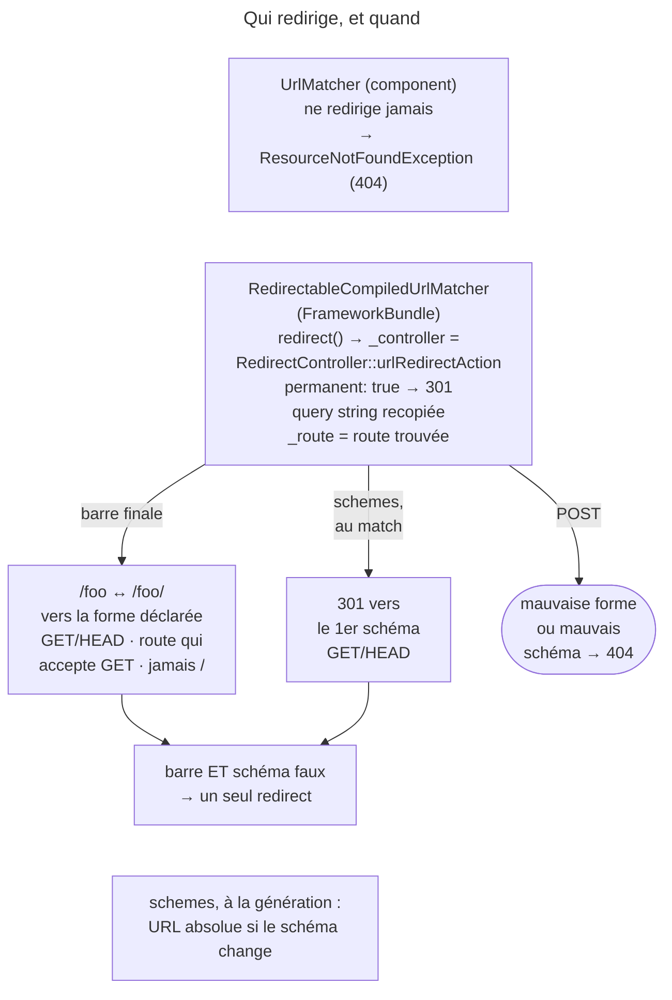
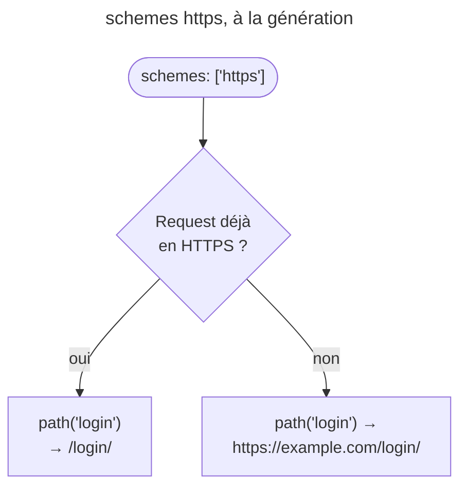
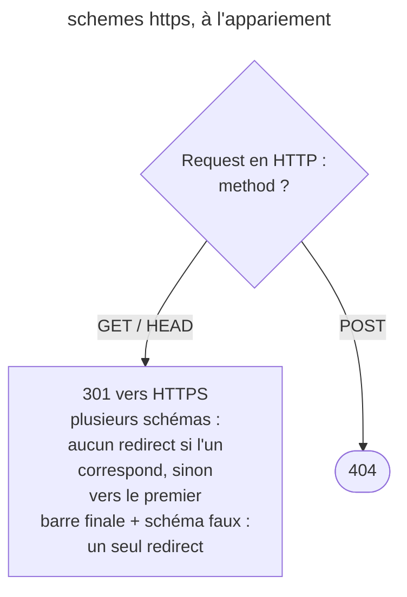

## Objectif

Connaître les redirects que **le routage** déclenche de lui-même. Les
redirects émis par un controller — `redirect()`, `redirectToRoute()` — et
les options de `RedirectController` appartiennent au lot Controllers.

## L'essentiel

Le routage redirige de lui-même dans deux cas : la **barre oblique finale** et
le **schéma** exigé par `schemes`. Toujours en **301**, toujours **seulement en
`GET` et `HEAD`** — un `POST` sur la mauvaise forme reçoit un 404. Ce n'est pas
le component seul qui redirige, mais le matcher de FrameworkBundle, qui route
la Request vers `RedirectController`.

## En un coup d'œil



## L'exemple

```php
#[Route('/login/', name: 'login', schemes: ['https'])]
public function login(): Response {}
// GET http://example.com/login  → un seul 301 vers https://example.com/login/
// POST http://example.com/login/ → 404
```

## Qui redirige, et comment

Le `UrlMatcher` du component lève `ResourceNotFoundException`, qui devient un
404. Le redirect n'existe que si le matcher implémente
`RedirectableUrlMatcherInterface` ; le component n'en fournit qu'une abstract
class, l'implémentation concrète est `RedirectableCompiledUrlMatcher`, de
FrameworkBundle. Sa method `redirect()` ne construit pas de Response : elle rend
des attributes qui désignent `RedirectController`, avec `permanent` à `true`.
D'où un **301**, la **query string** recopiée sur la cible, et `_route` qui
porte le nom de la route trouvée.

## La barre oblique finale

| Path de la route | `/foo` demandé | `/foo/` demandé |
|---|---|---|
| `/foo` | **200** | **301** vers `/foo` |
| `/foo/` | **301** vers `/foo/` | **200** |

Le redirect va vers la forme déclarée, à trois conditions : la route accepte
`GET`, la racine `/` n'est pas concernée, et la method est `GET` ou `HEAD`. Un
`POST` vers `/foo` pour une route `/foo/` reçoit un **404** : RFC 9110 (15.4.2)
permet de rejouer en `GET` un `POST` redirigé en 301, et le body serait perdu.

Le redirect passe avant une route générique : avec `/foo/` puis `/{name}`,
`GET /foo` est redirigé vers `/foo/` (test `testFallbackPage`).

## Le schéma





`schemes: ['https']` agit dans les deux sens.

**À la génération**, l'URL utilise HTTPS : `path('login')` produit le path absolu `/login/` si la Request est déjà en HTTPS, mais
`https://example.com/login/` si elle est en HTTP.

**À l'appariement**, un `GET` en HTTP est redirigé en 301 vers HTTPS — pas un
`POST`, qui reçoit un 404 ; la documentation omet cette restriction. Avec
plusieurs schémas, aucun redirect si l'un correspond, sinon vers le **premier**.
Barre finale et schéma faux sont corrigés par un seul redirect. `schemes`
s'impose aussi à un import ; derrière un proxy TLS mal configuré, il produit
une loop de redirect.

## Depuis une route

Une route peut déléguer à `RedirectController` pour un simple déplacement
d'URL, sans écrire de controller.

## Pièges d'examen

**Ni barre finale ni schéma ne redirigent un `POST`.** Les deux mécanismes
sont réservés à `GET` et `HEAD` ; un `POST` qui ne correspond qu'à une autre
forme d'URL reçoit un 404.

**Le schéma agit à l'appariement *et* à la génération.** Une Request dans le
mauvais schéma est redirigée ; et l'URL générée devient absolue dès que le
schéma courant diffère, alors qu'elle serait restée un path sans host
(`ABSOLUTE_PATH`, pas `RELATIVE_PATH`).

**Le component seul ne redirige pas.** Son `UrlMatcher` échoue en 404 ;
c'est le matcher de FrameworkBundle qui sait rediriger.

**Aucun controller applicatif n'intervient.** Le matcher route la Request vers
`RedirectController` ; le 301 conserve la query string.

## Application

- Forcer HTTPS sur l'espace client → `schemes: ['https']` sur l'import.
- Un form en `POST` reçoit un 404 sur `/contact/` → corriger l'URL du form, pas
  compter sur un redirect.

## QCM d'entraînement

**Question 1.** La route a le path `/search/`. Un form envoie `GET /search?q=php`.
Quelle URL le navigateur charge-t-il ensuite ?

- **A.** `/search/`
- **B.** `/search/?q=php`
- **C.** `/search?q=php/`
- **D.** Aucune : un 404, la query string bloquant le redirect

<details>
<summary>Correction</summary>

**Bonne réponse : B.** Le routage redirige en 301 vers la forme déclarée, et
`RedirectController` recopie la query string d'origine sur ce path.

</details>

**Question 2.** La route `/foo` est limitée à `methods: ['POST']`. Un `GET`
arrive sur `/foo/`. Quel statut ?

- **A.** 301 vers `/foo`
- **B.** 405
- **C.** 404
- **D.** 200

<details>
<summary>Correction</summary>

**Bonne réponse : C.** Le redirect de barre finale exige une route qui accepte
`GET` ; sans lui, `/foo/` ne correspond à aucune route.

</details>

**Question 3.** La route `/sec/` porte `schemes: ['https']`. Le client envoie
`GET http://example.com/sec`. Combien de redirects ?

- **A.** Deux : la barre, puis le schéma
- **B.** Un seul, vers `https://…/sec/`
- **C.** Aucun : un 404
- **D.** Un seul, vers `http://…/sec/`

<details>
<summary>Correction</summary>

**Bonne réponse : B.** Le matcher corrige la barre finale et le schéma dans le
même redirect, vers la forme déclarée en HTTPS.

</details>

**Question 4.** Le routage vient de décider un redirect de barre finale. Que
vaut l'attribute `_controller` de la Request ?

- **A.** Le controller de la route trouvée, inchangé
- **B.** `null` : aucun controller
- **C.** L'`ErrorController`
- **D.** `RedirectController::urlRedirectAction`

<details>
<summary>Correction</summary>

**Bonne réponse : D.** Le matcher remplace seulement le controller ; `_route`
garde le nom de la route trouvée, et le 301 part de `RedirectController`.

</details>

## Fiche express

**Si tu dois retenir seulement 6 choses :**

- Le **component** ne redirige pas ; **`RedirectableCompiledUrlMatcher`** si.
- Redirect de routage = **301**, query string **recopiée**.
- Barre finale : vers la forme **déclarée**, route qui accepte `GET`.
- Barre ou schéma : **`GET` et `HEAD`** seulement ; `POST` → **404**.
- `schemes` : URL **absolue** générée si le schéma change ; 1er schéma listé.
- Barre et schéma faux → **un seul** redirect.

Moyen mnémotechnique : **« Le routage ne redirige que ce qui se relit »**.

## Sources officielles

- [Routing, « Redirecting URLs with Trailing Slashes »](https://github.com/symfony/symfony-docs/blob/8.0/routing.rst)
- [Routing, « Forcing HTTPS on Generated URLs »](https://github.com/symfony/symfony-docs/blob/8.0/routing.rst)
- [`RedirectableCompiledUrlMatcher`](https://github.com/symfony/symfony/blob/8.0/src/Symfony/Bundle/FrameworkBundle/Routing/RedirectableCompiledUrlMatcher.php) et [`CompiledUrlMatcherTrait::match()`](https://github.com/symfony/symfony/blob/8.0/src/Symfony/Component/Routing/Matcher/Dumper/CompiledUrlMatcherTrait.php)
- [`RedirectController::urlRedirectAction()`](https://github.com/symfony/symfony/blob/8.0/src/Symfony/Bundle/FrameworkBundle/Controller/RedirectController.php)
- [`RedirectableUrlMatcherTest`](https://github.com/symfony/symfony/blob/8.0/src/Symfony/Component/Routing/Tests/Matcher/RedirectableUrlMatcherTest.php)
- [RFC 9110, section 15.4.2](https://github.com/httpwg/httpwg.github.io/blob/master/specs/rfc9110.html)

