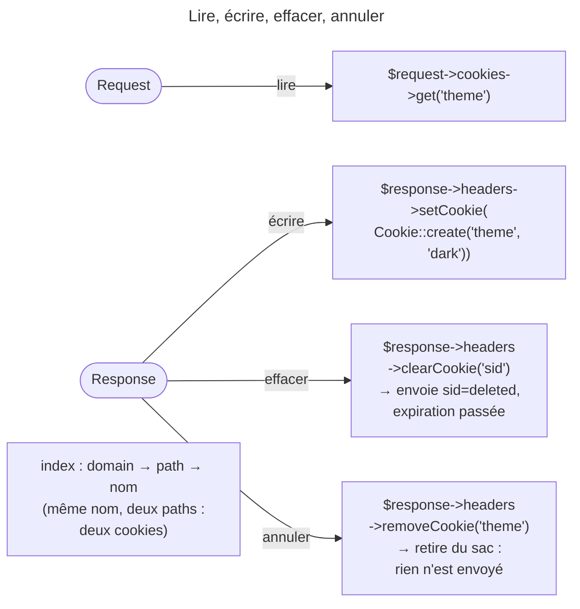

## Objectif

Savoir de quel côté un cookie se lit et de quel côté il s'écrit dans un
controller. Les attributes de sécurité — `SameSite`, `Secure`, `HttpOnly` — et la
constraint de suppression sont traités dans le lot HTTP.

## L'essentiel

Un cookie se **lit** sur la Request — c'est ce que le client a envoyé — et
s'**écrit** sur la Response, dans le header `Set-Cookie`. Un controller qui veut
poser un cookie doit donc tenir la Response. Deux methods aux noms voisins font
le contraire l'une de l'autre : `removeCookie()` annule un envoi,
`clearCookie()` efface chez le client.

## Le schéma



## L'exemple : poser un cookie de préférence

```php
$response = $this->render('page.html.twig');
$response->headers->setCookie(Cookie::create('theme', 'dark'));

return $response;
```

## Deux objects, deux sens

| Opération | Object | Path |
|---|---|---|
| **lire** un cookie | `Request` | `$request->cookies->get('nom')` |
| **écrire** un cookie | `Response` | `$response->headers->setCookie(...)` |
| **supprimer** un cookie chez le client | `Response` | `$response->headers->clearCookie('nom')` |
| **retirer** un cookie de la Response | `Response` | `$response->headers->removeCookie('nom')` |

## Conséquence pratique

Le controller construit la Response, y attache le cookie, puis la retourne. La
function PHP `setcookie()` marche au niveau du protocole, mais écrit le header
hors de la Response : le cookie échappe aux listeners de `kernel.response` et
aux functional tests qui inspectent la Response.

`removeCookie()` fait un `unset` dans le sac : aucun `Set-Cookie` ne part.
`clearCookie()` appelle `setCookie()` avec une valeur nulle et une date
d'expiration dans le passé : c'est un header envoyé. Les cookies sont rangés sur
trois niveaux — domain, path, nom — d'où le path (`/` par défaut) et le domain
de `removeCookie()`. `getCookies()` rend une liste à plat, ou l'arborescence
avec `ResponseHeaderBag::COOKIES_ARRAY` ; un autre format lève une
`InvalidArgumentException`.

## Pièges d'examen

**On lit un cookie sur la Request et on l'écrit sur la Response.** Poser un
cookie sur l'object Request ne l'envoie nulle part : la Request est ce que le
client a déjà envoyé.

**`removeCookie()` ne supprime rien chez le client.** Elle retire l'entrée du
sac, donc le cookie n'est pas envoyé du tout. Pour faire oublier un cookie déjà
posé, il faut en **envoyer** un — c'est `clearCookie()`.

**La fonction native de PHP fonctionne, et c'est le problème.** Elle écrit
le header hors du modèle de Symfony : le cookie échappe aux listeners de
`kernel.response` et n'apparaît pas dans un functional test qui inspecte la
Response.

**Écrire un cookie oblige donc à tenir la Response.** Un controller qui délègue
entièrement le rendu n'a pas d'endroit où l'attacher.

## Application

- Faire oublier au navigateur un cookie déjà posé → `clearCookie()`.
- Renoncer, plus bas dans le controller, à un cookie qu'on vient d'ajouter →
  `removeCookie()`.

## QCM d'entraînement

**Question 1.** Une Response reçoit deux cookies `t`, l'un sur le path `/`,
l'autre sur `/admin`. Combien `getCookies()` en rend-elle ?

- **A.** Un : le second écrase le premier
- **B.** Deux
- **C.** Un : le premier est conservé
- **D.** Une exception : nom dupliqué

<details>
<summary>Correction</summary>

**Bonne réponse : B.** L'index va du domain au path puis au nom : deux paths
différents donnent deux entrées, qui partent toutes les deux.

</details>

**Question 2.** Dans ce même cas, le controller appelle
`removeCookie('t')` sans autre argument. Que reste-t-il ?

- **A.** Rien : les deux cookies sont retirés
- **B.** Le cookie du path `/`
- **C.** Les deux : il manque le domain
- **D.** Le cookie du path `/admin`

<details>
<summary>Correction</summary>

**Bonne réponse : D.** Sans path, la method vise `/` : seul le cookie de la
racine est retiré, celui de `/admin` partira.

</details>

**Question 3.** Que produit `$response->headers->clearCookie('sid')` ?

- **A.** Rien n'est envoyé : le sac est nettoyé
- **B.** Une exception si `sid` n'a pas été posé
- **C.** Un `sid` vide, déjà expiré
- **D.** Un appel à `setcookie()` de PHP

<details>
<summary>Correction</summary>

**Bonne réponse : C.** La method écrit un cookie de valeur nulle, daté dans le
passé ; c'est cet envoi qui fait oublier le cookie au navigateur.

</details>

**Question 4.** Que fait `$response->headers->getCookies('tree')` ?

- **A.** Elle rend la liste à plat
- **B.** Une `InvalidArgumentException`
- **C.** Elle rend l'arborescence par domain
- **D.** Elle rend un array vide

<details>
<summary>Correction</summary>

**Bonne réponse : B.** Seuls les formats à plat et en arborescence existent ;
un autre format est refusé au lieu de retomber sur le défaut.

</details>

## Fiche express

**Si tu dois retenir seulement 5 choses :**

- **Lire** sur la Request, **écrire** sur la Response.
- `setcookie()` de PHP contourne la Response : **à éviter**.
- `clearCookie()` **envoie** une expiration passée ; `removeCookie()`
  **n'envoie rien**.
- Index **domain → path → nom** ; `removeCookie()` vise `/` par défaut.
- `getCookies()` : à plat ou en array ; autre format → exception.

Moyen mnémotechnique : **« Clear efface chez lui, remove annule chez moi »**.

## Sources officielles

- [ResponseHeaderBag, branche 8.0](https://github.com/symfony/symfony/blob/8.0/src/Symfony/Component/HttpFoundation/ResponseHeaderBag.php)

