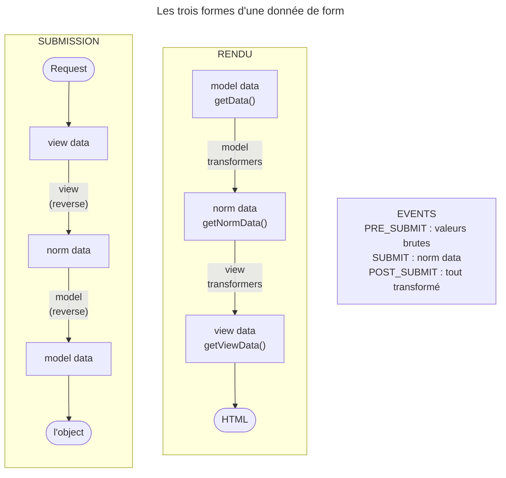

## Objectif

Comprendre ce que le component Form fait réellement : convertir un object
applicatif en fields HTML, et le path inverse. C'est ce modèle qui explique
tout le reste du lot.

## L'essentiel

Un navigateur n'envoie que du texte ; une application manipule des objects.
Le component Form convertit dans les deux sens à travers **trois couches** :
**model** (le format de l'application), **normalized** (un format pivot),
**view** (des strings). Il est autonome : utilisable sans FrameworkBundle.

## Le schéma



## L'exemple : l'échéance d'une tâche

```php
$form = $formFactory->create(DateType::class, new \DateTime('2026-10-18'), [
    'widget' => 'choice',
]);
$form->getData();      // DateTime(2026-10-18)                              — model
$form->getNormData();  // DateTime(2026-10-18)                              — normalized
$form->getViewData();  // ['year' => '2026', 'month' => '10', 'day' => '18'] — view
```

## Le problème résolu

Le component construit les fields à partir d'un object, et reconstruit
l'object à partir de ce que le navigateur renvoie. `Forms::createFormFactory()`,
sans kernel ni FrameworkBundle, suffit à créer et soumettre un form.

## Les trois couches de données

| Couche | Contenu | Method |
|---|---|---|
| **Model** | le format de l'application ; ce qu'on passe à `createForm()` | `getData()` |
| **Normalized** | le pivot, identique au modèle pour la plupart des types | `getNormData()` |
| **View** | le format des fields HTML : des strings | `getViewData()` |

Les **model transformers** relient modèle et normalisée ; les **view
transformers**, normalisée et vue. Un `IntegerType` : model `42`, normalized
`42`, view `"42"`.

### Le `DateType`, et une erreur de la documentation

La documentation 8.0 donne pour norm data un array d'ints. Le code dit autre
chose : le view transformer, `DateTimeToArrayTransformer`, part d'un
`DateTime`.

| Option `input` | Model data | Normalized data |
|---|---|---|
| `datetime` (défaut) | `DateTime` | `DateTime` |
| `array` | `['year' => 2026, …]` | `DateTime` |
| `string` | `'2026-10-18'` | `DateTime` |
| `datetime_immutable` | `DateTimeImmutable` | `DateTime` |

La norm data d'un `DateType` est **toujours un `DateTime`** : le format pivot
vers lequel chaque format d'entrée est ramené. L'array d'ints est la donnée
**modèle** quand `input` vaut `array`. La vue est un array de strings.

## Les deux sens

- **Au rendu** : model → model transformers → norm → view transformers → view.
- **À la submission** : view → view transformers à l'envers → norm → model
  transformers à l'envers → model, réécrite dans l'object. Un `DateType` soumis
  avec `['year' => '2026', 'month' => '10', 'day' => '18']` rend un
  `DateTime(2026-10-18)`.

Les mêmes transformers servent dans les deux sens ; à la submission, c'est
leur method inverse qui est appelée.

## Pièges d'examen

**Trois couches de données, pas deux.** Modèle, normalisée, vue : la couche
intermédiaire est identique au modèle pour la plupart des types, ce qui la rend
facile à oublier.

**La norm data d'un `DateType` est un `DateTime`**, pas l'array
d'ints de l'exemple documenté.

**La vue est faite de strings.** Un navigateur n'envoie que du texte.

**Le component est autonome.** Ce n'est pas une fonctionnalité de
FrameworkBundle.

**Un `DateTimeImmutable` en model devient un `DateTime` en norm data** : le
pivot du `DateType` est mutable, quel que soit le format de l'application.

## Application

- **La date stockée en string** `'2026-10-18'` → `DateType` avec
  `input: 'string'` : model string, norm `DateTime`, vue array de strings.
- Une date affichée vide → comparer `getData()`, `getNormData()` et
  `getViewData()` : la couche où la valeur disparaît désigne le transformer.

## QCM d'entraînement

**Question 1.** Un `IntegerType` contient `42`. Que rend `getViewData()` ?

- **A.** L'int `42`, comme la model data
- **B.** La string `"42"`
- **C.** `['value' => 42]`, un array de vue
- **D.** `null` tant que le form n'est pas rendu

<details>
<summary>Correction</summary>

**Bonne réponse : B.** La vue est faite de strings, le format qu'un navigateur
envoie ; model et norm data restent l'int `42`.

</details>

**Question 2.** Un `DateType` est déclaré avec `input: 'datetime_immutable'`.
Quelle est sa norm data ?

- **A.** Un `DateTimeImmutable`, comme le modèle
- **B.** Un array d'ints
- **C.** Un `DateTime`
- **D.** La string `'2026-10-18'`

<details>
<summary>Correction</summary>

**Bonne réponse : C.** Le pivot du `DateType` est un `DateTime` mutable, quel
que soit le format choisi par l'application pour son modèle.

</details>

**Question 3.** Le component Form peut-il être utilisé sans FrameworkBundle ?

- **A.** Non : il dépend du service container
- **B.** Oui, par `Forms::createFormFactory()`
- **C.** Non : il exige le kernel pour lire la Request
- **D.** Oui, mais sans submission possible

<details>
<summary>Correction</summary>

**Bonne réponse : B.** Le component est autonome, comme HttpFoundation : la
factory se crée et soumet un form sans kernel.

</details>

**Question 4.** Dans un `DateType`, quelle couche peut porter l'array d'ints
`['year' => 2026, 'month' => 10, 'day' => 18]` ?

- **A.** La norm data, comme le dit la documentation
- **B.** La view data, à tout moment
- **C.** Aucune : un `DateType` ne manipule pas d'array
- **D.** La model data, avec `input: 'array'`

<details>
<summary>Correction</summary>

**Bonne réponse : D.** La norm data reste un `DateTime`, et la vue est faite de
strings : l'array d'ints est le format modèle choisi par `input`.

</details>

## Fiche express

**Si tu dois retenir seulement 6 choses :**

- **Trois couches** : model, normalized, view.
- `getData()`, **`getNormData()`**, `getViewData()`.
- Model transformers : modèle ↔ norm ; view transformers : norm ↔ vue.
- La vue est faite de **strings**.
- `DateType` : norm data **toujours `DateTime`**, quel que soit `input`.
- Le component est **autonome**.

Moyen mnémotechnique : **« Métier, Pivot, Texte »** — model, normalized,
view.

## Sources officielles

- [Forms, « The Data Transformation Lifecycle » et « Accessing Form Data »](https://github.com/symfony/symfony-docs/blob/8.0/forms.rst)
- [Form 8.0, `DateType`](https://github.com/symfony/symfony/blob/8.0/src/Symfony/Component/Form/Extension/Core/Type/DateType.php) et [`DateTimeToArrayTransformer`](https://github.com/symfony/symfony/blob/8.0/src/Symfony/Component/Form/Extension/Core/DataTransformer/DateTimeToArrayTransformer.php)

