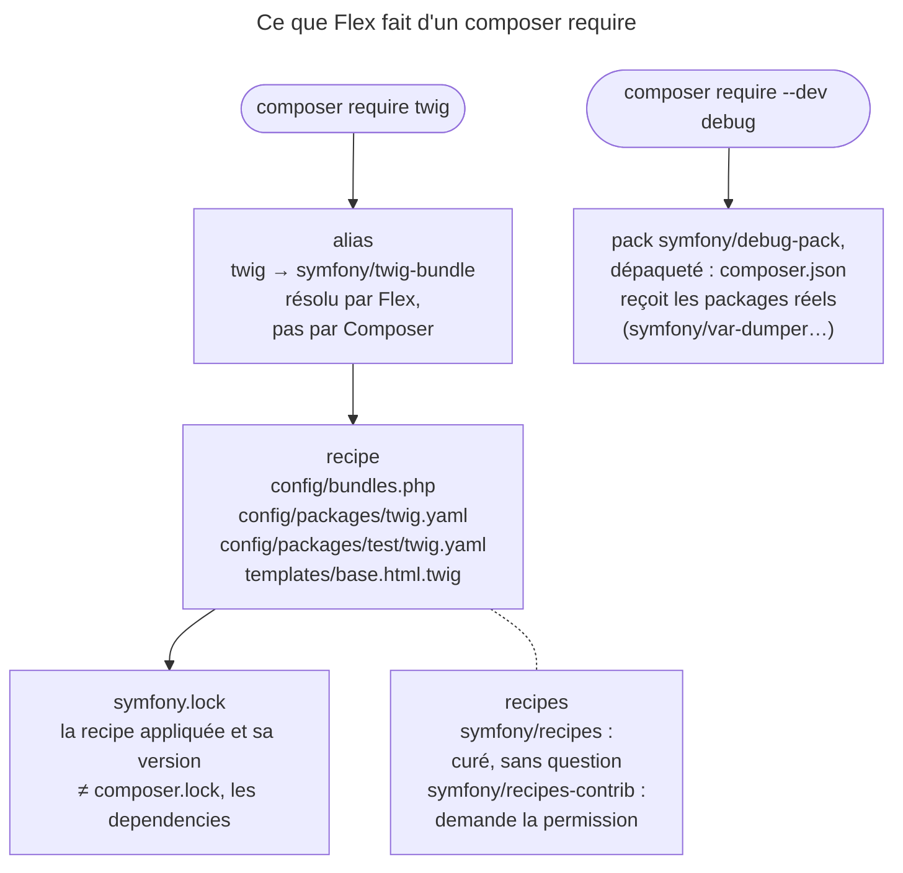

## Objectif

Savoir ce qu'est Flex techniquement, ce qu'une recipe fait, et quels files
Flex écrit dans le projet.

## L'essentiel

Flex est un **plugin Composer** : il ne s'appelle pas, il change ce que font
`composer require`, `update` et `remove`. Il apporte trois mécanismes — l'alias,
la recipe, le pack — et note les recipes appliquées dans `symfony.lock`, à
committer. Deux repositories de recipes, deux comportements.

## Le schéma



## L'exemple : installer et configurer en une command

```bash
composer require twig
# Flex résout l'alias, Composer installe symfony/twig-bundle,
# la recipe active le bundle et dépose sa configuration et templates/
```

## Ce que Flex est

Un plugin Composer, ni bundle ni command : il n'apparaît pas dans
`config/bundles.php`. Sans lui, `composer require twig` échoue, parce que
`twig` n'est le nom d'aucun package Composer.

## Alias et recipes

Trois mots, trois choses distinctes :

- un **alias** est un nom court que Flex résout — `twig` en
  `symfony/twig-bundle`, `api` en `api-platform/api-pack`, un pack tiers ;
- une **recipe** est la configuration qu'un package apporte : activer un bundle,
  créer des files et des directories, ajouter des variables à `.env` ;
- un **pack** est un métapaquet sans code. Flex le dépaquette : on cherche en
  vain `symfony/debug-pack` dans `composer.json` après l'installation.

La liste complète des recipes et des alias est publiée dans `RECIPES.md`, sur
le repository des recipes.

## symfony.lock

Il recense les recipes appliquées et leur version, et **se committe** : c'est
lui qui permet de savoir qu'une recipe a évolué. Il joue pour les recipes le
role que `composer.lock` joue pour les dependencies — deux files distincts.

## Les deux repositories de recipes

| Repository | Contenu | Comportement de Flex |
|---|---|---|
| `symfony/recipes` | liste **curée**, packages de qualité et maintenus | seul consulté par défaut |
| `symfony/recipes-contrib` | les recipes de la communauté | demande votre permission |

Les recipes contrib « are guaranteed to work » : c'est le **package** associé
qui « could be unmaintained ».

## Pièges d'examen

**Flex est un plugin Composer, pas un bundle ni une command.** Il n'y a rien à
appeler : il modifie `composer require`, `update` et `remove`. C'est aussi
pourquoi `composer require twig` fonctionne alors qu'aucun package ne s'appelle
`twig`.

**`symfony.lock` n'est pas `composer.lock`.** Il recense les **recipes**
appliquées, et il se committe.

**Les deux repositories de recipes ne se comportent pas pareil.**
`symfony/recipes` est appliqué sans question ; `symfony/recipes-contrib` demande
une permission. La raison n'est pas que ses recipes seraient douteuses — la
documentation les dit « guaranteed to work » — mais que les **packages** qu'elles
configurent peuvent être abandonnés.

## Application

- Un projet qui a perdu `symfony.lock` → on ne sait plus quelles recipes ont
  été appliquées : le committer.
- Un outil de debug à installer pour le développement → `composer require
  --dev debug`.

## QCM d'entraînement

**Question 1.** Après `composer require --dev debug`, que trouve-t-on dans
`composer.json` ?

- **A.** `symfony/debug-pack`, en `require-dev`
- **B.** Les packages réels, comme `symfony/var-dumper`
- **C.** Rien : un pack ne s'inscrit pas
- **D.** `symfony/debug-pack` et ses packages, côte à côte

<details>
<summary>Correction</summary>

**Bonne réponse : B.** Flex dépaquette le pack : il inscrit les dependencies
réelles qu'il regroupe, et retire le métapaquet lui-même.

</details>

**Question 2.** `composer require twig` est lancé dans un projet **sans**
Flex. Que se passe-t-il ?

- **A.** Composer installe `twig/twig`, l'engine seul
- **B.** Composer installe le bundle sans le configurer
- **C.** Composer échoue : aucun package ne s'appelle `twig`
- **D.** Composer installe `symfony/twig-bundle` et applique sa recipe

<details>
<summary>Correction</summary>

**Bonne réponse : C.** La résolution de l'alias est le travail de Flex ; sans
lui, Composer cherche un package de ce nom exact et n'en trouve aucun.

</details>

**Question 3.** Où se trouve la liste complète des recipes et des alias de
Flex ?

- **A.** Dans `RECIPES.md`, côté recipes
- **B.** Dans `symfony.lock`, à la racine du projet
- **C.** Dans `composer.json`, key `extra.symfony`
- **D.** Dans `config/bundles.php`

<details>
<summary>Correction</summary>

**Bonne réponse : A.** `symfony.lock` ne recense que les recipes déjà
appliquées au projet ; la liste publiée de toutes les recipes est `RECIPES.md`.

</details>

**Question 4.** Un alias de Flex pointe-t-il toujours vers un bundle Symfony ?

- **A.** Oui : un alias ne nomme qu'un bundle
- **B.** Oui, sauf en environment de test
- **C.** Non : seulement vers un package de `symfony/*`
- **D.** Non : `api` vise un pack tiers

<details>
<summary>Correction</summary>

**Bonne réponse : D.** `api` est résolu en `api-platform/api-pack` : un
métapaquet, publié hors de l'organisation Symfony.

</details>

## Fiche express

**Si tu dois retenir seulement 6 choses :**

- Flex = **plugin Composer** ; il change `require`, `update`, `remove`.
- **Alias** : nom court ; **recipe** : configuration ; **pack** : métapaquet.
- Un pack est **dépaqueté** : il n'apparaît pas dans `composer.json`.
- **`symfony.lock`** recense les recipes et se committe.
- `symfony/recipes` sans question ; **`recipes-contrib`** demande.
- Contrib : recipe garantie, **package** peut-être abandonné.

Moyen mnémotechnique : **« Un nom, une config, un package »**.

## Sources officielles

- [Setup, section « Symfony Flex »](https://github.com/symfony/symfony-docs/blob/8.0/setup.rst)
- [Quick Tour, « Flex Recipes and Aliases »](https://github.com/symfony/symfony-docs/blob/8.0/quick_tour/flex_recipes.rst)

