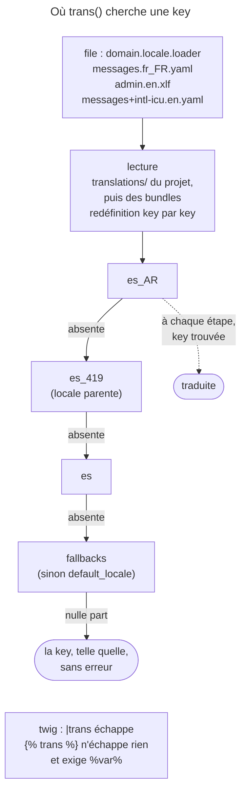

## Objectif

Traduire un message selon la locale du user, et savoir exactement quel
file Symfony va lire — c'est là que se jouent les surprises.

## L'essentiel

`trans()` cherche une key dans un catalogue choisi par le **nom du file** —
domain, locale, loader — et rend la key telle quelle si rien ne répond. Deux
syntaxes de placeholder coexistent : `%name%` en format classique, `{name}`
avec ICU MessageFormat, activé par le suffixe `+intl-icu`. Une key absente
suit une cascade de repli.

## Le schéma



## L'exemple : saluer

```yaml
# translations/messages+intl-icu.en.yaml
say_hello: 'Hello {name}!'
num_of_apples: >-
    {apples, plural, =0 {There are no apples} =1 {There is one apple} other {There are # apples!}}
```

```php
$translator->trans('say_hello', ['name' => 'Fabien']);   // Hello Fabien!
$translator->trans('Hello World', domain: 'app');        // le domain app
```

## Le nom du file n'est pas décoratif

- **domain** (`messages` par défaut), **locale** (`en`, `en_GB`), **loader**
  choisi par l'extension : `yaml`, `xlf`, `php`, `csv`, `json`, `ini`, `po`,
  `mo`.
- YAML pour un projet simple, XLIFF quand des translators et leurs outils
  interviennent.
- `translations/` du projet passe avant celui des bundles, **key par key**.
- Un nouveau catalogue exige un `cache:clear`.
- *i18n* sort les strings dans une couche traduisible ; la localisation
  fournit les valeurs d'une locale. Forme recommandée : `fr_FR`.
- Hors périmètre : les utilitaires d'accès aux données ICU du component Intl.

## Plusieurs catalogues pour une key

- Deux resources d'un même domain et d'une même locale : la **dernière**
  chargée gagne, key par key ; les autres keys restent.
- `messages` et `messages+intl-icu` comptent comme **un seul** domain : là
  aussi, la dernière chargée gagne. Les files d'un dossier se chargent par
  ordre de nom, et `+` passe avant `.` : avec `messages.en.yaml` et
  `messages+intl-icu.en.yaml`, c'est la version **classique** qui l'emporte.
- Une key trouvée dans une locale de repli est formatée avec les règles de
  **cette** locale.

## Les deux syntaxes de placeholder

| | Format classique | ICU MessageFormat |
|---|---|---|
| File | `messages.en.yaml` | `messages+intl-icu.en.yaml` |
| Écriture | `Hello %name%!` | `Hello {name}!` |

Sans `+intl-icu`, le remplacement est un `strtr` littéral :
`['name' => 'Ann']` sur `Hello {name}!` donne `Hello {Ann}!`. Dans un plural
ICU, `#` reprend le nombre, `=0` vise une valeur **exacte**, `one`, `few`,
`many`, `other` sont des **catégories** propres à chaque langue : l'anglais
n'a que `one` et `other`, le russe en a quatre.

Dans Twig : `{{ message|trans }}` traduit une expression et échappe le
résultat ; `Hello %name%` traduit un block statique,
et le tag n'échappe rien — parameters compris. ``
ne vaut que pour le template courant.

## La cascade de repli

Locale `es_AR`, key absente : `es_AR`, puis la **locale parente**, `es_419`
— définie pour certaines locales seulement —, puis `es`, puis l'option
**`fallbacks`**, qui vaut `default_locale` si elle n'est pas configurée.

## Pièges d'examen

**Un message non traduit est retourné tel quel**, sans erreur.

**`+intl-icu` est un suffixe de nom de file**, pas une option de
configuration.

**`%name%` en format classique, `{name}` en ICU** — les deux ne se mélangent
pas.

**Le directory `translations/` du projet prime** sur celui des bundles, key
par key.

**La locale parente s'intercale** dans le repli.

**`trans_default_domain` ne franchit pas un `include`.**

**Le tag `` n'échappe pas** ; le filter, si.

## Application

- Corriger deux libellés d'un bundle → les deux keys seules, dans
  `translations/` du projet.
- « 1 apple, 2 apples » → un catalogue `+intl-icu` et un plural ICU.

## QCM d'entraînement

**Question 1.** Deux resources du domain `messages`, locale `fr`, sont
chargées l'une après l'autre ; seule la key `title` existe dans les deux.
Que donne `trans()` ?

- **A.** La seconde resource remplace la première en entier
- **B.** Une erreur : key définie deux fois
- **C.** La première chargée gagne pour `title`
- **D.** La dernière chargée, pour `title` seulement

<details>
<summary>Correction</summary>

**Bonne réponse : D.** Les catalogues d'un même domain et d'une même locale
se fusionnent key par key, la dernière resource chargée l'emportant ; les
autres keys restent.

</details>

**Question 2.** Autoescape actif, le template écrit
`{{ 'hi'|trans({'%who%': '<i>x</i>'}) }}`, avec `hi: 'Hi %who%'`. Que
devient le parameter ?

- **A.** `<i>x</i>`, rendu en italique
- **B.** Échappé : `&lt;i&gt;x&lt;/i&gt;`
- **C.** Retiré : le filter supprime les tags
- **D.** Une exception : parameter HTML refusé

<details>
<summary>Correction</summary>

**Bonne réponse : B.** Le filter échappe le message traduit, parameters
compris ; seul le tag `` les rend tels quels.

</details>

**Question 3.** Combien de catégories de plural ICU l'anglais utilise-t-il ?

- **A.** Deux : `one` et `other`
- **B.** Quatre, comme le russe
- **C.** Une seule, `other`
- **D.** Six : `zero`, `one`, `two`, `few`, `many`, `other`

<details>
<summary>Correction</summary>

**Bonne réponse : A.** Les catégories sont propres à chaque langue ; `=0` ou
`=1`, eux, visent une valeur exacte, quelle que soit la langue.

</details>

**Question 4.** Locale `fr`. Quel catalogue lit
`$translator->trans('Hello World', domain: 'app')` ?

- **A.** `messages.fr.yaml`, le domain par défaut
- **B.** `app.yaml`, sans locale
- **C.** `app.fr.yaml`
- **D.** `messages+app.fr.yaml`

<details>
<summary>Correction</summary>

**Bonne réponse : C.** Le domain désigne le premier segment du nom de file ;
la locale, le second ; l'extension choisit le loader.

</details>

## Fiche express

**Si tu dois retenir seulement 7 choses :**

- **`domaine.locale.chargeur`** ; domain par défaut : `messages`.
- Key introuvable : **rendue telle quelle**, sans erreur.
- Projet avant bundles, **key par key** ; nouveau catalogue : `cache:clear`.
- **`%name%`** classique, **`{name}`** ICU, par **`+intl-icu`**.
- Plural ICU : `=0` exact, `one` / `other` selon la langue.
- Repli : locale, **locale parente**, langue, `fallbacks`.
- `|trans` échappe, `` non ; `trans_default_domain` reste local.

Moyen mnémotechnique : **« Domain, locale, loader — puis on remonte »**.

## Sources officielles

- [Translations](https://github.com/symfony/symfony-docs/blob/8.0/translation.rst)
- [ICU MessageFormat](https://github.com/symfony/symfony-docs/blob/8.0/reference/formats/message_format.rst)
- [`Translator`, branche 8.0](https://github.com/symfony/symfony/blob/8.0/src/Symfony/Component/Translation/Translator.php)

