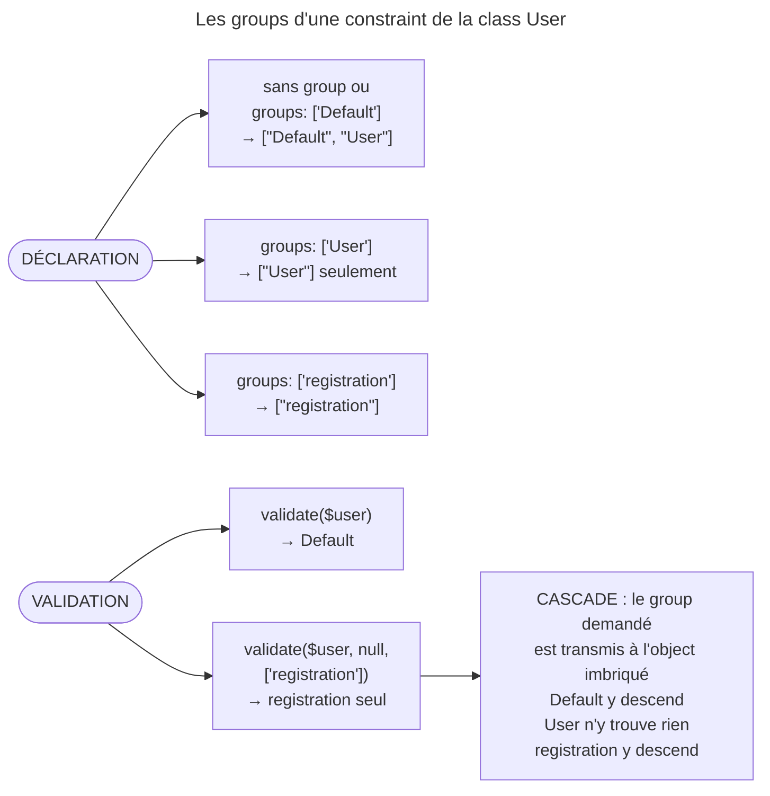

## Objectif

N'appliquer qu'une partie des constraints d'une class, et connaître les deux
groups que Symfony crée sans qu'on les déclare.

## L'essentiel

Un **group** est un nom posé sur une constraint ; à la validation, on choisit
les noms à appliquer. Sans group demandé, **seul `Default`** s'applique. Et
chaque class a deux groups que personne n'écrit : `Default` et **le nom de la
class** — identiques, sauf sur les objects imbriqués.

## Le schéma



## L'exemple : un `User` à deux usages

```php
class User
{
    #[Assert\Email(groups: ['registration'])]
    private string $email;

    #[Assert\NotBlank(groups: ['registration'])]
    #[Assert\Length(min: 7, groups: ['registration'])]
    private string $password;

    #[Assert\Length(min: 2)]
    private string $city;
}
```

À l'inscription, le password compte ; à la modification du profil, seule la
ville est vérifiée.

## Les groups implicites

| Group | Contenu |
|---|---|
| `Default` | les constraints sans group explicite — ici `city` |
| `User` | **le nom de la class** : les constraints de `User` qui sont dans `Default` |
| `registration` | les constraints étiquetées — `email` et `password` |

- `new Assert\NotBlank()` porte `["Default"]` ; rattachée à la class
  (`addImplicitGroupName('User')`), elle porte `["Default", "User"]`.
- Un group ne se déclare nulle part : il existe dès qu'une constraint le nomme.

**Un écart entre la documentation et le code.** `groups.rst` range dans
`Default` les constraints configurées avec le nom de la class. Exécuté : une
constraint `groups: ['User']` a pour seuls groups `["User"]` et ne s'exécute
**pas** en validant `Default`. Ce qui est dans `Default` est dans `User`, pas
l'inverse.

## Valider avec un group

```php
$validator->validate($user);                                   // Default
$validator->validate($user, null, ['registration']);           // registration seul
$validator->validate($user, null, ['Default', 'registration']); // les deux
```

- Sans argument : `Default`, pas « toutes les constraints ».
- Le troisième argument accepte aussi une string : `'Default'`.
- Un group inconnu ne lève rien : il ne sélectionne aucune constraint.
- Dans un form : l'option `validation_groups`.

## `Default` contre le nom de la class

`User::$address` porte `#[Assert\Valid]` :

| Group demandé | Violations |
|---|---|
| `Default` | `city`, `address.zip` |
| `User` | `city`, sans `address.zip` |
| `registration` | `email`, `address.street` |

Le group demandé est transmis à l'`Address` : `Default` y a un sens, `User`
non, un group nommé la traverse.

Avec l'inheritance, `User extends BaseUser` :

| Group demandé | Violations |
|---|---|
| `Default` ou `User` | celles de `User` **et** de `BaseUser` |
| `BaseUser` | celles de `BaseUser` seulement |

La troisième différence, avec une group sequence, est traitée dans l'item
*Group sequence*.

## Pièges d'examen

**Sans group passé, seul `Default` est validé.** Une constraint étiquetée
`registration` ne s'exécute jamais si personne ne demande ce group.

**`Default` et le nom de la class ne sont pas interchangeables** dès qu'il y a
un object imbriqué.

**Une constraint étiquetée du seul nom de la class n'est pas dans `Default`**,
quoi qu'en dise la documentation.

**Un group ne se déclare nulle part** : il existe dès qu'une constraint le
nomme.

## Application

- Un form d'inscription qui garde les règles communes →
  `validation_groups: ['Default', 'registration']`.
- Un form de profil → rien, ou `['Default']`.

## QCM d'entraînement

**Question 1.** Dans la class `Invoice`, une constraint est déclarée
`groups: ['Invoice']`. Que fait `validate($invoice)` avec elle ?

- **A.** Il l'exécute : le nom de la class équivaut à `Default`
- **B.** Il l'exécute deux fois, une par group implicite
- **C.** Il lève une exception : le nom de la class est réservé
- **D.** Il ne l'exécute pas

<details>
<summary>Correction</summary>

**Bonne réponse : D.** Ses seuls groups sont `["Invoice"]` ; elle ne s'exécute
que si l'on demande ce group, quoi qu'en dise la documentation.

</details>

**Question 2.** `Seller extends Account`, chacune avec un `NotBlank` sans
group. Que valide `validate($seller, null, ['Account'])` ?

- **A.** Les constraints de `Seller` et d'`Account`
- **B.** Rien : `Account` n'est pas la class de l'object
- **C.** Les constraints d'`Account` seulement
- **D.** Une exception : un group doit être celui de la class

<details>
<summary>Correction</summary>

**Bonne réponse : C.** Le group du parent ne couvre que le parent ; c'est le
group de la sous-classe qui couvre aussi le parent.

</details>

**Question 3.** `Order::$billing` porte `#[Assert\Valid]`, et `Billing::$vat`
un `NotBlank(groups: ['checkout'])`, vide. Quel appel signale `billing.vat` ?

- **A.** `validate($order, null, ['checkout'])`
- **B.** `validate($order)`
- **C.** `validate($order, null, ['Order'])`
- **D.** Aucun : `Valid` ne transmet que `Default`

<details>
<summary>Correction</summary>

**Bonne réponse : A.** Le group demandé est transmis tel quel à l'object
imbriqué : `checkout` y atteint la constraint étiquetée.

</details>

**Question 4.** Le form d'inscription utilise
`validation_groups: ['registration']`, et la ville trop courte n'est plus
signalée. Que faut-il ?

- **A.** Ajouter `groups: ['registration']` sur chaque constraint de la class
- **B.** `['Default', 'registration']`
- **C.** Remplacer `registration` par le nom de la class
- **D.** Retirer l'option : tous les groups seront alors validés

<details>
<summary>Correction</summary>

**Bonne réponse : B.** `Default` porte les règles communes ; sans lui, seules
les constraints étiquetées `registration` sont vérifiées.

</details>

## Fiche express

**Si tu dois retenir seulement 6 choses :**

- Sans group : `Default` **et** le group du nom de la class.
- `validate($o)` n'applique **que `Default`**.
- `groups: ['User']` n'est **pas** dans `Default`.
- Cascade : `Default` descend dans l'object imbriqué, le nom de la class non,
  un group nommé oui.
- Inheritance : le group de la sous-classe couvre le parent ; celui du parent,
  le parent seul.
- Un group inconnu ne lève rien : il ne sélectionne rien.

Moyen mnémotechnique : **« Default par défaut, le reste sur demande »**.

## Sources officielles

- [Validation Groups](https://github.com/symfony/symfony-docs/blob/8.0/validation/groups.rst)
- [Validator 8.0, `Constraint::addImplicitGroupName()`](https://github.com/symfony/symfony/blob/8.0/src/Symfony/Component/Validator/Constraint.php)

