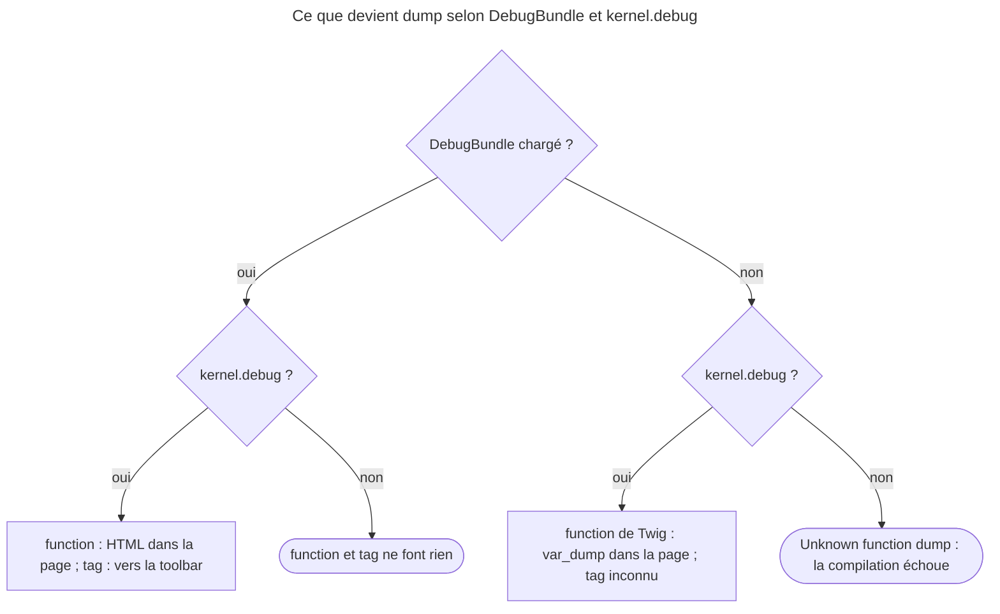

## Objectif

Inspecter le contenu d'une variable dans un template, savoir où le résultat
apparaît, et ce qui se passe hors du développement.

## Avant la règle : le problème à résoudre

Un template affiche une liste vide alors que le controller semble passer des
articles. Il faut **voir** la variable : sa structure, ses keys, ses valeurs. Un
`{{ articles|json_encode }}` casse la mise en page et cache les objects ; et un
outil de debug oublié ne doit jamais atteindre la production.

Symfony répond avec **un tag et une function** du même nom, `dump`, qui
n'écrivent pas au même endroit, et **deux commands** qui inspectent les
templates sans les rendre. Tous les faits de cette page ont été exécutés dans
des kernels Symfony 8.0.15 démarrés — DebugBundle 8.0.8 —, avec et sans
DebugBundle, en `debug` et hors `debug`.

## Le fil rouge : la liste vide

```twig
{# templates/blog/index.html.twig #}
       {# vers la debug toolbar, la page reste intacte #}

<ul>
    
        <li>{{ article.title }}</li>
    
</ul>

<aside>{{ dump(articles|first) }}</aside>  {# dans la page, à cet endroit #}
```

```bash
php bin/console debug:twig --filter=date     # ce que Twig connaît vraiment
php bin/console lint:twig templates/          # la syntaxe, sans rendre
```

## Le cycle complet en un schéma

Ce que devient un appel à `dump`, selon les bundles et le mode, lu dans
`ExtensionPass` et `DumpExtension`, et rejoué :



## Deux formes, deux destinations

C'est la distinction qui compte :

| Écriture | Où va le résultat |
|---|---|
| `{{ dump(article) }}` | **dans la page**, visible à l'endroit de l'appel |
| `` | dans la **debug toolbar**, pas dans la page |

Le tag est donc le bon choix quand on inspecte une variable dans une mise en page
qu'on ne veut pas casser. Le code 8.0 le montre : `DumpExtension::dump()` rend
du HTML inséré dans la page, alors que `DumpNode` compile le tag en un appel
à `VarDumper::dump()`, que DebugBundle collecte pour la barre.

Sans argument, `{{ dump() }}` comme `` sortent **tout le contexte** du
template, macros exclues.

**Rejoué** avec DebugBundle, en `debug` : `[{{ dump(x) }}]` insère un fragment HTML
`sf-dump` entre les crochets ; `[]` laisse la page à `[]`. Sans
argument, le fragment contient chaque variable du contexte, `app` comprise.

## Étiqueter ce qu'on inspecte

- Le **tag** nomme lui-même ce qu'il affiche : `` se compile
  en `VarDumper::dump(["articles" => …, "user" => …])`.
- La **function** : la documentation montre
  `{{ dump(blog_posts: articles, user: app.user) }}`. Or `DumpExtension`
  déclare `dump(Environment $env, array $context)` sans argument variadique, et
  Twig 3.22 rejette alors les named arguments : **`SyntaxError: Unknown
  arguments`**, reproduit en exécutant Twig 3.22 avec une function déclarée à
  l'identique. Les arguments positionnels, eux, passent.

**Rejoué** avec la vraie `DumpExtension` de Twig Bridge 8.0 : l'exemple de la
documentation lève « Unknown arguments "blogposts", "user" for function
"dump()" » — Twig retire le souligné du nom avant de le chercher. Avec un seul
named argument, `dump(posts: x)`, le message est au singulier. L'erreur tombe
à la compilation, en `debug` comme hors `debug`.

## Hors du développement

La function et le tag viennent de `DumpExtension`, que **DebugBundle**
enregistre (`services.php`). La documentation les annonce en `dev` et `test`
seulement.

- Bundle absent **et `kernel.debug` à `false`** — le cas de la production : la
  function n'existe pas, et la compilation du template échoue — `SyntaxError:
  Unknown "dump" function`. C'est l'« erreur PHP » que décrit la documentation
  pour `prod`.
- Bundle absent mais `kernel.debug` actif : `ExtensionPass` (TwigBundle 8.0)
  active alors la `DebugExtension` de **Twig** lui-même. Sa function `dump()`
  écrit un `var_dump` brut dans la page ; le **tag** `dump`, lui, n'existe pas.
- Extension chargée mais `kernel.debug` à `false` : `dump()` rend `null` et le
  tag ne fait rien — les deux testent `isDebug()`.

C'est délibéré : un `dump()` oublié divulguerait l'état interne de
l'application.

**Rejoué :**

| DebugBundle | `kernel.debug` | `{{ dump(x) }}` | `` |
|---|---|---|---|
| oui | oui | HTML `sf-dump` dans la page | rien dans la page ; vers le collector |
| oui | non | rien | rien |
| non | oui | `array(1) { ["a"]=> int(1) }` dans la page | « Unknown "dump" tag » |
| non | non | « Unknown function "dump" » | « Unknown "dump" tag » |

## Les commands

- `php bin/console debug:twig` — filters, functions, tests, globales et paths
  réellement disponibles ; `--filter=date` restreint la liste.
- `php bin/console lint:twig templates/` — vérifie la syntaxe **sans rendre** :
  une variable indéfinie n'y est pas détectée. `--show-deprecations` traite les
  deprecations comme des erreurs.

**Rejoué** sur un dossier de deux templates : `{{ undefined_var.foo }}` est
déclaré « OK », `` jamais fermé donne « Unexpected end of template. »,
et la command sort avec le code `1`. `debug:twig --filter=date` liste la
function `date(date = null, timezone = null)` et les filters `date` et
`date_modify`.

## Concrètement dans ton application

- Inspecter sans casser la mise en page : ``, et lire la debug
  toolbar.
- Voir la valeur à l'endroit même : `{{ dump(var) }}`.
- Plusieurs variables étiquetées : le tag, `` ; la function
  n'accepte que des arguments positionnels.
- Un `dump()` qui a survécu jusqu'en production : la page ne compile plus —
  le chercher avant de déployer, et garder DebugBundle en `dev` et `test`.
- Vérifier les templates en CI : `lint:twig`, en sachant qu'il ne voit que la
  syntaxe.

## À comprendre

- **Pourquoi deux destinations ?** La function sert à regarder une valeur dans
  son contexte visuel ; le tag sert à l'inspecter sans rien changer à ce que
  voit le user.
- **Pourquoi `dump()` existe-t-il parfois sans DebugBundle ?** TwigBundle
  fournit en `debug` la version minimale de Twig, et s'efface quand DebugBundle
  apporte la sienne.
- **Pourquoi `lint:twig` laisse-t-il passer une variable inconnue ?** Il compile
  sans rendre : une variable n'existe qu'au rendu, avec un contexte.

## À mémoriser

- **`{{ dump(x) }}`** : dans la page ; **``** : vers la toolbar.
- Sans argument : **tout le contexte**.
- Tag : variables **étiquetées** ; function : **pas de named arguments**.
- DebugBundle + `debug` : actifs ; hors `debug` : **muets**.
- Sans DebugBundle : en `debug`, le `dump()` de **Twig** ; sinon **Unknown
  function**.
- **`debug:twig`** inventorie ; **`lint:twig`** : syntaxe seulement.
- Moyen mnémotechnique : **« accolades dans la page, tag dans la barre, prod
  sans bundle : erreur »**.

## Pièges d'examen

**La function et le tag n'écrivent pas au même endroit.**

**En production, la function n'existe pas** : erreur à la compilation, pas un
avertissement.

**Sans argument, c'est tout le contexte qui sort.**

**Le tag indexe par nom de variable ; la function refuse les named arguments** avec Twig 3.22, malgré l'exemple de la documentation.

## Application : trois scénarios

**Scénario 1 — La mise en page cassée.** Un `{{ dump(cart) }}` dans un `<table>`
déforme toute la page. *Solution.* Le tag, `` : la page reste
intacte, le dump est dans la debug toolbar.

**Scénario 2 — La 500 du lundi matin.** Après deployment, la page d'accueil
lève « Unknown function "dump" ». *Solution.* Un `dump()` est resté dans un
template ; en production, DebugBundle est absent et `kernel.debug` vaut
`false`. Retirer l'appel. Rejoué : `lint:twig` lancé dans l'environment `prod`
signale ce template et sort avec le code `1` ; lancé en `dev`, avec DebugBundle,
il le déclare valide.

**Scénario 3 — Le dump qui ne ressemble à rien.** Sur un projet minimal, sans
DebugBundle, `{{ dump(x) }}` affiche un `var_dump` brut, et `` est
« Unknown ». *Solution.* C'est la function de Twig lui-même, que TwigBundle
active en `debug` ; installer DebugBundle apporte le dump HTML et le tag.

## QCM d'entraînement

Cinq questions sur `dump`. Choisis avant d'ouvrir la correction.

**Question 1.** Un projet n'a pas DebugBundle ; `kernel.debug` est actif. Que
fait `{{ dump(x) }}` ?

- **A.** Il échoue : « Unknown function "dump" »
- **B.** Il affiche un `var_dump` de `x`
- **C.** Il ne rend rien
- **D.** Il envoie `x` à la debug toolbar

<details>
<summary>Correction</summary>

**Bonne réponse : B.** Rejoué. Lu dans `ExtensionPass` (TwigBundle 8.0) : en
`debug`, sans le `dump` de DebugBundle, la `DebugExtension` de Twig est activée,
et sa function écrit un `var_dump`.

A est le cas hors `debug`. C est DebugBundle hors `debug`. D décrit le tag.

</details>

**Question 2.** Même projet, sans DebugBundle et en `debug`. Que fait
`` ?

- **A.** Il envoie `x` à la debug toolbar
- **B.** Il affiche un `var_dump` de `x`
- **C.** Il ne compile pas : tag inconnu
- **D.** Il ne rend rien

<details>
<summary>Correction</summary>

**Bonne réponse : C.** Rejoué : le tag vient de `DumpExtension`, donc de
DebugBundle ; la `DebugExtension` de Twig n'apporte que la function.

A et B supposent le tag présent. D est faux.

</details>

**Question 3.** Que signale `lint:twig` pour un template qui contient
`{{ undefined_var.foo }}` ?

- **A.** Une erreur : variable inconnue
- **B.** Rien : le template est déclaré OK
- **C.** Une deprecation
- **D.** Une erreur seulement avec `--show-deprecations`

<details>
<summary>Correction</summary>

**Bonne réponse : B.** Rejoué : la command compile sans rendre ; une variable
n'existe qu'au rendu.

A, C et D supposent une analyse du contexte que le linter ne fait pas.

</details>

**Question 4.** Avec DebugBundle, que lève l'exemple de la documentation
`{{ dump(blog_posts: articles, user: app.user) }}` ?

- **A.** Rien : le dump étiqueté s'affiche
- **B.** Une `SyntaxError` : arguments inconnus
- **C.** « Unknown function "dump" », DebugBundle n'étant pas lu
- **D.** Une erreur au rendu seulement, pas à la compilation

<details>
<summary>Correction</summary>

**Bonne réponse : B.** Rejoué : `DumpExtension::dump()` n'est pas variadique,
et Twig 3.22 refuse les named arguments à la compilation ; il retire au passage
le souligné de `blog_posts`.

A est ce que promet la documentation. C et D sont faux.

</details>

**Question 5.** DebugBundle est chargé, `kernel.debug` est actif. Que contient
la page produite par `[]` ?

- **A.** `[]`
- **B.** `[` suivi d'un bloc HTML `sf-dump`, puis `]`
- **C.** Un `var_dump` entre crochets
- **D.** Une erreur : le tag exige la toolbar

<details>
<summary>Correction</summary>

**Bonne réponse : A.** Rejoué : le tag appelle `VarDumper::dump()`, que
DebugBundle confie à son collector ; la page reste intacte.

B est ce que fait la function. C est la function de Twig sans DebugBundle. D
est faux.

</details>

## Fiche express

**Si tu dois retenir seulement 7 choses :**

- **Function** : dans la page ; **tag** : vers la toolbar.
- Sans argument : **tout le contexte**.
- Function : **arguments positionnels** seulement ; tag : chaque variable nommée.
- DebugBundle hors `debug` : **rien**.
- Sans DebugBundle : `debug` → **`var_dump`** de Twig, tag inconnu ; sinon
  **Unknown function**.
- **`debug:twig --filter=…`** : ce que Twig connaît.
- **`lint:twig`** : syntaxe seulement, exit code `1` en cas d'erreur.

**En une phrase, pour tout reconstruire :**

```text
{{ dump }} = page,  = toolbar ; sans argument = tout le contexte ; function sans named arguments ;
DebugBundle + debug = actif, sans debug = muet ; sans bundle : debug = var_dump de Twig, prod = Unknown function ; lint = syntaxe
```

## Sources officielles

- [Symfony Templates, « The Dump Twig Utilities »](https://github.com/symfony/symfony-docs/blob/8.0/templates.rst)
- [Twig Bridge 8.0, `DumpExtension`](https://github.com/symfony/symfony/blob/8.0/src/Symfony/Bridge/Twig/Extension/DumpExtension.php) et [`DumpNode`](https://github.com/symfony/symfony/blob/8.0/src/Symfony/Bridge/Twig/Node/DumpNode.php)
- [DebugBundle 8.0, `services.php`](https://github.com/symfony/symfony/blob/8.0/src/Symfony/Bundle/DebugBundle/Resources/config/services.php)
- [TwigBundle 8.0, `ExtensionPass`](https://github.com/symfony/symfony/blob/8.0/src/Symfony/Bundle/TwigBundle/DependencyInjection/Compiler/ExtensionPass.php)
- [Twig 3.22, `CallableArgumentsExtractor`](https://github.com/twigphp/Twig/blob/v3.22.0/src/Util/CallableArgumentsExtractor.php)
