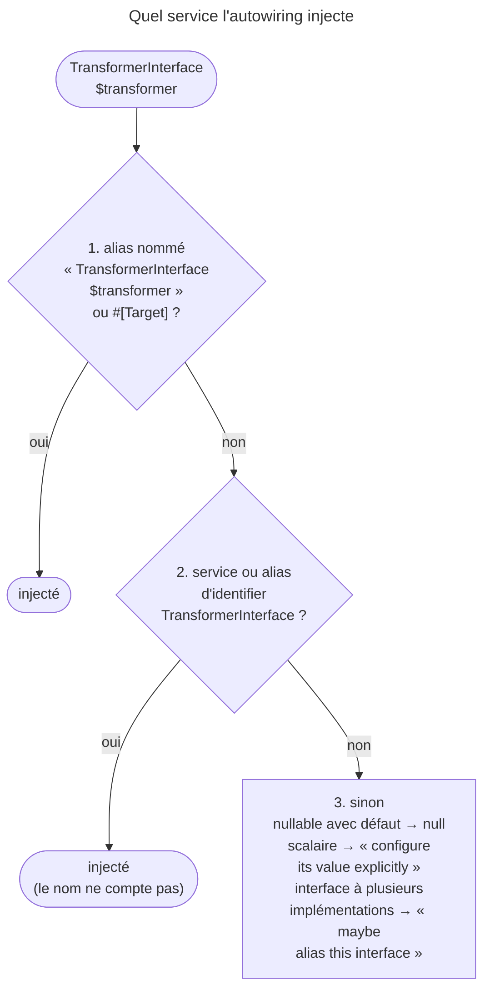

## Objectif

Comprendre par quoi le container remplit un argument, pourquoi deux
implémentations d'une même interface le bloquent, les trois façons de trancher,
et ce que l'autowiring ne peut pas deviner.

## L'essentiel

L'autowiring remplit un argument **par son type** : il cherche un service dont
l'identifier est ce type. Une interface n'est le nom d'aucun service : il faut
un **alias**, créé seul tant qu'il n'existe qu'**une** implémentation. Au-delà,
on départage par un alias, un alias nommé ou `#[Target]`. Un scalaire, lui, ne
se devine jamais.

## Le schéma



## Le fil rouge : deux transformers

```php
interface TransformerInterface { public function transform(string $value): string; }
class Rot13Transformer implements TransformerInterface { /* … */ }
class UppercaseTransformer implements TransformerInterface { /* … */ }
```

L'arrivée d'`UppercaseTransformer` casse des services qui n'ont rien changé.

## La règle, en une phrase : par le type

- Le container « looks for a service whose id exactly matches the
  type-hint ». Renommer l'argument ne change rien.
- Un service d'identifier `app.rot13.transformer` redevient autowirable par un
  alias : `Psr\Log\LoggerInterface` est ainsi un alias vers `logger`.
- Un type union ou intersection exige un alias pour le type complet, ou que
  **chaque** type soit un alias vers le **même** service
  (`AutowirePass::getCombinedAlias()`).

## Pourquoi une interface a besoin d'un alias

Une seule implémentation découverte : l'alias est automatique. Deux : la
compilation échoue, « …references interface "…\TransformerInterface" but no
such service exists. You should maybe alias this interface to one of these
existing services ».

`#[AsAlias]` sur une implémentation en fait l'alias de son interface — lu à la
**découverte** (`resource`) : sur un service déclaré un par un, sans effet.

## Trois façons de départager

```yaml
services:
    App\Util\TransformerInterface: '@App\Util\Rot13Transformer'                          # 1. alias par défaut
    App\Util\TransformerInterface $shoutyTransformer: '@App\Util\UppercaseTransformer'   # 2. alias nommé
```

```php
public function __construct(
    #[Target('shoutyTransformer')] private TransformerInterface $transformer,   // 3. #[Target]
) {}
```

| Argument | Reçoit |
|---|---|
| `TransformerInterface $transformer` | `rot13`, l'alias par défaut |
| `TransformerInterface $shoutyTransformer` | `upper`, l'alias nommé |
| `$shoutyTransfomer`, faute de frappe | `rot13`, **sans erreur** |
| `#[Target('shoutyTransfomer')]`, même faute | erreur : « …but no such target exists. Did you mean… » |
| `#[Target('shouty.transformer')]` | `upper` : le nom est normalisé en camelCase |

`registerAliasForArgument()` crée l'alias nommé depuis une passe.
`debug:autowiring Transformer` liste les alias, nommés compris.

## Ce que `#[Target]` attend

Le nom de l'**alias nommé**. La documentation dit qu'il « does not accept
service ids » ; en 8.0, un identifier passe pourtant s'il est déjà la cible
d'un alias nommé du même type.

## Câbler ce qui n'est pas un service

```php
#[Autowire(service: 'monolog.logger.request')] LoggerInterface $logger,
#[Autowire('%kernel.project_dir%/data')]       string $dataDir,
#[Autowire(param: 'kernel.debug')]             bool $debug,
#[Autowire(env: 'bool:FEATURE_FLAG')]          bool $flag,
```

- Un scalaire non configuré : « …is type-hinted "string", you should configure
  its value explicitly », pour un service **conservé** — un privé inutilisé est
  retiré sans erreur.
- `#[AutowireServiceClosure]`, `#[AutowireCallable]`, `#[AutowireMethodOf]`
  injectent une **closure** ; le service n'est construit qu'à son appel.
- `#[Required]` : une method ou une property publique typée, remplie par
  l'autowiring.

## Pièges d'examen

- L'autowiring passe par le **type**, pas par le nom — sauf alias nommé et `#[Target]`.
- Deux implémentations d'une interface **suppriment** l'alias automatique.
- Une faute dans le nom d'argument retombe **en silence** sur l'alias par
  défaut ; la même faute dans `#[Target]` lève une exception.
- `#[Target]` vise le nom de l'**alias nommé** ; un identifier ne passe que s'il
  est déjà la cible d'un alias nommé du même type.
- Un scalaire ne s'autowire jamais.
- Un type union ne s'autowire que si **chacun** de ses types est un alias vers le
  **même** service : deux services différents, et la compilation échoue.
- `#[AsAlias]` est lu à la **découverte** des classes (`resource`) : sur un
  service déclaré un par un, il ne départage rien.

## Application

- Une seconde class implémente `ExporterInterface` et le build casse → un alias
  par défaut, ou `#[AsAlias]` sur l'implémentation choisie.
- Un seul consommateur veut l'autre implémentation → un alias nommé, ou
  `#[Target]` pour qu'une faute de frappe soit signalée.

## QCM d'entraînement

**Question 1.** L'alias nommé est `ExporterInterface $csvExporter`. Un argument
porte `#[Target('csv.exporter')] ExporterInterface $exporter`. Que reçoit-il ?

- **A.** Une erreur : le nom doit être écrit comme l'argument
- **B.** L'alias par défaut : `#[Target]` n'accepte que du camelCase
- **C.** L'implémentation de l'alias nommé `csvExporter`
- **D.** Le service dont l'identifier est littéralement `csv.exporter`

<details>
<summary>Correction</summary>

**Bonne réponse : C.** Le nom passé à `#[Target]` est normalisé en camelCase
avant d'être comparé aux alias nommés.

</details>

**Question 2.** Un service attend `NormalizerInterface|SerializerInterface $s`.
Les deux types sont des alias vers **deux services différents**. Que se
passe-t-il ?

- **A.** Le premier type de l'union est retenu
- **B.** Le container choisit le service qui implémente le plus d'interfaces
- **C.** L'argument reçoit `null`, l'union restant ambiguë
- **D.** La compilation échoue

<details>
<summary>Correction</summary>

**Bonne réponse : D.** Il faut un alias pour le type complet, ou que chaque
type mène au même service ; ici, aucun des deux.

</details>

**Question 3.** Deux classes implémentent `SenderInterface`, découvertes par
`resource`. Quelle écriture, posée sur `SmsSender`, la fait injecter partout
où l'interface est demandée ?

- **A.** `#[AsAlias]`
- **B.** `#[AsTaggedItem('default')]`
- **C.** `#[Target('SmsSender')]`
- **D.** `#[Autoconfigure(public: true)]`

<details>
<summary>Correction</summary>

**Bonne réponse : A.** Sur une class découverte, `#[AsAlias]` en fait l'alias
de son unique interface ; `#[Target]` se pose sur un argument, pas sur la class.

</details>

**Question 4.** Un consommateur reçoit `#[AutowireServiceClosure('app.report')]
\Closure $report`. Le service `app.report` est-il construit en même temps que
le consommateur ?

- **A.** Oui : toute dependency est construite d'abord
- **B.** Non : il l'est au premier appel de la closure
- **C.** Jamais : la closure rend une definition
- **D.** La compilation échoue : un service ne s'injecte pas en closure

<details>
<summary>Correction</summary>

**Bonne réponse : B.** La closure diffère la construction : le service n'existe
qu'au moment où le consommateur l'appelle.

</details>

## Fiche express

**Si tu dois retenir seulement 7 choses :**

- Autowiring = **par le type** ; le nom ne compte que pour un alias nommé.
- Interface : alias **automatique** avec une seule implémentation.
- Départager : alias par défaut, **alias nommé**, **`#[Target]`**.
- Faute dans le nom d'argument : défaut **en silence** ; dans `#[Target]` :
  erreur.
- `#[Target]` : nom normalisé en camelCase.
- Union : chaque type vers le **même** service.
- Scalaire : `bind`, argument explicite ou **`#[Autowire]`**.

Moyen mnémotechnique : **« Type, puis Nom, puis rien »**.

## Sources officielles

- [Defining Services Dependencies Automatically (Autowiring)](https://github.com/symfony/symfony-docs/blob/8.0/service_container/autowiring.rst)
- [DependencyInjection 8.0, `Compiler\AutowirePass`](https://github.com/symfony/symfony/blob/8.0/src/Symfony/Component/DependencyInjection/Compiler/AutowirePass.php)
- [DependencyInjection 8.0, `Attribute\Target`](https://github.com/symfony/symfony/blob/8.0/src/Symfony/Component/DependencyInjection/Attribute/Target.php)

