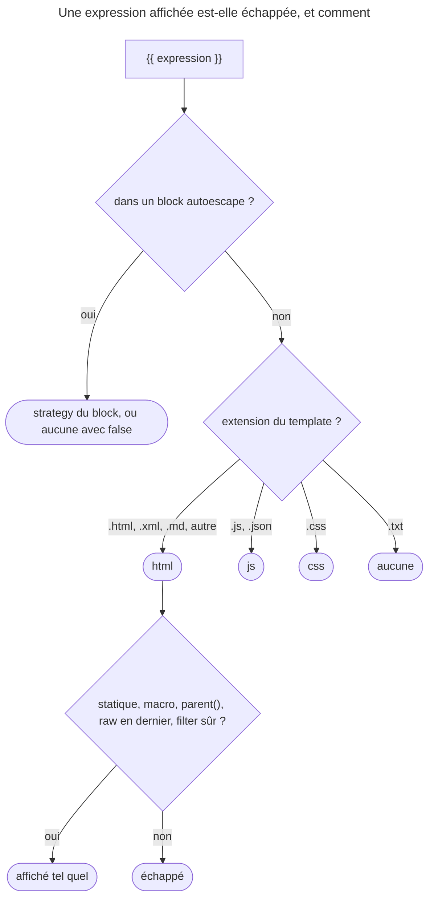

## Objectif

Savoir ce que Twig échappe par défaut, avec quelle strategy, et comment
choisir la bonne selon l'endroit du document.

## Avant la règle : le problème à résoudre

Un nom d'utilisateur contient `<script>`. Affiché tel quel dans une page, il
s'exécute chez chaque visiteur : c'est une faille XSS. Échapper la valeur la
rend inoffensive — mais **comment** échapper dépend de l'endroit : du HTML, un
attribute sans guillemets, une string JavaScript, une URL. Twig échappe
d'office ; il faut savoir **quand**, **avec quelle strategy**, et **comment
s'en écarter** sans ouvrir de faille.

Tous les faits de cette page ont été exécutés avec TwigBundle 8.0.15 et
Twig 3.22.2, la valeur affichée étant `<b>"x" & y</b>`.

## Le fil rouge : un profil et son script

```twig
{# templates/user/profile.html.twig #}
<h1>{{ user.name }}</h1>
<div data-role={{ user.role|e('html_attr') }}></div>
<a href="/search?q={{ user.city|e('url') }}">Voisins</a>
<script>const name = "{{ user.name|e('js') }}";</script>
```

Le nom est échappé en HTML sans rien demander ; l'attribute sans guillemets, le
paramètre d'URL et la string JavaScript demandent chacun leur strategy.

## Le cycle complet en un schéma

Ce qui décide de l'escaping d'un `{{ … }}`, lu dans la documentation de Twig
3.22 et rejoué :



## Le défaut : la strategy dépend du nom du template

L'auto-escaping est **actif** dans une application Symfony. Mais sa
strategy n'est pas fixe : TwigBundle (8.0) règle l'option `autoescape` de Twig
sur `'name'`, et Twig choisit alors la strategy d'après l'**extension** du
template, `.twig` retiré (`FileExtensionEscapingStrategy::guess()`, v3.22.0) :

| Template | Strategy |
|---|---|
| `page.html.twig`, et toute extension non listée | `html` |
| `data.js.twig`, `data.json.twig` | `js` |
| `style.css.twig` | `css` |
| `email.txt.twig` | **aucun escaping** |

Dans un template HTML, toute variable affichée par `{{ }}` est donc échappée sans
rien demander. Un template `.txt.twig` — un email en texte brut, par exemple —
affiche ses variables telles quelles.

**Rejoué, extension par extension :** `page.html.twig`, `note.xml.twig`,
`readme.md.twig` et un `plain.twig` sans extension donnent
`&lt;b&gt;&quot;x&quot; &amp; y&lt;/b&gt;` ; `data.js.twig` et
`data.json.twig`, `<b>…` ; `style.css.twig`, `\3C b\3E …` ;
`email.txt.twig`, la valeur brute.

L'escaping a lieu **à l'affichage**, pas à l'affectation :
`` ne transforme rien.

**Deux exceptions documentées.** Twig n'échappe pas les **expressions
statiques** : `{{ "<strong>world</strong>" }}` s'affiche en gras. Et les
functions qui retournent du template — les macros, `parent()` — retournent un
contenu considéré comme sûr.

Rejoué : la statique cesse de l'être dès qu'une variable s'y mêle.
`{{ "<b>" ~ v }}` échappe **tout**, le `<b>` littéral compris.

## Les cinq strategies

Le contexte du document décide, et le mauvais choix laisse une faille ouverte :

| Strategy | Contexte visé |
|---|---|
| `html` | corps HTML, ou valeur d'attribute **entre guillemets** |
| `js` | string JavaScript ou JSON, encodée par séquences d'escaping |
| `css` | tout ce qui est inséré dans du CSS |
| `url` | un **sous-composant** d'URI ou un parameter, jamais une URI entière |
| `html_attr` | nom d'attribute, ou valeur d'attribute **sans guillemets** |

La distinction `html` / `html_attr` est celle qui se rate : dès que la valeur
n'est pas entre guillemets — `data-x={{ v }}` — `html` ne suffit plus. La
documentation recommande d'ailleurs de mettre la valeur entre guillemets et
d'employer `html`, `html_attr` étant moins performant.

Pour la strategy `html`, Twig utilise la function PHP `htmlspecialchars`. On
peut enregistrer d'autres strategies avec `EscaperRuntime::setEscaper()`
(Twig 3.10).

Rejoué : `html_attr` encode aussi l'espace (`&#x20;`) et le slash (`&#x2F;`),
ce qui empêche la valeur de sortir de l'attribute ; `url` sur une adresse
complète donne `https%3A%2F%2Fex.com%2Fa%20b%3Fq%3D1`, sur un parameter seul
`a%20b%26c`.

## Choisir explicitement

```html
{{ user.name|e }}          {# équivaut à |e('html') #}
{{ user.name|e('js') }}
{{ user.name|escape('url') }}
```

`e` est l'alias de `escape`.

Twig évite le **double escaping** quand la strategy du filter est celle de
l'auto-escaping — mais seulement si elle est écrite en dur.
`|escape(strategy)`, avec une variable, est échappé deux fois ; la
documentation conseille alors d'ajouter `|raw`.

Rejoué : `{{ v|e('html') }}` donne `&lt;b&gt;…`, une fois ;
`{{ v|escape(strategy) }}`, avec `strategy` valant `'html'`, donne
`&amp;lt;b&amp;gt;…`, deux fois.

**Deux filters à connaître.** `json_encode` n'est pas déclaré sûr : dans un
template HTML, `{{ data|json_encode }}` sort `{&quot;a&quot;:…}`. `nl2br`, lui,
échappe d'abord son entrée puis ajoute des `<br />` laissés intacts : lu dans
`CoreExtension`, `pre_escape: html`, `is_safe: html`. Rejoué, `"<i>\nline"`
devient `&lt;i&gt;<br />` suivi de `line`.

## Désactiver, avec parcimonie

`{{ trusted|raw }}` affiche sans échapper — **à condition que `raw` soit le
dernier filter appliqué**. Le nom du filter est un avertissement : la valeur
doit être sûre *par construction*, pas parce qu'elle semble sûre.

Le tag `` change la strategy sur un block — sans argument,
c'est `html` —, et `` la coupe :

```html

    {{ value }}

```

Rejoué : `{{ v|upper|raw }}` affiche `<B>"X" & Y</B>` brut ;
`{{ v|raw|upper }}` affiche `&lt;B&gt;…`, échappé, parce que `upper` vient
après.

## Concrètement dans ton application

- Laisser l'auto-escaping faire, et nommer les templates par leur format :
  `.html.twig`, `.txt.twig`, `.js.twig`.
- Mettre les attributes entre guillemets ; sinon, `|e('html_attr')`.
- Une valeur dans une URL : `|e('url')` sur le parameter, jamais sur l'adresse.
- Une donnée pour JavaScript : `|e('js')` dans une string, ou `|json_encode|raw`
  seulement si la donnée vient du serveur et ne contient rien de l'utilisateur.
- `|raw` en dernier, et seulement sur du contenu sûr par construction.
- Un email texte : `.txt.twig`, rien n'est échappé — ce qui est voulu.

## À comprendre

- **Pourquoi l'extension décide-t-elle ?** Un `.txt.twig` n'est pas du HTML :
  y écrire `&lt;` serait faux. Le nom du template est le seul indice fiable du
  format de sortie.
- **Pourquoi pas d'escaping pour une statique ?** Elle est écrite par le
  développeur, pas fournie par un utilisateur ; seule une variable peut porter
  une attaque.
- **Pourquoi `raw` doit-il être le dernier ?** Un filter après lui produit une
  nouvelle valeur, que Twig ne connaît pas comme sûre.

## À mémoriser

- Escaping **actif** ; strategy choisie par l'**extension** (`autoescape: 'name'`).
- `.html` et inconnu → **html** ; `.js`, `.json` → **js** ; `.css` → **css** ;
  `.txt` → **aucune**.
- À l'**affichage**, pas à l'affectation ; les **statiques** ne sont pas
  échappées.
- Cinq strategies : **`html`**, **`js`**, **`css`**, **`url`**,
  **`html_attr`**.
- **`raw` en dernier**, sinon sans effet.
- `escape(variable)` **double** l'escaping.
- Moyen mnémotechnique : **« le nom choisit, l'affichage échappe, raw ferme la
  marche »**.

## Pièges d'examen

**La strategy par défaut dépend de l'extension du template.** `.html.twig`
échappe en HTML, `.js.twig` en JavaScript, `.txt.twig` n'échappe pas.

**L'escaping a lieu à l'affichage, pas à l'affectation.** Ranger une valeur
dans une variable ne la transforme pas.

**La strategy HTML ne suffit pas dans un attribute sans guillemets.** C'est la
strategy dédiée aux attributes qu'il faut ; le mauvais choix laisse une faille
ouverte sans rien signaler.

**`raw` n'agit que s'il est le dernier filter.**

**La strategy d'URL vise un sous-composant, pas une URI entière.** L'appliquer
à une adresse complète la détruit.

## Application : trois scénarios

**Scénario 1 — Le flux RSS échappé.** `feed.xml.twig` affiche un titre qui
contient `&` : il sort `&amp;`. *Solution.* C'est voulu : `.xml` n'est pas dans
la liste, il reçoit la strategy `html`, qui convient au XML.

**Scénario 2 — Le JSON cassé dans le HTML.** Un template HTML affiche
`{{ config|json_encode }}` dans un attribute et obtient des `&quot;`.
*Solution.* C'est l'escaping HTML qui s'applique, et il est juste dans un
attribute entre guillemets ; dans un `<script>`, préférer un template `.js.twig`
ou `|e('js')` valeur par valeur.

**Scénario 3 — Le titre en gras qui ne l'est plus.** `{{ "<b>" ~ title ~ "</b>" }}`
affiche les balises. *Solution.* La statique cesse de l'être dès qu'une
variable s'y mêle : écrire les balises hors de l'expression,
`<b>{{ title }}</b>`.

## QCM d'entraînement

Cinq questions sur l'escaping. Choisis avant d'ouvrir la correction.

**Question 1.** Dans une application Symfony, un template `feed.xml.twig`
affiche `{{ v }}` avec `v = '<b>'`. Que sort-il ?

- **A.** `<b>`, l'extension `.xml` n'étant pas listée
- **B.** `<b>`, comme en JavaScript
- **C.** `&lt;b&gt;`
- **D.** Une erreur : extension non prise en charge

<details>
<summary>Correction</summary>

**Bonne réponse : C.** Rejoué : une extension non listée reçoit la strategy
`html`, comme `.html`, `.md` ou un template sans extension.

A confond avec `.txt`. B décrit `.js` et `.json`. D est faux.

</details>

**Question 2.** Dans `page.html.twig`, que sort `{{ "<b>" ~ v }}` avec
`v = '<u>'` ?

- **A.** `<b><u>` : l'expression commence par une statique
- **B.** `&lt;b&gt;&lt;u&gt;`
- **C.** `<b>&lt;u&gt;` : seule la variable est échappée
- **D.** Une erreur : on ne concatène pas une statique

<details>
<summary>Correction</summary>

**Bonne réponse : B.** Rejoué : une concaténation avec une variable n'est plus
une expression statique ; tout le résultat est échappé.

A et C supposent que la statique garde son exemption. D est faux.

</details>

**Question 3.** `text` vaut `"<i>"` suivi d'un saut de ligne et de `line`.
Que sort `{{ text|nl2br }}` dans un template HTML ?

- **A.** `&lt;i&gt;<br />` puis `line`
- **B.** `<i><br />` puis `line`
- **C.** `&lt;i&gt;&lt;br /&gt;` puis `line`
- **D.** `<i>` puis un saut de ligne et `line`

<details>
<summary>Correction</summary>

**Bonne réponse : A.** Rejoué. Lu dans `CoreExtension` : `nl2br` déclare
`pre_escape: html` — l'entrée est échappée — et `is_safe: html` — les `<br />`
ajoutés ne le sont pas.

B oublie le pre-escape. C échapperait les `<br />`. D ignore le filter.

</details>

**Question 4.** Dans `page.html.twig`, `data` vaut `{a: '<b>'}`. Que sort
`{{ data|json_encode }}` ?

- **A.** `{"a":"<b>"}`
- **B.** `{&quot;a&quot;:&quot;&lt;b&gt;&quot;}`
- **C.** `{"a":"<b>"}`
- **D.** Une erreur : `json_encode` attend une string

<details>
<summary>Correction</summary>

**Bonne réponse : B.** Rejoué : `json_encode` n'est pas déclaré sûr, sa sortie
est échappée en HTML.

A supposerait un filter sûr ou `|raw`. C décrit les options de `json_encode`
de PHP, pas l'escaping. D est faux.

</details>

**Question 5.** Que vaut la strategy de `…`,
écrit sans argument ?

- **A.** Celle de l'extension du template
- **B.** `js`
- **C.** Aucune : l'escaping est coupé
- **D.** `html`

<details>
<summary>Correction</summary>

**Bonne réponse : D.** La documentation du tag, et rejoué : sans argument, le
block échappe en `html`.

A est faux, même dans un `.js.twig`. C décrit ``. B est
faux.

</details>

## Fiche express

**Si tu dois retenir seulement 7 choses :**

- **`autoescape: 'name'`** : l'extension du template choisit la strategy.
- `.html` et inconnu → **html** ; `.js`, `.json` → **js** ; `.css` → **css** ;
  `.txt` → **aucune**.
- L'escaping a lieu **à l'affichage**.
- **Statique** non échappée — tant qu'aucune variable ne s'y mêle.
- **`html_attr`** sans guillemets ; **`url`** pour un parameter.
- **`raw` en dernier** ; `escape(variable)` double l'escaping.
- **`json_encode`** est échappé ; **`nl2br`** échappe puis insère.

**En une phrase, pour tout reconstruire :**

```text
autoescape 'name' : html (html, xml, md, autre) | js (js, json) | css | rien (txt) ; à l'affichage ; statique exemptée sauf concaténée ;
html_attr sans guillemets, url = paramètre ; raw dernier ; escape(var) double ; json_encode échappé, nl2br pré-échappe
```

## Sources officielles

- [Twig 3.22, filter `escape`](https://github.com/twigphp/Twig/blob/v3.22.0/doc/filters/escape.rst)
- [Twig 3.22, tag `autoescape`](https://github.com/twigphp/Twig/blob/v3.22.0/doc/tags/autoescape.rst) et [filter `raw`](https://github.com/twigphp/Twig/blob/v3.22.0/doc/filters/raw.rst)
- [Twig 3.22, `FileExtensionEscapingStrategy`](https://github.com/twigphp/Twig/blob/v3.22.0/src/FileExtensionEscapingStrategy.php)
- [Twig 3.22, `CoreExtension`](https://github.com/twigphp/Twig/blob/v3.22.0/src/Extension/CoreExtension.php)
- [TwigBundle, `TwigExtension`](https://github.com/symfony/symfony/blob/8.0/src/Symfony/Bundle/TwigBundle/DependencyInjection/TwigExtension.php)
