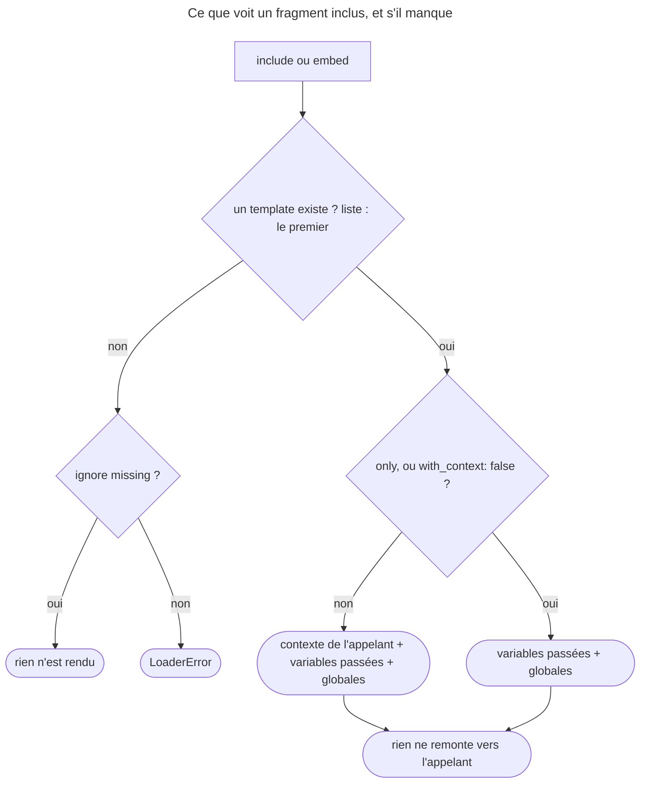

## Objectif

Insérer un template dans un autre, contrôler ce qu'il voit, et choisir entre
`include` et `embed`.

## Avant la règle : le problème à résoudre

La même carte d'article apparaît sur la page d'accueil, dans les résultats de
recherche et dans le profil d'un auteur. La recopier trois fois, c'est la
corriger trois fois. On veut **un fragment** inséré là où il faut, qui ne voit
**que** ce qu'on lui donne, et parfois **légèrement différent** d'une page à
l'autre.

Trois questions : **comment insérer**, **ce que le fragment voit**, et
**quand passer à `embed`**. Tous les faits de cette page ont été exécutés avec
Twig 3.22.2.

## Le fil rouge : la carte d'article

```twig
{# templates/article/_card.html.twig #}
<article class="card">
    <h2>{{ article.title }}</h2>
    <small>{{ article.date|date('d/m/Y') }}</small>
</article>

{# templates/home.html.twig #}

    {{ include('article/_card.html.twig', {article: post}, with_context: false) }}


{# templates/author/show.html.twig #}

    <strong>À la une</strong>

```

L'accueil insère la carte telle quelle, sans lui donner son contexte ; la page
de l'auteur la réutilise en changeant son pied.

## Le cycle complet en un schéma

Ce que voit un template inclus, et ce qui arrive s'il manque :



## Les deux écritures

La **function** `include()` est la forme recommandée :

```html
{{ include('article/_card.html.twig', {article: post}) }}
```

Le **tag** `` fait la même chose avec une autre syntaxe :

```html

```

La documentation de Twig 3.22 donne trois raisons de préférer la function :
elle est sémantiquement plus juste — un tag ne devrait rien afficher — ;
elle se compose, `` ou
`{{ include('x.html.twig')|upper }}` ; et ses named arguments n'imposent aucun
ordre.

Par convention, un fragment destiné à être inclus est préfixé d'un souligné —
`_card.html.twig` — ce qui le distingue d'un template de page. La documentation
Symfony précise que ce préfixe est facultatif.

## Le contexte

Par défaut, le template inclus **hérite de tout le contexte** du template
appelant, plus les variables qu'on lui passe. Deux mots changent cela :

| Écriture | Effet |
|---|---|
| `` | aucune variable du contexte |
| `` | seulement `a` |
| `{{ include('x.html.twig', {a: 1}, with_context: false) }}` | idem, en function |

`only` et `with_context: false` sont la même idée dans les deux écritures. Elles
rendent un fragment réutilisable en le forçant à déclarer ses entrées.

**Rejoué**, un fragment qui affiche `title`, `extra` et la globale `site`,
appelé depuis un template qui possède `title` :

| Appel | Le fragment voit |
|---|---|
| `include('_card', {extra: 'E'})` | `title`, `extra`, `site` |
| `` | `extra`, `site` |
| `include('_card', {extra: 'E'}, with_context: false)` | `extra`, `site` |

Les **globales** restent visibles malgré `only`. Et dans l'autre sens, rien ne
remonte : un `` écrit dans le fragment n'existe pas chez
l'appelant après l'inclusion.

## Quel template, et s'il manque

Le nom est une **expression** : une variable, un ternaire
(`ajax ? 'ajax.html.twig' : 'page.html.twig'`), ou une **liste** dont le premier
template existant est inclus.

Un template absent fait échouer l'inclusion, sauf :

- en tag, `ignore missing`, **juste après le nom** — les mots se combinent
  dans cet ordre : `ignore missing with {…} only` ;
- en function, l'argument `ignore_missing: true`, qui rend une string vide.

Avec une liste et `ignore missing`, rien n'est rendu si aucun template n'existe ;
sans, une exception est levée.

Pour un template écrit par un user, la documentation recommande le bac à
sable : `include('page.html.twig', sandboxed: true)` — effectif seulement si
l'extension `SandboxExtension` est enregistrée.

**Rejoué :** un nom absent lève « Template "missing" is not defined »
(`LoaderError`) ; une liste dont aucun template n'existe, « Unable to find one
of the following templates » ; `with {a: 1} ignore missing`, dans le mauvais
ordre, ne compile pas. Et `sandboxed: true` sans `SandboxExtension` ne prévient
pas : lu dans `CoreExtension::include()`, la condition est
`$sandboxed && $env->hasExtension(SandboxExtension::class)` — le template est
rendu normalement, **sans** bac à sable.

## `include` ou `embed`

`` combine `include` et `extends` : il insère un template **et**
permet de redéfinir ses blocks au point d'insertion.

```html

    Contenu de gauche

```

La documentation le décrit comme un « micro squelette de mise en page ». Il
accepte exactement les mêmes arguments que le tag `include` : `with`, `only`,
`ignore missing`. Le critère de choix : si le fragment est identique à chaque
appel, `include` ; s'il faut en changer une partie, `embed`.

Un avertissement de la documentation relie `embed` à l'escaping : un template
embarqué n'a pas de nom, donc l'escaping strategy déduite de l'extension
ne s'applique pas comme attendu. Pour embarquer du CSS ou du JavaScript dans du
HTML, on fixe la strategy avec le tag `autoescape`.

Rejoué : avec ``, un block redéfini **dans le
template appelant** ne voit pas non plus les variables de l'appelant — il
s'exécute dans le contexte de l'embed, réduit à `x`.

## Concrètement dans ton application

- Un fragment réutilisable : `include()` avec `with_context: false`, et ses
  entrées passées explicitement.
- Un fragment optionnel, comme un bandeau par thème : `ignore_missing: true`.
- Un layout par thème avec repli : une liste `[theme ~ '/x.html.twig', 'x.html.twig']`.
- Une variante d'un fragment : `embed` et un block redéfini.
- Un template fourni par un utilisateur : `sandboxed: true` **et**
  `SandboxExtension` enregistrée.
- Un résultat d'inclusion à transformer : la function, ``.

## À comprendre

- **Pourquoi hériter du contexte par défaut ?** C'est pratique pour un
  fragment propre à une page ; c'est piégeux pour un fragment partagé, qui
  marche tant que l'appelant a la bonne variable.
- **Pourquoi rien ne remonte ?** Le fragment travaille sur une copie du
  contexte : il ne peut pas modifier l'appelant en cachette.
- **Pourquoi `sandboxed` peut-il échouer en silence ?** C'est une option
  d'`include()`, pas une garantie : sans l'extension, il n'y a rien à activer.

## À mémoriser

- **`include()`** recommandée ; **``** équivalent en tag.
- Contexte **hérité** par défaut ; **`only`** ou **`with_context: false`** le
  coupe ; les **globales** restent.
- **Rien ne remonte** du fragment vers l'appelant.
- Liste : **premier existant** ; absent : **`LoaderError`**, sauf
  **`ignore missing`** (juste après le nom) ou **`ignore_missing: true`**.
- **`sandboxed: true`** sans `SandboxExtension` : sans effet, sans erreur.
- **`embed`** = include + blocks redéfinis, mêmes arguments.
- Moyen mnémotechnique : **« include insère, only isole, embed retouche »**.

## Pièges d'examen

**Par défaut, le template inclus voit tout le contexte de l'appelant.** Le
fragment marche par accident tant que l'appelant possède la variable, puis
casse ailleurs.

**Restreindre le contexte s'écrit différemment selon la forme employée** — un
mot-clé dans le tag, un named argument dans la function.

**Tolérer l'absence aussi** : `ignore missing` en tag, `ignore_missing: true`
en function.

**Une liste de noms n'inclut qu'un template** : le premier qui existe.

## Application : trois scénarios

**Scénario 1 — Le compteur qui ne compte pas.** Un fragment fait
`` à chaque inclusion ; la page affiche toujours `0`.
*Solution.* Rien ne remonte d'un fragment : calculer le total dans l'appelant,
avant ou autour de la boucle.

**Scénario 2 — Le bac à sable qui n'en est pas un.** Une page inclut des
gabarits écrits par les clients avec `sandboxed: true` ; un audit montre qu'ils
appellent n'importe quelle méthode. *Solution.* `SandboxExtension` n'est pas
enregistrée : sans elle, l'option est ignorée. L'enregistrer, avec sa policy.

**Scénario 3 — La variante de la carte.** Deux pages veulent la carte d'article
avec un autre pied. *Solution.* `embed` sur ces deux pages, `include` partout
ailleurs.

## QCM d'entraînement

Cinq questions sur l'inclusion. Choisis avant d'ouvrir la correction.

**Question 1.** Un fragment inclus fait ``. Après
`{{ include('_card.html.twig') }}`, que rend `{{ leaked ?? 'absent' }}` chez
l'appelant ?

- **A.** `L`
- **B.** `absent`
- **C.** Une erreur : variable déjà définie
- **D.** `L`, seulement sans `only`

<details>
<summary>Correction</summary>

**Bonne réponse : B.** Rejoué avec Twig 3.22.2 : le fragment travaille sur une
copie du contexte ; ce qu'il pose ne remonte pas.

A et D supposent un contexte partagé. C est faux.

</details>

**Question 2.** `{{ include('user_tpl.html.twig', sandboxed: true) }}`, dans une
application qui n'a pas enregistré `SandboxExtension`. Que se passe-t-il ?

- **A.** Une erreur : `SandboxExtension` non enregistrée
- **B.** Le template n'est pas rendu
- **C.** Le template est rendu sans bac à sable
- **D.** Twig active un bac à sable par défaut

<details>
<summary>Correction</summary>

**Bonne réponse : C.** Rejoué. Lu dans `CoreExtension::include()` : le bac à
sable n'est activé que si l'extension est présente ; sinon l'option est ignorée,
sans message.

A, B et D supposent une vérification qui n'existe pas.

</details>

**Question 3.** Un fragment est inclus avec `only`. Une globale `site` existe.
Le fragment peut-il lire `site` ?

- **A.** Oui
- **B.** Non : `only` coupe tout
- **C.** Seulement si elle est passée dans `with`
- **D.** Seulement avec la function, pas le tag

<details>
<summary>Correction</summary>

**Bonne réponse : A.** Rejoué : `only` retire le contexte de l'appelant, pas les
globales.

B, C et D confondent contexte et globales.

</details>

**Question 4.** Que fait `{{ include('missing.html.twig') }}` si le template
n'existe pas ?

- **A.** Rend une string vide
- **B.** Lève une `LoaderError`
- **C.** Rend le nom du template
- **D.** Lève une `SyntaxError` à la compilation

<details>
<summary>Correction</summary>

**Bonne réponse : B.** Rejoué : le template appelant se compile, puis le rendu
lève « Template "missing" is not defined ». A décrirait `ignore_missing: true`.

C est faux. D est faux : le nom est une expression, évaluée au rendu.

</details>

**Question 5.** Un template possède `title`. Il écrit
`{{ title ?? 'absent' }}`.
Que rend le block ?

- **A.** La valeur de `title`, le block étant écrit chez l'appelant
- **B.** Une erreur : `title` interdit dans un embed
- **C.** `1`
- **D.** `absent`

<details>
<summary>Correction</summary>

**Bonne réponse : D.** Rejoué : le block redéfini s'exécute dans le contexte de
l'embed, réduit par `only` à `x`.

A est l'idée reçue. B et C sont faux.

</details>

## Fiche express

**Si tu dois retenir seulement 7 choses :**

- **`include()`** recommandée : composable, arguments nommés.
- Contexte **hérité** par défaut ; **`only`** / **`with_context: false`** le coupe.
- Les **globales** restent visibles ; **rien ne remonte** du fragment.
- Liste : le **premier existant** ; absent : **`LoaderError`**.
- **`ignore missing`** juste après le nom ; **`ignore_missing: true`** en function.
- **`sandboxed: true`** n'agit qu'avec **`SandboxExtension`**.
- **`embed`** : include + blocks redéfinis, dans le contexte de l'embed.

**En une phrase, pour tout reconstruire :**

```text
include() >  ; contexte hérité sauf only/with_context:false (globales gardées), rien ne remonte ;
nom = expression ou liste (1er existant) ; absent = LoaderError sauf ignore missing ; sandboxed sans extension = rien ; embed = blocks
```

## Sources officielles

- [Twig 3.22, tag `include`](https://github.com/twigphp/Twig/blob/v3.22.0/doc/tags/include.rst) et [function `include`](https://github.com/twigphp/Twig/blob/v3.22.0/doc/functions/include.rst)
- [Twig 3.22, tag `embed`](https://github.com/twigphp/Twig/blob/v3.22.0/doc/tags/embed.rst)
- [Twig 3.22, `CoreExtension::include()`](https://github.com/twigphp/Twig/blob/v3.22.0/src/Extension/CoreExtension.php)
- [Symfony Templates, inclusion de templates](https://github.com/symfony/symfony-docs/blob/8.0/templates.rst)
