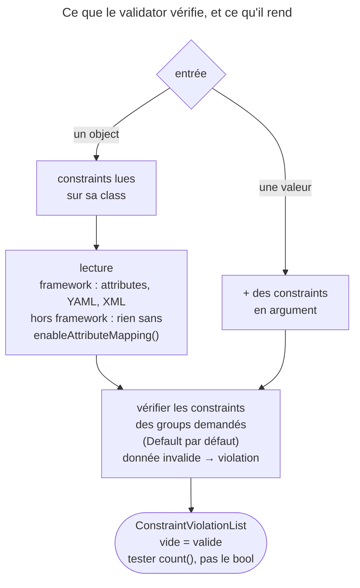

## Objectif

Savoir ce que le component valide, comment on l'appelle, et ce qu'il retourne.
Les constraints elles-mêmes appartiennent aux items *Built-in validation
constraints* et *Custom callback validators*.

## L'essentiel

Le Validator confronte une valeur à des **constraints** et rend toujours une
**liste de violations** — vide si tout va bien, jamais un bool. Une donnée
invalide ne lève rien ; une constraint mal configurée, si. Hors framework,
`createValidator()` **ne lit pas** les attributes.

## Le schéma



## Le fil rouge : un `User` et son adresse

```php
class User
{
    #[Assert\NotBlank]
    #[Assert\Email]
    public string $email = 'x';

    #[Assert\Length(min: 3)]
    public string $name = 'ab';

    #[Assert\Valid]
    public Address $address;          // Address::$city porte #[Assert\NotBlank], vide
}
```

Trois violations : `email`, `address.city`, `name`.

## Les trois manières de valider

| Besoin | Method |
|---|---|
| tout l'object, constraints de class comprises | `validate($object)` |
| une property d'un object existant | `validateProperty($object, 'email')` |
| une valeur **avant** de l'affecter | `validatePropertyValue(User::class, 'email', $candidat)` |
| une valeur isolée, sans class | `validate($valeur, new Assert\Email())` |

- Chaque method accepte les groups en dernier argument ; un group qu'aucune
  constraint ne porte rend une liste **vide**, sans erreur.
- `validateProperty()` sur une property inexistante rend une liste vide.
- Hors framework : `Validation::createValidator()` donne **0** violation sur
  le `User` ; `createValidatorBuilder()->enableAttributeMapping()->getValidator()`
  en donne 3. Dans une application, on injecte `ValidatorInterface`.

## Ce qu'il retourne : une liste, jamais un bool

```php
if (0 !== count($violations)) {
    foreach ($violations as $violation) {
        $violation->getMessage();
        $violation->getPropertyPath();   // 'email', 'address.city'
        $violation->getInvalidValue();   // 'x'
        $violation->getCode();           // Assert\Email::INVALID_FORMAT_ERROR
        $violation->getConstraint();     // l'objet Email
    }
}
```

- Une liste vide convertie en booléen vaut `true` : tester `count()`.
- `findByCodes(Assert\Email::INVALID_FORMAT_ERROR)` filtre par code ;
  `(string) $violations` donne une ligne par violation.
- `php bin/console debug:validator` affiche les constraints d'une class.

## Donnée invalide ou configuration invalide

| Situation | Résultat |
|---|---|
| donnée invalide, même mal typée (un array soumis à `Email`) | violation : « This value should be of type string. » |
| constraint mal configurée (`new Assert\Length()`) | `MissingOptionsException` à sa construction |
| scalaire ou `null` sans constraint | `RuntimeException` : « Cannot validate values of type "string" automatically… » |
| object ou array sans constraint | liste vide |

## Deux raccourcis de `Validation`

| Method | Valeur invalide | Valeur valide |
|---|---|---|
| `Validation::createIsValidCallable(...)` | la function rend `false` | `true` |
| `Validation::createCallable(...)` | elle **lève** `ValidationFailedException` | elle rend la valeur |

Utiles là où l'on attend une function : `setAllowedValues()` d'OptionsResolver,
une saisie en console.

## Pièges d'examen

**`validate()` ne lève rien pour une donnée invalide**, même mal typée ; une
constraint mal configurée ou un scalaire sans constraint, si.

**Une liste vide est un object.** Seul `count()` dit si la validation a réussi.

**`createValidator()` ignore les attributes** : il faut
`enableAttributeMapping()`.

**`validatePropertyValue()` n'a pas besoin de l'object peuplé** : elle teste une
valeur candidate contre les constraints de la property.

**Un group mal orthographié fait paraître l'object valide** : aucune constraint
n'y appartient, la liste rendue est vide, sans erreur.

## Application

- Un script hors framework trouve tous ses objects valides →
  `enableAttributeMapping()`.
- Vérifier une adresse saisie avant de créer le `User` →
  `validatePropertyValue(User::class, 'email', $saisie)`.

## QCM d'entraînement

**Question 1.** Que fait `$validator->validate(['a', 'b'], new Assert\Email())` ?

- **A.** Il lève une `UnexpectedTypeException`
- **B.** Il valide chaque élément de l'array comme un email
- **C.** Il rend une liste vide : un array est ignoré par `Email`
- **D.** Une violation : la valeur doit être une string

<details>
<summary>Correction</summary>

**Bonne réponse : D.** Une donnée invalide, même mal typée, produit une
violation et jamais une exception.

</details>

**Question 2.** Un `User` est invalide dans le group `Default`. Le code appelle
`$validator->validate($user, null, ['Registraton'])`, avec une faute de
frappe. Que se passe-t-il ?

- **A.** Une exception : le group n'existe pas
- **B.** Une liste vide, sans erreur
- **C.** Le group `Default` est utilisé à la place
- **D.** Les constraints de tous les groups sont vérifiées

<details>
<summary>Correction</summary>

**Bonne réponse : B.** Aucune constraint n'appartient à ce group : rien n'est
vérifié, et l'object paraît valide.

</details>

**Question 3.** Une option d'OptionsResolver doit refuser une adresse
invalide, par un `false` et non une exception. Quel raccourci ?

- **A.** `Validation::createCallable(new Assert\Email())`
- **B.** `Validation::createValidator()` avec une constraint `Email`
- **C.** `Validation::createIsValidCallable(new Assert\Email())`
- **D.** `Validation::createValidatorBuilder()->getValidator()`

<details>
<summary>Correction</summary>

**Bonne réponse : C.** La function rend un bool ; A lèverait une
`ValidationFailedException` sur la valeur invalide.

</details>

**Question 4.** Sur trois violations, comment ne garder que celles de format
d'email ?

- **A.** `$violations->findByCodes(Assert\Email::INVALID_FORMAT_ERROR)`
- **B.** `$violations->filter('email')`
- **C.** `$violations->getByPropertyPath('email', Assert\Email::class)`
- **D.** `$validator->validate($user, new Assert\Email(), ['Default', 'Email'])`

<details>
<summary>Correction</summary>

**Bonne réponse : A.** Chaque violation porte le code de sa constraint, et la
liste filtre par code.

</details>

## Fiche express

**Si tu dois retenir seulement 7 choses :**

- **`validate()`**, **`validateProperty()`**, **`validatePropertyValue()`**
  (accepte un nom de class).
- Retour : une **liste**, vide = valide ; tester **`count()`**.
- Violation : message, path, valeur, **code**, constraint.
- Hors framework : **`enableAttributeMapping()`**, sinon 0 violation.
- Donnée invalide → **violation** ; constraint mal configurée → **exception**.
- Scalaire sans constraint → **`RuntimeException`**.
- **`createIsValidCallable()`** rend un bool ; **`createCallable()`** lève.

Moyen mnémotechnique :
**« Règles sur la class, liste en retour, `count()` pour conclure »**.

## Sources officielles

- [ValidatorInterface, branche 8.0](https://github.com/symfony/symfony/blob/8.0/src/Symfony/Component/Validator/Validator/ValidatorInterface.php)
- [Validation, « Using the Validator »](https://github.com/symfony/symfony-docs/blob/8.0/validation.rst)
- [Loading Resources](https://github.com/symfony/symfony-docs/blob/8.0/components/validator/resources.rst) et [Validator 8.0, `ValidatorBuilder`](https://github.com/symfony/symfony/blob/8.0/src/Symfony/Component/Validator/ValidatorBuilder.php)

