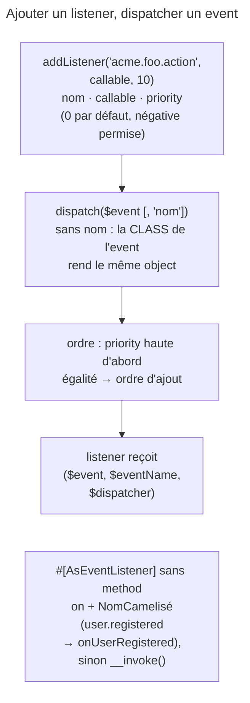

## Objectif

Brancher du code sur un event sans modifier celui qui le déclenche. C'est le
mécanisme qui rend Symfony extensible : le kernel ne connaît pas vos listeners, il
publie des events.

## L'essentiel

Le dispatcher tient un registre de listeners par **nom d'event** et les
notifie quand l'event est distribué : le code qui déclenche ne connaît pas
ceux qui écoutent. La **priority la plus haute passe en premier** ; à égalité,
l'ordre d'ajout décide. On s'inscrit par un listener, branché de l'extérieur,
ou un subscriber, qui se déclare lui-même.

## Le schéma



## L'exemple : réagir à un achat

```php
#[AsEventListener]
final class SendConfirmation
{
    public function __invoke(OrderPlacedEvent $event): void {}   // event déduit du type
}

final class OrderSubscriber implements EventSubscriberInterface
{
    public static function getSubscribedEvents(): array
    {
        return [
            KernelEvents::RESPONSE => [['onResponsePre', 10], ['onResponsePost', -10]],
            OrderPlacedEvent::class => 'onPlacedOrder',
        ];
    }
}
```

## La priority, et son départage

- Un int **positif ou négatif**, `0` par défaut ; **plus il est élevé, plus le
  listener est appelé tôt**.
- À priority égale, l'**ordre d'ajout** : ajoutés `0`, `0`, `10`, `-5`, ils
  tournent `10`, les deux `0` dans leur ordre, puis `-5`.

## Listener ou subscriber

| | Listener | Subscriber |
|---|---|---|
| inscription | de l'extérieur : configuration ou `#[AsEventListener]` | lui-même : `getSubscribedEvents()`, statique |
| atout (documentation) | **plus souple** : un bundle l'active selon sa configuration | **plus réutilisable** : la connaissance des events vit dans la class |

Résolution de la method d'un listener (`RegisterListenersPass`, 8.0) :

| Cas | Method appelée |
|---|---|
| `event: 'acme.foo_bar'`, `onAcmeFooBar()` présente | `onAcmeFooBar()` |
| `event: 'acme.other'`, sans `onAcmeOther()` | `__invoke()`, en repli |
| pas d'`event`, `__invoke(CustomEvent $e)` | `__invoke()`, event déduit du type |
| ni l'une ni l'autre | la compilation du container échoue |

`#[AsEventListener]` se répète pour configurer plusieurs methods ; un
subscriber peut inscrire **plusieurs methods sur un même event**.

## Distribuer

`dispatch($event)` ou `dispatch($event, 'foo.event')`. Sans nom, **la class de
l'object sert de nom**, d'où `OrderPlacedEvent::class` comme key
d'abonnement. `dispatch()` rend l'object event lui-même, modifié par les
listeners. Chaque listener reçoit l'event, son nom et le dispatcher, ce qui
lui permet d'en distribuer d'autres.

## Pièges d'examen

**Priority haute = appelé en premier**, et les valeurs négatives sont permises.

**À priority égale, l'ordre d'ajout décide.**

**`dispatch()` sans nom utilise la class de l'event.**

**`method` est optionnelle sur `#[AsEventListener]`** ; le défaut est `on` +
nom de l'event, et `__invoke()` sert de repli.

**Un subscriber peut inscrire plusieurs methods sur un même event.**

## Application

- Un listener qu'un bundle n'active que si une option le demande → un
  listener, enregistré selon la configuration.
- Deux traitements avant et après les autres sur `kernel.response` → un
  subscriber, avec les priorities `10` et `-10`.

## QCM d'entraînement

**Question 1.** Un listener est tagué pour l'event `user.registered`, sans
method. Quelle method le dispatcher appelle-t-il en premier ?

- **A.** `onUserRegistered()`
- **B.** `__invoke()`, toujours
- **C.** `handle()`
- **D.** `onEvent()`

<details>
<summary>Correction</summary>

**Bonne réponse : A.** Le défaut est `on` suivi du nom de l'event camélisé,
points et soulignés retirés ; `__invoke()` ne sert que de repli.

</details>

**Question 2.** `#[AsEventListener]` est posé sans `event` sur une class dont
la seule method est `__invoke(CustomEvent $e)`. Sur quel event écoute-t-elle ?

- **A.** Aucun : l'event est obligatoire
- **B.** `kernel.request`, par défaut
- **C.** Une erreur à la compilation du container
- **D.** `CustomEvent::class`

<details>
<summary>Correction</summary>

**Bonne réponse : D.** Le nom de l'event est la class de l'object distribué ;
le type de l'argument d'`__invoke()` le donne.

</details>

**Question 3.** Quelle raison la documentation donne-t-elle à Symfony pour
utiliser des subscribers en interne ?

- **A.** Ils sont appelés plus tôt que les listeners
- **B.** Ils sont plus réutilisables
- **C.** Eux seuls acceptent une priority
- **D.** Ils évitent l'autoconfiguration

<details>
<summary>Correction</summary>

**Bonne réponse : B.** Ils déclarent eux-mêmes leurs events : la liste vit
dans la class, pas dans une definition de service, et se réutilise avec elle.

</details>

**Question 4.** Listeners ajoutés dans l'ordre : `x` (0), `y` (-5), `z` (10),
`w` (0). Dans quel ordre tournent-ils ?

- **A.** `z`, `x`, `w`, `y`
- **B.** `y`, `x`, `w`, `z` : priority basse d'abord
- **C.** `x`, `y`, `z`, `w` : ordre d'ajout seul
- **D.** `z`, `w`, `x`, `y` : dernier ajouté d'abord

<details>
<summary>Correction</summary>

**Bonne réponse : A.** La priority la plus haute d'abord ; `x` et `w`, à
égalité, gardent leur ordre d'ajout ; `-5` passe en dernier.

</details>

## Fiche express

**Si tu dois retenir seulement 6 choses :**

- **Priority haute d'abord** ; négative permise ; égalité → ordre d'ajout.
- `addListener(nom, callable, priority)`.
- `dispatch($event)` sans nom : **la class** ; rend le même object.
- Listener **souple**, subscriber **réutilisable**.
- Method par défaut : **`on` + nom camélisé**, puis `__invoke()`.
- Le listener reçoit **event, nom, dispatcher**.

Moyen mnémotechnique : **« Le plus haut parle en premier »**.

## Sources officielles

- [The EventDispatcher Component](https://github.com/symfony/symfony-docs/blob/8.0/components/event_dispatcher.rst)
- [Events and Event Listeners](https://github.com/symfony/symfony-docs/blob/8.0/event_dispatcher.rst)
- [`RegisterListenersPass`, branche 8.0](https://github.com/symfony/symfony/blob/8.0/src/Symfony/Component/EventDispatcher/DependencyInjection/RegisterListenersPass.php)

