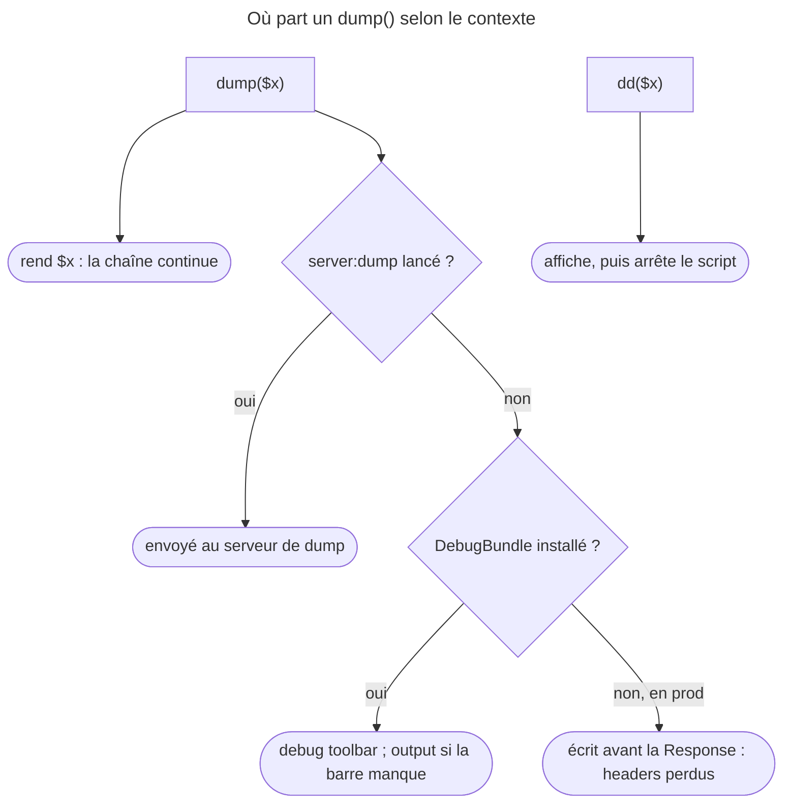

## Objectif

Inspecter une valeur, et interroger l'application sur ce qu'elle a réellement
compris de sa configuration.

## Avant la règle : le problème à résoudre

Un panier affiche un total faux ; une URL répond 404 alors que la route semble
correcte ; une option de configuration paraît ignorée. Lire le code ne suffit
pas : il faut **voir** la valeur au moment où elle passe, et **demander** à
Symfony ce qu'il a retenu.

Trois questions : ce que `dump()` apporte et **où** il écrit, ce qui arrive à un
`dump()` **oublié en production**, et quelle command **interroger** pour chaque
doute.

## Périmètre

Le **profiler web, la debug toolbar et les data collectors** font
l'objet d'un item distinct ; cette page ne les traite pas. Elle porte sur
VarDumper et sur les commands d'inspection.

On suppose connues les commands intégrées de la console.

## Le fil rouge : le total du panier

```php
// la valeur s'affiche, et la chaîne continue
$total = dump($cart)->getTotal();

// plusieurs valeurs : chacune s'affiche, un array est rendu
[$a, $b] = dump($cart->getItems(), $cart->getDiscount());

dd($total);   // affiche, puis arrête le script
```

```bash
php bin/console router:match /cart -v        # pourquoi cette URL répond 404
php bin/console debug:config framework        # la configuration après fusion
```

## Le cycle complet en un schéma



## `dump()` plutôt que `var_dump()`

VarDumper installe une function globale `dump()` qui apporte, sur `var_dump()` :

- une vue adaptée au type de l'object, plutôt qu'un déversement brut ;
- un output HTML ou coloré en terminal selon le contexte ;
- la détection des **références** : un même object rencontré deux fois n'est pas
  réaffiché intégralement.

```php
dump($someVar);

// dump() rend la valeur reçue : on peut inspecter sans casser la chaîne
dump($someObject)->someMethod();
```

`dd()` — *dump and die* — affiche puis **arrête** l'exécution.

Lu dans la function `dump()` (VarDumper, branche 8.0), et rejoué : `dump(5)`
rend `5` ; `dump(1, 2)` affiche les deux valeurs, numérotées `1` et `2`, et rend
l'array `[1, 2]`.

Dans une application Symfony, DebugBundle redirige `dump()` vers la barre de
debug plutôt que vers l'output, pour ne pas corrompre la vue en envoyant du
HTML au milieu d'une Response. Si la barre ne peut pas s'afficher — `dd()`,
`die()`, une erreur fatale — le dump repart sur l'output normal.

## Le serveur de dump

Mélanger l'output de debug à celui de l'application devient vite illisible.
Le serveur de dump collecte les dumps ailleurs :

```bash
php bin/console server:dump
php bin/console server:dump --format=html > dump.html
```

Une fois lancé, `dump()` ne s'affiche plus dans la Response : les données lui
sont envoyées. C'est la parade dans le cas d'une API JSON, où tout octet imprimé
casse la Response.

## Un `dump()` oublié en production

La documentation installe `symfony/var-dumper` et DebugBundle avec `--dev`. On
en déduit souvent qu'un `dump()` oublié appelle une function absente en
production. **C'est faux dans une application Symfony 8.0.** Lu dans les
`composer.json` de la branche 8.0 : FrameworkBundle exige
`symfony/error-handler`, qui exige `symfony/var-dumper` — en dependency
ordinaire, pas `--dev`. Le component est donc installé même avec
`composer install --no-dev`.

Seul DebugBundle est vraiment absent. Exécuté sur un serveur web PHP, kernel en
`prod`, sans DebugBundle :

| Appel | Résultat |
|---|---|
| `function_exists('dump')` | `true` |
| route qui appelle `dump()` | 200 ; le dump HTML part **avant** le contenu |
| headers de cette Response | ceux de PHP : `Cache-Control` de Symfony a disparu |

Le dump est écrit sur l'output avant que Symfony n'envoie sa Response : PHP
envoie alors ses propres headers, et ceux de la Response sont perdus. Pas
d'erreur fatale, donc, mais une Response corrompue — fatale pour une API JSON.

Rejoué pour cette page sur le même serveur : 200, headers `X-Powered-By` et
`Content-type` de PHP seulement, et le corps commence par le script `Sfdump`,
avant le contenu de la Response.

## Interroger l'application

Le second outil de debug n'inspecte pas une valeur mais la **configuration
comprise** — question qu'aucune relecture de file ne tranche, puisque la
configuration résulte d'une fusion :

| Command | Ce qu'elle répond |
|---|---|
| `debug:container` | quels services existent, sous quel identifier |
| `debug:autowiring` | quel type peut être injecté, et par quoi |
| `debug:router` | quelles routes existent, dans quel ordre |
| `router:match /chemin` | **quelle** route répond à cette URL, et pourquoi |
| `debug:event-dispatcher` | quels listeners, dans quel ordre de priority |
| `debug:config` | la configuration d'une extension, après fusion |
| `debug:twig` | les functions, filters et paths connus de Twig |

`router:match` mérite d'être retenue : elle explique un 404. Exécuté sur
FrameworkBundle 8.0.15, sur un path inconnu :

| Appel | Sortie |
|---|---|
| `router:match /e/rtx` | *None of the routes match the path "/e/rtx"* |
| même appel avec `-v` | chaque route essayée, et la raison : *Path "/public" does not match* |

`debug:config framework exceptions` affiche aussi les keys jamais écrites, avec
leur default value (`log_level: null`) : c'est la configuration **après
fusion**.

Deux voisines, rejouées. `config:dump-reference framework exceptions` montre la
**référence** — chaque key possible, sa default value et sa description, sans
rien de l'application : *The status code of the response. Null or 0 to let
Symfony decide.* Et `debug:autowiring Clock` ne liste que les types qui
contiennent `Clock`, avec leur alias : `Psr\Clock\ClockInterface - alias:clock`.

## Concrètement dans ton application

- Voir une valeur sans casser le code : `dump($x)`, qui la rend.
- Stopper net : `dd($x)`.
- Une API JSON : `server:dump`, pour garder les Responses propres.
- Une URL en 404 : `router:match /url -v`.
- Une option « ignorée » : `debug:config` pour la valeur retenue,
  `config:dump-reference` pour les valeurs possibles.
- Un type à injecter : `debug:autowiring <mot>`.
- Avant un déploiement : chercher les `dump(` et `dd(` oubliés — ils ne
  plantent pas, ils corrompent.

## À comprendre

- **Pourquoi `dump()` rend-il sa valeur ?** Pour s'insérer dans une expression
  sans la réécrire : on inspecte au passage.
- **Pourquoi un `dump()` en prod ne plante-t-il pas ?** VarDumper est une
  dependency ordinaire d'ErrorHandler, lui-même exigé par FrameworkBundle.
- **Pourquoi des commands plutôt que les files ?** La configuration finale
  résulte d'une fusion — bundles, environments, defaults — que seul le
  container compilé connaît.

## À mémoriser

- **`dump()`** affiche et **rend** sa valeur ; plusieurs valeurs → un **array**.
- **`dd()`** affiche puis **arrête**.
- **DebugBundle** → debug toolbar ; **`server:dump`** → serveur à part.
- En **prod**, `dump()` **existe** : Response corrompue, headers perdus.
- **`router:match /url -v`** pour un 404.
- **`debug:config`** = fusionné ; **`config:dump-reference`** = possible.
- **`debug:autowiring <mot>`**, **`debug:container`**, **`debug:event-dispatcher`**.
- Moyen mnémotechnique : **« Voir, rendre, demander »**.

## Pièges d'examen

**`dd()` arrête l'exécution ; `dump()` non**, et `dump()` rend sa valeur.

**`dump()` va dans la debug toolbar** quand DebugBundle est installé, pas
dans la Response.

**Un `dump()` déployé ne provoque pas d'erreur** : VarDumper est requis par
ErrorHandler. Il corrompt la Response — contenu et headers.

**`debug:config` montre la configuration fusionnée**, pas le contenu d'un
file.

## Application : trois scénarios

**Scénario 1 — L'API cassée en recette.** Une API répond du JSON invalide qui
commence par `<script> Sfdump`. *Solution.* Un `dump()` est resté dans le code :
le retirer ; pendant le développement, `server:dump` garde les Responses
propres.

**Scénario 2 — L'option fantôme.** `framework.exceptions` n'a qu'une key écrite,
mais l'équipe veut savoir quelles autres existent et ce qu'elles valent par
défaut. *Solution.* `config:dump-reference framework exceptions` pour la
référence ; `debug:config framework exceptions` pour ce qui est retenu.

**Scénario 3 — Le 404 inexpliqué.** `/cart/42` répond 404 alors qu'une route
`/cart/{id}` existe. *Solution.* `router:match /cart/42 -v` : la raison du
rejet de chaque route s'affiche — un requirement sur `id`, une method HTTP.

## QCM d'entraînement

Cinq questions sur le debug du code. Choisis avant d'ouvrir la correction.

**Question 1.** Que rend `dump(1, 2)` ?

- **A.** `1`, la première valeur
- **B.** `null`
- **C.** `2`, la dernière valeur
- **D.** L'array `[1, 2]`

<details>
<summary>Correction</summary>

**Bonne réponse : D.** Lu dans la function `dump()` (8.0) et rejoué : avec
plusieurs arguments, elle rend l'array ; avec un seul, la valeur elle-même.

A, B et C sont faux.

</details>

**Question 2.** Quelle command affiche **toutes** les keys possibles de
`framework.exceptions`, avec leur description, sans tenir compte de
l'application ?

- **A.** `config:dump-reference framework exceptions`
- **B.** `debug:config framework exceptions`
- **C.** `debug:container --parameters`
- **D.** `lint:yaml config/packages/framework.yaml --parse-tags`

<details>
<summary>Correction</summary>

**Bonne réponse : A.** Rejoué : `log_level`, `status_code`, `log_channel`, avec
*Null or 0 to let Symfony decide*.

B montre la configuration retenue par l'application, après fusion. C et D ne
décrivent pas une extension.

</details>

**Question 3.** Un développeur cherche quel service injecter pour une horloge.
Quelle command filtre les types autowirables par un mot ?

- **A.** `debug:container --tag=clock`
- **B.** `debug:autowiring Clock`
- **C.** `debug:router Clock`
- **D.** `debug:config clock`

<details>
<summary>Correction</summary>

**Bonne réponse : B.** Rejoué : seuls les types contenant `Clock`, dont
`Psr\Clock\ClockInterface - alias:clock`.

A filtre par tag, pas par type. C liste des routes. D attend une extension.

</details>

**Question 4.** En production, sans DebugBundle, une Response JSON passe par un
`dump()` oublié. Que reçoit le client ?

- **A.** Une erreur 500 : `dump()` n'existe pas
- **B.** Le JSON intact : le dump est ignoré hors environment de dev
- **C.** Un 200 dont le corps commence par le dump HTML
- **D.** Une page vide : le dump interrompt le script

<details>
<summary>Correction</summary>

**Bonne réponse : C.** Exécuté : 200, le script `Sfdump` avant le contenu, et
les headers de Symfony perdus.

A oublie qu'ErrorHandler exige VarDumper. B et D sont faux ; D décrit `dd()`.

</details>

**Question 5.** Que montre `router:match /e/rtx -v` quand aucune route ne
correspond ?

- **A.** Seulement « None of the routes match »
- **B.** La liste des routes, sans explication
- **C.** La route la plus proche, appliquée par défaut
- **D.** Chaque route essayée, avec la raison

<details>
<summary>Correction</summary>

**Bonne réponse : D.** Exécuté : *Route "…" does not match: Path "/public"
does not match*, route par route.

A est la sortie sans `-v`. B et C sont faux.

</details>

## Fiche express

**Si tu dois retenir seulement 7 choses :**

- **`dump()`** rend sa valeur (plusieurs → array) ; **`dd()`** arrête.
- **DebugBundle** : la debug toolbar ; **`server:dump`** : à part.
- En **prod**, `dump()` existe : **Response corrompue**.
- **`router:match -v`** explique un 404.
- **`debug:config`** : configuration **fusionnée**.
- **`config:dump-reference`** : toutes les keys possibles.
- **`debug:autowiring <mot>`** : quoi injecter.

**En une phrase, pour tout reconstruire :**

```text
dump() rend sa valeur, dd() arrête ; toolbar (DebugBundle) ou server:dump ; en prod : headers perdus, pas d'erreur ;
router:match -v (404), debug:config (fusionné), config:dump-reference (possible), debug:autowiring, debug:container
```

## Sources officielles

- [The VarDumper Component](https://github.com/symfony/symfony-docs/blob/8.0/components/var_dumper.rst)
- [Console Commands](https://github.com/symfony/symfony-docs/blob/8.0/console.rst)
- [`composer.json` d'ErrorHandler, branche 8.0](https://github.com/symfony/symfony/blob/8.0/src/Symfony/Component/ErrorHandler/composer.json)
- [`composer.json` de FrameworkBundle, branche 8.0](https://github.com/symfony/symfony/blob/8.0/src/Symfony/Bundle/FrameworkBundle/composer.json)
- [Function `dump()`, branche 8.0](https://github.com/symfony/symfony/blob/8.0/src/Symfony/Component/VarDumper/Resources/functions/dump.php)
