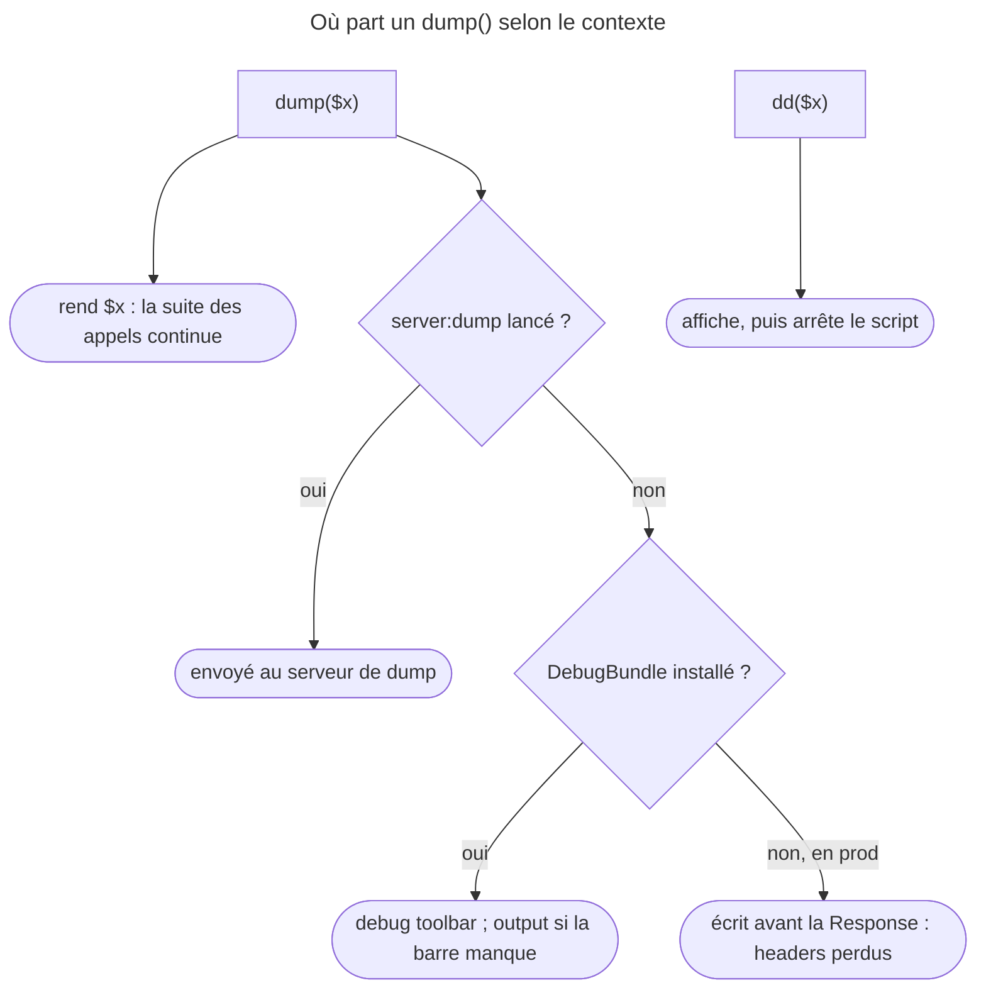

## Objectif

Inspecter une valeur, et interroger l'application sur ce qu'elle a réellement
compris de sa configuration.

## L'essentiel

`dump()` affiche une valeur **et la rend** ; `dd()` affiche puis **arrête**.
Avec DebugBundle, le dump va dans la debug toolbar, pas dans la Response. Un
`dump()` oublié en production ne casse rien de façon visible : il **corrompt**
la Response. Et des commands disent ce que Symfony a **retenu** de sa
configuration. Le profiler web relève d'un autre item.

## Le schéma



## L'exemple

```php
$total = dump($cart)->getTotal();                       // affiche, la chaîne continue
[$a, $b] = dump($cart->getItems(), $cart->getDiscount()); // plusieurs valeurs : un array
dd($total);                                               // affiche, puis arrête
```

```bash
php bin/console router:match /cart -v        # pourquoi cette URL répond 404
php bin/console debug:config framework        # la configuration après fusion
```

## `dump()` plutôt que `var_dump()`

- Une vue adaptée au type, en HTML ou colorée en terminal, et la détection des
  **références** : un object rencontré deux fois n'est pas réaffiché.
- `dump(5)` rend `5` ; `dump(1, 2)` affiche les deux et rend `[1, 2]`.
- Avec DebugBundle, le dump va dans la debug toolbar. Si la barre ne peut pas
  s'afficher — `dd()`, `die()`, une erreur fatale —, il repart sur l'output
  normal.
- `php bin/console server:dump` collecte les dumps à part : la parade pour une
  API JSON, où tout octet imprimé casse la Response.

## Un `dump()` oublié en production

La documentation installe VarDumper et DebugBundle avec `--dev`, mais
FrameworkBundle exige `symfony/error-handler`, qui exige `symfony/var-dumper`
en dependency ordinaire. Seul DebugBundle est absent. En `prod` :

| Appel | Résultat |
|---|---|
| `function_exists('dump')` | `true` |
| route qui appelle `dump()` | 200 ; le dump HTML part **avant** le contenu |
| headers de cette Response | ceux de PHP : le `Cache-Control` de Symfony a disparu |

Pas d'erreur fatale, donc, mais une Response corrompue — fatale pour une API
JSON.

## Interroger l'application

| Command | Ce qu'elle répond |
|---|---|
| `debug:container` | quels services existent, sous quel identifier |
| `debug:autowiring Clock` | quels types contenant `Clock` peuvent être injectés |
| `debug:router` | quelles routes existent, dans quel ordre |
| `router:match /chemin -v` | quelle route répond, et pourquoi chacune est rejetée |
| `debug:event-dispatcher` | quels listeners, dans quel ordre de priority |
| `debug:config framework` | la configuration d'une extension **après fusion**, defaults compris |
| `config:dump-reference framework` | la **référence** : chaque key possible, son défaut, sa description |
| `debug:twig` | les functions, filters et paths connus de Twig |

## Pièges d'examen

**`dd()` arrête l'exécution ; `dump()` non**, et `dump()` rend sa valeur.

**`dump()` va dans la debug toolbar** quand DebugBundle est installé, pas
dans la Response.

**Un `dump()` déployé ne provoque pas d'erreur** : VarDumper est requis par
ErrorHandler. Il corrompt la Response — contenu et headers.

**`debug:config` montre la configuration fusionnée**, pas le contenu d'un
file.

## Application

- Une API répond un JSON invalide qui commence par `<script> Sfdump` → un
  `dump()` est resté dans le code ; en développement, `server:dump`.
- L'équipe veut savoir quelles keys de `framework.exceptions` existent →
  `config:dump-reference framework exceptions`.

## QCM d'entraînement

**Question 1.** Que rend `dump(1, 2)` ?

- **A.** `1`, la première valeur
- **B.** `null`
- **C.** `2`, la dernière valeur
- **D.** L'array `[1, 2]`

<details>
<summary>Correction</summary>

**Bonne réponse : D.** Avec plusieurs arguments, la function rend l'array ;
avec un seul, elle rend la valeur elle-même.

</details>

**Question 2.** Quelle command affiche **toutes** les keys possibles de
`framework.exceptions`, avec leur description, sans tenir compte de
l'application ?

- **A.** `config:dump-reference framework exceptions`
- **B.** `debug:config framework exceptions`
- **C.** `debug:container --parameters`
- **D.** `lint:yaml config/packages/framework.yaml --parse-tags`

<details>
<summary>Correction</summary>

**Bonne réponse : A.** Elle décrit l'extension elle-même ; B montre la
configuration retenue par l'application, après fusion.

</details>

**Question 3.** Un développeur cherche quel service injecter pour une clock.
Quelle command filtre les types autowirables par un mot ?

- **A.** `debug:container --tag=clock`
- **B.** `debug:autowiring Clock`
- **C.** `debug:router Clock`
- **D.** `debug:config clock`

<details>
<summary>Correction</summary>

**Bonne réponse : B.** Elle ne garde que les types qui contiennent le mot, avec
leur alias ; A filtre par tag, pas par type.

</details>

**Question 4.** En dev, avec DebugBundle, un controller appelle `dd($x)`. Où
s'affiche le dump ?

- **A.** Dans la debug toolbar, comme un `dump()`
- **B.** Nulle part : `dd()` arrête le script avant tout affichage
- **C.** Sur l'output normal
- **D.** Dans le journal de l'application

<details>
<summary>Correction</summary>

**Bonne réponse : C.** Le script s'arrête avant que la barre ne soit rendue :
le dump repart donc sur l'output ordinaire.

</details>

## Fiche express

**Si tu dois retenir seulement 7 choses :**

- **`dump()`** rend sa valeur (plusieurs → array) ; **`dd()`** arrête.
- **DebugBundle** : la debug toolbar ; **`server:dump`** : à part.
- En **prod**, `dump()` existe : **Response corrompue**.
- **`router:match -v`** explique un 404.
- **`debug:config`** : configuration **fusionnée**.
- **`config:dump-reference`** : toutes les keys possibles.
- **`debug:autowiring <mot>`** : quoi injecter.

Moyen mnémotechnique : **« Voir, rendre, demander »**.

```text
dump() rend sa valeur, dd() arrête ; toolbar (DebugBundle) ou server:dump ; en prod : headers perdus, pas d'erreur ;
router:match -v (404), debug:config (fusionné), config:dump-reference (possible), debug:autowiring, debug:container
```

## Sources officielles

- [The VarDumper Component](https://github.com/symfony/symfony-docs/blob/8.0/components/var_dumper.rst)
- [Console Commands](https://github.com/symfony/symfony-docs/blob/8.0/console.rst)
- [`composer.json` d'ErrorHandler, branche 8.0](https://github.com/symfony/symfony/blob/8.0/src/Symfony/Component/ErrorHandler/composer.json)
- [`composer.json` de FrameworkBundle, branche 8.0](https://github.com/symfony/symfony/blob/8.0/src/Symfony/Bundle/FrameworkBundle/composer.json)
- [Function `dump()`, branche 8.0](https://github.com/symfony/symfony/blob/8.0/src/Symfony/Component/VarDumper/Resources/functions/dump.php)

