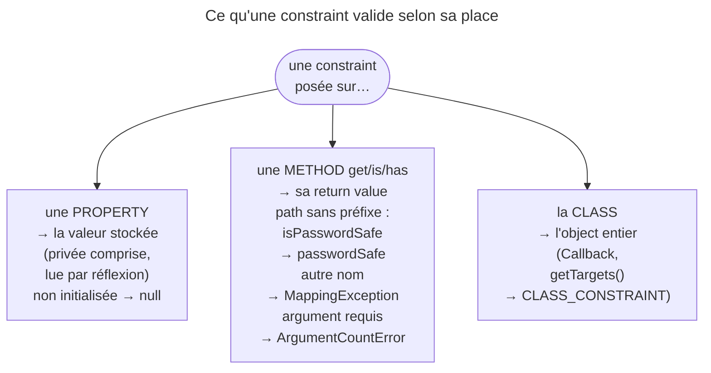

## Objectif

Savoir sur quoi une constraint peut être posée, et ce que chaque scope permet
que les autres ne permettent pas.

## L'essentiel

Une constraint se pose à trois endroits : une **property** (la valeur
stockée), un **accessor** (une valeur calculée par une method `get`, `is` ou
`has`) ou la **class** (l'object entier, seul endroit qui voit plusieurs
properties à la fois). La visibilité ne compte jamais.

## Le schéma



## L'exemple : un `Author`

```php
class Author
{
    #[Assert\Length(min: 3)]                  // stocké : property
    private string $firstName;

    private string $password;

    #[Assert\IsTrue(message: 'Le mot de passe ne peut pas reprendre le prénom.')]
    private function isPasswordSafe(): bool   // calculé : accessor
    {
        return $this->firstName !== $this->password;
    }
}
```

## Les trois cibles

| Cible | Ce qu'elle valide | Quand la choisir |
|---|---|---|
| property | la valeur stockée | le cas courant |
| accessor | la valeur **retournée** par une method | la règle est calculée |
| class | l'object entier | la règle croise plusieurs properties |

## La property

La visibilité n'a aucune importance : le validator lit la property par
réflexion, `private` comprise. Une property **typée non initialisée** est
validée comme `null` : `NotBlank` la refuse, `Length` la laisse passer.

## L'accessor

| Method annotée | Résultat |
|---|---|
| `private function isPasswordSafe()` | violation au path `passwordSafe` |
| `public function getFullName()` | violation au path `fullName` |
| `private function checkPasswordSafety()` | `MappingException` : « Constraints can only be added on methods beginning with "get", "is" or "has". » |
| `public function isOk(int $x)` | `ArgumentCountError` **à la validation** |

- Le path est le nom **sans le préfixe**, première lettre en minuscule ; le
  préfixe ignore la casse, et une method statique est acceptée.
- En YAML, ces constraints vont sous `getters:`, avec le nom sans préfixe.
- Un mauvais nom échoue à la lecture des metadata ; un argument requis n'est
  pas vérifié au chargement : c'est l'appel qui casse.

## La class

`Callback` s'applique à l'object lui-même. Une constraint maison y accède en
rendant `Constraint::CLASS_CONSTRAINT` depuis `getTargets()` ; par défaut, elle
rend `Constraint::PROPERTY_CONSTRAINT`, qui couvre properties **et**
accessors.

C'est la seule portée qui exprime une règle croisée :

```php
#[Assert\Callback('check')]
class Contract
{
    public function check(ExecutionContextInterface $context): void
    {
        if ($this->end < $this->start) {
            $context->buildViolation('La fin précède le début.')
                ->atPath('end')
                ->addViolation();
        }
    }
}
```

Sans `atPath()`, la violation est rattachée à l'object (path vide).

## Pièges d'examen

**Un accessor doit s'appeler `get…`, `is…` ou `has…`** ; sinon, une
`MappingException`, pas un oubli silencieux.

**La visibilité ne bloque rien**, ni sur une property ni sur un accessor.

**Le path d'une violation d'accessor perd le préfixe** : `isPasswordSafe`
donne `passwordSafe`.

**Une règle qui croise deux properties n'est pas une constraint de property** :
il lui faut le scope class.

**Une property typée jamais affectée est validée comme `null`** : `NotBlank` la
refuse, mais `Length` ou `Email` la laissent passer.

## Application

- « Le panier ne dépasse pas le plafond du client » → un accessor
  `isWithinLimit()` avec `IsTrue`.
- `verifyStock()` porte `#[Assert\IsTrue]` et la validation lève une
  `MappingException` → renommer en `hasStock()`.

## QCM d'entraînement

**Question 1.** `#[Assert\IsTrue]` est posé sur
`private function hasValidStock(): bool`, qui rend `false`. Quel path porte la
violation ?

- **A.** `hasValidStock`
- **B.** `hasValidStock()`
- **C.** Aucun : une method privée n'est pas lue
- **D.** `validStock`

<details>
<summary>Correction</summary>

**Bonne réponse : D.** Le préfixe `has` est retiré et la première lettre passe
en minuscule ; la visibilité privée ne gêne pas.

</details>

**Question 2.** `#[Assert\IsTrue]` est posé sur
`public function isAvailable(\DateTimeInterface $at): bool`. Que se passe-t-il ?

- **A.** Une `MappingException` au chargement des metadata
- **B.** Une `ArgumentCountError` à la validation
- **C.** Le validator passe la date du jour en argument
- **D.** La constraint est ignorée sans erreur

<details>
<summary>Correction</summary>

**Bonne réponse : B.** Le nom est accepté au chargement ; c'est l'appel sans
argument, au moment de valider, que PHP refuse.

</details>

**Question 3.** Un DTO déclare `#[Assert\Length(min: 3)] public string $code;`,
jamais affectée. Que rend la validation pour `code` ?

- **A.** Une `Error` : property typée lue avant initialisation
- **B.** Une violation « too short », la longueur valant 0
- **C.** Aucune violation
- **D.** Une violation « should not be blank »

<details>
<summary>Correction</summary>

**Bonne réponse : C.** La property non initialisée est validée comme `null`,
et `Length` laisse passer `null`.

</details>

**Question 4.** Une constraint maison ne redéfinit pas `getTargets()`. Où
peut-on la poser ?

- **A.** Sur une property ou un accessor
- **B.** Sur une property seulement, jamais sur une method
- **C.** Partout, la class comprise
- **D.** Sur la class seulement

<details>
<summary>Correction</summary>

**Bonne réponse : A.** Le défaut, `PROPERTY_CONSTRAINT`, couvre properties et
accessors ; posée sur une class, elle lève une `ConstraintDefinitionException`.

</details>

## Fiche express

**Si tu dois retenir seulement 6 choses :**

- Trois cibles : **property** (stocké), **accessor** (calculé), **class**
  (croisé).
- La visibilité ne compte jamais.
- Accessor : `get` / `is` / `has`, sans argument ; path **sans préfixe**.
- Mauvais nom : `MappingException` ; argument requis : `ArgumentCountError`.
- Property typée non initialisée : validée comme `null`.
- Règle entre deux fields : `Callback` de class + `atPath()`.

Moyen mnémotechnique : **« Stocké, Calculé, Croisé »** — property, accessor,
class.

## Sources officielles

- [Validation, « Constraint Targets »](https://github.com/symfony/symfony-docs/blob/8.0/validation.rst)
- [Custom Validation Constraint, « Class Constraint Validator »](https://github.com/symfony/symfony-docs/blob/8.0/validation/custom_constraint.rst)
- [Validator 8.0, `AttributeLoader`](https://github.com/symfony/symfony/blob/8.0/src/Symfony/Component/Validator/Mapping/Loader/AttributeLoader.php)

