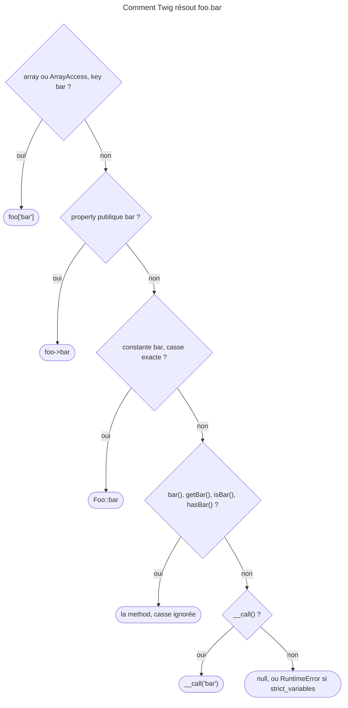

## Objectif

Maîtriser la syntaxe de base de Twig 3.22 : les trois délimiteurs, la façon dont
`foo.bar` est résolu, et le jeu d'operators. C'est le socle des treize autres
items du lot.

La version compte : le syllabus dit « Twig syntax **up to 3.22** version ». Ce
qu'une version ultérieure a ajouté est hors périmètre.

## Avant la règle : le problème à résoudre

Un template mélange du HTML et un peu de logique : afficher une valeur, tester,
boucler. Twig doit savoir **quand** une portion est du code, **comment** lire
`order.status` sans savoir si `order` est un array ou un object, et **quels
operators** il comprend — ce ne sont pas tout à fait ceux de PHP.

Trois questions : les **délimiteurs**, la **résolution** de `foo.bar`, et les
**operators**. Tous les faits de cette page ont été exécutés avec Twig 3.22.2,
sous PHP 8.4.

## Le fil rouge : la fiche commande

```twig
{# templates/order/show.html.twig #}

<h1>Commande {{ order.reference ~ ' — ' ~ order.status }}</h1>

    <p>{{ order.customer.nickname ?? 'client' }}, total {{ total }} €</p>

```

`order.status` peut venir d'une key, d'une property, d'une constante ou d'un
getter ; `~` concatène ; `and` relie ; `has some` teste une séquence ; `??`
couvre un nickname absent.

## Le cycle complet en un schéma

L'ordre que suit `CoreExtension::getAttribute()` pour `{{ foo.bar }}` :



## Les trois délimiteurs

| Délimiteur | Role |
|---|---|
| `{{ … }}` | **affiche** le résultat d'une expression |
| `` | **exécute** une instruction : `if`, `for`, `extends`, `set` |
| `{# … #}` | **commentaire**, jamais rendu |

La confusion classique est d'écrire `` pour afficher, ou
`{{ if … }}` pour tester. Un délimiteur dit *ce qu'on fait*, pas *ce qu'on
manipule*.

## `foo.bar` : l'ordre de résolution

C'est le mécanisme central, et il est ordonné. Pour `{{ foo.bar }}`, Twig essaie
dans cet ordre :

1. `$foo['bar']` — array, `ArrayObject` ou `ArrayAccess`, et key existante ;
2. `$foo->bar` — object et property publique ;
3. `Foo::bar` — object et **constante de class** ;
4. `$foo->bar()` — object et method publique ;
5. `$foo->getBar()` — *getter* ;
6. `$foo->isBar()` — *isser* ;
7. `$foo->hasBar()` — *hasser* ;
8. `$foo->__call('bar')`, si la class déclare `__call()` ;
9. sinon `null` — **ou** une `Twig\Error\RuntimeError` si l'option
   `strict_variables` est active.

La recherche de method ignore la casse, et un *hasser* est écarté quand un
*isser* du même nom existe.

Trois conséquences pratiques. D'abord, le template ne sait pas s'il manipule un
array ou un object, ce qui permet de commencer avec des arrays puis de passer
à des objects sans toucher aux templates. Ensuite, un array est essayé **avant**
un object : un object qui implémente `ArrayAccess` verra `$foo['bar']` gagner.
Enfin, la constant de class passe **avant** toute method — si son nom
correspond à la casse près, alors que les methods sont cherchées sans tenir
compte de la casse. Exécuté : avec `const STATUS` et `getStatus()`,
`{{ order.status }}` appelle le *getter* ; seule une constant nommée `status`
l'aurait masqué.

**Rejoué, étape par étape, avec Twig 3.22.2 :**

| Class | Expression | Résultat |
|---|---|---|
| `const STATUS`, `getStatus()` | `o.status` | le getter |
| `const status`, `getStatus()` | `o.status` | **la constante** |
| `ArrayAccess` et property publique `bar` | `o.bar` | la valeur d'`offsetGet()` |
| `isActive()` et `hasActive()` | `o.active` | `isActive()` |
| `GETNAME()` seulement | `o.getname` | la method, casse ignorée |
| `__call()` seulement | `o.whatever` | `__call('whatever')` |
| aucune correspondance, `strict_variables` active | `p.nope` | `RuntimeError` : « Neither the property "nope" nor one of the methods "nope()", "getnope()", "isnope()", "hasnope()" or "__call()" exist… » |

> **Deux sources divergent sur l'étape 3.** La documentation Symfony 8.0
> énumère sept étapes et ne mentionne pas la constant de class. La
> documentation Twig v3.22.0 l'énumère, et l'engine l'implémente :
> `CoreExtension::getAttribute()` teste `\defined($object::class.'::'.$item)`
> entre la property et les methods. L'item du syllabus porte sur *Twig syntax
> up to 3.22 version*, donc l'engine fait foi ; la liste Symfony est une
> restitution abrégée, pas une contradiction. Retenir l'ordre de l'engine, et
> savoir que l'énoncé d'examen peut n'en citer que sept.

Pour forcer l'appel d'une method, il existe la syntaxe explicite
`{{ foo.bar() }}`. Lorsque le nom est dynamique ou contient un tiret, Twig 3.15
a ajouté l'expression entre parenthèses : `{{ user.(name) }}`,
`{{ user.('first-name') }}`. La function `attribute()`, qui jouait ce role,
est **dépréciée depuis 3.15**.

Précision rejouée : en 3.22, `attribute()` fonctionne et **n'émet aucune
notice** de deprecation. La deprecation est documentée (avertissement de la
documentation, CHANGELOG 3.15), mais son déclenchement est commenté dans
`CoreExtension::parseAttributeFunction()`, « to uncomment sometimes during the
lifetime of the 4.x branch ». Un code qui l'utilise ne le signale donc pas : il
faut le savoir.

## Les operators

| Famille | Operators |
|---|---|
| Arithmétique | `+ - * / % // **` |
| Comparaison | `== != < > <= >= <=>` |
| Logique | `and or not xor` — pas `&& \|\| !` ; bit à bit : `b-and b-or b-xor` |
| Strings | `~` pour **concaténer** ; `starts with`, `ends with`, `matches` |
| Appartenance | `in`, `not in` ; `..` construit une plage |
| Itérables | `has some`, `has every`, avec une function fléchée |
| Test | `is` : `is defined`, `is empty`, `is null`, `is iterable`, `is same as` |
| Confort | `?:` (Elvis), `??` (coalescence) |
| Filter | `\|` |
| Functions | `=>` crée une function fléchée ; `...` étend une séquence ou un array (3.7), les arguments d'un appel (3.15) |

Quatre pièges reviennent :

- la concaténation est `~`, pas `+`. `+` est compilé tel quel en PHP : sur deux
  strings non numériques, PHP 8.4 lève une `TypeError` (« Unsupported operand
  types »), donc `{{ 'a' + 'b' }}` casse le rendu au lieu de concaténer ;
- `//` est la division **entière**, `/` la division ordinaire ;
- `?:` retourne l'opérande de gauche s'il est *vrai*, `??` s'il est *défini*.
  Sur une variable absente, `?:` déclenche `strict_variables`, `??` non ;
- sur un itérable vide, `has every` vaut `true` et `has some` vaut `false`.

**Rejoué, avec les sorties exactes :**

| Expression | Sortie |
|---|---|
| `'a' + 'b'` | `Twig\Error\RuntimeError` qui emballe la `TypeError` « Unsupported operand types: string + string » ; un `catch (\TypeError)` ne l'attrape pas |
| `7 / 2`, `7 // 2`, `-7 // 2` | `3.5`, `3`, **`-4`** : `//` arrondit vers le bas, pas vers zéro |
| `2 ** 3 ** 2` | `512` : `**` s'associe à droite |
| `zero ?: 'elvis'`, `zero ?? 'coalesce'`, avec `zero = 0` | `elvis`, `0` |
| `[1, ...[2, 3]]\|join(',')`, `max(...[4, 9, 2])` | `1,2,3`, `9` |
| `(1..4)\|join(',')`, `('a'..'c')\|join` | `1,2,3,4`, `abc` |
| `'b' in 'abc'` | vrai : `in` cherche aussi dans une string |
| `true && false` | `SyntaxError` : « Unexpected character "&" » |

## Affectation et espaces

`` déclare une variable ; `…`
capture un block entier.

Twig retire d'office le premier saut de ligne qui suit un tag. Au-delà, deux
modificateurs, d'un côté ou des deux :

- `-` — `{{-`, `-}}`, `` — supprime **tout** le blanc de ce côté,
  sauts de ligne compris ;
- `~` supprime le blanc **sauf** les sauts de ligne ; placé à droite, il
  désactive aussi le retrait automatique du premier saut de ligne.

Le filter `spaceless`, souvent employé avec ``, est **déprécié
depuis Twig 3.12** : la documentation renvoie aux modificateurs ci-dessus.

Rejoué : `[ {{- 'x' -}} ]` rend `[x]` ; un `{{~ 'x' ~}}` entouré d'espaces et de
sauts de ligne garde les sauts de ligne ; `` émet
« Since twig/twig 3.12: Twig Filter "spaceless" is deprecated » — contrairement
à `attribute()`, celui-là prévient.

## Concrètement dans ton application

- Afficher : `{{ }}` ; décider ou boucler : `` ; expliquer : `{# #}`.
- Concaténer : `~`, toujours.
- Une valeur facultative : `??` plutôt que `?:`, qui avale aussi `0` et `''`.
- Un attribute au nom dynamique : `obj.(name)`, plus `attribute()`.
- Un objet qui expose une constante et un getter du même nom, casse comprise :
  renommer l'un des deux.
- Les blancs : `-` et `~` sur les tags, plus `spaceless`.

## À comprendre

- **Pourquoi l'array d'abord ?** Pour que le template ignore la nature de la
  donnée : passer d'un array à un object ne doit rien changer à `foo.bar`.
- **Pourquoi `+` ne concatène-t-il pas ?** Twig compile `+` en `+` PHP ; PHP
  additionne, et PHP 8.4 refuse deux strings non numériques.
- **Pourquoi `?:` déclenche-t-il `strict_variables` ?** Il doit lire la valeur
  pour la tester ; `??` ne fait que demander si elle existe.

## À mémoriser

- **`{{ }}`** affiche, **``** exécute, **`{# #}`** commente.
- Résolution : **array**, property, **constante** (casse exacte), method,
  getter, isser, hasser, **`__call`**, puis `null` ou erreur.
- **`~`** concatène ; **`+`** additionne et casse sur des strings.
- **`//`** : division entière, arrondie vers le bas.
- **`?:`** teste la vérité, **`??`** l'existence.
- **`and or not`**, jamais `&& || !`.
- Moyen mnémotechnique : **« array d'abord, constante exacte, méthode sans
  casse »**.

## Pièges d'examen

- `{{ }}` affiche, `` exécute — un `` n'affiche jamais rien.
- L'ordre de résolution commence par l'**array**, pas par la property.
- Une **constante de class** est lue avant le *getter* si son nom est
  identique, casse comprise : `const STATUS` ne masque pas `getStatus()`.
- `and` / `or` / `not`, jamais `&&` / `||` / `!`.
- `~` concatène ; `+` additionne.
- Sans `strict_variables`, une variable inconnue vaut `null` silencieusement.
- `attribute()` (3.15) et `spaceless` (3.12) sont dépréciés en 3.22.

## Application : trois scénarios

**Scénario 1 — Le statut qui affiche une constante.** Une class `Order` déclare
`const status = 'draft'` et `getStatus()` ; la page affiche toujours `draft`.
*Solution.* La constante, à la casse exacte, passe avant le getter : la
renommer, ou appeler `order.getStatus()`.

**Scénario 2 — La pagination négative.** `{{ offset // size }}` donne `-1` pour
un offset de `-1`. *Solution.* `//` arrondit vers le bas ; borner l'offset à
zéro avant le calcul.

**Scénario 3 — Le libellé qui disparaît.** `{{ count ?: 'aucun' }}` affiche
« aucun » quand `count` vaut `0`. *Solution.* `??` : il ne remplace que ce qui
n'existe pas, `0` est affiché.

## QCM d'entraînement

Six questions sur la syntaxe. Choisis avant d'ouvrir la correction.

**Question 1.** Que rend `{{ -7 // 2 }}` ?

- **A.** `-3`
- **B.** `-3.5`
- **C.** `-4`
- **D.** Une erreur : `//` est un commentaire

<details>
<summary>Correction</summary>

**Bonne réponse : C.** Rejoué avec Twig 3.22.2 : `//` arrondit vers le bas, pas
vers zéro.

A suppose une troncature. B est le résultat de `/`. D est faux.

</details>

**Question 2.** Une class déclare `const status = 'CONST'` et une method
`getStatus()` qui rend `'GETTER'`. Que rend `{{ o.status }}` ?

- **A.** `GETTER` : les methods passent avant les constantes
- **B.** `CONST`
- **C.** Une erreur : deux candidats
- **D.** `null` : le nom est ambigu

<details>
<summary>Correction</summary>

**Bonne réponse : B.** Rejoué. La constante est testée avant les methods, et son
nom correspond ici à la casse près. Avec `const STATUS`, ce serait le getter.

A inverse l'ordre. C et D sont faux.

</details>

**Question 3.** Un template utilise `{{ attribute(user, field) }}` sous Twig
3.22. Que se passe-t-il ?

- **A.** La valeur est rendue, sans notice de deprecation
- **B.** Une `SyntaxError` : la function a été retirée en 3.15
- **C.** La valeur est rendue, avec une notice de deprecation
- **D.** Une `RuntimeError` : la function n'existe plus

<details>
<summary>Correction</summary>

**Bonne réponse : A.** Rejoué. La function est documentée dépréciée depuis 3.15,
mais le déclenchement de la notice est commenté dans
`parseAttributeFunction()`.

C serait vrai pour `spaceless`. B et D sont faux : la function est toujours
là, et le restera en 4.0 selon la documentation.

</details>

**Question 4.** Un controller entoure le rendu d'un `try` avec
`catch (\TypeError $e)`. Le template contient `{{ 'a' + 'b' }}`. Le catch
s'exécute-t-il ?

- **A.** Oui : PHP lève une `TypeError`
- **B.** Oui, mais seulement en PHP 8.4
- **C.** Non : le rendu affiche `ab`
- **D.** Non : Twig l'emballe

<details>
<summary>Correction</summary>

**Bonne réponse : D.** Rejoué : `Twig\Error\RuntimeError`, dont `getPrevious()`
est la `TypeError` « Unsupported operand types: string + string ».

A oublie l'emballage. B est faux. C décrirait `~`.

</details>

**Question 5.** `zero` vaut `0`. Que rend
`{{ zero ?: 'E' }}|{{ zero ?? 'C' }}` ?

- **A.** `E|C` : les deux remplacent `0`
- **B.** `0|0` : aucun ne remplace `0`
- **C.** `0|C` : seul `??` remplace `0`
- **D.** `E|0`

<details>
<summary>Correction</summary>

**Bonne réponse : D.** Rejoué : `?:` remplace une valeur fausse, `??` seulement
une valeur absente ou `null`.

A et C appliquent `??` à `0`. B ignore `?:`.

</details>

**Question 6.** Que rend `{{ 2 ** 3 ** 2 }}` ?

- **A.** `64`
- **B.** `512`
- **C.** `36`
- **D.** Une `SyntaxError`

<details>
<summary>Correction</summary>

**Bonne réponse : B.** Rejoué : `**` s'associe à droite, `2 ** 9`.

A calcule `(2 ** 3) ** 2`. C et D sont faux.

</details>

## Fiche express

**Si tu dois retenir seulement 8 choses :**

- **`{{ }}`** affiche, **``** exécute, **`{# #}`** commente.
- `foo.bar` : **array** d'abord, puis property, **constante à la casse
  exacte**, methods sans casse, **`__call`**.
- Rien trouvé : **`null`**, ou **`RuntimeError`** avec `strict_variables`.
- **`~`** concatène ; **`+`** additionne et casse sur des strings.
- **`//`** arrondit vers le bas ; **`**`** s'associe à droite.
- **`?:`** teste la vérité, **`??`** l'existence.
- **`has every`** sur vide : vrai ; **`has some`** : faux.
- **`attribute()`** dépréciée sans notice ; **`spaceless`** dépréciée avec.

**En une phrase, pour tout reconstruire :**

```text
{{ }} affiche,  exécute ; foo.bar = [key] > prop > CONST exacte > méthode/get/is/has (sans casse) > __call > null|erreur ;
~ concatène, // plancher, ** à droite, ?: vérité, ?? existence, and/or/not ; - et ~ pour les blancs
```

## Sources officielles

- [Twig 3.22, *Twig for Template Designers*](https://github.com/twigphp/Twig/blob/v3.22.0/doc/templates.rst)
- [Symfony Templates, « Template Variables »](https://github.com/symfony/symfony-docs/blob/8.0/templates.rst)
- [Twig 3.22, `CoreExtension::getAttribute()`](https://github.com/twigphp/Twig/blob/v3.22.0/src/Extension/CoreExtension.php)
- [Twig 3.22, filter `spaceless`](https://github.com/twigphp/Twig/blob/v3.22.0/doc/filters/spaceless.rst) et [function `attribute`](https://github.com/twigphp/Twig/blob/v3.22.0/doc/functions/attribute.rst)
- [php-src PHP-8.4, `add_006.phpt`](https://github.com/php/php-src/blob/PHP-8.4/Zend/tests/add_006.phpt)
