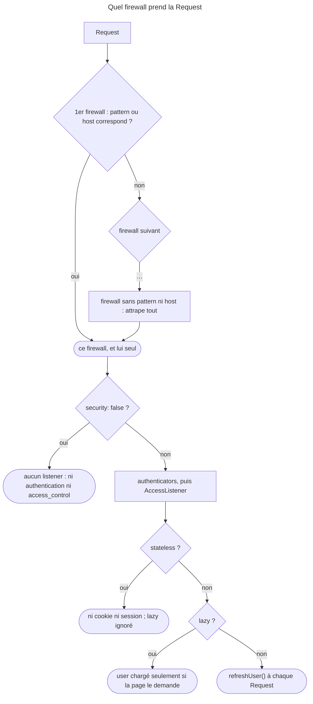

## Objectif

Comprendre ce qu'un firewall délimite, et la règle d'ordre qui décide lequel
s'applique.

## L'essentiel

Un firewall découpe les URL en zones qui s'authentifient chacune à sa façon :
outils de développement, API sans session, site avec form. **Un seul**
firewall traite une Request : le premier dont le matcher correspond.

## Le schéma



## L'exemple

```yaml
security:
    firewalls:
        dev:                                  # outils : aucune security
            pattern: ^/(_profiler|_wdt|assets)/
            security: false
        api:                                  # tokens, sans session
            pattern: ^/api
            stateless: true
        main:                                 # tout le reste, en dernier
            lazy: true
```

## Un seul firewall par Request

- Les firewalls sont essayés **dans l'ordre de déclaration** ; le **premier**
  qui correspond prend la Request, les autres ne sont jamais consultés.
- Un firewall **sans `pattern`** correspond à tout : il se déclare **en
  dernier**. Placé en premier, il capte tout, sans erreur.
- Un firewall peut aussi se choisir par `host`.
- `methods` n'entre dans le matcher **qu'avec** un `pattern` ou un `host` : un
  firewall qui ne déclare que `methods: [POST]` attrape aussi les `GET`.
- `$security->getFirewallConfig($request)->getName()` dit quel firewall a
  traité la Request.

Un firewall décide **comment on s'authentifie** ; `access_control` décide **ce
qu'il faut pour entrer**, et c'est le firewall qui l'applique.

## Ce qu'un firewall porte

- ses **authenticators**, son **provider**, son **entry point**, son **user
  checker** ;
- son caractère `stateless` ou non ;
- l'**`AccessListener`**, qui applique `access_control`.

Chaque firewall a **son propre contexte de session** : se connecter sur `main`
ne connecte pas sur `admin`. Avec `context: shared` sur les deux, `alice`
connectée sur `main` est reconnue sur `/admin/whoami`. Dans un test, le second
argument de `loginUser()` est ce **contexte**, pas le nom du firewall.

Sans état (`stateless: true`), aucun cookie n'est posé : la Request suivante
sans credentials est anonyme.

## `lazy`

`lazy: true` diffère la lecture du token et le rechargement du user jusqu'à ce
que quelque chose les demande : une page qui n'utilise pas le user n'appelle pas
le provider ; une page qui le lit l'appelle, à la demande. La documentation
ajoute que la session reste fermée, ce qui garde la Response cachable ; exécuté,
`Cache-Control` restait le même dans les deux modes, et l'effet mesuré était
l'appel au provider évité.

`lazy` est **ignoré sur un firewall `stateless`** : le contexte est un
`LazyFirewallContext` avec état, un `FirewallContext` ordinaire sans état.

## `security: false`

Ce firewall n'a **aucun listener** : ni authentication, ni `AccessListener`.
Une règle `access_control` sur ses URL est morte. Réservé aux outils de
développement et aux files statiques.

## Pièges d'examen

**Un seul firewall s'applique**, le premier qui correspond ; les autres sont
ignorés.

**Un firewall sans `pattern` attrape tout** et se déclare en dernier.

**Deux firewalls n'échangent pas leur authentication** sans `context` commun.

**`security: false` désactive aussi `access_control`** pour ses URL.

**`lazy` épargne le rechargement du user** sur les pages qui ne s'en
servent pas — et n'a aucun effet sur un firewall `stateless`.

## Application

- Une API sans état pose des cookies de session → un firewall sans `pattern`
  est déclaré avant elle : le mettre en dernier.
- Un admin connecté sur le site doit se reconnecter sur `/admin` → deux
  firewalls, deux contextes : `context: shared`.

## QCM d'entraînement

**Question 1.** Un firewall `post` ne déclare que `methods: [POST]`, avant
`main`. Quel firewall traite `GET /fw` ?

- **A.** `main` : `post` n'accepte que les POST
- **B.** `post`
- **C.** Aucun : la Request est refusée en 405
- **D.** `main`, après un avertissement de configuration

<details>
<summary>Correction</summary>

**Bonne réponse : B.** `methods` n'entre dans le matcher qu'avec un `pattern` ou
un `host` ; sans eux, `post` n'a pas de matcher et attrape tout.

</details>

**Question 2.** Avec `context: shared` sur `main` et `admin`, quel appel
connecte `alice` sur les deux dans un functional test ?

- **A.** `$client->loginUser($alice)`, sans second argument
- **B.** `$client->loginUser($alice, 'main')`
- **C.** `$client->loginUser($alice, 'admin')`
- **D.** `$client->loginUser($alice, 'shared')`

<details>
<summary>Correction</summary>

**Bonne réponse : D.** Le second argument de `loginUser()` est le contexte du
firewall ; avec `'main'`, la session visée n'est pas celle du contexte partagé.

</details>

**Question 3.** Firewall `lazy: true`, Request portant le cookie d'`alice`, sur
une page qui lit `$this->getUser()`. Le provider est-il appelé ?

- **A.** Non : `lazy` supprime le rechargement
- **B.** Seulement à la connexion
- **C.** Oui : `refreshUser(alice)`, à la demande
- **D.** Non : le user vient du token, jamais du provider

<details>
<summary>Correction</summary>

**Bonne réponse : C.** `lazy` diffère le rechargement jusqu'à ce que le user
soit demandé ; une page qui ne le lit pas n'appelle pas le provider.

</details>

**Question 4.** Quelle method dit, dans un controller, quel firewall a traité la
Request ?

- **A.** `$request->attributes->get('_firewall')`
- **B.** `$request->getFirewallName()`
- **C.** `$security->getFirewallConfig($request)->getName()`
- **D.** `$this->getParameter('security.firewall.current_name')`

<details>
<summary>Correction</summary>

**Bonne réponse : C.** Le service `Security` expose `getFirewallConfig()`, dont
la config porte le nom ; les autres écritures n'existent pas.

</details>

## Fiche express

**Si tu dois retenir seulement 7 choses :**

- **Un seul firewall** par Request : le **premier** qui correspond.
- Sans `pattern` : attrape tout, **en dernier**.
- **`methods`** seul ne forme pas de matcher.
- Chaque firewall a **sa session** ; **`context`** commun pour partager.
- **`stateless: true`** : rien n'est gardé.
- **`lazy`** diffère le rechargement du user ; ignoré si `stateless`.
- **`security: false`** : aucun listener, `access_control` mort.

Moyen mnémotechnique : **« Le premier prend tout, et garde sa session »**.

```text
firewalls dans l'ordre, 1er matcher gagne (sans pattern = tout, en dernier ; methods seul = pas de matcher) ;
contexte propre (context: shared) ; stateless = rien gardé ; lazy (ignoré si stateless) ; security: false = rien
```

## Sources officielles

- [Security, « Firewalls »](https://github.com/symfony/symfony-docs/blob/8.0/security.rst)
- [SecurityBundle 8.0, `SecurityExtension`](https://github.com/symfony/symfony/blob/8.0/src/Symfony/Bundle/SecurityBundle/DependencyInjection/SecurityExtension.php)
- [Security HTTP 8.0, `ContextListener`](https://github.com/symfony/symfony/blob/8.0/src/Symfony/Component/Security/Http/Firewall/ContextListener.php)
- [SecurityBundle 8.0, `Security`](https://github.com/symfony/symfony/blob/8.0/src/Symfony/Bundle/SecurityBundle/Security.php)
- [FrameworkBundle 8.0, `KernelBrowser`](https://github.com/symfony/symfony/blob/8.0/src/Symfony/Bundle/FrameworkBundle/KernelBrowser.php)

