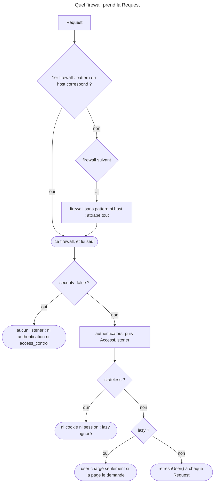

## Objectif

Comprendre ce qu'un firewall délimite, et la règle d'ordre qui décide lequel
s'applique.

## Avant la règle : le problème à résoudre

Une application sert trois publics : des outils de développement sans
connexion, une API à tokens sans session, et un site où l'on se connecte par
form. Chacun s'authentifie autrement. Il faut donc découper les URL en zones,
et savoir **quelle zone** traite une Request donnée.

Trois questions : **lequel** des firewalls s'applique, **ce qu'il porte** avec
lui, et ce que changent `lazy`, `stateless`, `context` et `security: false`.

On suppose connus les principes de l'authentication et le file
`security.yaml`.

## Le fil rouge : trois zones

```yaml
security:
    firewalls:
        dev:                                  # 1. outils : aucune security
            pattern: ^/(_profiler|_wdt|assets)/
            security: false
        api:                                  # 2. tokens, sans session
            pattern: ^/api
            stateless: true
        main:                                 # 3. tout le reste, en dernier
            lazy: true
```

## Le cycle complet en un schéma



## Un seul firewall par Request

C'est la règle centrale. Les firewalls sont essayés **dans l'ordre de
déclaration**, et **le premier dont le `pattern` correspond** prend la Request.
Les suivants ne sont jamais consultés.

```yaml
security:
    firewalls:
        dev:
            pattern: ^/(_profiler|_wdt|assets)/
            security: false
        api:
            pattern: ^/api
            stateless: true
        main:
            lazy: true
```

Deux conséquences pratiques. Le firewall **sans `pattern` correspond à tout** et
doit donc être déclaré **en dernier** — placé en premier, il capte tout sans
erreur de configuration. Et un firewall `dev` mal placé désactiverait la
security de toute l'application.

C'est la différence avec `access_control` : les deux prennent la première
correspondance, mais un firewall définit **comment on s'authentifie**, tandis
qu'`access_control` définit **ce qu'il faut pour entrer** — et c'est le firewall
qui l'applique.

Rejoué pour cette page avec SecurityBundle 8.0.15, en lisant le nom renvoyé par
`$security->getFirewallConfig($request)->getName()` :

| Ordre de déclaration | `/api/fw` | `/fw` |
|---|---|---|
| `main` (sans `pattern`), puis `api` (`^/api`) | `main` | `main` |
| `api`, puis `main` | `api` | `main` |

Un firewall peut aussi se choisir par `host`. Rejoué, `api` avec
`host: ^api\.example\.com$` placé avant `main` : `api.example.com` va à `api`,
`www.example.com` à `main`.

Le piège de `methods` : lu dans `SecurityExtension` (8.0), l'option n'entre dans
le matcher **qu'avec un `pattern` ou un `host`**. Rejoué, un firewall `post` ne
déclarant que `methods: [POST]`, avant `main` :

| Configuration de `post` | `GET /fw` | `POST /fw` |
|---|---|---|
| `methods: [POST]` seul | `post` | `post` |
| `pattern: ^/fw`, `methods: [POST]` | `main` | `post` |

Sans `pattern` ni `host`, le firewall n'a pas de matcher : il attrape tout, comme
un firewall sans `pattern`.

## Ce qu'un firewall porte

- ses **authenticators** — form de connexion, token, `remember_me` ;
- son **provider** de users ;
- son **entry point**, ce qui se passe quand un anonyme doit s'identifier ;
- son **user checker** ;
- son caractère `stateless` ou non ;
- l'**`AccessListener`**, qui applique `access_control`.

Chaque firewall a **son propre contexte de session** : par défaut, se connecter
sur l'un ne connecte pas sur l'autre. La key `context` permet de partager
explicitement l'authentication entre deux firewalls. Exécuté avec
SecurityBundle 8.0.15, `alice` connectée sur `main`, puis `/admin/whoami` sur un
firewall `admin` avec le même cookie :

| Configuration | User vu sur `admin` |
|---|---|
| deux firewalls, sans `context` | `null` |
| `context: shared` sur les deux | `alice` |

Rejoué pour cette page, la connexion faite en HTTP Basic sur `main`, puis la
Request suivante sur `/admin/whoami` avec le seul cookie : `null` sans
`context`, `alice` avec `context: shared`.

Le même partage se voit dans les tests. Lu dans `KernelBrowser` (8.0), le second
argument de `loginUser()` s'appelle `$firewallContext` : c'est le **contexte**,
pas le nom du firewall. Rejoué, avec `context: shared` sur les deux :
`loginUser($alice, 'main')` laisse `/whoami` anonyme, `loginUser($alice,
'shared')` connecte `alice` sur `main` et sur `admin`.

Sans état, rien n'est conservé. Rejoué, connexion HTTP Basic puis seconde
Request sans credentials :

| Firewall | Cookie posé | Seconde Request |
|---|---|---|
| avec état | un cookie de session | `alice` |
| `stateless: true` | aucun | anonyme |

## `lazy`

`lazy: true` diffère la lecture du token et le chargement du user
jusqu'à ce que quelque chose les demande. Exécuté, avec un provider qui
compte ses appels et une page `/plain` qui n'utilise pas le user, Request
portant le cookie d'`alice` :

| Firewall | Appels au provider sur `/plain` |
|---|---|
| `lazy: true` | aucun |
| sans `lazy` | `refreshUser(alice)` à chaque Request |

Rejoué pour cette page : sur une page qui lit le user, `/whoami`, le firewall
`lazy` appelle bien `refreshUser(alice)` — le chargement n'est pas supprimé,
il est **différé** jusqu'à la demande.

La documentation ajoute que le mode lazy évite d'ouvrir la session quand
aucune authorization n'est demandée, ce qui garde la Request cachable. Dans cette
exécution, le header `Cache-Control` de `/plain` est le même dans les deux
modes ; l'effet mesuré est l'appel au provider évité.

**`lazy` est ignoré sur un firewall `stateless`.** Lu dans `SecurityExtension`
(8.0) : `$isLazy = !$firewall['stateless'] && $firewall['lazy']`. Exécuté avec
`lazy: true` : le contexte du firewall est un `LazyFirewallContext` avec état,
un `FirewallContext` ordinaire une fois `stateless: true` ajouté.

## `security: false`

Ce firewall n'a **aucun listener** : ni authentication, ni `AccessListener`.
C'est donc bien « tout le monde passe » — `access_control` ne s'y applique pas.
Exécuté : une règle `ROLE_ADMIN` sur les URL d'un tel firewall laisse un anonyme
obtenir 200. Réservé aux outils de développement et aux files statiques.

Rejoué : la même règle `ROLE_ADMIN`, posée sur `^/admin` que couvre `main`,
répond 401 à l'anonyme — c'est l'`AccessListener` de `main` qui l'applique.

## Concrètement dans ton application

- L'ordre : `dev` d'abord, les zones à `pattern` ensuite, le firewall sans
  `pattern` en dernier.
- Une API à tokens : `stateless: true` — `lazy` n'y sert à rien.
- Un site à session : `lazy: true`, pour ne recharger le user que si la page
  s'en sert.
- Un back-office qui doit reconnaître le user du site : `context` commun.
- Filtrer par method HTTP : `methods` **avec** un `pattern` ou un `host`.
- Savoir quel firewall a répondu : `$security->getFirewallConfig($request)`.

## À comprendre

- **Pourquoi un seul firewall ?** Chacun définit une façon de s'authentifier ;
  en appliquer deux à la même Request poserait la question de celui qui gagne.
- **Pourquoi des contextes séparés ?** Une API et un back-office n'ont pas à
  hériter de la session du site ; le partage est un choix explicite.
- **Pourquoi `lazy` est-il ignoré sans état ?** Il diffère la lecture du token
  dans la session ; sans session, il n'y a rien à différer.

## À mémoriser

- **Premier `pattern` (ou `host`) qui correspond** = le seul firewall.
- **Sans `pattern` ni `host`** : attrape tout → **en dernier**.
- **`methods`** n'agit qu'**avec** un `pattern` ou un `host`.
- **Contexte de session par firewall** ; partage par **`context`**.
- **`loginUser($user, 'contexte')`** : le contexte, pas le firewall.
- **`stateless`** : ni cookie ni session ; **`lazy`** y est ignoré.
- **`security: false`** : aucun listener, **`access_control` compris**.
- Moyen mnémotechnique : **« Le premier prend tout, et garde sa session »**.

## Pièges d'examen

**Un seul firewall s'applique**, le premier qui correspond ; les autres sont
ignorés.

**Un firewall sans `pattern` attrape tout** et se déclare en dernier.

**Deux firewalls n'échangent pas leur authentication** sans `context` commun.

**`security: false` désactive aussi `access_control`** pour ses URL.

**`lazy` épargne le rechargement du user** sur les pages qui ne s'en
servent pas — et n'a aucun effet sur un firewall `stateless`.

## Application : trois scénarios

**Scénario 1 — L'API qui ouvre une session.** Les appels à `/api` posent un
cookie de session. *Solution.* Le firewall `main`, sans `pattern`, est déclaré
avant `api` et prend tout : le déplacer en dernier, et garder `stateless: true`
sur `api`.

**Scénario 2 — Le back-office anonyme.** Un user connecté sur le site arrive
anonyme sur `/admin`, servi par un firewall `admin`. *Solution.* `context: shared`
— la même valeur — sur `main` et sur `admin` ; dans les tests,
`loginUser($user, 'shared')`.

**Scénario 3 — Le firewall des envois.** Un firewall déclaré avec
`methods: [POST]` seulement, pour traiter les forms, prend aussi les GET.
*Solution.* Lui donner un `pattern` : sans lui, `methods` n'entre pas dans le
matcher.

## QCM d'entraînement

Six questions sur les firewalls. Choisis avant d'ouvrir la correction.

**Question 1.** Un firewall `post` ne déclare que `methods: [POST]`, avant
`main`. Quel firewall traite `GET /fw` ?

- **A.** `main` : `post` n'accepte que les POST
- **B.** `post`
- **C.** Aucun : la Request est refusée en 405
- **D.** `main`, après un avertissement de configuration

<details>
<summary>Correction</summary>

**Bonne réponse : B.** Exécuté avec SecurityBundle 8.0.15. Lu dans
`SecurityExtension` : `methods` n'entre dans le matcher qu'avec un `pattern` ou
un `host` ; sans eux, le firewall attrape tout.

A serait vrai avec un `pattern`. C et D sont faux.

</details>

**Question 2.** Avec `context: shared` sur `main` et `admin`, quel appel connecte
`alice` dans un test ?

- **A.** `$client->loginUser($alice)`, sans second argument
- **B.** `$client->loginUser($alice, 'main')`
- **C.** `$client->loginUser($alice, 'admin')`
- **D.** `$client->loginUser($alice, 'shared')`

<details>
<summary>Correction</summary>

**Bonne réponse : D.** Le second argument est le contexte du firewall. Exécuté :
avec `'main'`, `/whoami` reste anonyme ; avec `'shared'`, `alice` est vue sur les
deux firewalls.

A et B écrivent sous le contexte `main`, qui n'existe pas ici. C se trompe aussi
de nom.

</details>

**Question 3.** Un firewall `stateless: true` en HTTP Basic accepte `alice`. La
Request suivante arrive sans credentials. Que voit-elle ?

- **A.** `alice`, relue depuis la session
- **B.** Un user anonyme
- **C.** `alice`, servie par un cache du provider
- **D.** Une erreur : un firewall sans état exige un token

<details>
<summary>Correction</summary>

**Bonne réponse : B.** Exécuté : aucun cookie n'est posé à la connexion, la
seconde Request est anonyme.

A est le comportement d'un firewall avec état. C et D sont faux.

</details>

**Question 4.** Firewall `lazy: true`, Request portant le cookie d'`alice`, sur une
page qui lit `$security->getUser()`. Le provider est-il appelé ?

- **A.** Non : `lazy` supprime le rechargement
- **B.** Seulement à la connexion
- **C.** Oui : `refreshUser(alice)`, à la demande
- **D.** Non : le user vient du token, jamais du provider

<details>
<summary>Correction</summary>

**Bonne réponse : C.** Exécuté : `refreshUser(alice)` sur `/whoami`, aucun appel
sur `/plain`. `lazy` diffère le chargement, il ne le supprime pas.

A et D confondent différer et supprimer. B est faux.

</details>

**Question 5.** `api` déclare `host: ^api\.example\.com$` et précède `main`.
Quel firewall traite `GET /fw` sur `www.example.com` ?

- **A.** `main`
- **B.** `api` : le path `/fw` ne dépend pas du host
- **C.** Aucun : le host n'est déclaré nulle part
- **D.** `api`, puis `main`

<details>
<summary>Correction</summary>

**Bonne réponse : A.** Exécuté : `api.example.com` va à `api`, `www.example.com`
à `main`. Le host fait partie du matcher.

B oublie le host. C et D sont faux : un seul firewall s'applique.

</details>

**Question 6.** Quelle method dit, dans un controller, quel firewall a traité la
Request ?

- **A.** `$request->attributes->get('_firewall')`
- **B.** `$request->getFirewallName()`
- **C.** `$security->getFirewallConfig($request)->getName()`
- **D.** `$this->getParameter('security.firewall.current_name')`

<details>
<summary>Correction</summary>

**Bonne réponse : C.** Lu dans `Security` (SecurityBundle 8.0) et rejoué : le
nom rendu est `main` ou `api` selon le matcher.

A, B et D n'existent pas sous ces noms.

</details>

## Fiche express

**Si tu dois retenir seulement 7 choses :**

- **Un seul firewall** : le premier dont le matcher correspond.
- **Sans `pattern` ni `host`** : il attrape tout, donc **en dernier**.
- **`methods`** seul ne restreint rien.
- Un **contexte de session par firewall** ; **`context`** pour partager.
- **`loginUser()`** prend le **contexte**.
- **`stateless`** : pas de session ; **`lazy`** ignoré.
- **`security: false`** : aucun listener, **`access_control`** compris.

**En une phrase, pour tout reconstruire :**

```text
1er matcher (pattern/host ; methods seulement avec eux) = 1 firewall ; sans matcher = tout, en dernier ; contexte par firewall
(context pour partager, loginUser(…, contexte)) ; stateless : ni session ni lazy ; lazy : user à la demande ; security: false = rien
```

## Sources officielles

- [Security, « Firewalls »](https://github.com/symfony/symfony-docs/blob/8.0/security.rst)
- [SecurityBundle 8.0, `SecurityExtension`](https://github.com/symfony/symfony/blob/8.0/src/Symfony/Bundle/SecurityBundle/DependencyInjection/SecurityExtension.php)
- [Security HTTP 8.0, `ContextListener`](https://github.com/symfony/symfony/blob/8.0/src/Symfony/Component/Security/Http/Firewall/ContextListener.php)
- [SecurityBundle 8.0, `Security`](https://github.com/symfony/symfony/blob/8.0/src/Symfony/Bundle/SecurityBundle/Security.php)
- [FrameworkBundle 8.0, `KernelBrowser`](https://github.com/symfony/symfony/blob/8.0/src/Symfony/Bundle/FrameworkBundle/KernelBrowser.php)
