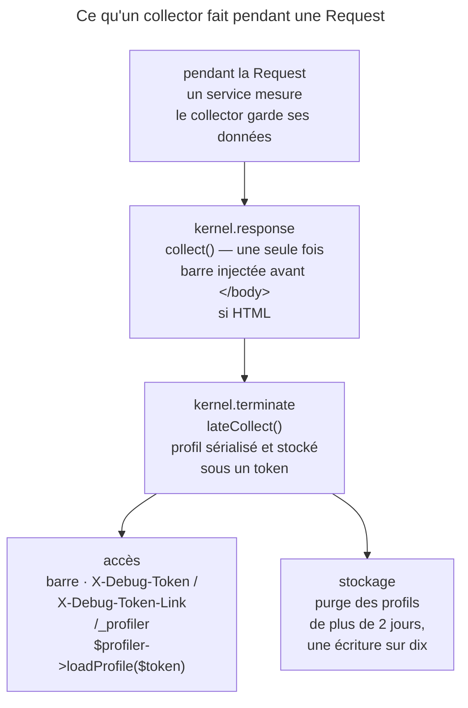

## Objectif

Comprendre qui collecte quoi, où c'est stocké, et par quels entry points on y
accède — y compris quand la barre n'apparaît pas.

## L'essentiel

Trois pièces : les **data collectors** ramassent l'information, le
**profiler** la stocke sous un token, la **debug toolbar** en affiche un
résumé. La barre n'est qu'une vue : elle manque souvent (JSON, redirect),
le profil existe toujours. Le tout s'installe en dependency de développement,
jamais en production.

## Le schéma



## L'exemple : un collector de hits

```php
class HitCollector extends AbstractDataCollector implements LateDataCollectorInterface
{
    public function __construct(private HitCounter $counter) {}

    public function collect(Request $request, Response $response, ?\Throwable $exception = null): void
    {
        $this->data['hits'] = $this->counter->count();      // ramasse, ne mesure pas
    }

    public function lateCollect(): void
    {
        $this->data['late_hits'] = $this->counter->count(); // après la Response
    }
}
```

## Trois pièces, trois roles

| Pièce | Role |
|---|---|
| **Data collectors** | ramassent l'information pendant la Request |
| **Profiler** | stocke ces données sous un **token**, et les ressert |
| **Debug toolbar** | affiche un résumé en bas de la page |

`composer require --dev symfony/profiler-pack`. La documentation est
catégorique : ne jamais l'activer en production, ce serait ouvrir des
vulnérabilités majeures. Un controller qui reçoit le service `profiler` le
type `?Profiler` : il n'existe pas en production.

## La barre n'apparaît pas toujours

| Response | Barre injectée | `X-Debug-Token-Link` |
|---|---|---|
| HTML avec `</body>` | oui | présent |
| JSON, redirect 302, HTML demandé en XHR | non | présent |
| HTML sans tag `</body>` | non | présent |

`X-Debug-Token` porte le token, `X-Debug-Token-Link` l'URL du profil, et
`/_profiler` liste tous les profils. Les profils sont supprimés
probabilistiquement après **2 jours** : une écriture sur dix, la purge
(`FileProfilerStorage`) retire les profils de plus de `2 * 86400` secondes.

## Les collectors

- Un service qui implémente `DataCollectorInterface` — `collect()`, `reset()`,
  `getName()` — ou étend `AbstractDataCollector`, qui fournit `$this->data`.
- `collect()` est appelée **une seule fois**, sur `kernel.response` : elle
  ramasse ce qu'un service a mesuré. `lateCollect()`
  (`LateDataCollectorInterface`) tourne sur **`kernel.terminate`** :
  `ProfilerListener::onKernelTerminate()` l'appelle, puis écrit le profil.
- Les données sont **sérialisées** : une connexion, une closure ne passent pas.
- `php bin/console debug:container --tag=data_collector` liste les collectors ;
  avec `autoconfigure`, rien à déclarer, sinon le tag `data_collector`.

## Un collector de bout en bout

| Étape | Résultat |
|---|---|
| `getName()` non redéfini | le FQCN de la class ; `getTemplate()` rend `null` |
| `Profiler::collect()` | appelle `collect()`, range un **clone** dans le profil |
| `saveProfile()` | `lateCollect()` sur ce clone, puis serialization |
| `loadProfile($token)->getCollector($nom)` | une copie désérialisée ; nom inconnu : `InvalidArgumentException` |
| une `Closure` dans `$this->data` | `saveProfile()` lève « Serialization of 'Closure' is not allowed » |
| `reset()` | vide `$this->data` |

Tagué à la main, le `data_collector` porte un `id` égal à `getName()`. En
test, `$client->getProfile()->getCollector('app.hit')`, après
`enableProfiler()` si `collect` vaut `false`.

## Pièges d'examen

**La barre n'est injectée que dans du HTML qui a un `</body>`**, hors
redirect et hors XHR ; sinon, `X-Debug-Token-Link`, toujours présent.

**`collect()` est appelée une fois, sur `kernel.response`** ;
`lateCollect()` sur `kernel.terminate`.

**Les profils disparaissent après environ 2 jours** — purge déclenchée une
fois sur dix, à l'écriture d'un profil.

**`getName()` est la key d'accès** — par défaut le FQCN, avec `AbstractDataCollector`.

## Application

- Une API JSON dont on veut le profil → le header `X-Debug-Token-Link`, ou
  `/_profiler`.
- Mesurer la durée des appels à un service distant → un service qui mesure,
  un collector qui ramasse.

## QCM d'entraînement

**Question 1.** Une page HTML complète, avec `</body>`, est chargée par un
appel `fetch()` en XHR, profiler actif. Que porte la Response ?

- **A.** La barre, injectée avant `</body>`
- **B.** Ni barre ni header : le profil n'est pas créé
- **C.** Pas de barre, mais `X-Debug-Token-Link`
- **D.** La barre, et une seconde barre pour l'appel XHR

<details>
<summary>Correction</summary>

**Bonne réponse : C.** Une Response demandée en XHR ne reçoit pas la barre ;
le profil existe pourtant, et son lien voyage dans le header.

</details>

**Question 2.** Pour diagnostiquer un incident, un développeur veut activer le
profiler sur le serveur de production. Que dit la documentation ?

- **A.** C'est possible le temps du diagnostic, avec `APP_DEBUG=1`
- **B.** C'est possible si `/_profiler` est protégé par un firewall
- **C.** C'est recommandé : la barre y est masquée par défaut
- **D.** Jamais : cela ouvrirait des vulnérabilités majeures

<details>
<summary>Correction</summary>

**Bonne réponse : D.** Le profiler est une dependency de développement ; la
documentation interdit de l'activer en production, sans exception.

</details>

**Question 3.** `HitCollector` étend `AbstractDataCollector` sans redéfinir
`getName()` ni `getTemplate()`. Que rendent ces deux methods ?

- **A.** Le FQCN de la class, puis `null`
- **B.** `hit`, puis le template par défaut du profiler
- **C.** `hit_collector`, puis `null`
- **D.** Une exception : `getName()` est abstraite

<details>
<summary>Correction</summary>

**Bonne réponse : A.** `AbstractDataCollector` nomme le collector par sa class
complète et ne fournit aucun template : c'est cette key que lit `getCollector()`.

</details>

**Question 4.** Sans `autoconfigure`, un collector est tagué
`data_collector` à la main. Quel attribute ce tag porte-t-il ?

- **A.** `priority`, obligatoire
- **B.** `id`, égal à `getName()`
- **C.** `alias`, égal au nom du service
- **D.** Aucun : le tag seul suffit

<details>
<summary>Correction</summary>

**Bonne réponse : B.** L'`id` du tag doit correspondre au nom que rend le
collector, sous lequel le profil le range et le rend.

</details>

## Fiche express

**Si tu dois retenir seulement 6 choses :**

- **Collectors** ramassent, **profiler** stocke, **barre** affiche.
- **`--dev`**, jamais en production ; `?Profiler` dans un controller.
- Barre : HTML avec `</body>`, hors redirect et XHR ; sinon
  **`X-Debug-Token-Link`** ou `/_profiler`.
- `collect()` sur **`kernel.response`**, une fois ; `lateCollect()` sur
  **`kernel.terminate`**.
- Données **sérialisées** ; purge après **2 jours**, une fois sur dix.
- Nom par défaut : le **FQCN** ; tag `data_collector` avec `id`.

Moyen mnémotechnique : **« Ramasser, stocker, montrer »**.

## Sources officielles

- [Profiler](https://github.com/symfony/symfony-docs/blob/8.0/profiler.rst)
- [`ProfilerListener`, branche 8.0](https://github.com/symfony/symfony/blob/8.0/src/Symfony/Component/HttpKernel/EventListener/ProfilerListener.php)
- [`FileProfilerStorage`, branche 8.0](https://github.com/symfony/symfony/blob/8.0/src/Symfony/Component/HttpKernel/Profiler/FileProfilerStorage.php)
- [`WebDebugToolbarListener`, branche 8.0](https://github.com/symfony/symfony/blob/8.0/src/Symfony/Bundle/WebProfilerBundle/EventListener/WebDebugToolbarListener.php)

