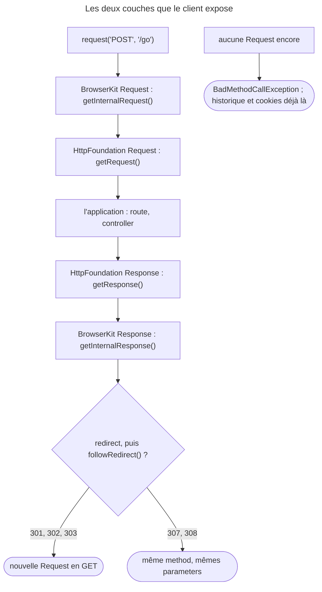

## Objectif

Lire ce que le client a réellement envoyé et reçu. La difficulté tient à ce que
**deux couches** existent, avec deux objects pour la Request et deux pour la
Response.

## L'essentiel

Le client expose **deux couches** : `getRequest()` et `getResponse()` rendent
les objects **HttpFoundation** que l'application a vus ;
`getInternalRequest()` et `getInternalResponse()` rendent ceux du **navigateur
simulé**, BrowserKit. Avant toute Request, ils lèvent une exception. Après un
redirect non suivi, `getRequest()` est la Request qui a redirigé.

## Le schéma



## L'exemple

```php
$client->request('POST', '/go');                       // répond 302 vers /hello
$client->getResponse()->getStatusCode();               // 302, côté application
$client->getRequest()->attributes->get('_route');      // 'go' : la Request qui a redirigé
$client->followRedirect();
$client->getRequest()->getMethod();                    // 'GET' : un 302 ne garde pas POST
$this->assertRouteSame('hello');
```

## Les deux couches

| Method | Class rendue | Couche |
|---|---|---|
| `getRequest()` | `HttpFoundation\Request` | application |
| `getInternalRequest()` | `BrowserKit\Request` | navigateur simulé |
| `getResponse()` | `HttpFoundation\Response` | application |
| `getInternalResponse()` | `BrowserKit\Response` | navigateur simulé |

- **`internal` désigne le navigateur**, pas l'application.
- `HttpKernelBrowser`, parent du client, traduit d'une couche à l'autre :
  `filterRequest()` et `filterResponse()`.
- La Response BrowserKit n'a pas de property `headers` : `getHeader()`,
  `getHeaders()`, `getStatusCode()`, `getContent()`.

## Les autres objects internes

| Method | Class rendue |
|---|---|
| `getHistory()` | `BrowserKit\History` |
| `getCookieJar()` | `BrowserKit\CookieJar` |
| `getCrawler()` | `DomCrawler\Crawler`, le même object que celui rendu par `request()` |

## Avant la première Request

| Appel avant toute Request | Résultat |
|---|---|
| `getRequest()`, `getResponse()`, leurs versions `internal`, `getCrawler()` | `BadMethodCallException` : « The "request()" method must be called before … » |
| `getHistory()` | un historique vide |
| `getCookieJar()` | utilisable : on peut y poser un cookie |

## Introspecter la Response

`getResponse()` est un `HttpFoundation\Response` ordinaire. Pour affirmer,
préférer les assertions de Symfony : `assertResponseStatusCodeSame(404)`
affiche en échec la Response entière — statut, headers, corps —, là où
`assertSame()` ne montre que deux nombres.

## Introspecter la Request

- `_route` dit **quelle route a répondu** — ce que vérifie
  `assertRouteSame()`, et qu'aucune inspection du HTML ne donne.
- `_controller` vaut `Classe::méthode` pour une route posée sur une method.
  Pour un controller invocable, la class seule :
  `AttributeRouteControllerLoader` omet le nom de la method.
- `getRequest()->getPathInfo()` rend `/hello` ; `getUri()`, des deux côtés,
  `http://localhost/hello`.

## Après un redirect

Le client ne suit pas les redirects par défaut : `getRequest()` est **la
Request qui a redirigé**.

| Étape | `getResponse()` | `_route` |
|---|---|---|
| `request('GET', '/go')` | 302 | `go` |
| `followRedirect()` | 200 | `hello` |

Après un 301, 302 ou 303, `followRedirect()` envoie un `GET` sans les
parameters ; après un 307 ou un 308, la method et les parameters sont gardés.

## Pièges d'examen

**`getInternalRequest()` est l'object BrowserKit**, pas celui de l'application.

**`getRequest()` et `getResponse()` sont les objects HttpFoundation** — ceux que
le controller a vus et produits.

**Avant toute Request, ils lèvent `BadMethodCallException`** — ils ne rendent pas
`null`. L'historique et les cookies, eux, existent déjà.

**Un redirect non suivi** laisse `_route` sur la route qui a redirigé.

**Préférer les assertions Symfony** aux lectures brutes, pour le message
d'échec.

## Application

- Deux routes rendent le même template et le test passe sur la mauvaise →
  `assertRouteSame('product_show')`.
- Un helper appelle `getResponse()` avant toute Request et reçoit une
  `BadMethodCallException` → faire la Request d'abord.

## QCM d'entraînement

**Question 1.** `POST /go` répond par un 302 vers `/hello`. Le test appelle
`followRedirect()`. Que vaut ensuite `$client->getRequest()->getMethod()` ?

- **A.** `POST` : la method d'origine est conservée
- **B.** `GET`
- **C.** `HEAD`, le temps de suivre le redirect
- **D.** Rien : `getRequest()` lève une exception après un redirect

<details>
<summary>Correction</summary>

**Bonne réponse : B.** Après un 301, 302 ou 303, le client envoie un `GET` sans
parameters ; A vaut pour un 307 ou un 308.

</details>

**Question 2.** `POST /go307` avec `a=1` répond par un **307** vers `/echo`.
Après `followRedirect()`, que reçoit `/echo` ?

- **A.** Un `GET`, sans parameters
- **B.** Un `GET`, avec `a=1` en query string
- **C.** Un `POST`, avec `a=1`
- **D.** Rien : un 307 n'est pas suivi par le client

<details>
<summary>Correction</summary>

**Bonne réponse : C.** Hors 301, 302 et 303, la method et les parameters sont
conservés ; A est le cas d'un 302.

</details>

**Question 3.** `$crawler = $client->request('GET', '/hello');`. Que vaut
`$client->getCrawler() === $crawler` ?

- **A.** `true`
- **B.** `false` : une copie est rendue
- **C.** `false` : `getCrawler()` relit la page
- **D.** Une exception : un seul crawler par Request

<details>
<summary>Correction</summary>

**Bonne réponse : A.** Le client garde le crawler de la dernière Request et le
rend tel quel, sans copie ni nouvelle lecture.

</details>

**Question 4.** La route `/inv` est posée sur une class invocable,
`InvController`. Que vaut l'attribute `_controller` de la Request ?

- **A.** `App\P13\W\InvController::__invoke`
- **B.** `inv`, le nom de la route
- **C.** `null` : une class invocable n'en a pas
- **D.** `App\P13\W\InvController`

<details>
<summary>Correction</summary>

**Bonne réponse : D.** Le loader omet le nom de la method pour `__invoke` ; A
est le format d'une route posée sur une method, B la valeur de `_route`.

</details>

## Fiche express

**Si tu dois retenir seulement 7 choses :**

- **`internal`** = navigateur simulé (**BrowserKit**).
- **`getRequest()`**, **`getResponse()`** = **HttpFoundation**, ce qu'a vu
  l'application.
- **Avant toute Request** : exception, sauf **historique** et **cookies**.
- **`getCrawler()`** : le crawler de la dernière Request.
- **`_route`** et **`_controller`** dans les attributes de la Request.
- Redirect **non suivi** : `_route` de la route qui a redirigé.
- **302 suivi → `GET`** ; 307/308 → même method.

Moyen mnémotechnique :
**« Interne = navigateur ; rien avant request() »**.

```text
internal = BrowserKit, sinon HttpFoundation ; rien avant request() (sauf History, CookieJar) ; _route / _controller ;
redirect non suivi = Request d'origine ; followRedirect : 301/302/303 → GET, 307/308 → même method
```

## Sources officielles

- [Testing](https://github.com/symfony/symfony-docs/blob/8.0/testing.rst)
- [`AbstractBrowser`, branche 8.0](https://github.com/symfony/symfony/blob/8.0/src/Symfony/Component/BrowserKit/AbstractBrowser.php)
- [`BrowserKit\Response`, branche 8.0](https://github.com/symfony/symfony/blob/8.0/src/Symfony/Component/BrowserKit/Response.php)

