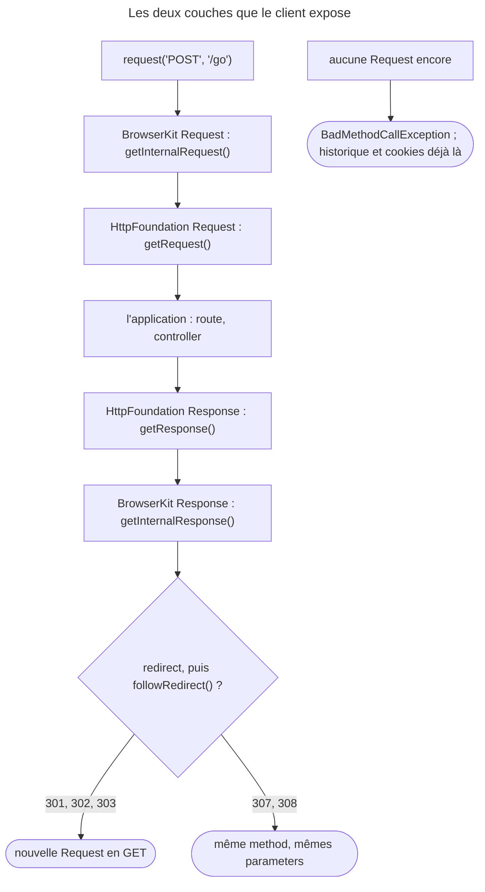

## Objectif

Lire ce que le client a réellement envoyé et reçu. La difficulté tient à ce que
**deux couches** existent, avec deux objects pour la Request et deux pour la
Response.

## Avant la règle : le problème à résoudre

Un test échoue : la page affichée n'est pas la bonne. Était-ce la bonne route ?
Le bon controller ? La Response a-t-elle redirigé ? Pour répondre, le test doit
lire **ce qui s'est vraiment passé** — et le client lui tend deux jeux
d'objects, l'un du navigateur simulé, l'autre de l'application.

Trois questions : **quelle method** rend quel object, ce qu'on lit dans la
**Response**, et ce que la **Request** révèle — route, controller, method HTTP
après un redirect.

On suppose connus l'object client, et les objects `Request` et `Response` de
HttpFoundation.

## Le fil rouge : une page qui redirige

```php
$client->request('POST', '/go');                       // répond 302 vers /hello

$client->getResponse()->getStatusCode();               // 302, côté application
$client->getRequest()->attributes->get('_route');      // 'go' : la Request qui a redirigé

$client->followRedirect();
$client->getRequest()->getMethod();                    // 'GET' : un 302 ne garde pas POST
$this->assertRouteSame('hello');
```

## Le cycle complet en un schéma



## Les deux couches

BrowserKit simule le navigateur ; HttpKernel exécute l'application. Le client
expose les objects des deux côtés, et l'examen teste qu'on ne les confonde pas :

| Method | Class rendue (exécuté, 8.0) | Couche |
|---|---|---|
| `getRequest()` | `HttpFoundation\Request` | application |
| `getInternalRequest()` | `BrowserKit\Request` | navigateur simulé |
| `getResponse()` | `HttpFoundation\Response` | application |
| `getInternalResponse()` | `BrowserKit\Response` | navigateur simulé |

La règle de lecture : **`internal` désigne le navigateur**, pas l'application.
L'intuition inverse — « interne, donc plus proche du framework » — est
exactement ce sur quoi la question porte.

En pratique, c'est `getResponse()` qu'on utilise : c'est l'object
`HttpFoundation\Response` que le controller a produit, avec son code, ses
headers et son contenu.

Les deux Responses ne se lisent pas de la même façon. Lu dans
`BrowserKit\Response` (8.0) : pas de property `headers`, mais `getHeader()`,
`getHeaders()`, `getStatusCode()` et `getContent()`. Rejoué sur `/hello` :
`getInternalResponse()->getHeader('Content-Type')` rend
`text/html; charset=UTF-8`, la même valeur que
`getResponse()->headers->get('content-type')`.

## Les autres objects internes

```php
$history   = $client->getHistory();     // l'historique de navigation
$cookieJar = $client->getCookieJar();   // les cookies accumulés
$crawler   = $client->getCrawler();     // le crawler de la dernière requête
```

| Method | Class rendue (exécuté, 8.0) |
|---|---|
| `getHistory()` | `BrowserKit\History` |
| `getCookieJar()` | `BrowserKit\CookieJar` |
| `getCrawler()` | `DomCrawler\Crawler` |

`getCrawler()` évite de conserver la valeur rendue par `request()` quand on en a
besoin plus loin dans le test. Rejoué : c'est **le même object** —
`$client->getCrawler() === $crawler` vaut `true`.

## Avant la première Request

Les quatre objects de Request et de Response, ainsi que le crawler, n'existent pas
encore. Le client ne rend pas `null` : il **lève une exception**. Exécuté sur
BrowserKit 8.0.14 :

| Appel avant toute Request | Résultat |
|---|---|
| `getRequest()`, `getResponse()` | `BadMethodCallException` |
| `getInternalRequest()`, `getInternalResponse()` | `BadMethodCallException` |
| `getCrawler()` | `BadMethodCallException` |
| `getHistory()` | un historique vide |
| `getCookieJar()` | un pot utilisable : on peut y poser un cookie |

Le message nomme la method fautive : *The "request()" method must be called
before …*. L'historique et le pot de cookies, eux, existent dès la création du
client — c'est ce qui permet de poser un cookie avant la première Request.

## Introspecter la Response

```php
$response = $client->getResponse();

$response->headers->get('content-type');
$response->getContent();
```

L'object est un `HttpFoundation\Response` ordinaire : son code, ses headers et
son contenu se lisent comme partout ailleurs.

Ces lectures directes ont leur place, mais les assertions de Symfony sont
préférables pour ce qu'on affirme. Exécuté sur une Response 200 :

| Assertion qui échoue | Message d'échec |
|---|---|
| `assertSame()` sur le status code brut | deux nombres : 200 contre 404 |
| `assertResponseStatusCodeSame(404)` | le code attendu, puis la Response entière : statut, headers, corps |

La seconde montre **pourquoi** la Response n'est pas celle attendue.

## Introspecter la Request

```php
$request = $client->getRequest();

$request->attributes->get('_route');
$request->getPathInfo();
```

L'attribute `_route` dit **quelle route a répondu**. C'est ce que vérifie
`assertRouteSame()`, et c'est une information qu'aucune inspection du HTML ne
donne : deux routes différentes peuvent rendre la même page.

Le nom de la route est sous `_route` ; le controller appelé est sous
`_controller`, au format `Classe::méthode` pour une route posée par attribute
sur une method. Pour un controller invocable, la valeur est la class seule :
`AttributeRouteControllerLoader` omet le nom de la method. Exécuté :
`…\Pages::hello` pour la method, `…\Inv` pour la class invocable.

Rejoué pour cette page avec FrameworkBundle 8.0.15 :
`App\P13\W\HelloController::hello` pour une method, `App\P13\W\InvController`
pour une class invocable dont la route est posée sur la class.

Les deux Requests n'exposent pas l'adresse de la même façon. Exécuté sur
`/hello` :

| Lecture | Valeur |
|---|---|
| `getInternalRequest()->getUri()` | `http://localhost/hello` |
| `getRequest()->getPathInfo()` | `/hello` |
| `getRequest()->getUri()` | `http://localhost/hello` |

## Après un redirect

Le client ne suit pas les redirects par défaut. Après une Request sur une
route qui redirige, `getRequest()` est **la Request qui a redirigé**, pas sa
cible. Exécuté :

| Étape | `getResponse()` | `_route` |
|---|---|---|
| `request('GET', '/go')` | 302 | `go` |
| `followRedirect()` | 200 | `hello` |

L'historique conserve les deux adresses : `current()` rend la cible,
`back()` revient à la page qui a redirigé.

La method HTTP de la Request suivie dépend du code. Lu dans
`AbstractBrowser::followRedirect()` (8.0) : après un 301, 302 ou 303, le client
envoie un `GET` sans les parameters ; sinon, il garde la method. Rejoué :

| Request | Redirect | `getRequest()->getMethod()` après `followRedirect()` |
|---|---|---|
| `POST /go` | 302 vers `/hello` | `GET` |
| `POST /go307`, parameter `a=1` | 307 vers `/echo` | `POST`, et `a` vaut toujours `1` |

## Concrètement dans ton application

- Le code et le contenu : `getResponse()`, ou mieux les assertions
  `assertResponse…()`.
- La route qui a répondu : `assertRouteSame()`, ou l'attribute `_route`.
- Le controller appelé : l'attribute `_controller`.
- La page après un form qui redirige : `followRedirect()`, puis lire la
  nouvelle Request — en `GET` après un 302.
- Le crawler de la dernière page, plus loin dans le test : `getCrawler()`.
- Un cookie à poser avant tout : `getCookieJar()`, disponible dès la création.

## À comprendre

- **Pourquoi deux couches ?** BrowserKit ne dépend pas de HttpKernel : il
  simule un navigateur générique, avec ses propres objects. `HttpKernelBrowser`,
  parent du client, les traduit en objects HttpFoundation pour le kernel, puis
  l'inverse — `filterRequest()` et `filterResponse()`.
- **Pourquoi une exception avant la première Request ?** Il n'y a encore ni
  Request ni Response à rendre ; `null` cacherait un test mal ordonné.
- **Pourquoi le `GET` après un 302 ?** Le client imite les navigateurs : un
  form posté puis redirigé n'est pas renvoyé ; un 307 ou un 308 demande au
  contraire de rejouer la même Request.

## À mémoriser

- **`internal`** = **BrowserKit** (navigateur) ; sans préfixe = **HttpFoundation**.
- **Avant toute Request** : `BadMethodCallException`, sauf **historique** et
  **cookies**.
- **`getCrawler()`** : le même crawler que celui rendu par `request()`.
- **`_route`** : la route ; **`_controller`** : `Classe::méthode`, ou la class
  seule si invocable.
- **Redirect non suivi** : `_route` reste sur la route qui a redirigé.
- **`followRedirect()`** : `GET` après 301/302/303, method gardée après 307/308.
- Moyen mnémotechnique : **« Interne = navigateur ; rien avant request() »**.

## Pièges d'examen

**`getInternalRequest()` est l'object BrowserKit**, pas celui de l'application.

**`getRequest()` et `getResponse()` sont les objects HttpFoundation** — ceux que
le controller a vus et produits.

**Avant toute Request, ils lèvent `BadMethodCallException`** — ils ne rendent pas
`null`. L'historique et les cookies, eux, existent déjà.

**Un redirect non suivi** laisse `_route` sur la route qui a redirigé.

**Préférer les assertions Symfony** aux lectures brutes, pour le message
d'échec.

## Application : trois scénarios

**Scénario 1 — La mauvaise route.** Deux routes rendent le même template ; le
test vérifie un titre et passe, alors que la mauvaise route a répondu.
*Solution.* `assertRouteSame('product_show')` : l'attribute `_route` nomme la
route choisie.

**Scénario 2 — Le POST perdu.** Après un `POST` redirigé en 302, le test attend
que la page suivante reçoive les données du form ; elle reçoit un `GET` vide.
*Solution.* C'est le comportement d'un navigateur : lire les données avant le
redirect, ou attendre un 307 si l'application veut rejouer le `POST`.

**Scénario 3 — L'exception au démarrage.** Un helper de test appelle
`$client->getResponse()` avant toute Request et obtient une
`BadMethodCallException`. *Solution.* Faire la Request d'abord ; seuls
`getHistory()` et `getCookieJar()` sont utilisables avant.

## QCM d'entraînement

Cinq questions sur l'introspection. Choisis avant d'ouvrir la correction.

**Question 1.** `POST /go` répond par un 302 vers `/hello`. Le test appelle
`followRedirect()`. Que vaut ensuite `$client->getRequest()->getMethod()` ?

- **A.** `POST` : la method d'origine est conservée
- **B.** `GET`
- **C.** `HEAD`, le temps de suivre le redirect
- **D.** Rien : `getRequest()` lève une exception après un redirect

<details>
<summary>Correction</summary>

**Bonne réponse : B.** Exécuté. Lu dans `followRedirect()` : après un 301, 302
ou 303, le client envoie un `GET` sans parameters.

A vaut pour un 307 ou un 308. C et D sont faux.

</details>

**Question 2.** `POST /go307` avec `a=1` répond par un **307** vers `/echo`.
Après `followRedirect()`, que reçoit `/echo` ?

- **A.** Un `GET`, sans parameters
- **B.** Un `GET`, avec `a=1` en query string
- **C.** Un `POST`, avec `a=1`
- **D.** Rien : un 307 n'est pas suivi par le client

<details>
<summary>Correction</summary>

**Bonne réponse : C.** Exécuté : `POST`, et `a` vaut `1`. Hors 301, 302 et 303,
la method et les parameters sont conservés.

A est le cas d'un 302. B et D sont faux.

</details>

**Question 3.** `$crawler = $client->request('GET', '/hello');`. Que vaut
`$client->getCrawler() === $crawler` ?

- **A.** `true`
- **B.** `false` : une copie est rendue
- **C.** `false` : `getCrawler()` relit la page
- **D.** Une exception : un seul crawler par Request

<details>
<summary>Correction</summary>

**Bonne réponse : A.** Exécuté : le client garde le crawler de la dernière
Request et le rend tel quel.

B, C et D sont faux.

</details>

**Question 4.** Comment lire le `Content-Type` sur la Response **BrowserKit** ?

- **A.** `$client->getInternalResponse()->headers->get('Content-Type')`
- **B.** `$client->getInternalResponse()->getHeader('Content-Type')`
- **C.** `$client->getInternalResponse()['Content-Type']`
- **D.** `$client->getInternalResponse()->getContentType()`

<details>
<summary>Correction</summary>

**Bonne réponse : B.** Rejoué : `text/html; charset=UTF-8`. La Response
BrowserKit n'a pas de property `headers` publique : c'est la Response
HttpFoundation qui en a une.

A mélange les deux couches. C et D n'existent pas.

</details>

**Question 5.** La route `/inv` est posée sur une class invocable, `InvController`.
Que vaut l'attribute `_controller` de la Request ?

- **A.** `App\P13\W\InvController::__invoke`
- **B.** `inv`, le nom de la route
- **C.** `null` : une class invocable n'en a pas
- **D.** `App\P13\W\InvController`

<details>
<summary>Correction</summary>

**Bonne réponse : D.** Exécuté. `AttributeRouteControllerLoader` omet le nom
de la method pour `__invoke`.

A est le format d'une route posée sur une method. B est la valeur de `_route`.
C est faux.

</details>

## Fiche express

**Si tu dois retenir seulement 7 choses :**

- **`internal`** = navigateur simulé (**BrowserKit**).
- **`getRequest()`**, **`getResponse()`** = **HttpFoundation**, ce qu'a vu
  l'application.
- **Avant toute Request** : exception, sauf **historique** et **cookies**.
- **`getCrawler()`** : le crawler de la dernière Request.
- **`_route`** et **`_controller`** dans les attributes de la Request.
- Redirect **non suivi** : `_route` de la route qui a redirigé.
- **302 suivi → `GET`** ; 307/308 → même method.

**En une phrase, pour tout reconstruire :**

```text
internal = BrowserKit, sinon HttpFoundation ; rien avant request() (sauf History, CookieJar) ; _route / _controller ;
redirect non suivi = Request d'origine ; followRedirect : 301/302/303 → GET, 307/308 → même method
```

## Sources officielles

- [Testing](https://github.com/symfony/symfony-docs/blob/8.0/testing.rst)
- [`AbstractBrowser`, branche 8.0](https://github.com/symfony/symfony/blob/8.0/src/Symfony/Component/BrowserKit/AbstractBrowser.php)
- [`BrowserKit\Response`, branche 8.0](https://github.com/symfony/symfony/blob/8.0/src/Symfony/Component/BrowserKit/Response.php)
