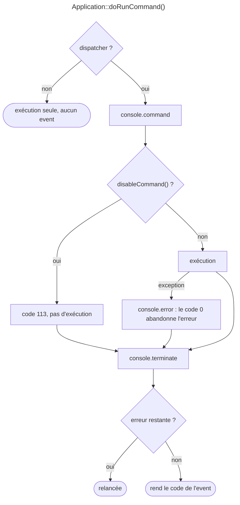

## Objectif

Intervenir autour de l'exécution d'une command sans la modifier : journaliser,
mesurer, empêcher, rattraper une erreur.

## L'essentiel

La Console dispatche des events autour de chaque command — **avant**
(`COMMAND`), **en cas d'erreur** (`ERROR`), **après** (`TERMINATE`), **à un
signal** (`SIGNAL`) — mais seulement si l'`Application` a un dispatcher.
`TERMINATE` est toujours atteint, et l'exit code final est celui qu'il porte.

## Le schéma



## L'exemple : journaliser chaque command

```php
class CommandLogger implements EventSubscriberInterface
{
    public static function getSubscribedEvents(): array
    {
        return [ConsoleEvents::TERMINATE => 'onTerminate'];
    }

    public function onTerminate(ConsoleTerminateEvent $event): void
    {
        $this->logger->info($event->getCommand()?->getName().' → '.$event->getExitCode());
    }
}
```

## Quatre constantes, cinq events

| Constante | Valeur | Quand |
|---|---|---|
| `COMMAND` | `console.command` | avant l'exécution |
| `SIGNAL` | `console.signal` | à la réception d'un signal POSIX |
| `ERROR` | `console.error` | une exception ou une erreur est remontée |
| `TERMINATE` | `console.terminate` | après l'exécution, quoi qu'il arrive |

`ConsoleEvents` déclare aussi une cinquième constante, `ALIASES`, qui associe
chaque class d'event à son nom. Un cinquième event, `ConsoleAlarmEvent`, n'a pas de constante.
FrameworkBundle donne un dispatcher à l'`Application` ; construite à la main,
elle ne dispatche rien sans `setDispatcher()`.

## L'ordre réel

| Cas | Events | Code |
|---|---|---|
| succès | `COMMAND`, exécution, `TERMINATE:0` | 0 |
| `disableCommand()` sur `COMMAND` | `COMMAND`, **`TERMINATE:113`** — pas d'exécution | 113 |
| exception | `COMMAND`, exécution, `ERROR`, `TERMINATE:1` | 1 |
| exception, `setExitCode(0)` sur `ERROR` | … `ERROR`, `TERMINATE:0` | 0 |
| succès, `setExitCode(1)` sur `TERMINATE` | … `TERMINATE:0` | **1** |
| exception, **sans** dispatcher | exécution seule | 1 |

- `ConsoleCommandEvent::RETURN_CODE_DISABLED` vaut **113** : « refusée », pas
  « échouée ».
- `TERMINATE` est le seul endroit fiable pour libérer une ressource ou mesurer
  une durée.

## `ERROR` — rattraper

`ConsoleErrorEvent` : `getError()`, `setError()`, `setExitCode()`.
`setExitCode(0)` fait abandonner l'erreur : l'exception n'est pas propagée.
`ERROR` couvre tout `Throwable` : une `TypeError` déclenche `ERROR` puis
`TERMINATE`, et n'est relancée qu'ensuite.

## `SIGNAL` — pendant

Avec un dispatcher, l'`Application` intercepte `SIGINT`, `SIGQUIT`,
`SIGTERM`, `SIGUSR1`, `SIGUSR2` et `SIGALRM`. Ordre : `SIGNAL`, puis
`handleSignal()` d'une `SignalableCommandInterface`, puis `TERMINATE` et
`exit()`.

| Situation | Résultat |
|---|---|
| aucun listener ne change le code | sortie en code **0**, `getInterruptingSignal()` = 2 |
| `abortExit()` sur `SIGNAL`, ou `handleSignal()` rend `false` | la command continue |
| `setExitCode(3)` sur `SIGNAL` | sortie en code 3 |
| ni dispatcher ni command signalable | PHP meurt du signal |

## L'alarme

`Application::setAlarmInterval(10)` programme un `SIGALRM` toutes les 10 s,
qui dispatche `SIGNAL` puis `ConsoleAlarmEvent` sous son nom de class. Sans
`abortExit()` dans un listener, la **première alarme termine la command**.
Il faut l'extension `pcntl`.

## Pièges d'examen

**Quatre constantes, cinq events.** `ConsoleAlarmEvent` n'a pas de constante ;
il n'existe pas d'event « après `configure()` ».

**Un signal intercepté sort en code 0** si personne ne le change.

**`TERMINATE` est dispatché même après une erreur** — c'est sa raison d'être.

**`disableCommand()` produit le code 113**, pas 0 ni 1 — et `TERMINATE` est
quand même dispatché.

**`setExitCode(0)` sur `ERROR` avale l'exception** au lieu de la laisser remonter.

**Pas de dispatcher, pas d'events** : une `Application` autonome est muette.

## Application

- Interdire une command en production → `disableCommand()` sur `COMMAND` ;
  le script lit le code 113.
- Une erreur attendue qui ne doit pas faire échouer un `cron` →
  `setExitCode(0)` sur `ERROR`.

## QCM d'entraînement

**Question 1.** Un listener de `console.command` appelle `disableCommand()`.
Quel est l'exit code, et `console.terminate` est-il dispatché ?

- **A.** 0, sans `console.terminate`
- **B.** 113, avec `console.terminate`
- **C.** 1, et `console.terminate` est dispatché
- **D.** 113, sans `console.terminate`

<details>
<summary>Correction</summary>

**Bonne réponse : B.** La command n'est pas exécutée, le code vaut
`RETURN_CODE_DISABLED`, et `TERMINATE` est atteint dans tous les cas.

</details>

**Question 2.** Une command lève une exception ; un listener de
`console.error` appelle `setExitCode(0)`. Que se passe-t-il ?

- **A.** L'exception est relancée, avec le code 0
- **B.** L'exception est relancée, avec le code 1
- **C.** `console.terminate` n'est pas dispatché
- **D.** L'exception est abandonnée, code 0

<details>
<summary>Correction</summary>

**Bonne réponse : D.** Le code 0 signifie qu'il n'y a plus d'erreur à
propager ; `TERMINATE` est dispatché avec ce code.

</details>

**Question 3.** Une `Application` est construite à la main, sans
`setDispatcher()`, avec un listener déclaré par ailleurs. Une command lève une
exception. Quels events sont dispatchés ?

- **A.** Aucun
- **B.** `console.error` seulement
- **C.** `console.command`, `console.error` et `console.terminate`
- **D.** `console.terminate` seulement

<details>
<summary>Correction</summary>

**Bonne réponse : A.** Sans dispatcher, l'`Application` exécute la command
seule ; le process sort en 1, sans aucun event.

</details>

**Question 4.** Une `Application` munie d'un dispatcher exécute une command
longue, qui reçoit `SIGINT`. Aucun listener ne change le code. Quel exit
code ?

- **A.** 130, la convention du shell
- **B.** 2, le numéro du signal
- **C.** 0
- **D.** 1, comme une erreur

<details>
<summary>Correction</summary>

**Bonne réponse : C.** Le signal intercepté dispatche `SIGNAL` puis
`TERMINATE` ; le code par défaut reste 0, et `getInterruptingSignal()` vaut 2.

</details>

## Fiche express

**Si tu dois retenir seulement 7 choses :**

- **Quatre constantes** (`COMMAND`, `SIGNAL`, `ERROR`, `TERMINATE`), **cinq
  events** avec `ConsoleAlarmEvent`.
- **Pas de dispatcher, pas d'events.**
- `TERMINATE` est **toujours** dispatché ; son code est le code final.
- `disableCommand()` → **113**.
- `setExitCode(0)` sur `ERROR` **avale** l'exception.
- Un signal intercepté sort en **0**, sauf `abortExit()` ou un autre code.
- `setAlarmInterval()` : la première alarme **termine**, sans `abortExit()`.

Moyen mnémotechnique : **« Avant, erreur, après — et toujours après »**.

## Sources officielles

- [`ConsoleEvents`, branche 8.0](https://github.com/symfony/symfony/blob/8.0/src/Symfony/Component/Console/ConsoleEvents.php)
- [`Application::doRunCommand`, branche 8.0](https://github.com/symfony/symfony/blob/8.0/src/Symfony/Component/Console/Application.php)
- [Using Events](https://github.com/symfony/symfony-docs/blob/8.0/components/console/events.rst)

