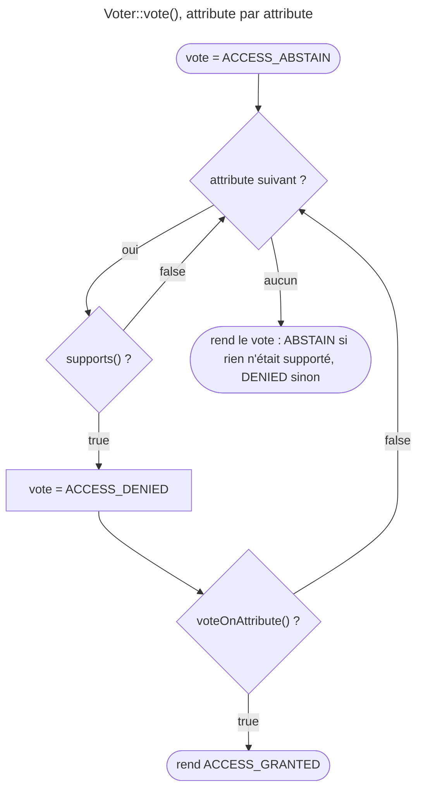

## Objectif

Écrire une décision d'authorization qui dépend de l'object, et savoir comment les
votes de plusieurs voters sont agrégés — parce que la strategy choisie change
la décision à votes identiques.

## Avant la règle : le problème à résoudre

Un role décrit ce qu'un user **est**. Il ne peut pas exprimer « l'auteur
peut modifier son propre article », qui dépend de l'article. Il faut une règle
qui reçoive l'attribute *et* l'object, et décide au cas par cas : c'est un
**voter**.

Une application en a vite plusieurs — un pour les articles, un pour les
factures, ceux de Symfony pour les roles. Deux questions se posent donc :
**comment un voter vote**, et **comment ses votes se combinent** avec ceux des
autres.

On suppose connus les roles et `isGranted()`.

## Le fil rouge : l'article et son auteur

```php
// Dans un controller
$this->denyAccessUnlessGranted('POST_EDIT', $post);
```

```twig
<a href="…">Modifier</a>
```

Aucun role ne dit qui est l'auteur de `$post`. L'appel part donc vers
l'`AccessDecisionManager`, qui interroge les voters ; l'un d'eux, `PostVoter`,
reconnaît `POST_EDIT` et compare l'auteur au user connecté.

## Le cycle complet en un schéma

Ce que fait `Voter::vote()` pour un voter, attribute par attribute :



Ensuite, l'`AccessDecisionManager` passe les votes des voters à la
**strategy**, qui rend la décision finale.

## Les deux methods, en 8.0

```php
use Symfony\Component\Security\Core\Authorization\Voter\Vote;
use Symfony\Component\Security\Core\Authorization\Voter\Voter;

class PostVoter extends Voter
{
    protected function supports(string $attribute, mixed $subject): bool
    {
        return in_array($attribute, ['POST_EDIT', 'POST_VIEW'], true)
            && $subject instanceof Post;
    }

    protected function voteOnAttribute(string $attribute, mixed $subject, TokenInterface $token, ?Vote $vote = null): bool
    {
        $user = $token->getUser();
        if (!$user instanceof User) {
            return false;
        }

        if ('POST_EDIT' === $attribute && $subject->getAuthor() !== $user) {
            $vote?->addReason('Only the author may edit this post.');

            return false;
        }

        return 'POST_VIEW' !== $attribute || $subject->isPublished() || $subject->getAuthor() === $user;
    }
}
```

Le quatrième parameter, `?Vote $vote = null`, est **obligatoire dans la
signature** en 8.0 : le CHANGELOG de Security Core 8.0 l'ajoute à
`VoterInterface::vote()` et à `Voter::voteOnAttribute()`. Exécuté, une class
qui déclare encore l'ancienne signature à trois parameters ne se charge pas :
« Declaration of PostVoter::voteOnAttribute(…) must be compatible with
Voter::voteOnAttribute(…, ?Vote $vote = null) » — erreur fatale.

`Vote::addReason()` explique un refus. Exécuté avec SecurityBundle 8.0.15 :
`denyAccessUnlessGranted('POST_EDIT', …)` répond 403 avec « Access Denied. Only
the author may edit this post. » Lu dans `AbstractController` : un troisième
argument `$message` remplace ce texte, raisons comprises.

`supports()` filter : il dit si ce voter a quelque chose à dire. Quand il
retourne `false`, le voter **s'abstient** — il ne refuse pas.
`voteOnAttribute()` ne s'exécute que sur ce que le voter comprend, et son
booléen devient accordé ou refusé.

Un voter est un service ordinaire : l'autoconfiguration le déclare. Exécuté,
le voter ci-dessus a voté sans une ligne dans `services.yaml`.

## Trois valeurs, pas deux

Un vote vaut `ACCESS_GRANTED` (1), `ACCESS_ABSTAIN` (0) ou `ACCESS_DENIED` (-1).
L'abstention est le cas normal, et c'est ce qui permet à des voters
indépendants de coexister : chacun ne se prononce que sur son domain.

Le schéma le montre : un voter qui ne supporte **aucun** attribute s'abstient ;
dès qu'il en supporte un, il ne peut plus s'abstenir — il accorde ou refuse.

## Les quatre strategies

`security.access_decision_manager.strategy` accepte `affirmative` (défaut),
`consensus`, `unanimous` et `priority` ; une strategy maison passe par
`strategy_service`, un service qui implémente
`AccessDecisionStrategyInterface`. Lu dans `MainConfiguration` : « "strategy"
and "strategy_service" cannot be used together. »

Les voters ne votent **pas tous** : l'`AccessDecisionManager` les interroge un
par un, et la strategy s'arrête dès que sa décision est acquise. Exécuté sur
`AccessDecisionManager` 8.0.15, voters dans l'ordre indiqué, avec le journal
des voters réellement interrogés :

| Votes | `affirmative` | `consensus` | `unanimous` | `priority` |
|---|---|---|---|---|
| accordé, refusé | **accordé** (1 interrogé) | accordé (2) | **refusé** (2) | accordé (1) |
| refusé, accordé | accordé (2) | accordé (2) | refusé (1) | **refusé** (1) |
| abstention ×3 | refusé | refusé | **refusé** | refusé |
| accordé, abstention | accordé (1) | accordé (2) | accordé (2) | accordé (1) |
| abstention, refusé, accordé | accordé (3) | accordé (3) | refusé (2) | refusé (2) |
| accordé, refusé, refusé | accordé (1) | **refusé** (3) | refusé (2) | accordé (1) |

Ce que le tableau montre :

- `affirmative` accorde au **premier** accord ; `unanimous` refuse au **premier**
  refus ; `priority` suit le **premier** voter qui ne s'abstient pas ;
  seul `consensus` interroge tout le monde, puisqu'il compte.
- `priority` dépend de l'**ordre** des voters — la priority de leur service.
- `consensus` tranche une égalité par `allow_if_equal_granted_denied`, défaut
  `true` : accordé.

**Rejoué**, deux voters sur l'attribute `PRIO`, l'un qui refuse, l'autre qui
accorde, ordonnés par la `priority` de leur tag `security.voter` :

| Tag du voter qui refuse | Tag du voter qui accorde | `priority` | `affirmative` |
|---|---|---|---|
| `priority: 10` | `priority: 20` | accordé | accordé |
| `priority: 20` | `priority: 10` | **refusé** | accordé |

La priority la plus haute est interrogée en premier. `affirmative` ne dépend pas
de l'ordre pour sa décision ; `priority` n'existe que par lui.

## Les deux cas limites

**Égalité en `consensus`** : `allow_if_equal_granted_denied`, défaut `true`.

**Tous abstenus**, quelle que soit la strategy : `allow_if_all_abstain`, défaut
**`false`** — donc refusé. Cela vaut **aussi** pour `unanimous` : trois
abstentions et aucun refus donnent un refus, pas un accord. Un attribute qu'aucun
voter ne comprend — une faute de frappe — est donc refusé.

```yaml
security:
    access_decision_manager:
        strategy: unanimous
        allow_if_all_abstain: false
```

**Rejoué** : `isGranted('POST_EDTI', $post)`, faute de frappe, est refusé par
défaut — et **accordé** avec `allow_if_all_abstain: true`. Activer cette option
transforme chaque faute de frappe en accès ouvert.

## Ce que le voter reçoit vraiment

Quatre faits, tous rejoués avec SecurityBundle 8.0.15.

**Un visiteur anonyme passe aussi par les voters.** Sans user, `isGranted()`
remplace le token par un `NullToken` — lu dans `AuthorizationChecker` — et
`$token->getUser()` rend `null`. Le `if (!$user instanceof User)` du fil rouge
n'est donc pas décoratif : c'est lui qui décide pour l'anonyme.

**La décision détaillée se lit dans un `AccessDecision`.**

```php
$decision = new AccessDecision();
$this->isGranted('POST_EDIT', $post, $decision);
$decision->getMessage(); // "Access Denied. Only the author may edit this post."
$decision->strategy;     // "affirmative"
```

`getMessage()` ne reprend que les raisons des votes qui vont **dans le sens** de
la décision.

**Décider pour un autre user** : `Security::isGrantedForUser($user, 'POST_EDIT',
$post)`, pour une command console ou une notification. Exécuté pendant qu'un autre
user était connecté : le voter a reçu le user passé en argument. Le token est
alors un `OfflineTokenInterface`, et un attribute d'état de connexion lève
`InvalidArgumentException` : « Cannot decide on authentication attributes when
an offline token is used. »

**Vérifier un role depuis un voter** : la documentation demande
`AccessDecisionManagerInterface::decide($token, ['ROLE_SUPER_ADMIN'])`, et non
`Security::isGranted()`, qui « does not guarantee that the checks are
performed on the same token as the one in your voter ».

**Un voter peut s'exclure d'avance.** `Voter` implémente
`CacheableVoterInterface` : `supportsAttribute()` et `supportsType()` rendent
`true` par défaut. Rejoué, un voter dont `supportsAttribute()` rend `false`
pour un attribute : deux `isGranted()` sur cet attribute, **un** appel à
`supportsAttribute()`, **aucun** à `supports()`. Le résultat est mis en cache
par l'`AccessDecisionManager`.

## Concrètement dans ton application

- Une règle qui dépend de l'object : un voter, pas un role de plus.
- Attributes en constantes de la class, comparés avec `in_array(…, true)`.
- Toujours `?Vote $vote = null` en quatrième parameter, et `addReason()` sur
  chaque refus qu'un humain devra comprendre.
- Traiter l'anonyme en premier dans `voteOnAttribute()`.
- Besoin d'un role à l'intérieur : `AccessDecisionManagerInterface::decide()`.
- Beaucoup de voters : `supportsAttribute()` et `supportsType()`.
- Laisser `allow_if_all_abstain` à `false`.

## À comprendre

- **Pourquoi l'abstention ?** Sans elle, chaque voter devrait se prononcer sur
  tous les attributes de l'application ; un voter d'articles refuserait les
  factures.
- **Pourquoi la strategy change-t-elle la décision ?** Elle définit ce que
  « d'accord » veut dire : un accord suffit (`affirmative`), une majorité
  (`consensus`), aucun refus (`unanimous`), le premier qui parle (`priority`).
- **Pourquoi refuser quand tout le monde s'abstient ?** Personne n'a reconnu
  la demande ; ouvrir l'accès serait accorder ce que personne n'a examiné.

## À mémoriser

- **`supports()`** filter ; `false` = **abstention**.
- **`voteOnAttribute(…, ?Vote $vote = null)`** décide ; l'ancienne signature est
  une erreur fatale.
- **`addReason()`** explique ; **`AccessDecision::getMessage()`** relit.
- **1, 0, -1** : accordé, abstention, refusé.
- **`affirmative`** par défaut ; **`consensus`**, **`unanimous`**,
  **`priority`** ; **`strategy_service`** pour une strategy maison.
- **`allow_if_all_abstain: false`**, **`allow_if_equal_granted_denied: true`**.
- Moyen mnémotechnique : **« supports trie, voteOnAttribute tranche, la strategy agrège »**.

## Pièges d'examen

- `supports()` à `false` = **abstention**, pas refus.
- L'ancienne signature de `voteOnAttribute()` est une **erreur fatale** en 8.0.
- Le défaut est `affirmative` : **un seul** accord suffit, même si un autre refuse.
- `unanimous` = « aucun refus **et** au moins un accord » ; si tous s'abstiennent,
  `allow_if_all_abstain` décide, et refuse par défaut.
- Les voters ne sont pas tous interrogés : seule `consensus` les consulte tous.
- `priority` dépend de l'ordre des voters.

## Application : trois scénarios

**Scénario 1 — Le bouton qui apparaît pour l'anonyme.** Un voter rend `true`
pour `POST_VIEW` sans regarder le user, et un visiteur non connecté voit un
brouillon. *Solution.* Le voter est appelé pour l'anonyme, avec un `NullToken` :
tester `$token->getUser()` avant toute autre règle.

**Scénario 2 — Le support qui ne comprend pas le 403.** *Solution.*
`$vote?->addReason('…')` dans le voter ; le message de l'`AccessDeniedException`
devient « Access Denied. » suivi de la raison.

**Scénario 3 — Le double contrôle.** Une action exige que le voter métier
**et** le voter de conformité accordent. *Solution.* `strategy: unanimous`,
`allow_if_all_abstain` à `false`.

## QCM d'entraînement

Cinq questions sur les voters. Choisis avant d'ouvrir la correction.

**Question 1.** Personne n'est connecté. Un template appelle
`is_granted('POST_VIEW', post)`. Que se passe-t-il ?

- **A.** Refus immédiat : aucun voter n'est appelé sans user
- **B.** Les voters sont appelés, avec un `NullToken`
- **C.** Une exception : `isGranted()` exige un token
- **D.** Les voters sont appelés avec le token de la Request précédente

<details>
<summary>Correction</summary>

**Bonne réponse : B.** Lu dans `AuthorizationChecker::isGranted()`, et
rejoué : sans user, le token devient un `NullToken`, dont `getUser()` rend
`null`. C'est au voter de décider pour l'anonyme.

A et C supposent un court-circuit qui n'existe pas. D est faux.

</details>

**Question 2.** Une command console appelle
`$security->isGrantedForUser($user, 'IS_AUTHENTICATED_FULLY')`. Résultat ?

- **A.** `true` si `$user` a au moins un role
- **B.** `false`, puisque personne n'est connecté
- **C.** Une `InvalidArgumentException`
- **D.** `true`, puisque `$user` est passé explicitement

<details>
<summary>Correction</summary>

**Bonne réponse : C.** Rejoué : « Cannot decide on authentication attributes
when an offline token is used. » `isGrantedForUser()` construit un token
`OfflineTokenInterface`, et `AuthenticatedVoter` refuse d'en juger.

A, B et D supposent un résultat booléen ; un user hors session n'a pas
d'état de connexion.

</details>

**Question 3.** Dans un voter, pourquoi la documentation demande-t-elle
`AccessDecisionManagerInterface::decide($token, ['ROLE_SUPER_ADMIN'])` plutôt
que `Security::isGranted('ROLE_SUPER_ADMIN')` ?

- **A.** Pour décider sur le token que le voter a reçu
- **B.** `Security::isGranted()` n'est pas injectable dans un voter
- **C.** `decide()` ignore la `role_hierarchy`, ce qui est plus sûr
- **D.** Pour éviter une loop infinie entre voters

<details>
<summary>Correction</summary>

**Bonne réponse : A.** La documentation : `Security::isGranted()` « does not
guarantee that the checks are performed on the same token as the one in your
voter ». Le token du voter peut être celui d'`isGrantedForUser()`.

B est faux : `Security` est autowirable. C est faux : `decide()` passe par les
mêmes voters. D n'est pas la raison donnée.

</details>

**Question 4.** Un voter rend `false` dans `supportsAttribute('REPORT_EXPORT')`.
Le même process appelle deux fois `isGranted('REPORT_EXPORT')`. Que reçoit le
voter ?

- **A.** Deux appels à `supports()`, puis deux abstentions
- **B.** Deux appels à `supportsAttribute()`
- **C.** Un vote `ACCESS_DENIED` à chaque appel
- **D.** Un seul appel à `supportsAttribute()`

<details>
<summary>Correction</summary>

**Bonne réponse : D.** Rejoué : un appel à `supportsAttribute()`, aucun à
`supports()`. L'`AccessDecisionManager` met le résultat en cache et n'appelle
plus ce voter pour cet attribute.

A oublie le cache. B l'oublie aussi. C est faux : un voter écarté ne vote pas.

</details>

**Question 5.** La configuration met `allow_if_all_abstain: true`. Un template
appelle `is_granted('POST_EDTI', post)`, avec une faute de frappe. Décision ?

- **A.** Refusé : aucun voter ne comprend l'attribute
- **B.** Une exception : attribute inconnu
- **C.** Accordé, malgré la faute de frappe
- **D.** Refusé : `affirmative` exige au moins un accord

<details>
<summary>Correction</summary>

**Bonne réponse : C.** Rejoué : tous les voters s'abstiennent, et
`allow_if_all_abstain: true` transforme l'abstention générale en accord.

A et D décrivent le comportement par défaut, avec l'option à `false`. B est
faux : aucun contrôle ne vérifie l'existence d'un attribute.

</details>

## Fiche express

**Si tu dois retenir seulement 7 choses :**

- **`supports()`** à `false` = abstention.
- **`voteOnAttribute(…, ?Vote $vote = null)`** : la signature 8.0, sinon erreur fatale.
- **`addReason()`** complète « Access Denied. ».
- **`affirmative`** par défaut : un accord suffit.
- **`unanimous`** : aucun refus et au moins un accord.
- **`priority`** : le premier voter qui ne s'abstient pas, selon la priority du tag.
- Tous abstenus : **refusé**, sauf `allow_if_all_abstain: true`.

**En une phrase, pour tout reconstruire :**

```text
supports false → abstention (0) ; voteOnAttribute(+ ?Vote) → 1 ou -1, addReason ; anonyme = NullToken ;
affirmative (défaut) / consensus (égalité : true) / unanimous / priority (ordre des tags) ; tous abstenus → false
```

## Sources officielles

- [How to Use Voters to Check User Permissions](https://github.com/symfony/symfony-docs/blob/8.0/security/voters.rst)
- [Security Core 8.0, `Voter`](https://github.com/symfony/symfony/blob/8.0/src/Symfony/Component/Security/Core/Authorization/Voter/Voter.php)
- [Security Core 8.0, `AuthorizationChecker`](https://github.com/symfony/symfony/blob/8.0/src/Symfony/Component/Security/Core/Authorization/AuthorizationChecker.php)
- [Security Core 8.0, `AccessDecision`](https://github.com/symfony/symfony/blob/8.0/src/Symfony/Component/Security/Core/Authorization/AccessDecision.php)
- [Security Core 8.0, `AccessDecisionManager`](https://github.com/symfony/symfony/blob/8.0/src/Symfony/Component/Security/Core/Authorization/AccessDecisionManager.php)
- [Security Core 8.0, `UnanimousStrategy`](https://github.com/symfony/symfony/blob/8.0/src/Symfony/Component/Security/Core/Authorization/Strategy/UnanimousStrategy.php)
- [Security Core 8.0, CHANGELOG](https://github.com/symfony/symfony/blob/8.0/src/Symfony/Component/Security/Core/CHANGELOG.md)
- [SecurityBundle 8.0, `MainConfiguration`](https://github.com/symfony/symfony/blob/8.0/src/Symfony/Bundle/SecurityBundle/DependencyInjection/MainConfiguration.php)
