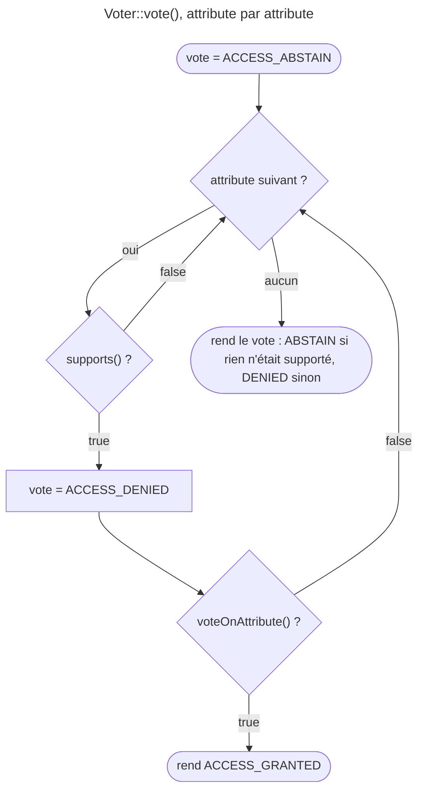

## Objectif

Écrire une décision d'authorization qui dépend de l'object, et savoir comment les
votes de plusieurs voters sont agrégés — parce que la strategy choisie change
la décision à votes identiques.

## L'essentiel

Un role dit ce qu'un user **est** ; un **voter** décide sur un **object** —
« l'auteur peut modifier son article ». Chaque voter accorde, refuse ou
s'abstient, et une **strategy** agrège les votes : à votes identiques, elle
change la décision.

## Le schéma



## Les deux methods, en 8.0

```php
class PostVoter extends Voter
{
    protected function supports(string $attribute, mixed $subject): bool
    {
        return in_array($attribute, ['POST_EDIT', 'POST_VIEW'], true) && $subject instanceof Post;
    }

    protected function voteOnAttribute(string $attribute, mixed $subject, TokenInterface $token, ?Vote $vote = null): bool
    {
        $user = $token->getUser();
        if (!$user instanceof User) {
            return false;
        }
        if ('POST_EDIT' === $attribute && $subject->getAuthor() !== $user) {
            $vote?->addReason('Only the author may edit this post.');

            return false;
        }

        return true;
    }
}
```

- `supports()` à `false` : le voter **s'abstient**, il ne refuse pas.
- `voteOnAttribute()` rend un bool : accordé ou refusé.
- Le quatrième parameter, `?Vote $vote = null`, est **obligatoire** dans la
  signature en 8.0 : l'ancienne signature à trois parameters est une erreur
  fatale (« must be compatible with Voter::voteOnAttribute(…) »).
- `Vote::addReason()` explique un refus : « Access Denied. Only the author may
  edit this post. ».
- Un voter est un service autoconfiguré : aucune déclaration à écrire.

## Trois valeurs, pas deux

`ACCESS_GRANTED` (1), `ACCESS_ABSTAIN` (0), `ACCESS_DENIED` (-1). L'abstention
est le cas normal : chaque voter ne se prononce que sur son domain.

## Les quatre strategies

`security.access_decision_manager.strategy` : `affirmative` (défaut),
`consensus`, `unanimous`, `priority` ; une strategy maison passe par
`strategy_service` (pas avec `strategy`). Les voters sont interrogés **un par
un** :

| Votes | `affirmative` | `consensus` | `unanimous` | `priority` |
|---|---|---|---|---|
| accordé, refusé | **accordé** | accordé | **refusé** | accordé |
| refusé, accordé | accordé | accordé | refusé | **refusé** |
| accordé, refusé, refusé | accordé | **refusé** | refusé | accordé |

- `affirmative` accorde au **premier** accord ; `unanimous` refuse au
  **premier** refus ; `priority` suit le **premier** voter qui ne s'abstient
  pas, dans l'ordre de la `priority` de leur tag ; seul `consensus` interroge
  tout le monde.

## Les deux cas limites

- **Égalité en `consensus`** : `allow_if_equal_granted_denied`, défaut `true`.
- **Tous abstenus** : `allow_if_all_abstain`, défaut **`false`** — refusé, y
  compris en `unanimous`. Avec `true`, un attribute mal orthographié est
  **accordé**.

## Ce que le voter reçoit vraiment

- Un **anonyme** passe aussi par les voters, avec un `NullToken` :
  `$token->getUser()` vaut `null`.
- `isGranted($attribute, $subject, $accessDecision)` remplit un
  `AccessDecision` : `getMessage()`, `strategy`.
- `Security::isGrantedForUser($user, …)` décide pour un autre user (command,
  notification) ; un attribute d'état de connexion y lève
  `InvalidArgumentException`.
- Dans un voter, vérifier un role par `AccessDecisionManagerInterface::decide()`,
  sur le token reçu, pas par `Security::isGranted()`.
- `supportsAttribute()` et `supportsType()` (`CacheableVoterInterface`)
  excluent un voter d'avance ; le résultat est mis en cache.

## Pièges d'examen

- `supports()` à `false` = **abstention**, pas refus.
- L'ancienne signature de `voteOnAttribute()` est une **erreur fatale** en 8.0.
- Le défaut est `affirmative` : **un seul** accord suffit, même si un autre refuse.
- `unanimous` = « aucun refus **et** au moins un accord » ; si tous s'abstiennent,
  `allow_if_all_abstain` décide, et refuse par défaut.
- Les voters ne sont pas tous interrogés : seule `consensus` les consulte tous.
- `priority` dépend de l'ordre des voters.

## Application

- Un éditeur modifie l'article d'un autre malgré `PostVoter` → la strategy est
  `affirmative` et un autre voter accorde : un seul accord suffit.
- Une faute de frappe dans un attribute ouvre l'accès → `allow_if_all_abstain`
  vaut `true` : le remettre à `false`.

## QCM d'entraînement

**Question 1.** Personne n'est connecté. Un template appelle
`is_granted('POST_VIEW', post)`. Que se passe-t-il ?

- **A.** Refus immédiat : aucun voter n'est appelé sans user
- **B.** Les voters sont appelés, avec un `NullToken`
- **C.** Une exception : `isGranted()` exige un token
- **D.** Les voters sont appelés avec le token de la Request précédente

<details>
<summary>Correction</summary>

**Bonne réponse : B.** `AuthorizationChecker` remplace l'absence de token par un
`NullToken` ; le voter reçoit `getUser()` à `null` et décide.

</details>

**Question 2.** Une command console appelle
`$security->isGrantedForUser($user, 'IS_AUTHENTICATED_FULLY')`. Résultat ?

- **A.** `true` si `$user` a au moins un role
- **B.** `false`, puisque personne n'est connecté
- **C.** Une `InvalidArgumentException`
- **D.** `true`, puisque `$user` est passé explicitement

<details>
<summary>Correction</summary>

**Bonne réponse : C.** Le token hors connexion ne permet pas de décider d'un
état d'authentication : « Cannot decide on authentication attributes when an
offline token is used. »

</details>

**Question 3.** Deux voters, l'un refuse, l'autre accorde ; le premier
interrogé est celui qui refuse. Strategy `priority`. Décision ?

- **A.** Accordé : un accord suffit
- **B.** Refusé
- **C.** Accordé : l'égalité accorde par défaut
- **D.** Une exception : votes contradictoires

<details>
<summary>Correction</summary>

**Bonne réponse : B.** `priority` suit le premier voter qui ne s'abstient pas,
dans l'ordre de priority ; A décrit `affirmative`, C `consensus`.

</details>

**Question 4.** La configuration met `allow_if_all_abstain: true`. Un template
appelle `is_granted('POST_EDTI', post)`, avec une faute de frappe. Décision ?

- **A.** Refusé : aucun voter ne comprend l'attribute
- **B.** Une exception : attribute inconnu
- **C.** Accordé, malgré la faute de frappe
- **D.** Refusé : `affirmative` exige au moins un accord

<details>
<summary>Correction</summary>

**Bonne réponse : C.** Tous les voters s'abstiennent, et l'option transforme
cette abstention générale en accord ; le défaut, `false`, refuserait.

</details>

## Fiche express

**Si tu dois retenir seulement 7 choses :**

- **`supports()`** trie (faux = abstention), **`voteOnAttribute()`** tranche.
- Signature 8.0 : **`?Vote $vote = null`** obligatoire ; `addReason()`.
- Votes : **1, 0, -1**.
- **`affirmative`** (défaut) : un accord suffit ; **`unanimous`** : un refus
  suffit ; **`priority`** : le premier qui vote ; **`consensus`** : la majorité.
- Tous abstenus : **refusé** (`allow_if_all_abstain: false`).
- Un anonyme vote aussi : **`NullToken`**.
- **`isGrantedForUser()`** pour un autre user, sans attribute d'état.

Moyen mnémotechnique : **« supports trie, voteOnAttribute tranche, la strategy
agrège »**.

```text
supports (faux = abstain) → voteOnAttribute(…, ?Vote) → GRANTED/ABSTAIN/DENIED ;
affirmative | consensus (égalité = accordé) | unanimous | priority (ordre) ; tous abstenus = refusé
```

## Sources officielles

- [How to Use Voters to Check User Permissions](https://github.com/symfony/symfony-docs/blob/8.0/security/voters.rst)
- [Security Core 8.0, `Voter`](https://github.com/symfony/symfony/blob/8.0/src/Symfony/Component/Security/Core/Authorization/Voter/Voter.php)
- [Security Core 8.0, `AuthorizationChecker`](https://github.com/symfony/symfony/blob/8.0/src/Symfony/Component/Security/Core/Authorization/AuthorizationChecker.php)
- [Security Core 8.0, `AccessDecision`](https://github.com/symfony/symfony/blob/8.0/src/Symfony/Component/Security/Core/Authorization/AccessDecision.php)
- [Security Core 8.0, `AccessDecisionManager`](https://github.com/symfony/symfony/blob/8.0/src/Symfony/Component/Security/Core/Authorization/AccessDecisionManager.php)
- [Security Core 8.0, `UnanimousStrategy`](https://github.com/symfony/symfony/blob/8.0/src/Symfony/Component/Security/Core/Authorization/Strategy/UnanimousStrategy.php)
- [Security Core 8.0, CHANGELOG](https://github.com/symfony/symfony/blob/8.0/src/Symfony/Component/Security/Core/CHANGELOG.md)
- [SecurityBundle 8.0, `MainConfiguration`](https://github.com/symfony/symfony/blob/8.0/src/Symfony/Bundle/SecurityBundle/DependencyInjection/MainConfiguration.php)

