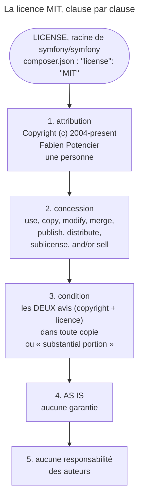

## Objectif

Savoir sous quelle licence Symfony est publié et ce que cette licence autorise.

## L'essentiel

Symfony est publié sous licence **MIT**, au nom de **Fabien Potencier**. C'est
une licence permissive : tout usage est permis, commercial et propriétaire
compris, à une seule condition — reproduire l'avis de copyright et le texte de
la licence. Rien n'oblige à publier son propre code.

## Le schéma

## L'exemple : un produit propriétaire

Une société vend une application fermée bâtie sur Symfony. Elle garde son
code privé, le vend, peut même sous-licencier les parties de Symfony qu'elle
redistribue — et joint à sa distribution l'avis de copyright et le texte MIT.

## La licence

La key `license` du `composer.json` de `symfony/symfony` vaut `MIT`, et le file
`LICENSE` à la racine en donne le texte : `Copyright (c) 2004-present Fabien
Potencier` — une personne physique, ni une société ni SensioLabs.

## Ce qu'elle autorise

La concession est accordée « free of charge, to any person obtaining a copy »
et porte sur huit verbes : *use, copy, modify, merge, publish, distribute,
sublicense, and/or sell*. « Sublicense » compte pour un éditeur : on peut
redistribuer sous **une autre licence**.

## Le texte, clause par clause

- **La condition est au singulier** : les deux avis — copyright **et**
  licence — dans « all copies or **substantial portions** of the Software ».
  Copier un file significatif suffit à la déclencher ; elle ne porte pas sur le
  seul nom de Symfony.
- **Les deux clauses finales** sont distinctes : le logiciel est fourni *AS IS*,
  sans garantie, **et** les auteurs ne peuvent être tenus responsables d'aucun
  dommage.

| | MIT | Copyleft (GPL et apparentées) |
|---|---|---|
| Usage propriétaire | autorisé | restreint |
| Publier son propre code | non exigé | exigé pour les œuvres dérivées |
| Sous-licencier | autorisé | interdit |
| Obligation | reproduire les deux avis | reproduire **et** partager à l'identique |

## Pièges d'examen

**MIT n'est pas copyleft.** Une application qui utilise Symfony n'a aucune
obligation d'être publiée sous MIT, ni d'être publiée du tout. Usage
propriétaire et commercial compris.

**L'unique obligation porte sur l'avis, pas sur le code.** Il faut reproduire
l'avis de copyright et le texte de la licence dans toute copie substantielle du
logiciel — rien de plus.

## Application

- Une distribution qui embarque des files de Symfony → y joindre l'avis de
  copyright et le texte de la licence.
- Un audit de dependencies → lire la key `license` du `composer.json`.

## QCM d'entraînement

**Question 1.** Quel verbe de la concession MIT permet de redistribuer le
logiciel sous une autre licence ?

- **A.** *publish*, qui couvre toute diffusion
- **B.** *modify*, qui transforme le texte
- **C.** *sublicense*
- **D.** *merge*, qui l'intègre à un autre code

Correction

**Bonne réponse : C.** *Sublicense* autorise à accorder à son tour des droits,
sous ses propres termes ; c'est lui qui rend possible un produit propriétaire.

**Question 2.** L'obligation de la MIT vaut-elle seulement quand on
redistribue Symfony **entier** ?

- **A.** Oui : seule une copie complète est visée
- **B.** Non : une portion substantielle suffit
- **C.** Oui, sauf usage commercial
- **D.** Non : elle vaut même sans redistribution

Correction

**Bonne réponse : B.** Le texte vise « all copies or substantial portions » :
reprendre un file significatif de Symfony suffit à imposer les deux avis.

**Question 3.** Que disent les deux dernières clauses de la licence ?

- **A.** La même chose, répétée pour insister
- **B.** Qu'il faut citer Symfony dans l'interface
- **C.** Que le code dérivé doit rester sous MIT
- **D.** Ni garantie, ni responsabilité

Correction

**Bonne réponse : D.** *AS IS* écarte toute garantie ; la clause suivante
exclut, à part, la responsabilité des auteurs pour tout dommage.

**Question 4.** Où lire la licence de Symfony sans ouvrir le file `LICENSE` ?

- **A.** Dans la key `license` du `composer.json`
- **B.** Dans `config/bundles.php`, par bundle
- **C.** Dans le header de chaque file PHP
- **D.** Nulle part ailleurs : `LICENSE` seul fait foi

Correction

**Bonne réponse : A.** Le `composer.json` de `symfony/symfony` déclare `MIT`
dans sa key `license`, celle que lisent les outils d'audit de dependencies.

## Fiche express

**Si tu dois retenir seulement 5 choses :**

- **MIT**, titulaire **Fabien Potencier**, depuis 2004.
- Usage commercial et propriétaire **autorisés**, sans réciprocité.
- Une seule obligation : **les deux avis**, copyright et licence.
- « **Substantial portions** » suffit à la déclencher.
- Aucune garantie, **et** aucune responsabilité : deux clauses.

Moyen mnémotechnique : **« Tout permis, sauf d'oublier l'avis »**.

## Sources officielles

- [File LICENSE de symfony/symfony (branche 8.0)](https://github.com/symfony/symfony/blob/8.0/LICENSE)

