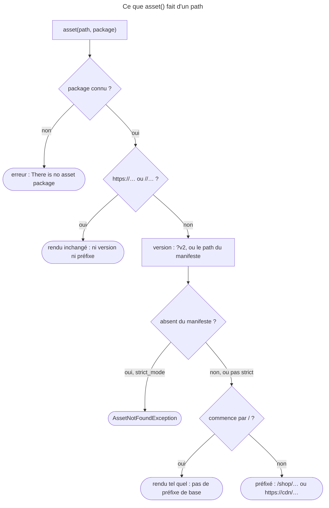

## Objectif

Référencer une ressource publique depuis un template, et savoir ce que le
component Asset fait du path.

## Limite de périmètre

Les outils de construction d'assets — AssetMapper, Webpack Encore — sont
**exclus du périmètre de l'examen** (`docs/syllabus/exclusions.yml`). Ce qui
reste ici est la function Twig et la configuration du component Asset.

## L'essentiel

`asset()` transforme un path relatif à `public/` en URL utilisable : il ajoute
le **préfixe de base** de l'application — si elle n'est pas servie à la racine —
et la **version** configurée. Un second argument choisit un **package**, avec
sa propre base et sa propre version.

## Le schéma


## La function

```html

<link rel="stylesheet" href="{{ asset('css/app.css') }}">
```

Signature : `asset(path, packageName = null)`. Le path est relatif à `public/`,
**sans barre oblique initiale**. C'est pourquoi on n'écrit jamais un path en
dur : `asset()` applique le préfixe de base et la strategy de version.

Pour une application servie sous `/shop`, avec `version: 'v2'` :

| Appel | Résultat |
|---|---|
| `asset('css/app.css')` | `/shop/css/app.css?v2` |
| `asset('/css/app.css')` | `/css/app.css?v2` — version gardée, **préfixe perdu** |
| `asset('https://cdn.example.com/app.js')` | inchangé : ni préfixe ni version |
| `absolute_url(asset('images/logo.png'))` | `http://example.com/shop/images/logo.png?v2` |

Sans `base_urls`, le package est un `PathPackage` : il traite une URL absolue
telle quelle, applique la version, puis préfixe la base — sauf si le résultat
commence par `/`.

## La version

Trois réglages de `framework.assets` s'excluent : `version`,
`version_strategy` et `json_manifest_path`.

- `version: 'v2'` : `StaticVersionStrategy`, format `%s?%s` par défaut. Dans
  `version_format`, chaque `%` se **double** — `'%%s?version=%%s'` —, sinon le
  container y voit un parameter et ne démarre pas.
- `json_manifest_path` : le path est cherché dans un manifeste JSON ; absent, il
  passe inchangé, sauf avec `strict_mode: true`, qui lève une erreur en
  proposant les noms proches — « Did you mean one of these? ».
- `asset_version(path)` retourne la version appliquée.

## Les packages

```yaml
framework:
    assets:
        version: 'v2'
        packages:
            avatars:
                base_urls: ['https://cdn.example.com']
```

```html
{{ asset('u/42.png', 'avatars') }}   {# https://cdn.example.com/u/42.png?v2 #}
```

- Le second argument choisit le package ; sans lui, c'est le package par
  défaut ; un nom inconnu est une erreur.
- Un package **hérite de la version par défaut** ; `version: ~` l'en retire.
- `base_path` et `base_urls` ne se combinent pas sur un même package.

## Pièges d'examen

**Une barre en tête supprime le préfixe de base**, pas la version.

**Une URL absolue traverse `asset()` sans version.**

**`version`, `version_strategy` et `json_manifest_path` ne se combinent pas.**

**Absent du manifeste, un path passe inchangé**, sauf en mode strict.

**Les outils de construction d'assets sont hors périmètre** de l'examen.

## Application

- Les images sont cassées en préproduction, servie sous `/shop` → les templates
  écrivent `asset('/images/…')` : retirer la barre initiale.
- Un file mal orthographié charge un 404 sans erreur → `strict_mode: true`
  sur le manifeste.

## QCM d'entraînement

**Question 1.** La configuration contient `version: 'v2'` et
`version_format: '%s?version=%s'`, écrit tel quel. Que se passe-t-il ?

- **A.** Les URLs prennent la forme `css/app.css?version=v2`
- **B.** La version est ignorée, le format étant invalide
- **C.** Le kernel ne démarre pas
- **D.** Le format est accepté, mais seulement en `prod`

<details>
<summary>Correction</summary>

**Bonne réponse : C.** `%s?version=%` est lu comme un parameter du container,
introuvable ; la documentation demande de doubler chaque `%`. A est le
résultat avec `'%%s?version=%%s'`.

</details>

**Question 2.** La version par défaut est `v2`. Le package `avatars` ne déclare
que `base_urls: ['https://cdn.example.com']`. Que rend
`{{ asset('u/42.png', 'avatars') }}` ?

- **A.** `https://cdn.example.com/u/42.png`, sans version
- **B.** `https://cdn.example.com/u/42.png?v2`
- **C.** `/shop/u/42.png?v2`
- **D.** Une erreur : le package n'a pas de version

<details>
<summary>Correction</summary>

**Bonne réponse : B.** Un package sans version propre hérite de la strategy par
défaut ; `version: ~` la lui retirerait.

</details>

**Question 3.** Le manifeste JSON contient `build/app.js` et `build/app.css`,
avec `strict_mode: true`. Que fait `{{ asset('build/ap.js') }}` ?

- **A.** Il rend `build/ap.js` tel quel, préfixé
- **B.** Il rend `build/app.js`, le nom le plus proche
- **C.** Il rend une string vide
- **D.** Il échoue, en proposant des noms proches

<details>
<summary>Correction</summary>

**Bonne réponse : D.** En mode strict, un path absent du manifeste est une
erreur qui liste les noms proches. Sans `strict_mode`, A.

</details>

**Question 4.** Que fait `{{ asset('x.png', 'nope') }}` quand aucun package
`nope` n'est déclaré ?

- **A.** Il utilise le package par défaut
- **B.** Il échoue : package inconnu
- **C.** Il rend `nope/x.png`
- **D.** Il rend `x.png`, sans version ni préfixe de base

<details>
<summary>Correction</summary>

**Bonne réponse : B.** « There is no "nope" asset package. » Le second argument
doit nommer un package déclaré sous `framework.assets.packages` ; aucun repli
n'existe.

</details>

## Fiche express

**Si tu dois retenir seulement 7 choses :**

- **`asset('images/logo.png')`** : relatif à `public/`, **sans barre**.
- **Barre initiale** : préfixe perdu, version gardée.
- **URL absolue** : inchangée.
- **Une seule** strategy : `version`, `version_strategy` ou
  `json_manifest_path`.
- **`version_format`** : chaque `%` **doublé**.
- Manifeste : absent → inchangé ; **`strict_mode`** → erreur avec suggestions.
- Second argument : le **package** ; il hérite de la version par défaut.

Moyen mnémotechnique : **« pas de barre, pas de dur, un seul versionnage »**.

```text
asset(path relatif à public/, package) ; URL absolue inchangée ; version puis base ; / en tête = pas de base ;
une seule strategy ; %% dans version_format ; manifeste strict = erreur ; package hérite de la version
```

## Sources officielles

- [Symfony Twig Reference, `asset` et `asset_version`](https://github.com/symfony/symfony-docs/blob/8.0/reference/twig_reference.rst)
- [Symfony, configuration `framework.assets`](https://github.com/symfony/symfony-docs/blob/8.0/reference/configuration/framework.rst)
- [Asset 8.0, `PathPackage`](https://github.com/symfony/symfony/blob/8.0/src/Symfony/Component/Asset/PathPackage.php), [`StaticVersionStrategy`](https://github.com/symfony/symfony/blob/8.0/src/Symfony/Component/Asset/VersionStrategy/StaticVersionStrategy.php) et [`JsonManifestVersionStrategy`](https://github.com/symfony/symfony/blob/8.0/src/Symfony/Component/Asset/VersionStrategy/JsonManifestVersionStrategy.php)
- [FrameworkBundle 8.0, `Configuration`](https://github.com/symfony/symfony/blob/8.0/src/Symfony/Bundle/FrameworkBundle/DependencyInjection/Configuration.php)

