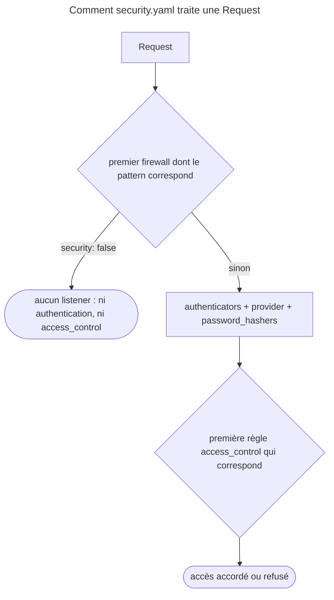

## Objectif

Lire un `security.yaml` et savoir quelle section répond de quoi — et quelles
erreurs d'ordre passent sans un message. Le détail de chaque section a son
propre item.

## Avant la règle : le problème à résoudre

Une application a un back-office, une API et des outils de développement. Son
`security.yaml` mélange déjà cinq listes. Un jour, l'API pose des cookies de
session alors qu'elle devait être sans état ; un autre, une page admin s'ouvre à
un visiteur anonyme. **Aucune erreur** n'a été affichée.

Pour lire ce file, il faut savoir à quelle question répond chaque section,
dans quel ordre elles s'appliquent, et quelles configurations Symfony accepte
sans rien dire alors qu'elles ne font pas ce qu'on croit.

## Le fil rouge : un `security.yaml` complet

```yaml
security:
    password_hashers:                 # comment les mots de passe sont hachés
        App\Entity\User: { algorithm: auto }

    providers:                        # d'où viennent les utilisateurs
        app_users:
            entity: { class: App\Entity\User, property: email }

    firewalls:                        # comment on s'authentifie
        dev:  { pattern: ^/(_profiler|_wdt)/, security: false }
        main: { lazy: true, provider: app_users, form_login: ~ }

    access_control:                   # ce qu'il faut pour entrer
        - { path: ^/admin, roles: ROLE_ADMIN }
```

La lecture se fait dans cet ordre parce qu'il suit une dependency : les
users viennent d'un provider, un firewall utilise un provider, et
`access_control` s'applique **à l'intérieur** du firewall qui a pris la Request.

## Le cycle complet en un schéma



## Ce qui décide de quoi

| Section | Question |
|---|---|
| `password_hashers` | comment un password est stocké et vérifié |
| `providers` | d'où le user est chargé |
| `firewalls` | **comment** on prouve son identité |
| `access_control` | **ce qu'il faut** pour atteindre une URL |
| `role_hierarchy` | quels roles en impliquent d'autres |

## Les deux règles d'ordre

Elles se ressemblent et se confondent :

- dans `firewalls`, le **premier `pattern`** correspondant prend la Request ;
- dans `access_control`, la **première règle** correspondante s'applique.

Dans les deux cas, les entrées suivantes sont ignorées, et l'entrée sans pattern
doit venir en dernier. Exécuté avec SecurityBundle 8.0.15 :

| Configuration | Résultat |
|---|---|
| `main` sans pattern déclaré **avant** `api` (`^/api`, sans état) | aucune erreur ; `/api/fw` est pris par `main`, qui pose un cookie de session |
| la même, `api` déclaré **avant** `main` | `/api/fw` est pris par `api`, aucun cookie |
| `^/rules` en `PUBLIC_ACCESS` avant `^/rules/a` en `ROLE_ADMIN` | `/rules/a` répond 200 à un anonyme |

Aucune des deux erreurs d'ordre n'est signalée : l'effet est silencieux.

## `security: false` éteint tout

Un firewall `security: false` n'a **aucun listener** — ni authentication, ni
access control. `SecurityExtension` le traite à part et rend une liste
de listeners vide ; or c'est l'`AccessListener` du firewall qui applique
`access_control`. Exécuté : firewall `free` (`^/free`, `security: false`) et une
règle `access_control` exigeant `ROLE_ADMIN` sur `^/free` — `/free/page` répond
**200** à un anonyme, sans token.

La règle est donc morte. C'est l'usage du firewall `dev` : laisser passer les
outils de développement, pas les protéger.

## Plusieurs providers

Dès qu'il y en a deux, chaque firewall doit nommer le sien. Exécuté, sans key
`provider` : `InvalidConfigurationException`, « Not configuring explicitly the
provider for the "http_basic" authenticator on "main" firewall is ambiguous as
there is more than one registered provider. »

## Ce que l'échec révèle

Un message « ce user n'existe pas » dit à un attaquant quels identifiers sont
valides. L'option **`security.expose_security_errors`** — à la racine de
`security`, pas dans un firewall — règle ce qui sort ;
`hide_user_not_found`, son ancêtre, n'existe plus en 8.0.

| Valeur | User inconnu | Statut du compte (bloqué, expiré) |
|---|---|---|
| `none` (défaut) | masqué | masqué |
| `account_status` | masqué | montré, si le password était correct (documentation 8.0) |
| `all` | montré | montré |

Lu dans `AuthenticatorManager::isSensitiveException()` (8.0) : une exception
jugée sensible est remplacée par `BadCredentialsException('Bad credentials.')`
avant d'atteindre l'authenticator. Seules ces deux familles peuvent être
masquées — `UserNotFoundException` et `AccountStatusException`, sauf sa
variante `CustomUserMessageAccountStatusException` ; un token CSRF invalide,
par exemple, reste visible. Lu dans `MainConfiguration` : la default value est
`none`.

## Vérifier

```bash
php bin/console debug:config security
php bin/console debug:firewall main
```

`debug:config` affiche la configuration **résolue**, default values
comprises — ce qui répond mieux que la relecture du file. `debug:firewall`
liste les firewalls et détaille celui qu'on nomme.

## Concrètement dans ton application

- Les firewalls du plus précis au plus large : `dev`, puis `api` (`^/api`),
  puis `main` sans pattern, en dernier.
- Les règles `access_control` du plus précis au plus large, pour la même
  raison.
- Les outils de développement : un firewall `security: false` — jamais une URL
  qu'on veut protéger.
- Deux sources d'users : nommer le `provider` de chaque firewall.
- Un doute : `debug:config security`, pas la relecture du file.

## À comprendre

- **Pourquoi la première correspondance ?** Pour que le comportement soit
  prévisible : une Request a un seul firewall, une seule règle d'accès.
- **Pourquoi `security: false` désactive-t-il `access_control` ?** Parce que les
  règles sont appliquées par un listener du firewall, et que ce firewall n'en a
  aucun.
- **Pourquoi masquer « user inconnu » ?** Pour qu'un attaquant ne puisse pas
  tester quels identifiers existent.

## À mémoriser

- Quatre sections : hash, providers, firewalls, access control
  (+ `role_hierarchy`).
- Firewall = comment on s'authentifie ; `access_control` = ce qu'il faut pour
  entrer, appliqué par le firewall.
- Première correspondance dans les deux listes ; le fourre-tout en dernier.
- `security: false` : ni authentication ni `access_control`.
- Deux providers : `provider` obligatoire par firewall.
- `expose_security_errors` : `none` par défaut, `account_status`, `all`.
- Moyen mnémotechnique : **« Le premier qui correspond gagne, deux fois »**.

## Pièges d'examen

**`firewalls` et `access_control` ont chacun leur règle de première
correspondance**, et ce sont deux décisions différentes.

**Un firewall `security: false` désactive aussi `access_control`** pour ses URL :
aucun listener, aucune règle appliquée.

**Un firewall sans pattern déclaré en premier capte tout, sans erreur.**

**Plusieurs providers imposent de nommer celui de chaque firewall.**

**Par défaut, un user inconnu et un mauvais password donnent la même erreur** :
`expose_security_errors` vaut `none`.

## Application : trois scénarios

**Scénario 1 — L'API qui pose des cookies.** Le firewall `api` est
`stateless: true`, mais ses Responses portent un cookie de session.
*Solution.* `main`, sans pattern, est déclaré avant `api` et capte tout :
déclarer `api` en premier.

**Scénario 2 — L'admin ouverte.** `/admin/users` s'ouvre à un anonyme alors
qu'une règle exige `ROLE_ADMIN` sur `^/admin/users`. Une règle `^/admin` en
`PUBLIC_ACCESS` la précède. *Solution.* La première règle correspondante
s'applique : placer la règle la plus précise avant la plus large.

**Scénario 3 — La règle sans effet.** Une règle `access_control` protège
`^/_profiler`, sans effet. *Solution.* Le firewall `dev` est
`security: false` : aucun listener ne l'applique. Restreindre plutôt l'accès au
profiler par l'environment.

## QCM d'entraînement

Six questions sur la configuration. Choisis avant d'ouvrir la correction.

**Question 1.** `firewalls` déclare `main` (sans pattern) puis `api` (`pattern: ^/api`, `stateless: true`). Une Request authentifiée arrive sur `/api/fw`. Que se passe-t-il ?

- **A.** Une exception de configuration : `main` masque `api`
- **B.** `main` la prend, sans erreur
- **C.** `api` la prend : le pattern le plus précis gagne
- **D.** Les deux firewalls la traitent tour à tour

<details>
<summary>Correction</summary>

**Bonne réponse : B.** Le premier firewall qui correspond prend la Request ;
exécuté, `main` pose même un cookie de session, et aucune erreur n'est signalée.

A suppose un contrôle qui n'existe pas. C est vrai seulement si `api` est
déclaré en premier. D : un seul firewall par Request.

</details>

**Question 2.** `access_control` liste `^/rules` en `PUBLIC_ACCESS`, puis `^/rules/a` en `ROLE_ADMIN`. Un anonyme demande `/rules/a`. Résultat ?

- **A.** 200
- **B.** 401 : la règle la plus précise l'emporte
- **C.** 403 : les deux règles se cumulent
- **D.** Une exception de configuration

<details>
<summary>Correction</summary>

**Bonne réponse : A.** La première règle correspondante s'applique (exécuté).
L'ordre des règles est celui de la déclaration.

B et C supposent une fusion ou une préséance du plus précis. D est faux : rien
n'est signalé.

</details>

**Question 3.** Les feuilles de style sont servies sous `/css`, couvertes par un firewall déclaré avec `security: false`. Une règle d'accès, plus bas, réserve tout le site aux membres connectés. Un visiteur sans session charge `/css/app.css`. Que reçoit-il ?

- **A.** 401 : la règle d'accès s'applique
- **B.** 403
- **C.** Une exception au démarrage
- **D.** 200, sans token

<details>
<summary>Correction</summary>

**Bonne réponse : D.** Un firewall `security: false` n'a aucun listener, donc
pas d'`AccessListener` (exécuté).

A et B supposent la règle appliquée. C : la configuration est acceptée.

</details>

**Question 4.** Deux providers sont déclarés, et le firewall `main` en `http_basic` ne nomme pas le sien. Que se passe-t-il ?

- **A.** Le premier provider déclaré est utilisé
- **B.** Une `InvalidConfigurationException`
- **C.** Les deux providers sont essayés tour à tour
- **D.** Le dernier provider déclaré est utilisé

<details>
<summary>Correction</summary>

**Bonne réponse : B.** Exécuté : « … is ambiguous as there is more than one
registered provider ».

A, C et D supposent un choix automatique.

</details>

**Question 5.** Sans configurer `expose_security_errors`, un attaquant essaie un identifier inexistant. Quelle erreur reçoit-il ?

- **A.** « User not found »
- **B.** « Account disabled »
- **C.** « Bad credentials. »
- **D.** Aucune : la Request est ignorée

<details>
<summary>Correction</summary>

**Bonne réponse : C.** La même que pour un mauvais password : le défaut `none`
remplace `UserNotFoundException` par
`BadCredentialsException` (lu dans `AuthenticatorManager` et
`MainConfiguration`).

A est le message avec `all`. B et D sont faux.

</details>

**Question 6.** Où se règle l'option `expose_security_errors` ?

- **A.** Sous `security`
- **B.** Dans chaque firewall de `security`
- **C.** Dans `framework`
- **D.** Sous `providers`

<details>
<summary>Correction</summary>

**Bonne réponse : A.** C'est une option globale de SecurityBundle ; elle
remplace `hide_user_not_found`, qui n'existe plus en 8.0.

B, C et D sont faux.

</details>

## Fiche express

**Si tu dois retenir seulement 6 choses :**

- **`password_hashers`, `providers`, `firewalls`, `access_control`**
  (+ `role_hierarchy`).
- Firewall = **comment** ; `access_control` = **ce qu'il faut**, appliqué par
  le firewall.
- **Première correspondance** dans les deux listes ; le fourre-tout **en
  dernier** — sinon, effet silencieux.
- **`security: false`** : ni authentication, ni `access_control`.
- Deux providers : **`provider` par firewall**.
- **`expose_security_errors: none`** par défaut : user inconnu = « Bad
  credentials. ».

**En une phrase, pour tout reconstruire :**

```text
Request → 1er firewall qui correspond (security: false ? rien) → authenticators(provider, hashers)
  → 1re règle access_control qui correspond → accès ; vérifier avec debug:config security
```

## Sources officielles

- [Security](https://github.com/symfony/symfony-docs/blob/8.0/security.rst)
- [SecurityBundle 8.0, `SecurityExtension`](https://github.com/symfony/symfony/blob/8.0/src/Symfony/Bundle/SecurityBundle/DependencyInjection/SecurityExtension.php)
- [Security HTTP 8.0, `AuthenticatorManager`](https://github.com/symfony/symfony/blob/8.0/src/Symfony/Component/Security/Http/Authentication/AuthenticatorManager.php)
