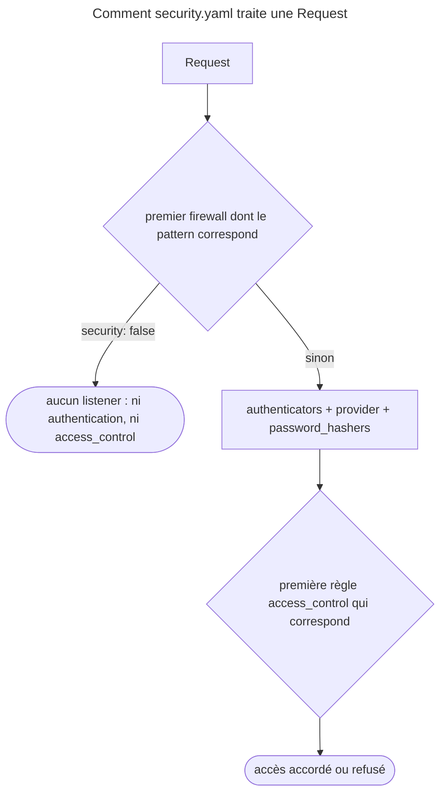

## Objectif

Lire un `security.yaml` et savoir quelle section répond de quoi — et quelles
erreurs d'ordre passent sans un message. Le détail de chaque section a son
propre item.

## L'essentiel

`security.yaml` réunit cinq sections qui répondent chacune à une question.
Deux d'entre elles, `firewalls` et `access_control`, appliquent la **première**
entrée qui correspond — et une erreur d'ordre passe **sans un message**.

## Le schéma



## L'exemple

```yaml
security:
    password_hashers:                 # comment les passwords sont hachés
        App\Entity\User: { algorithm: auto }
    providers:                        # d'où viennent les users
        app_users:
            entity: { class: App\Entity\User, property: email }
    firewalls:                        # comment on s'authentifie
        dev:  { pattern: ^/(_profiler|_wdt)/, security: false }
        main: { lazy: true, provider: app_users, form_login: ~ }
    access_control:                   # ce qu'il faut pour entrer
        - { path: ^/admin, roles: ROLE_ADMIN }
```

## Ce qui décide de quoi

| Section | Question |
|---|---|
| `password_hashers` | comment un password est stocké et vérifié |
| `providers` | d'où le user est chargé |
| `firewalls` | **comment** on prouve son identité |
| `access_control` | **ce qu'il faut** pour atteindre une URL |
| `role_hierarchy` | quels roles en impliquent d'autres |

## Les deux règles d'ordre

- Dans `firewalls`, le **premier `pattern`** correspondant prend la Request.
- Dans `access_control`, la **première règle** correspondante s'applique.

L'entrée la plus générale vient en dernier. Sinon, rien n'est signalé :
`main` sans pattern déclaré avant `api` (`^/api`, `stateless: true`) prend
`/api/…` et pose un cookie de session ; `^/rules` en `PUBLIC_ACCESS` avant
`^/rules/a` en `ROLE_ADMIN` ouvre `/rules/a` à un anonyme.

## `security: false` éteint tout

Un firewall `security: false` n'a **aucun listener** — ni authentication, ni
`AccessListener` —, et `SecurityExtension` lui rend une liste vide. Une règle
`access_control` sur ses URL est donc morte : avec un firewall `free`
(`^/free`, `security: false`) et une règle `ROLE_ADMIN` sur `^/free`,
`/free/page` répond 200 à un anonyme. C'est l'usage du firewall `dev`.

## Plusieurs providers

Dès qu'il y en a deux, chaque firewall doit nommer le sien, sinon
`InvalidConfigurationException` : « … is ambiguous as there is
more than one registered provider ».

## Ce que l'échec révèle

`security.expose_security_errors` — à la racine de `security` — règle ce que
voit un client en échec ; `hide_user_not_found` n'existe plus en 8.0.

| Valeur | User inconnu | Statut du compte (bloqué, expiré) |
|---|---|---|
| `none` (défaut) | masqué | masqué |
| `account_status` | masqué | montré, si le password était correct |
| `all` | montré | montré |

Masqué veut dire remplacé par « Bad credentials. » : un user inconnu et un
mauvais password donnent la même erreur. La default value, `none`, est lue
dans `MainConfiguration`.

## Vérifier

```bash
php bin/console debug:config security    # la configuration résolue, défauts compris
php bin/console debug:firewall main      # les firewalls, et le détail de main
```

## Pièges d'examen

**`firewalls` et `access_control` ont chacun leur règle de première
correspondance**, et ce sont deux décisions différentes.

**Un firewall `security: false` désactive aussi `access_control`** pour ses URL :
aucun listener, aucune règle appliquée.

**Un firewall sans pattern déclaré en premier capte tout, sans erreur.**

**Plusieurs providers imposent de nommer celui de chaque firewall.**

**Par défaut, un user inconnu et un mauvais password donnent la même erreur** :
`expose_security_errors` vaut `none`.

## Application

- Une API déclarée sans état pose des cookies → un firewall sans pattern est
  déclaré avant elle : le déplacer en dernier.
- Une page sous `/css` reste ouverte malgré une règle d'accès → elle est
  couverte par un firewall `security: false`.

## QCM d'entraînement

**Question 1.** `firewalls` déclare `main` (sans pattern) puis `api`
(`pattern: ^/api`, `stateless: true`). Une Request authentifiée arrive sur
`/api/fw`. Que se passe-t-il ?

- **A.** Une exception de configuration : `main` masque `api`
- **B.** `main` la prend, sans erreur
- **C.** `api` la prend : le pattern le plus précis gagne
- **D.** Les deux firewalls la traitent tour à tour

<details>
<summary>Correction</summary>

**Bonne réponse : B.** Le premier firewall qui correspond prend la Request ;
`main` pose même un cookie de session, et rien n'est signalé.

</details>

**Question 2.** Un firewall `security: false` couvre `/css`. Une règle
d'accès, plus bas, réserve tout le site aux membres connectés. Un visiteur
anonyme demande `/css/app.css`. Résultat ?

- **A.** 401 : la règle d'accès s'applique
- **B.** 403
- **C.** Une exception au démarrage
- **D.** 200, sans token

<details>
<summary>Correction</summary>

**Bonne réponse : D.** Un firewall `security: false` n'a aucun listener, donc
pas d'`AccessListener` pour appliquer `access_control`.

</details>

**Question 3.** Deux providers sont déclarés, et le firewall `main` en
`http_basic` ne nomme pas le sien. Que se passe-t-il ?

- **A.** Le premier provider déclaré est utilisé
- **B.** Une `InvalidConfigurationException`
- **C.** Les deux providers sont essayés tour à tour
- **D.** Le dernier provider déclaré est utilisé

<details>
<summary>Correction</summary>

**Bonne réponse : B.** Le choix est ambigu dès qu'il existe plus d'un provider :
Symfony refuse la configuration au lieu de choisir.

</details>

**Question 4.** Sans configurer `expose_security_errors`, un attaquant essaie
un identifier inexistant. Quelle erreur reçoit-il ?

- **A.** « User not found »
- **B.** « Account disabled »
- **C.** « Bad credentials. »
- **D.** Aucune : la Request est ignorée

<details>
<summary>Correction</summary>

**Bonne réponse : C.** Le défaut `none` remplace `UserNotFoundException` par
`BadCredentialsException`, comme pour un mauvais password. A est le message
avec `all`.

</details>

## Fiche express

**Si tu dois retenir seulement 6 choses :**

- Cinq sections : **hashers**, **providers**, **firewalls**,
  **access_control**, **role_hierarchy**.
- **Firewalls** : premier `pattern` ; **access_control** : première règle.
- Le plus général **en dernier** ; une erreur d'ordre est **silencieuse**.
- **`security: false`** : aucun listener, `access_control` mort.
- Deux providers : **nommer** celui de chaque firewall.
- **`expose_security_errors`** : `none` par défaut, « Bad credentials. ».

Moyen mnémotechnique : **« Le premier qui correspond gagne, deux fois »**.

```text
hashers / providers / firewalls (1er pattern) / access_control (1re règle) / role_hierarchy ;
security: false = pas de listener ; 2 providers = provider explicite ; expose_security_errors: none
```

## Sources officielles

- [Security](https://github.com/symfony/symfony-docs/blob/8.0/security.rst)
- [SecurityBundle 8.0, `SecurityExtension`](https://github.com/symfony/symfony/blob/8.0/src/Symfony/Bundle/SecurityBundle/DependencyInjection/SecurityExtension.php)
- [Security HTTP 8.0, `AuthenticatorManager`](https://github.com/symfony/symfony/blob/8.0/src/Symfony/Component/Security/Http/Authentication/AuthenticatorManager.php)

