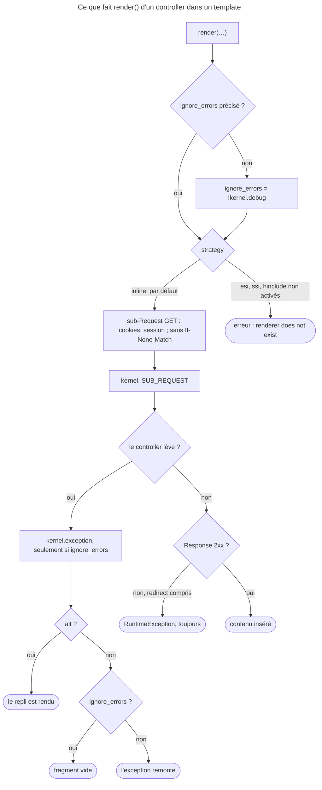

## Objectif

Exécuter un controller depuis un template, et savoir ce que cela coûte et ce qui
peut échouer. Le `forward()` d'un controller vers un autre appartient au lot
Controllers.

## Avant la règle : le problème à résoudre

Un fragment a besoin de données que la page courante n'a pas — les derniers
articles dans une barre latérale présente sur tout le site. Passer ces données
depuis chaque controller serait absurde. La function `render()` exécute un
controller et insère sa Response :

```html
{{ render(path('latest_articles', {max: 3})) }}
{{ render(url('latest_articles', {max: 3})) }}
```

La documentation Symfony 8.0 nuance d'emblée : pour une simple unité d'interface
réutilisable, elle recommande les Twig Components ; intégrer un controller se
justifie quand il faut vraiment une sub-Request, par exemple pour mettre le
fragment en cache séparément avec ESI.

Tous les faits de cette page ont été exécutés dans un kernel Symfony 8.0.15
démarré, avec Twig 3.22.2, en `debug` puis en `prod`.

## Le fil rouge : la barre latérale

```twig
{# templates/base.html.twig #}
<aside>
    {{ render(controller('App\\Controller\\SidebarController::latest', {max: 3}), {
        alt: controller('App\\Controller\\SidebarController::placeholder')
    }) }}
</aside>
```

Le controller n'a pas de route : `controller()` le désigne. Le fragment est
exécuté à chaque page, dans une sub-Request ; s'il échoue, `alt` affiche un
repli au lieu de casser la page.

## Le cycle complet en un schéma

Ce qui se passe entre `render()` et le HTML inséré, lu dans `FragmentHandler`
et `InlineFragmentRenderer`, et rejoué :



## Avec ou sans route

`render()` prend une URL ou une référence de controller. Pour un controller
**sans** route, on l'encapsule dans `controller()` :

```html
{{ render(controller(
    'App\\Controller\\BlogController::recentArticles',
    {max: 3}
)) }}
```

`controller(nom, attributs, query)` construit un simple `ControllerReference` —
il n'exécute rien ; c'est `render()` qui le fait. Les attributes deviennent des
attributes de la sub-Request (des objects y sont admis en mode `inline`), le
troisième argument des parameters de query string.

**Rejoué :**

| Appel | Le controller du fragment reçoit |
|---|---|
| `render(path('latest', {max: 3}))` | `max = 3` ; `isMainRequest()` faux |
| `render(url('latest', {max: 3, page: 2}))` | `max = 3`, `page = 2` en query |
| `render(controller('…::recent', {max: 3}, {page: 2}))` | l'attribute `max = 3`, `page = 2` en query |
| `render(controller('…::recent', {max: date('2026-01-01')}))` | un object `DateTime`, intact |

Et `{{ controller('…::recent') }}` **sans** `render()` ne rend pas une string
vide : la `ControllerReference` n'a pas de `__toString()`, et sur Twig 3.22 le
rendu échoue sur une `Error` PHP, « Object of class …ControllerReference could
not be converted to string ».

## Ce que cela déclenche

Chaque appel est une **sub-Request** `GET` traitée par le kernel
(`HttpKernelInterface::SUB_REQUEST`) : le kernel retraverse son cycle pour le
fragment. `InlineFragmentRenderer` la construit avec les cookies, les variables
serveur et la session de la Request courante, sans les headers
`If-Modified-Since` et `If-None-Match`, et transmet `_format` et la locale.

Ce n'est pas gratuit ; la documentation avertit qu'intégrer beaucoup de
controllers peut peser nettement sur les performances.

**Rejoué**, la page étant appelée avec un cookie et un header
`If-None-Match` : le fragment voit le cookie, ne voit pas le header, et reçoit
la méthode `GET`, le format `html` et la locale de la page.

## Les strategies

`render()` utilise la strategy `inline` par défaut ; l'option `strategy` ou les
functions `render_esi()`, `render_ssi()` et `render_hinclude()` en choisissent
une autre. `fragment_uri()` rend l'URI d'un fragment sans l'exécuter.

**Rejoué :**

- sans `framework.esi`, `render_esi(…)` — comme `render(…, {strategy: 'esi'})` —
  échoue : « The "esi" renderer does not exist. » ;
- avec `framework.esi` activé, une Request qui ne vient pas d'un reverse proxy
  capable d'ESI reçoit le fragment rendu en `inline` ;
- `fragment_uri(controller('…::recent', {max: 3}))` rend une URI signée en
  `/_fragment?_hash=…&_path=…`, même `framework.fragments` désactivé.

## L'URL des fragments

Avec `controller()`, la sub-Request vise une URL interne, `/_fragment` par
défaut (`framework.fragments.path`). L'option `framework.fragments` est
**désactivée par défaut** ; l'activer charge le `FragmentListener`, qui sert
cette URL aux Requests venues de l'extérieur — ESI, hinclude — et y vérifie la
signature. En `inline`, la sub-Request porte déjà son `_controller`, et le
`RouterListener` ne route pas une Request qui en a un.

**Rejoué :** le service `fragment.listener` n'existe qu'une fois
`framework.fragments` activé ; sans lui, tous les `render(controller(…))` en
`inline` ci-dessus fonctionnent.

## Quand le fragment échoue

- **Exception** dans le controller du fragment : relancée en `dev`, avalée en
  `prod`. `FragmentHandler` fixe `ignore_errors` à `!kernel.debug` si l'appel ne
  le précise pas ; ignorée, l'exception passe par l'event `kernel.exception`
  — pour le logging — et le fragment est vide.
  L'option `alt` désigne un fragment de repli.
- **Response non 2xx** — un redirect compris : `FragmentHandler::deliver()`
  lève une `RuntimeException`, quel que soit `ignore_errors`. Un controller de
  fragment ne redirige pas.

**Rejoué** avec un controller qui lève une `LogicException` :

| Appel | `debug` | `prod` |
|---|---|---|
| `render(…)` | `RuntimeError` de Twig, autour de la `LogicException` | fragment vide, `kernel.exception` dispatché |
| `render(…, {alt: …})` | le repli, **sans** `kernel.exception` | le repli, `kernel.exception` dispatché |
| `render(…, {ignore_errors: true})` | fragment vide, `kernel.exception` dispatché | idem |

Lu dans `InlineFragmentRenderer::render()` : l'event n'est dispatché que si
`ignore_errors` est vrai, **avant** d'essayer `alt`. En `dev`, un repli masque
donc l'erreur, sans trace dans les logs.

Avec un controller qui redirige, `ignore_errors: true` ne change rien : « Error
when rendering "…" (Status code is 302). », où les guillemets contiennent l'URL
de la **page**, pas celle du fragment — `deliver()` lit la Request courante.

## Concrètement dans ton application

- Un bloc réutilisable sans logique propre : un `include`, ou un Twig
  Component, pas un controller.
- Un bloc qui a besoin de ses propres données sur toutes les pages :
  `render(controller(…))`, en sachant que chaque appel est une sub-Request.
- Un fragment à mettre en cache à part : `render_esi()`, avec `framework.esi`
  activé — sinon l'appel échoue.
- Un fragment qui ne doit pas casser la page : `alt`, et regarder les logs en
  `prod` ; en `dev`, le repli cache l'erreur.
- Un fragment qui veut rediriger : impossible ; le faire dans le controller de
  la page.

## À comprendre

- **Pourquoi une sub-Request ?** Le fragment a son propre controller, ses
  listeners, sa propre Response : c'est ce qui permet de le mettre en cache à
  part, et ce qui le rend cher.
- **Pourquoi `ignore_errors` dépend-il du debug ?** En développement, on veut
  voir l'erreur ; en production, une barre latérale cassée ne doit pas casser la
  page.
- **Pourquoi un redirect est-il une erreur ?** Un fragment est inséré dans une
  page déjà en cours de rendu : il n'y a plus de Response à rediriger.

## À mémoriser

- **`render(path(…))`** ou **`render(url(…))`** : route ;
  **`render(controller(…))`** : sans route.
- **`controller()`** seul : une référence, et l'afficher fait échouer le rendu.
- Sub-Request **`GET`** : cookies et session oui, **`If-None-Match`** non.
- **`ignore_errors`** = `!kernel.debug` ; **`alt`** = repli.
- **Non 2xx** → `RuntimeException`, même avec `ignore_errors`.
- **`render_esi()`** exige `framework.esi` ; **`/_fragment`** exige
  `framework.fragments` pour l'extérieur seulement.
- Moyen mnémotechnique : **« render exécute, controller désigne, dev
  relance, prod avale, redirect casse »**.

## Pièges d'examen

**Rendre un controller depuis un template déclenche une sub-Request**, pas un
appel de function.

**`controller()` seul n'exécute rien** : il construit une référence, et
l'afficher sans `render()` fait échouer le rendu.

**Une erreur de fragment ne se comporte pas pareil en `dev` et en `prod`.**

**Un redirect dans un fragment est une erreur.**

**`framework.fragments` n'est pas actif par défaut** ; il sert à exposer
`/_fragment` à l'extérieur, pas à faire fonctionner `inline`.

## Application : trois scénarios

**Scénario 1 — La barre latérale silencieuse.** En production, la barre
latérale est vide depuis une semaine, et personne ne l'a vu. *Solution.*
`ignore_errors` vaut `true` en `prod` : l'exception est passée par
`kernel.exception` ; elle est dans les logs. Ajouter un `alt` pour un repli
visible, et surveiller les logs.

**Scénario 2 — Le fragment qui veut connecter.** Le controller du fragment
redirige vers la page de login quand le user n'est pas connecté ; la page entière
tombe en erreur. *Solution.* Un fragment ne redirige pas : rendre un message
« Connectez-vous » à la place, et laisser le contrôle d'accès à la page.

**Scénario 3 — L'ESI qui n'existe pas.** `render_esi()` est ajouté pour mettre
un fragment en cache ; la page lève « The "esi" renderer does not exist. ».
*Solution.* Activer `framework.esi` — et `framework.fragments`, que le reverse
proxy appellera. Rejoué sans reverse proxy : le fragment est rendu en
`inline`.

## QCM d'entraînement

Cinq questions sur les fragments. Choisis avant d'ouvrir la correction.

**Question 1.** Un template écrit `{{ controller('App\\Controller\\Box::recent') }}`,
sans `render()`. Que se passe-t-il sur Symfony 8.0 et Twig 3.22 ?

- **A.** Rien ne s'affiche : la référence n'est pas exécutée
- **B.** Le rendu échoue : pas de conversion en string
- **C.** Le controller est exécuté et sa Response affichée
- **D.** L'URL `/_fragment` du controller s'affiche

<details>
<summary>Correction</summary>

**Bonne réponse : B.** Rejoué : `ControllerReference` n'a pas de
`__toString()`, et le rendu lève « Object of class …ControllerReference could
not be converted to string ».

A est l'idée reçue : rien n'est exécuté, mais l'affichage échoue. C et D sont
faux.

</details>

**Question 2.** En `dev` (`debug` actif), le controller d'un fragment lève une
exception. L'appel est `render(controller('…'), {alt: controller('…::fallback')})`.
Que se passe-t-il ?

- **A.** L'exception remonte, comme toujours en `dev`
- **B.** Le fragment est vide, et l'exception est loguée
- **C.** Le repli est rendu, sans dispatch de `kernel.exception`
- **D.** Le repli est rendu, et l'exception passe aussi par `kernel.exception`

<details>
<summary>Correction</summary>

**Bonne réponse : C.** Rejoué. Lu dans `InlineFragmentRenderer::render()` :
`kernel.exception` n'est dispatché que si `ignore_errors` est vrai — il vaut
`false` en `dev` — puis `alt` est essayé avant de relancer.

A ignore `alt`. B décrit `prod` sans `alt`. D décrit `prod` avec `alt`, où
`ignore_errors` vaut `true`.

</details>

**Question 3.** `framework.esi` n'est pas activé. Que fait
`{{ render_esi(controller('…::recent')) }}` ?

- **A.** Il rend le fragment en `inline`, faute d'ESI
- **B.** Il écrit une balise `<esi:include>` dans la page
- **C.** Il échoue : le renderer `esi` n'existe pas
- **D.** Il ne rend rien

<details>
<summary>Correction</summary>

**Bonne réponse : C.** Rejoué : « The "esi" renderer does not exist. ». A est
ce qui arrive **avec** `framework.esi` activé, quand la Request ne vient pas
d'un reverse proxy capable d'ESI.

B suppose un proxy. D est faux.

</details>

**Question 4.** Le controller d'un fragment retourne un redirect ; l'appel porte
`ignore_errors: true`. La page est `/page`. Que se passe-t-il ?

- **A.** Le fragment est vide, sans erreur
- **B.** La page entière est redirigée
- **C.** Le fragment affiche le contenu de la page cible du redirect
- **D.** Une erreur « Status code is 302 » qui nomme la page

<details>
<summary>Correction</summary>

**Bonne réponse : D.** Rejoué : `FragmentHandler::deliver()` refuse toute
Response non 2xx, quel que soit `ignore_errors`, et son message lit l'URI de la
Request courante — la page, pas le fragment.

A suppose que `ignore_errors` couvre ce cas. B et C sont faux.

</details>

**Question 5.** La page reçoit un cookie `c` et un header `If-None-Match`. Que
voit le controller d'un fragment rendu en `inline` ?

- **A.** Le cookie, mais pas le header
- **B.** Le header, mais pas le cookie
- **C.** Les deux
- **D.** Aucun des deux : la sub-Request est neuve

<details>
<summary>Correction</summary>

**Bonne réponse : A.** Rejoué. Lu dans `InlineFragmentRenderer::createSubRequest()` :
cookies, session et variables serveur sont repris ; `If-Modified-Since` et
`If-None-Match` sont retirés.

B inverse. C et D sont faux.

</details>

## Fiche express

**Si tu dois retenir seulement 8 choses :**

- **`render()`** exécute ; **`controller()`** désigne un controller sans route.
- **`{{ controller(…) }}`** seul : le rendu **échoue**.
- Chaque fragment = une **sub-Request `GET`** dans le kernel.
- Cookies et session **repris** ; **`If-None-Match`** retiré.
- **`ignore_errors`** = `!kernel.debug` : `dev` relance, `prod` avale et logue.
- **`alt`** est essayé avant de relancer ; en `dev`, sans log.
- **Non 2xx** → `RuntimeException`, toujours ; le message nomme la page.
- **`render_esi()`** sans `framework.esi` : « renderer does not exist ».

**En une phrase, pour tout reconstruire :**

```text
render(path|url|controller) = sub-Request GET (cookies oui, If-None-Match non) ; controller() seul échoue ;
ignore_errors = !debug ; alt avant de relancer ; non 2xx = RuntimeException ; esi à activer ; /_fragment pour l'extérieur
```

## Sources officielles

- [Symfony Templates, « Embedding Controllers »](https://github.com/symfony/symfony-docs/blob/8.0/templates.rst)
- [Twig Bridge 8.0, `HttpKernelExtension`](https://github.com/symfony/symfony/blob/8.0/src/Symfony/Bridge/Twig/Extension/HttpKernelExtension.php) et [`HttpKernelRuntime`](https://github.com/symfony/symfony/blob/8.0/src/Symfony/Bridge/Twig/Extension/HttpKernelRuntime.php)
- [HttpKernel 8.0, `FragmentHandler`](https://github.com/symfony/symfony/blob/8.0/src/Symfony/Component/HttpKernel/Fragment/FragmentHandler.php) et [`InlineFragmentRenderer`](https://github.com/symfony/symfony/blob/8.0/src/Symfony/Component/HttpKernel/Fragment/InlineFragmentRenderer.php)
- [FrameworkBundle 8.0, `Configuration`](https://github.com/symfony/symfony/blob/8.0/src/Symfony/Bundle/FrameworkBundle/DependencyInjection/Configuration.php)
