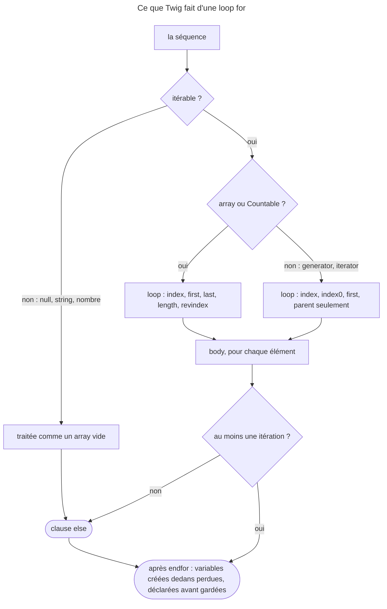

## Objectif

Parcourir une séquence, connaître la variable `loop` et sa limite, le scope
d'une loop, et écrire une condition sans se tromper sur ce qui est « vide ».

## Avant la règle : le problème à résoudre

Une page liste les membres d'une équipe : un tiret entre chaque nom mais pas
après le dernier, un message quand l'équipe est vide, seulement les membres
actifs, et le total des points en bas. En PHP, on écrirait un `foreach` avec un
compteur, un `if (count(...) === 0)`, un `continue` et une variable cumulée.

Twig a tout cela, mais **autrement** : une clause `else` sur la loop, une
variable `loop` qui connaît sa position, aucun `break` ni `continue`, et un
scope qui décide quelles variables survivent à la loop. Tous les faits de cette
page ont été exécutés avec Twig 3.22.2.

## Le fil rouge : la liste des membres

```twig

<ul>

    <li>{{ loop.index }}. {{ member.name }}{{ not loop.last ? ' —' }}</li>
    

    <li>Aucun membre actif.</li>

</ul>
<p>Total : {{ total }}</p>
```

Chaque morceau de cette page s'y retrouve : `else` pour la séquence vide,
`loop.index` et `loop.last`, `filter` à la place de `continue`, et `total`
déclaré **avant** la loop pour survivre à `endfor`.

## Le cycle complet en un schéma

Ce que fait une loop `for`, lu dans `ForNode::compile()` et rejoué :



## La loop

```html

    <li>{{ user.username }}</li>

    <li>Aucun utilisateur.</li>

```

La clause `else` s'exécute quand **aucune itération n'a eu lieu** — la séquence
était vide. Sans équivalent en PHP, elle évite un `if` englobant.

`` donne la key et la valeur ; `` les clés seules. L'opérateur `..` produit une suite —
`` va de 0 à 10 inclus, `'a'..'z'` marche aussi — et la
function `range()` accepte un pas différent de 1.

**Rejoué :** `3..0` produit `3210` — la suite descend quand la borne de départ
est la plus grande. Et la séquence passe d'abord par
`CoreExtension::ensureTraversable()`, qui remplace toute valeur **non
itérable** par un array vide : une loop sur `null` ou sur la string `'abc'` ne
lève rien et rend sa clause `else`. Une string ne se parcourt pas caractère par
caractère.

## La variable `loop`

Disponible dans le body de la loop :

| Variable | Contenu |
|---|---|
| `loop.index` | itération courante, **à partir de 1** |
| `loop.index0` | itération courante, à partir de 0 |
| `loop.revindex` | itérations restantes, à partir de 1 |
| `loop.revindex0` | itérations restantes, à partir de 0 |
| `loop.first` | vrai à la première |
| `loop.last` | vrai à la dernière |
| `loop.length` | taille de la séquence |
| `loop.parent` | le contexte englobant |

**La limite à connaître :** `loop.length`, `loop.revindex`, `loop.revindex0` et
`loop.last` ne sont disponibles que pour un **array PHP** ou un object
implémentant `Countable`. Le code compilé par `ForNode` ne les renseigne que
dans ce cas : sur un generator, ou sur un iterator qui n'implémente pas
`Countable`, ces keys n'existent pas — Twig ne peut pas connaître la taille sans
consommer la séquence.

`loop.index` et `loop.first`, eux, fonctionnent toujours.

**Rejoué**, avec `strict_variables` activé, en lisant `loop.last` :

| Séquence | Résultat |
|---|---|
| array PHP | fonctionne |
| `ArrayIterator` — un iterator, mais `Countable` | fonctionne, `loop.length` aussi |
| `IteratorAggregate` non `Countable` | `RuntimeError` |
| generator | `RuntimeError` |

Le message nomme ce qui existe : « Key "last" for sequence/mapping with keys
"parent, index0, index, first" does not exist ». Sans `strict_variables`, la
même lecture rend `null`, sans prévenir.

Dans deux loops imbriquées, `loop.parent.loop.index` lit l'index de la loop
extérieure : `loop.parent` est le contexte d'avant la loop, qui contient la
variable `loop` de la loop englobante.

## Le scope d'une loop

Une loop a sa propre portée. Une variable **créée** par `` dans le
corps n'existe plus après `` ; une variable **déclarée avant** la
loop garde en revanche la dernière valeur qu'elle y a reçue. `ForNode` le
compile ainsi : à la fin de la loop, seules les keys du contexte d'avant la loop sont
conservées. Pour cumuler un total, on le déclare donc avant.

**Rejoué**, et lu dans la même fin de `ForNode::compile()` : la variable de
loop elle-même est retirée du contexte, puis le contexte d'avant est recomposé.
Avec `…`, `u` vaut de
nouveau `outer` après la loop — pas `b`. Sans variable d'avant, `u` n'existe
plus, et `loop` non plus.

## Filtrer et découper

Twig n'a pas de `break` ni de `continue`, et `ForTokenParser` n'accepte aucune
condition sur le tag `for` lui-même. On restreint la séquence en amont :

```html



```

Un `if` à l'intérieur du body fonctionne aussi, mais `loop.index` compte alors
les éléments sautés, et `loop.last` peut tomber sur un élément non affiché.

**Rejoué** sur `[1, 2, 3, 4]` :

| Écriture | Ce qui s'affiche (`index:valeur`) |
|---|---|
| `\|filter(n => n is even)`, puis la loop | `1:2 2:4`, `loop.last` sur `4` |
| la loop, puis `` dans le body | `2:2 4:4`, `loop.last` sur `4` |
| la loop sur `[1, 2, 3]`, `` | `1:1 3:3`, `loop.last` sur `3` |

Avec le filter, la numérotation suit ce qui est affiché. Un ``, lui,
ne compile pas : « Unexpected "break" tag (expecting closing tag for the "for"
tag defined near line 1) ».

## Les conditions

```html

    …

    …

    …

```

Les tests s'écrivent avec `is` et se nient par `is not`. `CoreExtension`
(3.22) enregistre `constant`, `defined`, `divisible by`, `empty`, `even`,
`iterable`, `mapping`, `null` (alias `none`), `odd`, `same as` et `sequence` —
plus `true`, que le compiler pose lui-même sur chaque condition d'un `if`.
Twig n'a pas d'operator `===` : la comparaison stricte s'écrit avec le
**test** `same as`.

**Rejoué :** écrire `===` ne compile pas, et le message donne la solution :
« Did you try to use "===" or "!==" for strict comparison? Use "is same
as(value)" instead ». Et une variable inconnue dans un `if` lève une
`RuntimeError` sous `strict_variables`, mais rend la branche fausse sans lui.
`is defined` est le test qui pose la question sans risque.

## Vrai, faux, vide : trois questions différentes

Une condition nue suit les règles de PHP. La documentation de `if` en donne les
cas limites : la string vide, zéro, la string `'0'`, une séquence vide et `null`
sont faux ; une string d'espaces, `NAN`, `INF` et **tout object** sont vrais.
Une exception, lue dans `IfNode` et `TrueTest` : un object `Markup` — une string
déjà marquée sûre — est jugé sur son texte.

Le test `empty` n'est pas la négation de cette règle. `CoreExtension::testEmpty()`
rend vrai pour `''`, `[]`, `null` et `false`, pour un `Countable` de taille
zéro, pour un `Traversable` sans élément, et pour un object dont la conversion en
string est vide. **`0` et `'0'` ne sont pas vides**, alors qu'ils sont faux dans
un `if`. Et un object `Countable` vide — une collection, par exemple — est vrai
dans un `if`, mais `empty`.

`is defined`, enfin, porte sur l'existence de la variable, pas sur sa valeur.

**Rejoué**, chaque valeur passée à `` puis à `v is empty` :

| Valeur | `if` | `is empty` |
|---|---|---|
| `''`, `[]`, `null` | faux | vide |
| `0`, `'0'` | faux | **pas vide** |
| `' '` | vrai | pas vide |
| collection `Countable` vide | **vrai** | vide |
| `Markup('0')` | faux | — |

Un dernier cas, lu dans `testEmpty()` : pour un `Traversable` qui n'est pas
`Countable`, le test **compte les éléments en les parcourant**. Sur un
generator, `` le consomme ; la loop qui suit lève
alors une `RuntimeError` — « Cannot traverse an already closed generator ». La
clause `else` de la loop répond à la même question sans parcourir deux fois.

## Concrètement dans ton application

- Une liste qui peut être vide : `……`, pas un
  `if` autour.
- Un séparateur entre les éléments : `{{ not loop.last ? ', ' }}` — sur un
  array ou une collection `Countable` ; sur un generator,
  `{{ not loop.first ? ', ' }}` placé avant l'élément.
- Un generator ou un iterator maison : `loop.index` et `loop.first` seulement ;
  pour `loop.last`, passer un array ou implémenter `Countable`.
- Un total : `` **avant** la loop.
- Un sous-ensemble : `filter`, `slice` ou `sort` sur la séquence ; mieux encore,
  une requête qui ne ramène que les bons éléments.
- Une comparaison stricte : `is same as(…)`.

## À comprendre

- **Pourquoi la moitié de `loop` dépend du type ?** `length`, `revindex` et
  `last` exigent de connaître la taille avant la fin ; seul un array ou un
  `Countable` la donne sans consommer la séquence.
- **Pourquoi pas de `break` ?** Un template présente des données ; choisir
  lesquelles relève de la séquence qu'on lui passe, ou d'un filter.
- **Pourquoi `0` est-il faux mais pas vide ?** Ce sont deux questions : le `if`
  suit PHP, `empty` demande s'il y a un contenu — et `0` en est un.
- **Pourquoi la variable de loop retrouve-t-elle sa valeur ?** Le contexte
  d'avant est recomposé à `endfor` : la loop ne peut écraser une variable qu'en
  lui donnant une valeur avec `set`.

## À mémoriser

- **`else`** de la loop : séquence vide — ou non itérable, comme `null` ou une
  string.
- **`loop.index`** commence à **1** ; `index0` à 0.
- **`length`, `revindex`, `revindex0`, `last`** : array ou **`Countable`**
  seulement — `ArrayIterator` oui, generator non.
- Créée dans la loop : **perdue** ; déclarée avant : **dernière valeur**.
- **Pas de `break` ni de `continue`** : `filter`, `slice`, `sort`.
- **`same as`** pour `===` ; `is not` pour nier un test.
- **`if`** = règles de PHP ; **`empty`** = `testEmpty()` : `0` faux mais pas
  vide.
- Moyen mnémotechnique : **« else pour le vide, Countable pour la fin, avant
  pour garder »**.

## Pièges d'examen

**La moitié des properties de loop n'existent pas sur un generator ni sur un
iterator non `Countable`** ; l'index et le test de première itération, si. Un
`ArrayIterator`, qui est `Countable`, les a toutes.

**L'index commence à 1.**

**La clause `else` d'une loop se déclenche sur une séquence vide.**

**Une variable créée dans une loop n'en sort pas** ; déclarée avant, elle
garde sa dernière valeur.

**`0` est faux mais n'est pas vide ; une collection vide est vraie mais vide.**

## Application : trois scénarios

**Scénario 1 — Le séparateur qui casse en production.** `{{ not loop.last ?
', ' }}` marche en développement sur un array, puis lève une `RuntimeError`
quand le repository renvoie un generator. *Solution.* Un generator ne connaît
pas sa taille : convertir en array avant de le passer au template, ou poser le
séparateur **avant** chaque élément sauf le premier, avec `loop.first`, qui
existe toujours.

**Scénario 2 — La liste qui disparaît.** Un template teste
`` puis parcourt `items`, un generator ; la page
lève « Cannot traverse an already closed generator ». *Solution.* Le test l'a
déjà consommé : remplacer le `if` par la clause `else` de la loop.

**Scénario 3 — La numérotation à trous.** Une liste numérotée affiche 1, 3, 4
parce qu'un `if` dans le body saute les éléments masqués. *Solution.* Filtrer
la séquence avec `filter` : `loop.index` suit alors ce qui est affiché.

## QCM d'entraînement

Cinq questions sur les loops et les conditions. Choisis avant d'ouvrir la
correction.

**Question 1.** Que rend ce template ?

```twig
{{ u }}/{{ u }}
```

- **A.** `ab/b`
- **B.** `ab/outer`
- **C.** `ab/`
- **D.** Une erreur : `u` est déjà définie

<details>
<summary>Correction</summary>

**Bonne réponse : B.** Rejoué avec Twig 3.22.2 : à `endfor`, `ForNode` retire
la variable de loop puis recompose le contexte d'avant ; `u` y valait `outer`.

A est l'intuition PHP du `foreach`. C vaudrait sans `set` avant la loop, avec
une variable inconnue rendue vide. D est faux.

</details>

**Question 2.** Avec `strict_variables` activé, une loop parcourt
`new ArrayIterator(['a', 'b'])` et affiche `{{ loop.last ? 'L' : '-' }}`. Que
rend-elle ?

- **A.** `-L`
- **B.** Une `RuntimeError` : la key `last` n'existe pas sur un iterator
- **C.** `--`
- **D.** `LL`

<details>
<summary>Correction</summary>

**Bonne réponse : A.** Rejoué : `ArrayIterator` implémente `Countable`, et
`ForNode` pose `last` pour tout `Countable`. La `RuntimeError` de B est ce
qu'on obtient avec un generator ou un iterator non `Countable`.

C et D sont faux.

</details>

**Question 3.** `items` est un generator qui produit deux valeurs. Que fait ce
template ?

```twig
{{ i }}
```

- **A.** Il affiche les deux valeurs
- **B.** Il n'affiche rien, sans erreur, le generator étant épuisé
- **C.** Il lève une `RuntimeError` dans la loop
- **D.** Il affiche les deux valeurs deux fois

<details>
<summary>Correction</summary>

**Bonne réponse : C.** Rejoué : `testEmpty()` compte les éléments d'un
`Traversable` non `Countable` en le parcourant ; le generator est épuisé, et la
loop lève « Cannot traverse an already closed generator ».

A vaudrait pour un array. B et D sont faux.

</details>

**Question 4.** Que rend `[{{ c }}]E` ?

- **A.** `[a][b][c]`
- **B.** `[abc]`
- **C.** Une `RuntimeError`
- **D.** `E`

<details>
<summary>Correction</summary>

**Bonne réponse : D.** Rejoué. Lu dans `CoreExtension::ensureTraversable()` :
une valeur non itérable devient un array vide, et la clause `else` s'exécute.

A est l'intuition d'autres langages. B et C sont faux.

</details>

**Question 5.** Que rend
`{{ loop.index }}:{{ n }} ` ?

- **A.** `2:2 4:4`
- **B.** `0:2 1:4`
- **C.** `1:2 2:4`
- **D.** `1:1 2:2 3:3 4:4`

<details>
<summary>Correction</summary>

**Bonne réponse : C.** Rejoué : la loop ne voit que la séquence filtrée, donc
`loop.index` compte les éléments affichés, à partir de 1.

A est ce que donne un `if` dans le body. B part de 0, comme `index0`. D ignore
le filter.

</details>

## Fiche express

**Si tu dois retenir seulement 8 choses :**

- **`else`** de loop : séquence vide ou non itérable.
- **`loop.index`** part de **1**.
- **`last`, `length`, `revindex`, `revindex0`** : array ou **`Countable`**.
- Generator : **`RuntimeError`** sous `strict_variables`, `null` sans.
- Variable **créée dedans perdue**, **déclarée avant gardée** ; la variable de
  loop retrouve sa valeur d'avant.
- **Ni `break` ni `continue`** : `filter`, `slice`, `sort`.
- **`same as`** remplace `===`, qui ne compile pas.
- **`0` faux mais pas vide** ; collection vide **vraie mais vide** ;
  `is empty` consomme un generator.

**En une phrase, pour tout reconstruire :**

```text
for…else (vide ou non itérable) ; loop.index dès 1 ; last/length/revindex = array ou Countable ;
scope : créé perdu, déclaré avant gardé ; filter au lieu de break ; same as pour === ; if ≠ empty
```

## Sources officielles

- [Twig 3.22, tag `for`](https://github.com/twigphp/Twig/blob/v3.22.0/doc/tags/for.rst) et [`ForNode`](https://github.com/twigphp/Twig/blob/v3.22.0/src/Node/ForNode.php)
- [Twig 3.22, tag `if`](https://github.com/twigphp/Twig/blob/v3.22.0/doc/tags/if.rst) et [tag `set`, portée des loops](https://github.com/twigphp/Twig/blob/v3.22.0/doc/tags/set.rst)
- [Twig 3.22, tests](https://github.com/twigphp/Twig/blob/v3.22.0/doc/tests/index.rst), [`empty`](https://github.com/twigphp/Twig/blob/v3.22.0/doc/tests/empty.rst) et [`CoreExtension`](https://github.com/twigphp/Twig/blob/v3.22.0/src/Extension/CoreExtension.php)
