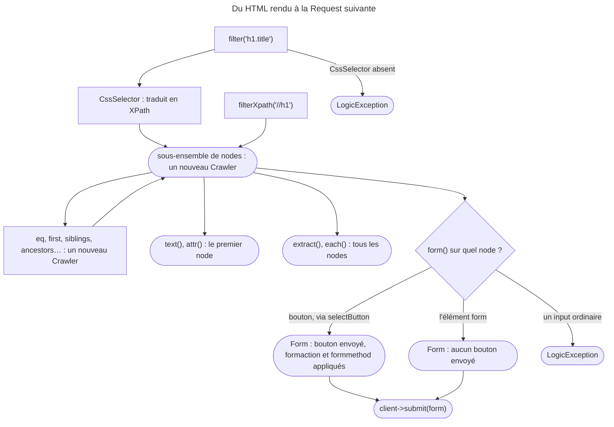

## Objectif

Parcourir le document rendu, en extraire une valeur, et cliquer ou soumettre —
c'est le component qui donne au test l'accès au HTML.

## L'essentiel

**DomCrawler** parcourt le document et en extrait des nodes ; **CssSelector**
ne parcourt rien, il **traduit** un selector CSS en XPath. Chaque method de
parcours rend un **nouveau `Crawler`**. `text()` et `attr()` ne lisent que le
**premier** node. Pour soumettre un form, on part **du bouton**.

## Le schéma



## L'exemple

```php
$crawler = $client->request('GET', '/products');
$titre = $crawler->filter('h1')->text();                    // le premier h1
$liens = $crawler->filter('.product a')->extract(['_text', 'href']);
$form  = $crawler->selectButton('Supprimer')->form();       // le bouton compte
$client->submit($form);
```

## Deux components, un role chacun

- `(new CssSelectorConverter())->toXPath('h1.title')` rend une **string** :
  `descendant-or-self::h1[@class and contains(…)]`.
- `filter()` crée ce convertisseur, puis filtre par l'expression XPath
  obtenue : il **exige** CssSelector. `filterXpath()` non — sans le component,
  `filter()` lève une `LogicException`.

## Parcourir

| Method | Ce qu'elle rend |
|---|---|
| `eq(1)` | le node à cet index — `0` est le premier |
| `first()`, `last()` | le premier, le dernier |
| `siblings()` | les frères, **le node courant exclu** |
| `nextAll()`, `previousAll()` | les frères après, avant — du plus proche au plus lointain |
| `ancestors()`, `children()` | les ascendants jusqu'à `<html>`, les enfants directs |
| `reduce($fn)` | retire les nodes pour lesquels la function rend `false` ; tout autre retour garde le node |

- Une sélection vide n'est pas une erreur : `eq(5)` sur trois `<li>` rend un
  `Crawler` vide, `count()` à `0`.
- L'erreur vient d'une method qui a besoin d'un node :
  « The current node list is empty. »
- `reduce()` avec une function sans `return` garde tous les nodes.

## Extraire

```php
$crawler->text();                     // le texte du premier nœud, espaces normalisés
$crawler->text('Défaut');             // ce texte si le nœud n'existe pas
$crawler->text(null, false);          // sans normaliser les espaces
$crawler->attr('class');              // un attribut du premier nœud
$crawler->extract(['_text', 'href']); // un tableau, pour tous les nœuds
$crawler->each(fn ($node, $i) => $node->attr('href'));
```

`text()` sur une sélection vide, sans default value, lève une
`InvalidArgumentException`.

## Cliquer et soumettre

```php
$client->clickLink('Cliquez ici');
$client->submitForm('Ajouter', ['comment_form[content]' => '…']);
$form = $crawler->selectButton('submit')->form();
```

- On sélectionne **un bouton** : par son texte, sa `value`, son `id` ou son
  `name`. C'est lui qui décide de ce qui est envoyé.
- Form à deux boutons `Save` (`a=A`) et `Delete` (`b=B`) :

| Origine du `Form` | Valeurs envoyées |
|---|---|
| `selectButton('Delete')->form()` | `b=B`, `q=1`, vers le `formaction` du bouton, avec son `formmethod` |
| `filter('#f')->form()` — le `<form>` | `q=1` seulement, vers l'`action` du form |
| `filter('input[name=q]')->form()` | `LogicException` « Unable to submit on a "input" tag. » |

- Fields : `select()` pour une liste ou un radio button, `tick()` pour une
  case, `upload()` pour un file.

## Pièges d'examen

**CssSelector ne parcourt pas le DOM** : il traduit CSS en XPath.

**`text()` et `attr()` ne lisent que le premier node.**

**`siblings()` exclut le node courant.**

**On sélectionne un bouton pour obtenir un form** quand le bouton compte ;
le `<form>` seul marche aussi, mais n'envoie aucun bouton.

**`text()` normalise les espaces par défaut**, et lève une exception sur une
sélection vide sans default value.

**Chaque method de parcours rend un nouveau `Crawler`** ; l'object d'origine
n'est pas modifié.

## Application

- `$crawler->filter('h1')` lève une `LogicException` dans un projet minimal →
  installer CssSelector, ou `filterXpath('//h1')`.
- `filter('.flash')->text()` échoue quand aucun message n'est affiché →
  `text('')`, ou tester `count()` d'abord.

## QCM d'entraînement

**Question 1.** Une liste compte trois `<li>`. Que fait
`$crawler->filter('li')->eq(5)` ?

- **A.** Il lève une `InvalidArgumentException` immédiatement
- **B.** Il rend le dernier `<li>`, faute de sixième
- **C.** Il rend `null`
- **D.** Il rend un `Crawler` vide : `count()` vaut 0

<details>
<summary>Correction</summary>

**Bonne réponse : D.** L'exception ne vient qu'ensuite, d'une method qui a
besoin d'un node, comme `text()` sans default value.

</details>

**Question 2.** Trois `<li>` : `a`, `b`, `c`. Que rend ce code ?

```php
$crawler->filter('li')->last()->previousAll()->extract(['_text']);
```

- **A.** `["a", "b"]`
- **B.** `["a", "b", "c"]`
- **C.** `["b", "a"]`
- **D.** `["c"]`

<details>
<summary>Correction</summary>

**Bonne réponse : C.** Les frères précédents, du plus proche au plus lointain ;
A garde l'ordre du document, B inclut le node courant.

</details>

**Question 3.** Le `<form>` déclare `action="/save"` et `method="post"` ; son
bouton Delete porte `formaction="/del"` et `formmethod="get"`. Quelle Request
décrit `selectButton('Delete')->form()` ?

- **A.** GET sur `/del`, les valeurs en query string
- **B.** POST sur `/save`, la cible déclarée par le `<form>`
- **C.** POST sur `/del`, seul `formaction` étant lu
- **D.** GET sur `/save`, seul `formmethod` étant lu

<details>
<summary>Correction</summary>

**Bonne réponse : A.** Le bouton impose sa cible et sa method ; B est ce que
rend un `Form` construit depuis le `<form>` lui-même.

</details>

**Question 4.** `selectButton('b')` trouve-t-il `<button name="b">Delete</button>` ?

- **A.** Non : seul le texte affiché du bouton est comparé
- **B.** Oui : son `name` suffit, comme son `id`
- **C.** Non : il faudrait le selector CSS `button[name=b]`
- **D.** Seulement pour un `<input type="submit">`

<details>
<summary>Correction</summary>

**Bonne réponse : B.** La recherche compare le texte, la `value`, l'`id` et le
`name` ; le bouton trouvé envoie `b=B`.

</details>

## Fiche express

**Si tu dois retenir seulement 7 choses :**

- **CssSelector** traduit CSS → XPath ; **DomCrawler** parcourt.
- **`filter()`** exige CssSelector ; **`filterXpath()`** non.
- Chaque method de parcours rend un **nouveau `Crawler`**.
- **`siblings()`** exclut le node courant.
- **`text()`/`attr()`** : premier node ; **`extract()`/`each()`** : tous.
- **`text()`** normalise, et lève une exception sur du vide sans default value.
- **`selectButton()->form()`** : le bouton, sa cible, sa method.

Moyen mnémotechnique :
**« Traduire, parcourir, partir du bouton »**.

```text
CSS --CssSelector--> XPath --DomCrawler--> nouveau Crawler (immuable) ; text/attr = 1er node, extract/each = tous ;
selectButton()->form() = bouton + formaction + formmethod ; <form> seul = aucun bouton ; input = LogicException
```

## Sources officielles

- [The DOM Crawler](https://github.com/symfony/symfony-docs/blob/8.0/testing/dom_crawler.rst)
- [The CssSelector Component](https://github.com/symfony/symfony-docs/blob/8.0/components/css_selector.rst)
- [The DomCrawler Component](https://github.com/symfony/symfony-docs/blob/8.0/components/dom_crawler.rst)
- [DomCrawler 8.0, `Crawler`](https://github.com/symfony/symfony/blob/8.0/src/Symfony/Component/DomCrawler/Crawler.php)
- [DomCrawler 8.0, `Form`](https://github.com/symfony/symfony/blob/8.0/src/Symfony/Component/DomCrawler/Form.php)
- [Testing](https://github.com/symfony/symfony-docs/blob/8.0/testing.rst)

