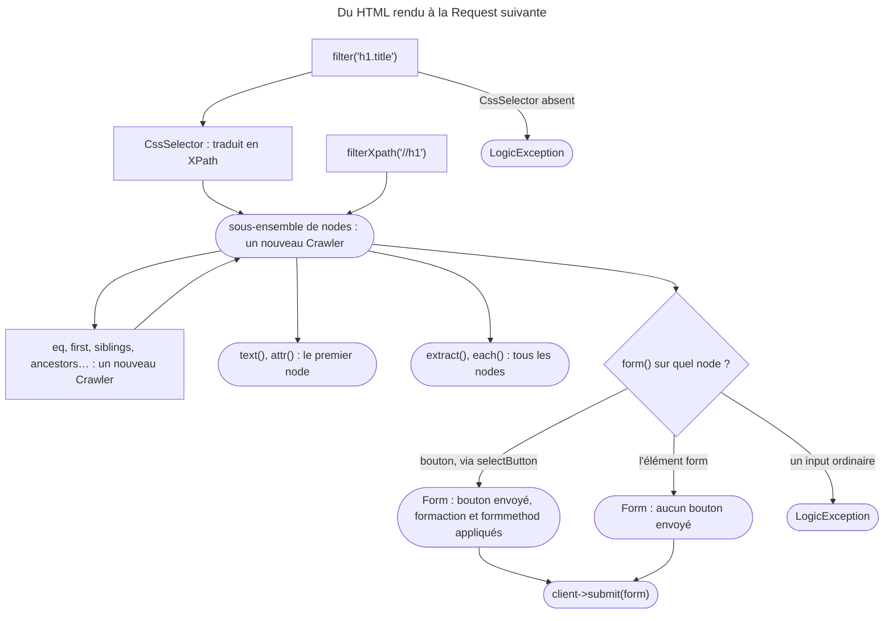

## Objectif

Parcourir le document rendu, en extraire une valeur, et cliquer ou soumettre —
c'est le component qui donne au test l'accès au HTML.

## Avant la règle : le problème à résoudre

Un test fonctionnel a reçu la page `/products`. Il doit vérifier le titre, lire
chaque lien de la liste, puis cliquer sur « Supprimer ». Chercher des chaînes
dans le HTML brut casse au premier espace ajouté par un template.

Le **crawler** donne au test un accès structuré au document. Trois questions :
**qui fait quoi** entre DomCrawler et CssSelector, ce que rend chaque method de
**parcours** et d'**extraction** — le premier node, ou tous —, et comment
obtenir le **form** qu'un bouton enverrait.

On suppose connus l'object client — `request()` rend un `Crawler` — et les
selectors CSS.

## Le fil rouge : la liste des produits

```php
$crawler = $client->request('GET', '/products');

$titre = $crawler->filter('h1')->text();                    // le premier h1
$liens = $crawler->filter('.product a')->extract(['_text', 'href']);
$form  = $crawler->selectButton('Supprimer')->form();       // le bouton compte
$client->submit($form);
```

## Le cycle complet en un schéma



## Deux components, un role chacun

**DomCrawler** parcourt le document et en extrait des nodes. **CssSelector**
ne parcourt rien : il **traduit un selector CSS en expression XPath**. Le
premier utilise le second.

C'est la distinction que l'examen teste. XPath est plus puissant mais illisible ;
CSS est plus simple et couvre presque tous les besoins. CssSelector permet
d'écrire `h1.title` là où il faudrait sinon une expression XPath complète.

Exécuté avec CssSelector 8.0.9 — la dernière version 8.0 du component, installée
avec Symfony 8.0.15 —, `(new CssSelectorConverter())->toXPath('h1.title')` rend
une **chaîne** :

```text
descendant-or-self::h1[@class and contains(concat(' ', normalize-space(@class), ' '), ' title ')]
```

Lu dans `Crawler::filter()` (8.0) : la method crée le convertisseur, appelle
`toXPath()`, puis filtre avec l'expression obtenue — le même chemin que
`filterXpath()`.

## Sélectionner

```php
$crawler->filter('h1.title');        // sélecteur CSS
$crawler->filterXpath('//h1');       // expression XPath
```

`filter()` exige le component CssSelector ; `filterXpath()` non. Lu dans
`Crawler` (8.0) : sans lui, `LogicException` « To filter with a CSS selector,
install the CssSelector component… Or use filterXpath instead. »

## Parcourir

Chaque method rend **un nouveau `Crawler`**, ce qui permet de les enchaîner :

```php
$crawler->filter('input[type=submit]')
    ->last()
    ->ancestors()
    ->first();
```

| Method | Ce qu'elle rend |
|---|---|
| `eq(1)` | le node à cet index — `0` est le premier |
| `first()`, `last()` | le premier, le dernier |
| `siblings()` | les frères, **le node courant exclu** |
| `nextAll()`, `previousAll()` | les frères après, avant |
| `ancestors()` | les ascendants, jusqu'à `<html>` |
| `children()` | les enfants directs |
| `reduce($fn)` | retire les nodes pour lesquels la function rend `false` ; tout autre retour garde le node |

`count($crawler)` donne le nombre de nodes retenus.

Rejoué pour cette page avec DomCrawler 8.0.12 — la dernière version 8.0 du
component, installée avec Symfony 8.0.15 —, sur trois `<li>` `a`, `b`, `c` :

| Appel | Résultat |
|---|---|
| `eq(1)->text()` | `b` |
| `first()->nextAll()` | `b`, `c` |
| `last()->previousAll()` | `b`, puis `a` — du plus proche au plus lointain |
| `eq(5)` | un `Crawler` vide : `count()` vaut `0`, sans exception |
| `previousAll()` sur une sélection vide | `InvalidArgumentException` « The current node list is empty. » |

Une sélection vide n'est donc pas une erreur en soi ; l'erreur arrive quand une
method a besoin d'un node pour travailler.

## Extraire

```php
$crawler->text();                     // le texte du premier nœud
$crawler->text('Défaut');             // ce texte si le nœud n'existe pas
$crawler->text(null, false);          // sans normaliser les espaces
$crawler->attr('class');              // un attribut du premier nœud
$crawler->extract(['_text', 'href']); // un tableau, pour tous les nœuds
$crawler->each(fn ($node, $i) => $node->attr('href'));
```

Le point à retenir : **`text()` et `attr()` ne portent que sur le premier
node** ; `extract()` et `each()` portent sur tous. La key `_text` d'`extract()`
désigne le texte plutôt qu'un attribute.

Exécuté avec DomCrawler 8.0.12 :

| Appel | Résultat |
|---|---|
| `text()` sur `<h1>  Hello⏎   World  </h1>` | `"Hello World"` — espaces normalisés **par défaut** |
| `text(null, false)` | le texte brut, retours à la ligne compris |
| `text()` sur une sélection vide | `InvalidArgumentException` : « The current node list is empty. » |
| `text('Défaut')`, `attr('class', 'none')` sur une sélection vide | la default value |
| `text()` sur trois `<li>` | le premier seulement |
| `siblings()` de `li.me` | les deux autres `<li>` |
| `ancestors()` de `li.me` | `ul`, `body`, `html` |
| `reduce()` sur trois `<li>`, une function sans `return` | les trois gardés |

Rejoué : `attr('title')` sur deux liens de titres `A` et `B` rend `"A"` ;
`extract(['_text', 'href'])` rend `[['X', '/x'], ['Y', '/y']]`, un array par
node, dans l'ordre des keys demandées.

## Cliquer et soumettre

Deux niveaux coexistent. Le raccourci passe par le client :

```php
$client->clickLink('Cliquez ici');
$crawler = $client->submitForm('Ajouter', ['comment_form[content]' => '…']);
```

L'object passe par le crawler, quand on a besoin du `Link` ou du `Form` :

```php
$link = $crawler->selectLink('Cliquez ici')->link();
$client->click($link);

$form = $crawler->selectButton('submit')->form();
$form['my_form[name]'] = 'Fabien';
$client->submit($form);
```

Le point contre-intuitif : **on sélectionne un bouton**, comme le recommande
`testing.rst`. Un form peut en porter plusieurs, et c'est le bouton qui
détermine ce qui est envoyé. Le premier argument de `submitForm()` est le
texte, l'`id` ou le `name` d'un `<button>` ou d'un `<input type="submit">`.

Lu dans `Crawler::selectButton()` (8.0), la recherche compare aussi la `value`
du bouton, et l'`alt` d'un `<input type="image">`. Rejoué : `selectButton('b')`
trouve `<button name="b">Delete</button>`.

Le code accepte pourtant aussi le `<form>` lui-même — la documentation du
component le montre : `$crawler->filter('.form-vertical')->form()`. Exécuté,
un form à deux boutons `Save` (`a=A`) et `Delete` (`b=B`) :

| Origine du `Form` | Valeurs envoyées |
|---|---|
| `selectButton('Delete')->form()` | `b=B`, `q=1` |
| `filter('#f')->form()` — le `<form>` | `q=1` seulement |
| `filter('input[name=q]')->form()` | `LogicException` « Unable to submit on a "input" tag. » |

Depuis le `<form>`, aucun bouton n'est envoyé, et les attributes `formaction` et
`formmethod` d'un bouton ne s'appliquent pas.

Rejoué, le `<form>` déclarant `action="/save"` et `method="post"`, et le bouton
`Delete` portant `formaction="/del"` et `formmethod="get"` :

| Origine du `Form` | `getMethod()` | `getUri()` |
|---|---|---|
| `selectButton('Delete')->form()` | `GET` | `http://localhost/del?b=B&q=1` |
| `selectButton('Save')->form()` | `POST` | `http://localhost/save` |
| `filter('#f')->form()` | `POST` | `http://localhost/save` |

En `GET`, `Form::getUri()` place les valeurs dans la query string.

Sur les fields : `select()` pour une liste ou un radio button, `tick()` pour une
case, `upload()` pour un file. Rejoué : `select('L')` sur deux radio buttons `M`
et `L` envoie `size=L` ; `tick()` sur ce même field lève `LogicException`
« You cannot tick "size" as it is not a checkbox (radio). », et `select('XL')`
lève `InvalidArgumentException`, qui liste les valeurs possibles.

## Concrètement dans ton application

- Vérifier un titre : `filter('h1')->text()` — ou `text('…')` si l'élément peut
  manquer.
- Lire toute une liste : `extract()` ou `each()`, jamais `text()`.
- Un projet sans CssSelector : `composer require --dev symfony/css-selector`,
  ou `filterXpath()`.
- Un form à plusieurs boutons : `selectButton()` sur **le** bouton voulu.
- Un seul appel suffit : `$client->submitForm('Ajouter', [...])`.
- Un lien à suivre : `$client->clickLink()`, ou `selectLink()->link()` puis
  `$client->click()`.

## À comprendre

- **Pourquoi deux components ?** Parcourir un DOM et traduire un langage de
  selectors sont deux métiers : DomCrawler ne parle qu'XPath, CssSelector lui
  fournit l'XPath.
- **Pourquoi `text()` ne lit-il qu'un node ?** Il rend une seule chaîne ; pour
  plusieurs nodes, `extract()` et `each()` rendent un array.
- **Pourquoi partir du bouton ?** Le navigateur envoie le bouton cliqué, avec
  sa cible et sa method propres ; seul un `Form` construit depuis ce bouton les
  reproduit.

## À mémoriser

- **DomCrawler** parcourt ; **CssSelector** traduit CSS → **XPath**.
- **`filter()`** en CSS (CssSelector requis), **`filterXpath()`** en XPath.
- Parcours **chaînable**, **immuable** ; **`count()`** pour le nombre de nodes.
- **`siblings()`** sans le node courant ; **`previousAll()`** du plus proche
  au plus lointain.
- **`text()`/`attr()`** : premier node ; **`extract()`/`each()`** : tous.
- **`text()`** normalise ; exception sur sélection vide, sauf default value.
- **`selectButton()->form()`** : bouton, `formaction` et `formmethod` compris.
- Moyen mnémotechnique : **« Traduire, parcourir, partir du bouton »**.

## Pièges d'examen

**CssSelector ne parcourt pas le DOM** : il traduit CSS en XPath.

**`text()` et `attr()` ne lisent que le premier node.**

**`siblings()` exclut le node courant.**

**On sélectionne un bouton pour obtenir un form** quand le bouton compte ;
le `<form>` seul marche aussi, mais n'envoie aucun bouton.

**`text()` normalise les espaces par défaut**, et lève une exception sur une
sélection vide sans default value.

**Chaque method de parcours rend un nouveau `Crawler`** ; l'object d'origine
n'est pas modifié.

## Application : trois scénarios

**Scénario 1 — Le projet minimal.** Dans une application sans le pack de test
complet, `$crawler->filter('h1')` lève une `LogicException`. *Solution.* Le
component CssSelector manque : l'installer, ou écrire `filterXpath('//h1')`.

**Scénario 2 — La suppression jamais appelée.** Le test construit le `Form`
depuis le `<form>` et le soumet ; le controller de suppression, branché sur le
`formaction` du bouton « Supprimer », n'est jamais atteint. *Solution.* Partir
du bouton : `selectButton('Supprimer')->form()` envoie ce bouton, vers sa cible
et avec sa method.

**Scénario 3 — Le message facultatif.** Un test lit `filter('.flash')->text()`
et échoue avec « The current node list is empty. » quand aucun message n'est
affiché. *Solution.* `text('')` rend la default value ; ou vérifier d'abord
`count($crawler->filter('.flash'))`.

## QCM d'entraînement

Six questions sur le crawler. Choisis avant d'ouvrir la correction.

**Question 1.** Que rend `(new CssSelectorConverter())->toXPath('h1.title')` ?

- **A.** Un `Crawler` limité aux titres `h1.title`
- **B.** Une chaîne : l'expression XPath équivalente
- **C.** Un tableau des nodes `h1` qui portent la classe
- **D.** `true` si le selector est valide, `false` sinon

<details>
<summary>Correction</summary>

**Bonne réponse : B.** Exécuté : la chaîne
`descendant-or-self::h1[@class and contains(…)]`. CssSelector ne lit aucun
document.

A décrit `filter()`, qui appartient à DomCrawler. C et D sont faux.

</details>

**Question 2.** Une liste compte trois `<li>`. Que fait
`$crawler->filter('li')->eq(5)` ?

- **A.** Il lève une `InvalidArgumentException` immédiatement
- **B.** Il rend le dernier `<li>`, faute de sixième
- **C.** Il rend `null`
- **D.** Il rend un `Crawler` vide : `count()` vaut 0

<details>
<summary>Correction</summary>

**Bonne réponse : D.** Exécuté : `count()` vaut `0`. L'exception ne vient
qu'ensuite, d'une method qui a besoin d'un node : `text()` sans default value,
ou `previousAll()`.

A arrive trop tôt. B et C sont faux.

</details>

**Question 3.** Trois `<li>` : `a`, `b`, `c`. Que rend ce code ?

```php
$crawler->filter('li')->last()->previousAll()->extract(['_text']);
```

- **A.** `["a", "b"]`
- **B.** `["a", "b", "c"]`
- **C.** `["b", "a"]`
- **D.** `["c"]`

<details>
<summary>Correction</summary>

**Bonne réponse : C.** Exécuté : les frères précédents, du plus proche au plus
lointain.

A garde l'ordre du document. B inclut le node courant. D est le node courant
seul.

</details>

**Question 4.** Le `<form>` déclare `action="/save"` et `method="post"` ; son
bouton Delete porte `formaction="/del"` et `formmethod="get"`. Quelle Request
décrit `selectButton('Delete')->form()` ?

- **A.** GET sur `/del`, les valeurs en query string
- **B.** POST sur `/save`, la cible déclarée par le `<form>`
- **C.** POST sur `/del`, seul `formaction` étant lu
- **D.** GET sur `/save`, seul `formmethod` étant lu

<details>
<summary>Correction</summary>

**Bonne réponse : A.** Exécuté : `getMethod()` rend `GET`, `getUri()` rend
`http://localhost/del?b=B&q=1`.

B est ce que rend un `Form` construit depuis le `<form>`. C et D n'appliquent
qu'un des deux attributes.

</details>

**Question 5.** `selectButton('b')` trouve-t-il `<button name="b">Delete</button>` ?

- **A.** Non : seul le texte affiché du bouton est comparé
- **B.** Non : il faudrait le selector CSS `button[name=b]`
- **C.** Oui : son `name` suffit, comme son `id`
- **D.** Seulement pour un `<input type="submit">`

<details>
<summary>Correction</summary>

**Bonne réponse : C.** Lu dans `Crawler::selectButton()` (8.0) : texte,
`value`, `id` ou `name`. Rejoué : le bouton est trouvé et envoie `b=B`.

A, B et D restreignent une recherche plus large.

</details>

**Question 6.** Le field `size` est un groupe de deux radio buttons, `M` et
`L`. Comment le test choisit-il `L` ?

- **A.** `$form['size']->tick('L')`
- **B.** `$form['size']->check('L')`
- **C.** `$form['size']->setChecked('L')`
- **D.** `$form['size']->select('L')`

<details>
<summary>Correction</summary>

**Bonne réponse : D.** Exécuté : `size=L`.

A : `tick()` ne prend pas d'argument et refuse un radio — « You cannot tick
"size" as it is not a checkbox (radio). ». B et C n'existent pas sur
`ChoiceFormField`.

</details>

## Fiche express

**Si tu dois retenir seulement 7 choses :**

- **CssSelector** traduit CSS → XPath ; **DomCrawler** parcourt.
- **`filter()`** exige CssSelector ; **`filterXpath()`** non.
- Chaque method de parcours rend un **nouveau `Crawler`**.
- **`siblings()`** exclut le node courant.
- **`text()`/`attr()`** : premier node ; **`extract()`/`each()`** : tous.
- **`text()`** normalise, et lève une exception sur du vide sans default value.
- **`selectButton()->form()`** : le bouton, sa cible, sa method.

**En une phrase, pour tout reconstruire :**

```text
CSS --CssSelector--> XPath --DomCrawler--> nouveau Crawler (immuable) ; text/attr = 1er node, extract/each = tous ;
selectButton()->form() = bouton + formaction + formmethod ; <form> seul = aucun bouton ; input = LogicException
```

## Sources officielles

- [The DOM Crawler](https://github.com/symfony/symfony-docs/blob/8.0/testing/dom_crawler.rst)
- [The CssSelector Component](https://github.com/symfony/symfony-docs/blob/8.0/components/css_selector.rst)
- [The DomCrawler Component](https://github.com/symfony/symfony-docs/blob/8.0/components/dom_crawler.rst)
- [DomCrawler 8.0, `Crawler`](https://github.com/symfony/symfony/blob/8.0/src/Symfony/Component/DomCrawler/Crawler.php)
- [DomCrawler 8.0, `Form`](https://github.com/symfony/symfony/blob/8.0/src/Symfony/Component/DomCrawler/Form.php)
- [Testing](https://github.com/symfony/symfony-docs/blob/8.0/testing.rst)
