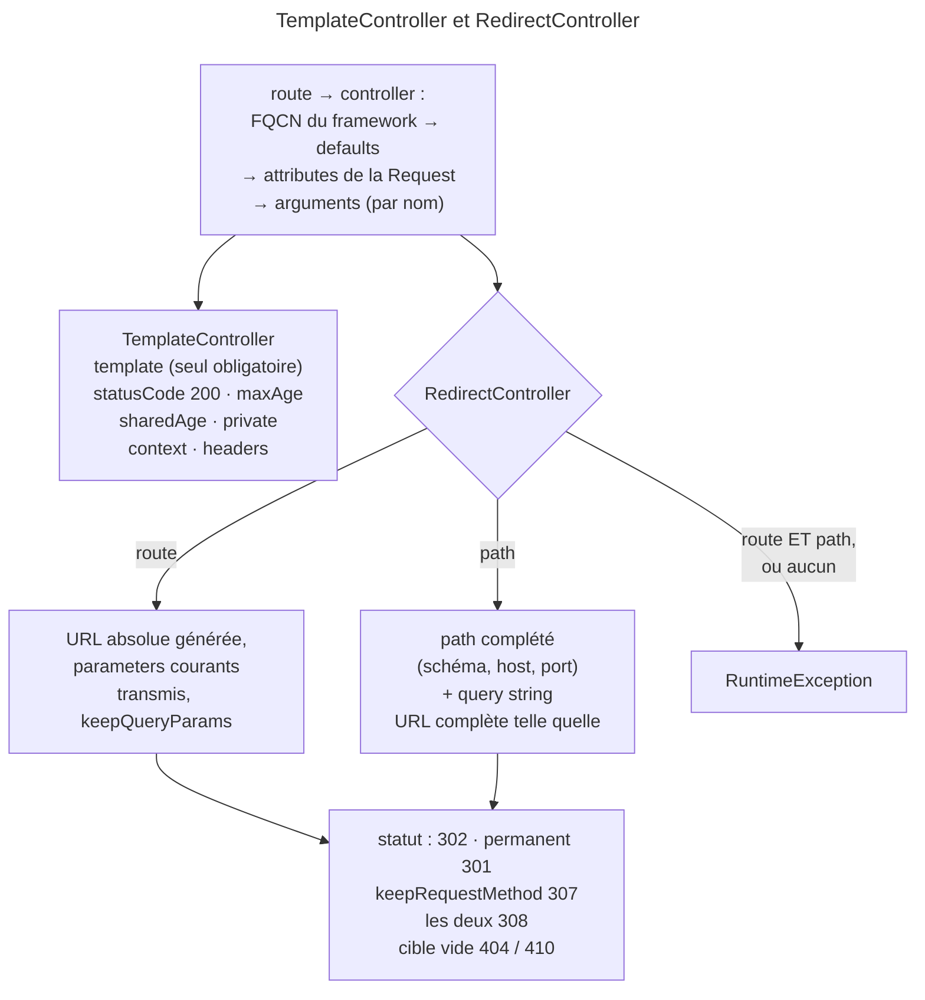

## Objectif

Connaître les controllers que FrameworkBundle fournit tout faits, et le cas
d'usage de chacun : afficher une page sans écrire de code.

## L'essentiel

Une route peut viser un controller **fourni par FrameworkBundle**, réglé par
ses seuls `defaults` : `TemplateController` rend un template,
`RedirectController` redirige. L'examen interroge ce que le code tranche :
cache public, 307/308, cible vide, mode `path` contre mode `route`.

## Le schéma



## L'exemple : deux routes sans code

```yaml
acme_privacy:
    path: /privacy
    controller: Symfony\Bundle\FrameworkBundle\Controller\TemplateController
    defaults:
        template: 'static/privacy.html.twig'
        maxAge: 86400

legacy_blog:
    path: /old-blog
    controller: Symfony\Bundle\FrameworkBundle\Controller\RedirectController
    defaults:
        route: 'blog_index'
        permanent: true
```

## Le principe

Rien n'oblige le controller d'une route à être une class de l'application.
Les `defaults` deviennent des attributes de la Request, puis des arguments,
appariés par nom.

## `TemplateController`

Rend un template sans code, pour une page statique. `template` est le seul obligatoire ; `statusCode` vaut 200 par défaut ; sans
TwigBundle, le controller lève une `LogicException`. Pour le cache :

- sans `private`, poser `maxAge` ou `sharedAge` rend la Response **publique** ;
- `private: true` la rend privée, `private: false` publique ;
- `maxAge` n'est appliqué que s'il est non nul : `maxAge: 0` ne pose aucun
  `max-age`, mais la Response devient publique quand même ; `sharedAge: 0`
  pose bien un `s-maxage=0`.

## `RedirectController`

Redirige depuis la route elle-même. Deux modes exclusifs : `route` pour viser
une route, `path` pour un path ou une URL.

| Option | Effet |
|---|---|
| `permanent: true` | 301 au lieu de 302 |
| `keepRequestMethod: true` | conserve la method HTTP : **307**, ou **308** si permanent |
| `keepQueryParams: true` | conserve la query string — mode `route` seulement |
| `ignoreAttributes` | `true` n'en transmet aucun, un array retire ceux-là |

### Ce que le code tranche

- **`route` et `path` ensemble** lèvent une `RuntimeException`
  (`Ambiguous redirection settings`) ; **aucun des deux** en lève une aussi.
- **Une cible vide** lève une `HttpException` **404**, ou **410** si permanente.
- **Mode `route`** : les parameters de la route courante sont transmis à la
  cible, et l'URL générée est **absolue** — à l'inverse de `redirectToRoute()`.
- **Mode `path`** : la query string est recopiée sur un path, sans option pour
  s'en passer ; une URL complète — `https://…` ou `//…` — part telle quelle,
  **sans** elle. Un path est complété par le schéma, le host et le port, que
  `scheme`, `httpPort` et `httpsPort` permettent de fixer.

## `ErrorController`

Il produit les pages d'erreur ; en développement, `/_error/404` les prévisualise.

## Pièges d'examen

**Conserver la method HTTP change le status code** : 307 si temporaire, 308
si permanente.

**Un redirect vers une cible vide renvoie 404 ou 410**, pas une erreur de
configuration.

**`route` et `path` ensemble lèvent une exception** : les modes sont exclusifs,
et le code le vérifie.

**`keepQueryParams` n'existe qu'en mode `route`.** En mode `path`, la query
string suit un path, jamais une URL complète.

**Un `maxAge` seul rend la Response publique.** Il faut `private: true` pour
l'éviter.

**Un controller de route n'est pas forcément dans `App\`.**

## Application

- Une page « mentions légales » gardée en cache une journée → `TemplateController`
  avec `template` et `maxAge: 86400`.
- Une ancienne URL de form déplacée pour de bon, qui reçoit des `POST`
  → `RedirectController` avec `permanent` et `keepRequestMethod`.

## QCM d'entraînement

**Question 1.** Une route `TemplateController` ne porte que `template` et
`maxAge: 0`. Quel header `Cache-Control` part ?

- **A.** `max-age=0, public`
- **B.** `no-cache, private`
- **C.** `public`
- **D.** `max-age=0, private`

<details>
<summary>Correction</summary>

**Bonne réponse : C.** Un `maxAge` nul n'est pas appliqué, mais il est
renseigné : sans `private`, le controller rend donc la Response publique.

</details>

**Question 2.** La route `/old` porte `path: 'https://shop.example.org/'`. Le
client appelle `/old?ref=mail`. Que contient `Location` ?

- **A.** `https://shop.example.org/?ref=mail`
- **B.** `https://shop.example.org/`
- **C.** `/old?ref=mail`
- **D.** Une exception : il manque `keepQueryParams`

<details>
<summary>Correction</summary>

**Bonne réponse : B.** Une URL complète part telle quelle ; la query string
n'est recopiée que sur un path, que le controller complète lui-même.

</details>

**Question 3.** La route `/old/{id}` redirige, en mode `route` et sans autre
option, vers `item` de path `/item/{id}`. Le client appelle `/old/7` sur
`https://example.com`. Que contient `Location` ?

- **A.** `https://example.com/item/7`
- **B.** `/item/7`
- **C.** Une exception : `id` manque à la route cible
- **D.** `https://example.com/item/{id}`

<details>
<summary>Correction</summary>

**Bonne réponse : A.** Les parameters de la route courante sont transmis à la
cible, et le mode `route` génère une URL absolue, schéma et host compris.

</details>

**Question 4.** La route courante porte les parameters `id` et `utm`, et
`ignoreAttributes: ['utm']`. Que reçoit la route cible ?

- **A.** `id` et `utm`
- **B.** Aucun parameter
- **C.** `utm` seul
- **D.** `id` seul

<details>
<summary>Correction</summary>

**Bonne réponse : D.** Un array dans `ignoreAttributes` retire seulement les
parameters nommés ; la valeur `true` les aurait tous écartés.

</details>

## Fiche express

**Si tu dois retenir seulement 6 choses :**

- `TemplateController` : **`template`** obligatoire ; sans Twig → `LogicException`.
- `maxAge` ou `sharedAge` sans `private` → Response **publique**.
- `RedirectController` : `route` **ou** `path` ; les deux, ou aucun → exception.
- 302 · 301 permanent · **307 / 308** avec `keepRequestMethod`.
- Cible vide : **404**, ou **410** si permanente.
- Mode `route` : URL **absolue**, parameters transmis ; mode `path` : query
  string sur un **path** seulement.

Moyen mnémotechnique : **« 7 garde la method, 8 la garde pour toujours »**.

## Sources officielles

- [Routing, redirect directe depuis une route](https://github.com/symfony/symfony-docs/blob/8.0/routing.rst)
- [Templates, rendre un template depuis une route](https://github.com/symfony/symfony-docs/blob/8.0/templates.rst)
- [`RedirectController`](https://github.com/symfony/symfony/blob/8.0/src/Symfony/Bundle/FrameworkBundle/Controller/RedirectController.php)
- [`TemplateController`](https://github.com/symfony/symfony/blob/8.0/src/Symfony/Bundle/FrameworkBundle/Controller/TemplateController.php)

